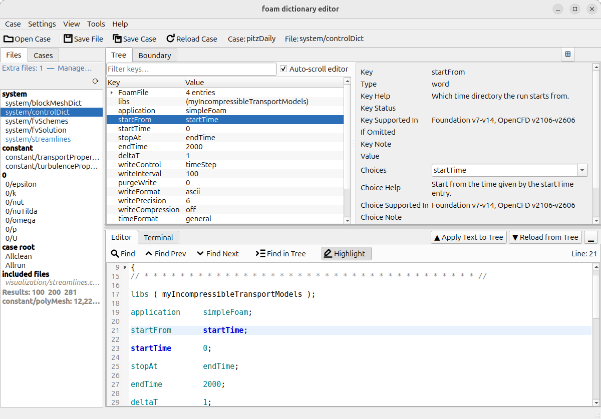
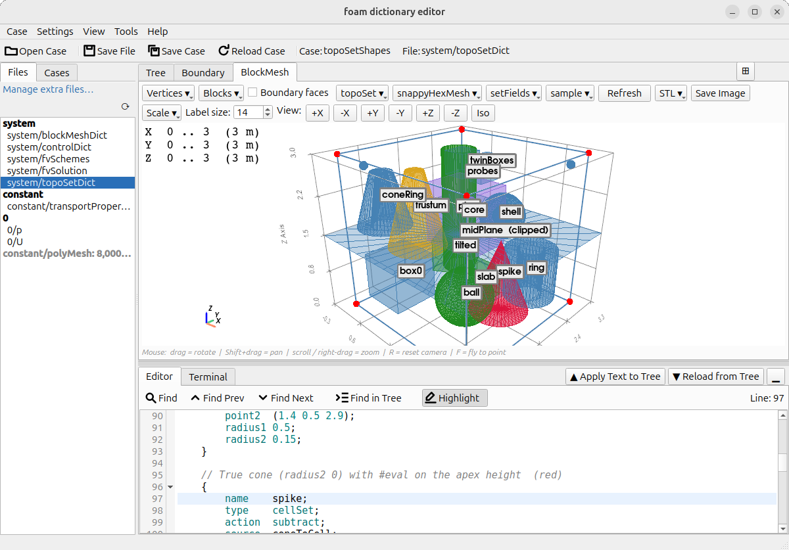
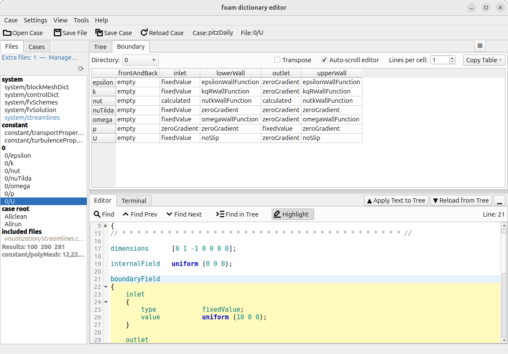
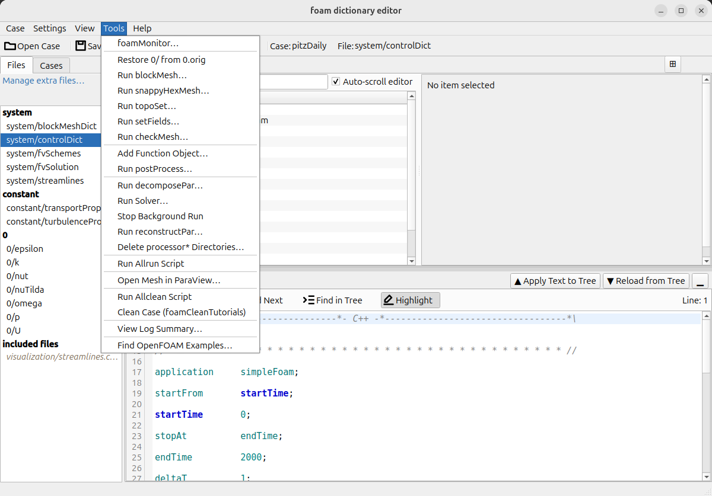

# Foam Dictionary Editor (FoDE)

**A desktop editor for OpenFOAM cases** — open a case, see what its dictionaries describe, edit them with help on every key, and run the case without memorising commands. FoDE (pronounced "foh-dee") is free and open source, written in Python with PySide6.

🎬 [Demo movies](docs/DEMO_SCRIPTS.md) (twelve, on Vimeo) · 📖 [User Guide](USER_GUIDE.md) · 🖼️ [Screenshots](docs/SCREENSHOTS.md) · 📄 Published in [*SoftwareX*](https://doi.org/10.1016/j.softx.2026.102852) — see [Citation](#citation)



## What it does for you

- **See your dictionaries.** `blockMeshDict` is drawn in 3-D, and the shapes in `topoSetDict`, `snappyHexMeshDict`, `setFieldsDict` and your sampling files are drawn on top of it — a box in the wrong place shows up before you mesh, not after. → [3-D viewer](USER_GUIDE.md#blockmesh-panel)
- **Get help on every key.** Select a setting and the side panel explains it, lists the valid choices, and says which OpenFOAM versions support it. Turbulence models come with the paper that defines them and their default coefficients. → [Detail pane](USER_GUIDE.md#detail-pane)
- **All boundary conditions in one table.** Every patch against every field, editable in place, instead of opening `0/U`, `0/p`, `0/k`… one by one. → [Boundary view](USER_GUIDE.md#boundary-view)
- **Run the case from the menu.** blockMesh, setFields, the solver — in parallel, or in the background so it keeps going after you close FoDE — each with a dialog that shows the exact command, and a short summary of the log afterwards. → [Run Solver](USER_GUIDE.md#run-solver)
- **Add post-processing without knowing the dictionary.** Probes, line graphs, cutting planes and forces from a form, drawn in 3-D as you fill it in. → [Add Function Object](USER_GUIDE.md#add-function-object)
- **Compare with a working case.** Put your case beside a tutorial: differences are coloured, and one right-click adopts a value. → [Case comparison](USER_GUIDE.md#case-comparison)

## Requirements

- **Python 3.10 or newer.**
- **Linux** is the main platform; **macOS** works too. On **Windows**, use the `no-terminal` variant (see [Launch options](#launch-options)): the xterm terminal needs a Unix pseudo-terminal, and the Tools commands are OpenFOAM shell commands, which Simple mode's `cmd.exe` cannot run.
- **OpenFOAM is not needed to edit.** It is needed to run anything from the Tools menu: source OpenFOAM's `bashrc` in the shell you start FoDE from, and the built-in terminal inherits it. Both forks are supported — OpenFOAM from openfoam.com (v2xxx) and from openfoam.org (numbered versions).

## Install

```bash
git clone https://github.com/snaka-dev/foam-dictionary-editor
cd foam-dictionary-editor
python3 -m venv .venv
source .venv/bin/activate
pip install -r requirements.txt pyvista pyvistaqt
```

`pyvista` and `pyvistaqt` give you the 3-D viewer. They are optional — leave them out and everything else works — but most of what FoDE shows you is in that view.

<details>
<summary>The terminal needs an internet connection on first launch</summary>

The built-in terminal uses xterm.js, which is downloaded into `ui/xterm/` the first time FoDE starts. Without it, FoDE falls back to a simpler terminal; restart with internet access to retry, or download the files yourself:

| File | URL |
|---|---|
| `xterm.js` | `https://cdn.jsdelivr.net/npm/@xterm/xterm@6.0.0/lib/xterm.js` |
| `xterm.css` | `https://cdn.jsdelivr.net/npm/@xterm/xterm@6.0.0/css/xterm.css` |
| `xterm-addon-fit.js` | `https://cdn.jsdelivr.net/npm/@xterm/addon-fit@0.11.0/lib/addon-fit.js` |

</details>

**Updating:** `git pull`, then `pip install -r requirements.txt` again.

## Quick start: a dam break in five minutes

This uses `tutorials/damBreak`, which comes with FoDE.

1. **Start FoDE** from a shell where OpenFOAM is sourced:

   ```bash
   source /usr/lib/openfoam/openfoam2606/etc/bashrc   # your installation's path
   python3 main.py
   ```

2. **Open the case:** **Case > Open Case…** (`Ctrl+O`) and choose `tutorials/damBreak`. Its files are listed on the left.
3. **See it:** open the **BlockMesh** tab. The mesh, the water column from `setFieldsDict` and the two gauge lines are drawn. *If the tab is missing,* untick **xterm terminal** at the top of the **Terminal** tab: the 3-D view and that terminal cannot share the graphics card, so they take turns.
4. **Read and edit:** click `system/controlDict`, then a row in the **Tree** tab — the side panel explains the key and lists its choices. Change a value and save with `Ctrl+S`.
5. **Check the boundaries:** the **Boundary** tab shows every patch against every field.
6. **Run it** (the run writes its mesh and results into the opened folder, so copy the tutorial first with **Case > Duplicate Case…** if you want to keep the repository clean): **Tools > Run blockMesh…**, then **Tools > Run setFields…** (its *Restore 0/ from 0.orig/ first* box is ticked for you), then **Tools > Run Solver…**. Each shows the command before it runs; the output appears in the Terminal and is saved to `log.*`.
7. **Look at the result:** **Tools > View Log Summary…** condenses the solver log; **Tools > Open Mesh in ParaView…** opens the case for viewing.

To start from your own case instead, open it the same way, or drag its folder onto the window. **Case > Duplicate from Case Library…** copies an OpenFOAM tutorial into a folder of your own to start from.

## Features

Each heading links to the full description in the [User Guide](USER_GUIDE.md).

<p>



</p>

**[Files and cases](USER_GUIDE.md#file-list-behavior)**
- The case's dictionaries, `0/` fields and `Allrun`-style scripts are listed for you; multi-region cases are grouped by region, and files pulled in by `#include` are listed too.
- The list keeps itself up to date and shows whether a mesh exists, whether it is older than `blockMeshDict`, and whether the case is decomposed.
- Create, back up, duplicate or delete files; save the case as a new one.
- [Browse, move, rename, copy or delete cases](USER_GUIDE.md#case-navigator) from inside FoDE.

**[Tree and text editing](USER_GUIDE.md#tree-and-text-workflow)**
- A tree view and the plain text, kept in step both ways, with syntax highlighting and folding.
- Add, duplicate, comment out or delete entries with a right-click; undo with `Ctrl+Z`.

**[Help on settings](USER_GUIDE.md#detail-pane)**
- Descriptions, valid choices and version support for `controlDict`, `fvSchemes`, `fvSolution`, `blockMeshDict`, `snappyHexMeshDict` and the turbulence models — including keys one fork renamed or the other never had.
- [Add your own](USER_GUIDE.md#writing-a-custom-schema-module) as plain Python files.

**[3-D viewer](USER_GUIDE.md#blockmesh-panel)** *(needs pyvista / pyvistaqt)*
- `blockMeshDict` with its `$variables`, `#eval` and `#include` resolved, coloured by patch type, with an editable table of its vertices.
- `topoSetDict`, `snappyHexMeshDict`, `setFieldsDict` and sampling shapes on top, each switchable on and off; STL/OBJ surfaces as reference.
- Side-by-side with the tree while you edit; save the view as an image.

**[Boundary conditions](USER_GUIDE.md#boundary-view)**
- Edit, add, delete, copy and paste patch entries in the table; add, delete or rename a patch in every field file at once.
- Copy the table as Markdown or CSV.

**[Running and post-processing](USER_GUIDE.md#run-solver)**
- blockMesh, snappyHexMesh, topoSet, setFields, checkMesh, decomposePar, reconstructPar and the solver, each from a dialog that shows the command; `Allrun`/`Allclean`; [runs that outlive FoDE](USER_GUIDE.md#background-runs-and-stop-background-run), stopped cleanly at a written time.
- [Add function objects](USER_GUIDE.md#add-function-object) from your installation's own templates, and [run postProcess](USER_GUIDE.md#run-postprocess) on existing results.
- [Delete processor\* directories](USER_GUIDE.md#delete-processor-directories) only after FoDE has checked that the reconstructed results are complete.
- [Log summaries](USER_GUIDE.md#view-log-summary), [foamMonitor](USER_GUIDE.md#foammonitor-launcher) residual plots, and ParaView.

**[Finding out how others do it](USER_GUIDE.md#find-openfoam-examples)**
- Search your installation's tutorials for a keyword and see it in use; [compare your case](USER_GUIDE.md#case-comparison) with one and adopt its values.

**Settings**
- [Light or dark theme](USER_GUIDE.md#appearance-and-colours), English or 日本語, UI scaling, and a window that reopens [the way you left it](USER_GUIDE.md#session-restore).

## Launch options

```bash
python3 main.py                                   # standard: terminal and 3-D viewer
python3 main.py --variant no-terminal             # no terminal (recommended on Windows)
python3 main.py --variant no-terminal-blockmesh   # no terminal, 3-D viewer always shown
```

The variant you choose is remembered for the next launch. See [Variants](USER_GUIDE.md#variants).

## Example cases

The `tutorials/` folder holds ready-to-open cases:

| Directory | Solver | Purpose |
|---|---|---|
| `tutorials/cavity/cavity/` | `icoFoam` | Single-region end-to-end workflow walkthrough |
| `tutorials/cavity/cavityGrade/` | `icoFoam` | Non-uniform grading (`simpleGrading`) |
| `tutorials/cavity/cavityClipped/` | `icoFoam` | Clipped geometry; `mapFieldsDict` |
| `tutorials/snappyMultiRegionHeater/` | `chtMultiRegionFoam` | Multi-region case for the boundary view and region file listing |
| `tutorials/damBreak/` | `interFoam` | Two-phase flow; `setFieldsDict` and `0.orig/` |
| `tutorials/pitzDaily/` | `simpleFoam` | The canonical RAS case; the only bundled case that is not laminar, so it is where the turbulence-model help is visible |
| `tutorials/oneBlocks/` | `icoFoam` | 3-D single-block; `blockMeshDict` editing and 3-D mesh viewer |
| `tutorials/oneBlocks-vars/` | `icoFoam` | As `oneBlocks` with variable substitution and compact face notation |
| `tutorials/nineBlocks/` | `icoFoam` | 3×3 multi-block; regex boundary patches |
| `tutorials/nineBlocks-vars/` | `icoFoam` | As `nineBlocks` with variable substitution and compact face notation |
| `tutorials/topoSetShapes/` | `icoFoam` | Every `topoSetDict` geometry source the 3-D viewer can overlay, in one 3×3×3 block |
| `tutorials/samplingShapes/` | `icoFoam` | The same for the sampling overlay: probe points, lines, a point cloud and both plane spellings |

The `cavity/` cases, `snappyMultiRegionHeater`, `damBreak`, and `pitzDaily` are from the OpenFOAM v2512 standard tutorial set. The `oneBlocks*` and `nineBlocks*` cases are custom `blockMeshDict` cases derived from cavity for FoDE testing.

**License:** these case files are licensed under the **GPL-3.0** (not the AGPL-3.0 that covers FoDE source code). See `tutorials/README.md` for full provenance and license details.

## Documentation

- [User Guide](USER_GUIDE.md) — every panel, menu and workflow.
- [Screenshots](docs/SCREENSHOTS.md) — annotated pictures of the app.
- [Demo movies](docs/DEMO_SCRIPTS.md) — twelve short walkthroughs on Vimeo, with their shot-by-shot scripts. Start with [Edit, see, run](https://vimeo.com/1218332419?texttrack=en) (~94 s), or watch [the whole workflow](https://vimeo.com/1217899060?texttrack=en) (~3 min 41 s).
- [Release notes](RELEASE_NOTES.md) — what changed in each version.
- [Developer guide](DEVELOPER.md) — project structure, development setup and tests.

## Help and feedback

Questions, bug reports and suggestions are welcome as [GitHub issues](https://github.com/snaka-dev/foam-dictionary-editor/issues). For a bug, the FoDE version (**Help > About**), your OpenFOAM version and the steps that led to it help most.

## Citation

Citation is not required, but if FoDE has been useful in your research, a citation is welcome and helps support continued development:

> Shinji Nakagawa,
> Foam Dictionary Editor: A GUI-based open-source tool for OpenFOAM case configuration,
> *SoftwareX*, Volume 35, 2026, 102852, ISSN 2352-7110,
> [https://doi.org/10.1016/j.softx.2026.102852](https://doi.org/10.1016/j.softx.2026.102852)
> ([ScienceDirect](https://www.sciencedirect.com/science/article/pii/S2352711026003444))

## License

Copyright (C) 2025-2026 Shinji NAKAGAWA. Released under the [GNU Affero General Public License v3.0 or later](LICENSE) (AGPL-3.0-or-later).

Some material here comes from OpenFOAM and is **not** covered by that licence: the bundled tutorial cases, the extracted keyword list, and the documentation quoted in the generated turbulence schema modules. That material is GPL-3.0-or-later and is held by several parties — the OpenFOAM Foundation, OpenCFD Ltd, Upstream CFD GmbH and Keysight Technologies. See [THIRD-PARTY.md](THIRD-PARTY.md) for per-file credits, generated from the sources rather than maintained by hand.

The toolbar and menu icons were drawn for this project, so they are covered by the licence above and need no third-party attribution.

## Disclaimer

FoDE is provided "as is", without warranty of any kind. It edits, copies and deletes files in your cases, and although it guards those operations, you use it at your own risk: the authors are not liable for any loss of data or other damage arising from its use. Keep backups of any case you cannot regenerate. The binding terms are sections 15 (Disclaimer of Warranty) and 16 (Limitation of Liability) of the [licence](LICENSE).

This offering is not approved or endorsed by OpenCFD Limited, producer and distributor of the OpenFOAM software via [www.openfoam.com](http://www.openfoam.com/), and owner of the OPENFOAM® and OpenCFD® trade marks.

## Acknowledgements

- [PySide6 (Qt for Python)](https://doc.qt.io/qtforpython/) — GUI framework (LGPL v3)
- [pyVista](https://pyvista.org/) / [VTK](https://vtk.org/) — the 3-D viewer (BSD-3-Clause, optional)
- [xterm.js](https://xtermjs.org/) — Terminal emulator used in the Terminal panel (MIT). Downloaded automatically from jsDelivr on first launch and cached in `ui/xterm/`
- [pytest](https://pytest.org/) / [pytest-qt](https://pytest-qt.readthedocs.io/) — Test framework (development only)

Special thanks to the [OpenFOAM Foundation](https://openfoam.org/) and [OpenCFD / ESI Group](https://www.openfoam.com/) and all contributors for developing and maintaining OpenFOAM as free, open-source CFD software.
