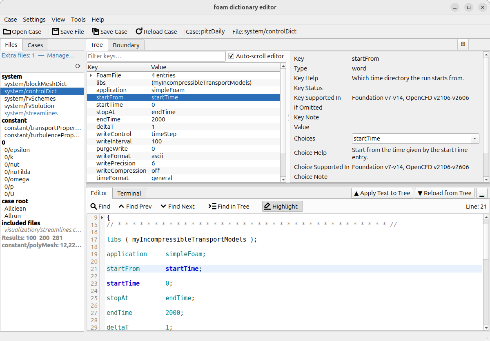
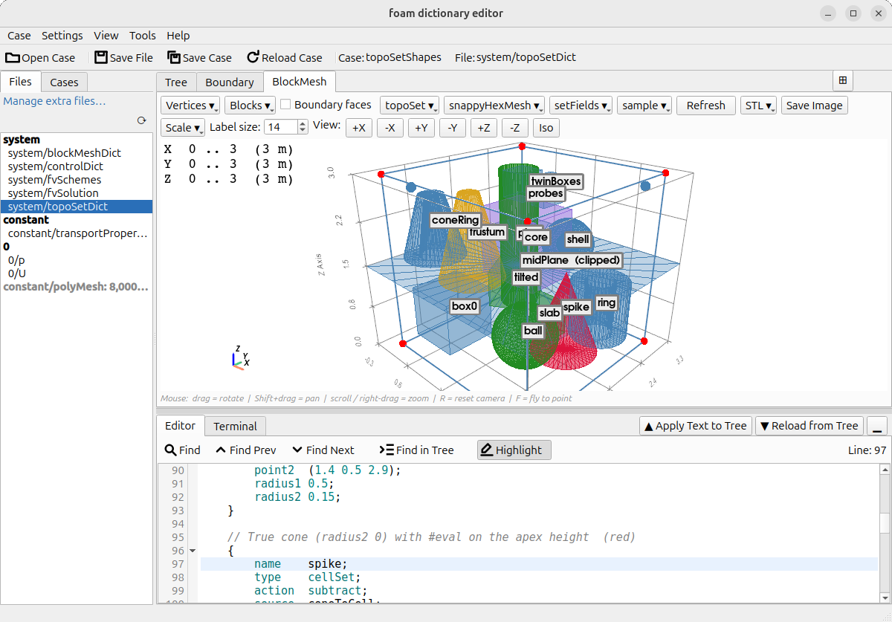
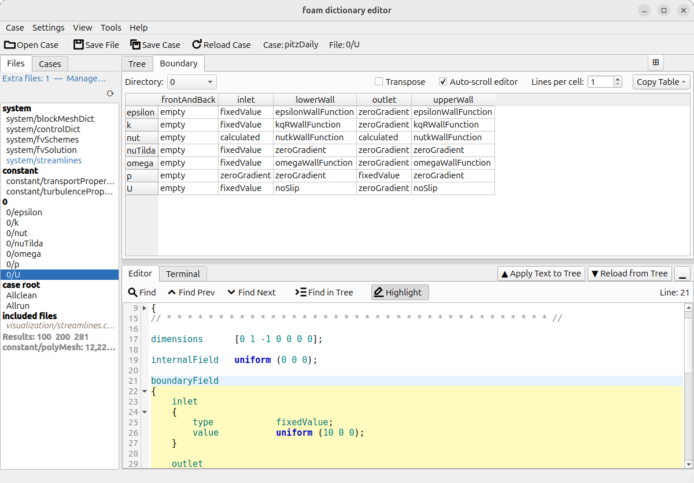
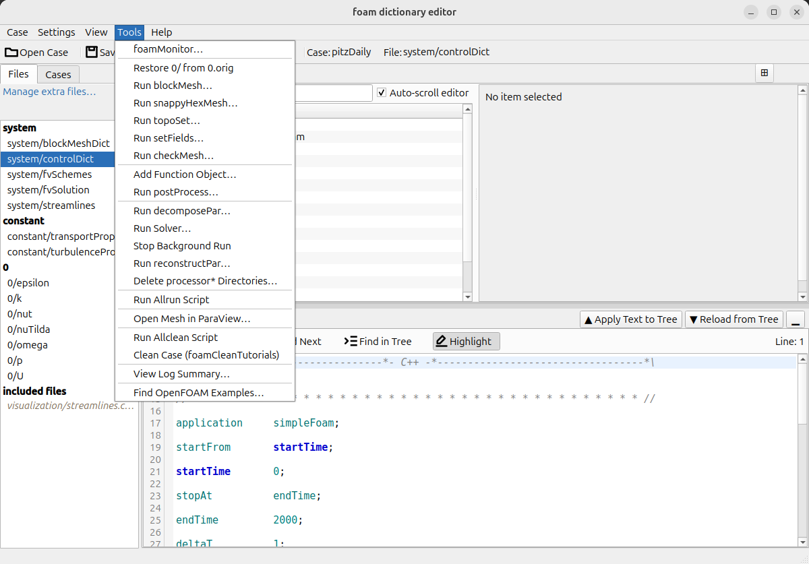

# Foam Dictionary Editor (FoDE)

**OpenFOAM のケースを扱うデスクトップエディタです。** ケースを開くと辞書の内容が目に見え、すべてのキーに説明が付いた状態で編集でき、コマンドを覚えていなくてもケースを実行できます。FoDE（読み方: "フォーディー"）は Python と PySide6 で書かれた、無料のオープンソースソフトウェアです。

🎬 [デモ動画](docs/DEMO_SCRIPTS_ja.md)（12 本、Vimeo）· 📖 [ユーザーガイド](USER_GUIDE_ja.md) · 🖼️ [スクリーンショット](docs/SCREENSHOTS_ja.md) · 📄 [*SoftwareX*](https://doi.org/10.1016/j.softx.2026.102852) に掲載 — 「[引用](#引用)」を参照



## FoDE でできること

- **辞書が目に見える。** `blockMeshDict` を 3D で描き、`topoSetDict`・`snappyHexMeshDict`・`setFieldsDict`・サンプリングファイルの形状をその上に重ねます。位置のずれた箱に、メッシュを切った後ではなく切る前に気づけます。→ [3D ビューア](USER_GUIDE_ja.md#blockmesh-パネル)
- **すべてのキーに説明が付く。** 設定を選ぶと、横のパネルがその意味、選べる値、対応する OpenFOAM のバージョンを示します。乱流モデルには、そのモデルを定義した論文と係数の既定値が付きます。→ [詳細ペイン](USER_GUIDE_ja.md#詳細ペイン)
- **境界条件を 1 つの表で。** すべてのパッチとすべてのフィールドを 1 つの表で見て、その場で編集できます。`0/U`・`0/p`・`0/k`… を 1 つずつ開く必要はありません。→ [境界条件ビュー](USER_GUIDE_ja.md#境界条件ビュー)
- **メニューからケースを実行。** blockMesh、setFields、ソルバー — 並列でも、FoDE を閉じても続くバックグラウンドでも実行でき、どれも実行するコマンドをそのまま見せるダイアログから始まります。終わったらログの要約も見られます。→ [Run Solver](USER_GUIDE_ja.md#run-solver)
- **辞書を知らなくても後処理を追加。** プローブ、ライングラフ、切断面、力をフォームから追加でき、入力するそばから 3D に描かれます。→ [Add Function Object](USER_GUIDE_ja.md#add-function-object)
- **動くケースと比べる。** 自分のケースをチュートリアルと並べると、違いが色分けされ、右クリック 1 回で値を取り込めます。→ [ケース比較](USER_GUIDE_ja.md#ケース比較)

## 動作環境

- **Python 3.10 以上。**
- 主な対象は **Linux** で、**macOS** でも動きます。**Windows** では `no-terminal` バリアントを使ってください（「[起動オプション](#起動オプション)」を参照）。xterm ターミナルは Unix の疑似端末を必要とし、Tools のコマンドは OpenFOAM のシェルコマンドで、シンプルモードの `cmd.exe` では実行できないためです。
- **編集だけなら OpenFOAM は不要です。** Tools メニューから何かを実行するには必要です。FoDE を起動するシェルで OpenFOAM の `bashrc` を読み込んでおくと、内蔵ターミナルがそれを引き継ぎます。両方の系統に対応しています — openfoam.com の OpenFOAM（v2xxx）と openfoam.org の OpenFOAM（番号付きのバージョン）です。

## インストール

```bash
git clone https://github.com/snaka-dev/foam-dictionary-editor
cd foam-dictionary-editor
python3 -m venv .venv
source .venv/bin/activate
pip install -r requirements.txt pyvista pyvistaqt
```

`pyvista` と `pyvistaqt` は 3D ビューアのためのものです。入れなくても他の機能はすべて動きますが、FoDE が見せてくれるものの多くはこのビューの中にあります。

<details>
<summary>初回起動時、ターミナルにはインターネット接続が必要です</summary>

内蔵ターミナルは xterm.js を使い、FoDE の初回起動時に `ui/xterm/` へダウンロードします。接続がない場合は簡易ターミナルが使われます。インターネットに接続した状態で再起動すると再試行されます。手動で配置する場合は、以下のファイルを `ui/xterm/` に置いてください:

| ファイル | URL |
|---|---|
| `xterm.js` | `https://cdn.jsdelivr.net/npm/@xterm/xterm@6.0.0/lib/xterm.js` |
| `xterm.css` | `https://cdn.jsdelivr.net/npm/@xterm/xterm@6.0.0/css/xterm.css` |
| `xterm-addon-fit.js` | `https://cdn.jsdelivr.net/npm/@xterm/addon-fit@0.11.0/lib/addon-fit.js` |

</details>

**更新:** `git pull` の後、もう一度 `pip install -r requirements.txt` を実行してください。

## クイックスタート: 5 分でダム崩壊

FoDE に同梱の `tutorials/damBreak` を使います。

1. **FoDE を起動します。** OpenFOAM を source したシェルから:

   ```bash
   source /usr/lib/openfoam/openfoam2606/etc/bashrc   # お使いのインストールのパス
   python3 main.py
   ```

2. **ケースを開きます:** **Case > Open Case…**（`Ctrl+O`）で `tutorials/damBreak` を選びます。左側にファイルが並びます。
3. **見てみます:** **BlockMesh** タブを開くと、メッシュ、`setFieldsDict` の水柱、2 本のゲージ線が描かれています。*タブが見当たらない場合は、* **Terminal** タブ上部の **xterm terminal** のチェックを外してください。3D ビューとこのターミナルはグラフィックスカードを共有できないため、交代で使います。
4. **読んで編集します:** `system/controlDict` をクリックし、**Tree** タブの行を選ぶと、横のパネルがキーの意味と選べる値を示します。値を変えて `Ctrl+S` で保存します。
5. **境界条件を確認します:** **Boundary** タブに、すべてのパッチとすべてのフィールドが表になっています。
6. **実行します**（実行するとメッシュと結果は開いたフォルダに書き込まれるため、リポジトリを汚したくない場合は、先に **Case > Duplicate Case…** でチュートリアルをコピーしてください）**:** **Tools > Run blockMesh…**、続いて **Tools > Run setFields…**（*Restore 0/ from 0.orig/ first* にはあらかじめチェックが入っています）、そして **Tools > Run Solver…**。どれも実行前にコマンドを示し、出力は Terminal に表示されて `log.*` に保存されます。
7. **結果を見ます:** **Tools > View Log Summary…** でソルバーのログを要約し、**Tools > Open Mesh in ParaView…** でケースを ParaView で開きます。

自分のケースから始めるときも同じように開くか、フォルダをウィンドウにドラッグしてください。**Case > Duplicate from Case Library…** を使うと、OpenFOAM のチュートリアルを自分のフォルダにコピーして出発点にできます。

## 機能

各見出しから[ユーザーガイド](USER_GUIDE_ja.md)の詳しい説明へ移れます。

<p>



</p>

**[ファイルとケース](USER_GUIDE_ja.md#ファイル一覧の挙動)**
- ケースの辞書、`0/` のフィールド、`Allrun` などのスクリプトが自動で並びます。マルチリージョンのケースはリージョンごとにまとまり、`#include` で取り込まれるファイルも並びます。
- 一覧は自動で最新の状態に保たれ、メッシュがあるか、`blockMeshDict` より古くないか、ケースが分割されているかを示します。
- ファイルの作成・バックアップ・複製・削除、ケースを新しいケースとして保存。
- FoDE の中から[ケースを探し、移動・名前変更・コピー・削除](USER_GUIDE_ja.md#ケースナビゲーター)できます。

**[ツリーとテキストの編集](USER_GUIDE_ja.md#ツリーとテキストの編集フロー)**
- ツリー表示とプレーンテキストを双方向に同期し、シンタックスハイライトと折りたたみ付き。
- 右クリックでエントリの追加・複製・コメントアウト・削除、`Ctrl+Z` で元に戻せます。

**[設定の説明](USER_GUIDE_ja.md#詳細ペイン)**
- `controlDict`・`fvSchemes`・`fvSolution`・`blockMeshDict`・`snappyHexMeshDict` と乱流モデルについて、説明・選べる値・対応バージョン。一方の系統で名前が変わったキーや、もう一方には存在しないキーも示します。
- [独自のモジュールを追加](USER_GUIDE_ja.md#カスタムスキーマモジュールの書き方)できます（プレーンな Python ファイル）。

**[3D ビューア](USER_GUIDE_ja.md#blockmesh-パネル)** *（pyvista / pyvistaqt が必要）*
- `$変数`・`#eval`・`#include` を解決した `blockMeshDict` を、パッチの種類で色分けして表示。頂点の座標は表で編集できます。
- `topoSetDict`・`snappyHexMeshDict`・`setFieldsDict`・サンプリングの形状を重ね、それぞれ表示を切り替えられます。STL/OBJ の表面も参考として表示できます。
- 編集中はツリーと並べて表示でき、ビューを画像として保存できます。

**[境界条件](USER_GUIDE_ja.md#境界条件ビュー)**
- 表の中でパッチのエントリを編集・追加・削除・コピー・貼り付け。パッチの追加・削除・名前変更はすべてのフィールドファイルに一度に反映されます。
- 表を Markdown または CSV としてコピー。

**[実行と後処理](USER_GUIDE_ja.md#run-solver)**
- blockMesh、snappyHexMesh、topoSet、setFields、checkMesh、decomposePar、reconstructPar とソルバーを、コマンドを示すダイアログから実行。`Allrun`/`Allclean` も。[FoDE を閉じても続く実行](USER_GUIDE_ja.md#background-runs-and-stop-background-run)は、書き出し済みの時刻できれいに止められます。
- インストールに含まれるテンプレートから[関数オブジェクトを追加](USER_GUIDE_ja.md#add-function-object)し、既存の結果に [postProcess を実行](USER_GUIDE_ja.md#run-postprocess)。
- 再構築した結果が完全であることを FoDE が確かめてから [processor\* ディレクトリを削除](USER_GUIDE_ja.md#delete-processor-directories)。
- [ログの要約](USER_GUIDE_ja.md#view-log-summary)、[foamMonitor](USER_GUIDE_ja.md#foammonitor-ランチャー) による残差のプロット、ParaView。

**[他の人の書き方を知る](USER_GUIDE_ja.md#find-openfoam-examples)**
- インストールのチュートリアルからキーワードを検索して使用例を見られます。そのケースと[自分のケースを比較](USER_GUIDE_ja.md#ケース比較)し、値を取り込むこともできます。

**設定**
- [ライト/ダークのテーマ](USER_GUIDE_ja.md#外観と配色)、English または日本語、UI の拡大縮小、そして前回[閉じたときの状態](USER_GUIDE_ja.md#セッションの復元)で開くウィンドウ。

## 起動オプション

```bash
python3 main.py                                   # 標準: ターミナルと 3D ビューア
python3 main.py --variant no-terminal             # ターミナルなし（Windows ではこちらを推奨）
python3 main.py --variant no-terminal-blockmesh   # ターミナルなし、3D ビューアを常に表示
```

選んだバリアントは次回の起動にも引き継がれます。「[バリアント](USER_GUIDE_ja.md#バリアント)」を参照してください。

## サンプルケース

`tutorials/` フォルダには、すぐに開けるケースが入っています。

| ディレクトリ | ソルバー | 用途 |
|---|---|---|
| `tutorials/cavity/cavity/` | `icoFoam` | 単一リージョンのエンドツーエンドワークフロー解説 |
| `tutorials/cavity/cavityGrade/` | `icoFoam` | 非一様グレーディング（`simpleGrading`） |
| `tutorials/cavity/cavityClipped/` | `icoFoam` | クリップ形状・`mapFieldsDict` |
| `tutorials/snappyMultiRegionHeater/` | `chtMultiRegionFoam` | 境界条件ビューとリージョンファイル一覧のマルチリージョンケース |
| `tutorials/damBreak/` | `interFoam` | 二相流・`setFieldsDict` と `0.orig/` |
| `tutorials/pitzDaily/` | `simpleFoam` | RAS の定番ケース。同梱ケースで唯一の乱流ケースであり、乱流モデルのヘルプを実際に確認できる場所 |
| `tutorials/oneBlocks/` | `icoFoam` | 3-D 単一ブロック・`blockMeshDict` 編集と 3-D メッシュビューア |
| `tutorials/oneBlocks-vars/` | `icoFoam` | `oneBlocks` の変数置換・コンパクト面記法バリアント |
| `tutorials/nineBlocks/` | `icoFoam` | 3×3 マルチブロック・正規表現パッチ |
| `tutorials/nineBlocks-vars/` | `icoFoam` | `nineBlocks` の変数置換・コンパクト面記法バリアント |
| `tutorials/topoSetShapes/` | `icoFoam` | 3D ビューアがオーバーレイできる `topoSetDict` のジオメトリソースを、1 つの 3×3×3 ブロックに網羅 |
| `tutorials/samplingShapes/` | `icoFoam` | 同じことをサンプリングオーバーレイについて行ったケース: プローブ点・線・点群・平面の 2 通りの記法 |

`cavity/` 各ケース・`snappyMultiRegionHeater`・`damBreak`・`pitzDaily` は OpenFOAM v2512 標準チュートリアルセットから取得しています。`oneBlocks*` および `nineBlocks*` は FoDE テスト用に cavity をベースにしたカスタム `blockMeshDict` ケースです。

**ライセンス:** これらのケースファイルは **GPL-3.0** でライセンスされています（FoDE ソースコードの AGPL-3.0 とは別です）。詳細は `tutorials/README.md` を参照してください。

## ドキュメント

- [ユーザーガイド](USER_GUIDE_ja.md) — すべてのパネル・メニュー・操作手順。
- [スクリーンショット](docs/SCREENSHOTS_ja.md) — 注釈付きの画面写真。
- [デモ動画](docs/DEMO_SCRIPTS_ja.md) — Vimeo の短い紹介動画 12 本と、ショットごとの台本。まずは [編集し、見て、実行する](https://vimeo.com/1218332419?texttrack=ja)（約 94 秒）から。[ワークフロー全体](https://vimeo.com/1217899060?texttrack=ja)（約 3 分 41 秒）もあります。
- [リリースノート](RELEASE_NOTES_ja.md) — バージョンごとの変更点。
- [開発者ガイド](DEVELOPER_ja.md) — プロジェクト構成、開発環境、テスト。

## 質問と報告

質問、不具合の報告、提案は [GitHub の issue](https://github.com/snaka-dev/foam-dictionary-editor/issues) で歓迎します。不具合の場合は、FoDE のバージョン（**Help > About**）、OpenFOAM のバージョン、そこに至った手順があると助かります。

## 引用

引用は必須ではありませんが、FoDE が研究の役に立った場合は、以下を引用いただけると開発の励みになります:

> Shinji Nakagawa,
> Foam Dictionary Editor: A GUI-based open-source tool for OpenFOAM case configuration,
> *SoftwareX*, Volume 35, 2026, 102852, ISSN 2352-7110,
> [https://doi.org/10.1016/j.softx.2026.102852](https://doi.org/10.1016/j.softx.2026.102852)
> ([ScienceDirect](https://www.sciencedirect.com/science/article/pii/S2352711026003444))

## ライセンス

Copyright (C) 2025-2026 Shinji NAKAGAWA。[GNU Affero General Public License v3.0 以降](LICENSE)（AGPL-3.0-or-later）で配布されます。

本リポジトリには OpenFOAM 由来の素材が含まれており、それらは上記ライセンスの対象外です。同梱のチュートリアルケース、抽出したキーワード一覧、生成された乱流スキーマモジュール中の引用ドキュメントが該当します。これらは GPL-3.0-or-later であり、権利者は複数です（OpenFOAM Foundation、OpenCFD Ltd、Upstream CFD GmbH、Keysight Technologies）。ファイルごとの表示は [THIRD-PARTY.md](THIRD-PARTY.md) にあります（手で管理するのではなくソースから生成しています）。

ツールバーとメニューのアイコンは本プロジェクトのために描き起こしたものなので、上記ライセンスの対象であり、第三者への表示義務はありません。

## 免責事項

FoDE は「現状のまま」提供され、いかなる保証もありません。FoDE はケース内のファイルを編集・コピー・削除します。これらの操作には安全策を設けていますが、ご自身の責任でお使いください。本ソフトウェアの使用によって生じたデータの損失その他の損害について、作者は責任を負いません。再生成できないケースはバックアップを取っておいてください。拘束力のある条件は[ライセンス](LICENSE)の第 15 条（保証の否認）と第 16 条（責任の制限）です。

This offering is not approved or endorsed by OpenCFD Limited, producer and distributor of the OpenFOAM software via [www.openfoam.com](http://www.openfoam.com/), and owner of the OPENFOAM® and OpenCFD® trade marks.

## 謝辞

- [PySide6 (Qt for Python)](https://doc.qt.io/qtforpython/) — GUI フレームワーク（LGPL v3）
- [pyVista](https://pyvista.org/) / [VTK](https://vtk.org/) — 3D ビューア（BSD-3-Clause、オプション）
- [xterm.js](https://xtermjs.org/) — ターミナルパネルで使用するターミナルエミュレータ（MIT）。初回起動時に jsDelivr から自動ダウンロードされ `ui/xterm/` にキャッシュされます
- [pytest](https://pytest.org/) / [pytest-qt](https://pytest-qt.readthedocs.io/) — テストフレームワーク（開発時のみ）

[OpenFOAM Foundation](https://openfoam.org/) および [OpenCFD / ESI Group](https://www.openfoam.com/) をはじめ、OpenFOAM をフリーのオープンソース CFD ソフトウェアとして開発・維持してきたすべての貢献者の方々に深く感謝いたします。
