# Foam Dictionary Editor (FoDE)

FoDE — Foam Dictionary Editor (pronounced "foh-dee")

## What is FoDE?

FoDE is a graphical editor for OpenFOAM case dictionary files. It lets you browse, edit, and manage dictionaries through a structured tree view or a plain-text editor — whichever suits the task. It is aimed at engineers and researchers who run OpenFOAM simulations and want a more convenient way to set up and modify case files.

## About This Guide

This is the full reference for FoDE: every panel, menu, dialog and workflow. New to FoDE? Start with [First steps](#first-steps), a five-minute tour. If something does not work, see [Troubleshooting](#troubleshooting). For installation, see [README.md](README.md); for project structure, development setup and testing, see [DEVELOPER.md](DEVELOPER.md).

## First steps

A short tour with the damBreak tutorial that comes with FoDE (`tutorials/damBreak`). It takes about five minutes and touches most of what the rest of this guide describes; each step links to the section that explains it fully.

1. **Start FoDE from a shell where OpenFOAM is sourced** — the built-in terminal inherits that environment, so `blockMesh`, the solver and the rest are found. Editing needs no OpenFOAM at all. See [Tools menu](#tools-menu).
2. **Open the case:** choose `tutorials/damBreak` with **Case > Open Case…** (`Ctrl+O`), or drag the folder onto the window. Its dictionaries, the `0.orig/` fields and the `Allrun`/`Allclean` scripts are listed on the left. See [File list behavior](#file-list-behavior).
3. **See it in 3-D:** open the **BlockMesh** tab. The mesh, the water column from `setFieldsDict` and the two gauge lines are drawn. *If the tab is missing,* untick **xterm terminal** at the top of the **Terminal** tab: the 3-D view and that terminal cannot share the graphics card, so they take turns. See [BlockMesh panel](#blockmesh-panel) and [Terminal tab](#terminal-tab).
4. **Read and edit:** click `system/controlDict`, then a row in the **Tree** tab — the **Detail pane** beside it explains the key and lists its choices. Change a value and save with `Ctrl+S`. See [Tree and text workflow](#tree-and-text-workflow) and [Detail pane](#detail-pane).
5. **Check the boundaries:** the **Boundary** tab shows every patch against every field. See [Boundary view](#boundary-view).
6. **Run it:** **Tools > Run blockMesh…**, then **Tools > Run setFields…** (its *Restore 0/ from 0.orig/ first* box is ticked for you), then **Tools > Run Solver…**. Each shows the command before it runs; the output appears in the Terminal and is saved to `log.*`. See [Tools menu](#tools-menu).
7. **Look at the result:** **Tools > View Log Summary…** condenses the solver log, and **Tools > Open Mesh in ParaView…** opens the case for viewing. See [View Log Summary](#view-log-summary).

The run writes its mesh and results into the folder you opened, so if you want to keep the repository clean, copy the tutorial first with **Case > Duplicate Case…** and open the copy. To start from your own case, open it the same way. **Case > Duplicate from Case Library…** copies an OpenFOAM tutorial into a folder of your own to start from; see [Case Library](#case-library).

## Contents

**Getting started**
- [What is FoDE?](#what-is-fode)
- [About This Guide](#about-this-guide)
- [First steps](#first-steps)
- [Where to Find Things](#where-to-find-things)
- [Features](#features)
- [Current UI layout](#current-ui-layout)
- [Current case and file display](#current-case-and-file-display)

**Editing**
- [Tree and text workflow](#tree-and-text-workflow)
- [Detail pane](#detail-pane)
  - [Old names and entries that do nothing](#old-names-and-entries-that-do-nothing)
  - [Coverage](#coverage)
  - [Numeric type promotion](#numeric-type-promotion)
  - [Edit validation](#edit-validation)
- [Editor behavior](#editor-behavior)
  - [Code folding](#code-folding)
- [Tree key filter and editor sync](#tree-key-filter-and-editor-sync)
  - [Tree key filter](#tree-key-filter)
  - [Editor sync (Auto-scroll editor)](#editor-sync-auto-scroll-editor)
  - [Find in Tree (editor → tree)](#find-in-tree-editor--tree)
- [Tree view context menu](#tree-view-context-menu)
  - [Undo and redo](#undo-and-redo)
  - [Value copy and paste](#value-copy-and-paste)
  - [Adding and duplicating entries](#adding-and-duplicating-entries)
  - [Commenting and deleting](#commenting-and-deleting)
- [Behavior on parse failure](#behavior-on-parse-failure)

**Files and cases**
- [File list behavior](#file-list-behavior)
  - [Directory header markers](#directory-header-markers)
  - [Default target files](#default-target-files)
  - [Case-root scripts](#case-root-scripts)
  - [MultiRegion cases](#multiregion-cases)
  - [Included files](#included-files)
  - [Symbolic links](#symbolic-links)
  - [Adding files at runtime](#adding-files-at-runtime)
  - [Adding extra directories](#adding-extra-directories)
  - [Extra files and directories indicator](#extra-files-and-directories-indicator)
  - [Removing extra files and directories](#removing-extra-files-and-directories)
  - [Numeric time directory indicator](#numeric-time-directory-indicator)
  - [Mesh presence/staleness indicator](#mesh-presencestaleness-indicator)
  - [Decomposed and background-run indicators](#decomposed-and-background-run-indicators)
  - [Creating a backup](#creating-a-backup)
  - [Creating a new file](#creating-a-new-file)
  - [Cleaning up backup files](#cleaning-up-backup-files)
  - [Deleting a file](#deleting-a-file)
  - [Duplicating a file](#duplicating-a-file)
  - [Duplicating a field directory](#duplicating-a-field-directory)
  - [Deleting a field directory](#deleting-a-field-directory)
  - [Resetting the file list](#resetting-the-file-list)
- [Case navigator](#case-navigator)
  - [Case Browser window](#case-browser-window)
  - [Moving, renaming, copying and deleting a case](#moving-renaming-copying-and-deleting-a-case)
- [Case Library](#case-library)
  - [Automatic inclusion of $FOAM_TUTORIALS](#automatic-inclusion-of-foam_tutorials)
  - [Managing user-added directories](#managing-user-added-directories)
  - [Opening a case from the library](#opening-a-case-from-the-library)
  - [Duplicating a case from the library](#duplicating-a-case-from-the-library)
- [Bundled example cases](#bundled-example-cases)
- [Saving as a new case](#saving-as-a-new-case)
- [Duplicating a case](#duplicating-a-case)
- [Case comparison](#case-comparison)
  - [Side-by-side view](#side-by-side-view)
  - [Tree overlay](#tree-overlay)
  - [File list markers](#file-list-markers)
  - [Clearing compare mode](#clearing-compare-mode)
- [Reloading a case](#reloading-a-case)

**Boundary conditions and 3-D view**
- [Boundary view](#boundary-view)
  - [Table layout](#table-layout)
  - [Directory selector](#directory-selector)
  - [Transpose](#transpose)
  - [Single-click navigation](#single-click-navigation)
  - [Editing a boundary condition](#editing-a-boundary-condition)
  - [Creating a patch entry](#creating-a-patch-entry)
  - [Deleting a patch entry](#deleting-a-patch-entry)
  - [Copy and paste](#copy-and-paste)
  - [Copy Table](#copy-table)
  - [Renaming a boundary patch](#renaming-a-boundary-patch)
  - [Deleting a boundary condition across all field files](#deleting-a-boundary-condition-across-all-field-files)
  - [Adding a boundary condition across all field files](#adding-a-boundary-condition-across-all-field-files)
  - [No-type cells](#no-type-cells)
- [BlockMesh panel](#blockmesh-panel)
  - [Parameters kept in an included file](#parameters-kept-in-an-included-file)
  - [Side-by-side mode](#side-by-side-mode)
  - [Variable resolution](#variable-resolution)
  - [Geometry controls](#geometry-controls)
  - [topoSetDict overlay](#toposetdict-overlay)
  - [snappyHexMeshDict overlay](#snappyhexmeshdict-overlay)
  - [setFieldsDict overlay](#setfieldsdict-overlay)
  - [Sampling overlay](#sampling-overlay)
  - [Overlay clipping](#overlay-clipping)
  - [Boundary face colours](#boundary-face-colours)
  - [Vertices table](#vertices-table)
  - [Scale and label controls](#scale-and-label-controls)
  - [Mouse controls](#mouse-controls)

**Tools**
- [Tools menu](#tools-menu)
  - [What the Tools need](#what-the-tools-need)
  - [How a Run dialog works](#how-a-run-dialog-works)
  - [One command at a time](#one-command-at-a-time)
  - [The menu, in order](#the-menu-in-order)
- [foamMonitor launcher](#foammonitor-launcher)
- [Restore 0/ from 0.orig](#restore-0-from-0orig)
- [Run blockMesh](#run-blockmesh)
- [Run snappyHexMesh](#run-snappyhexmesh)
- [Run topoSet](#run-toposet)
- [Run setFields](#run-setfields)
- [Run checkMesh](#run-checkmesh)
- [Add Function Object](#add-function-object)
- [Run postProcess](#run-postprocess)
- [Run decomposePar](#run-decomposepar)
- [Run Solver](#run-solver)
- [Background runs and Stop Background Run](#background-runs-and-stop-background-run)
  - [Without FoDE: finding, stopping or killing a run from a terminal](#without-fode-finding-stopping-or-killing-a-run-from-a-terminal)
- [Run reconstructPar](#run-reconstructpar)
- [Delete processor* Directories](#delete-processor-directories)
- [Run Allrun Script](#run-allrun-script)
- [Open Mesh in ParaView](#open-mesh-in-paraview)
- [Run Allclean Script](#run-allclean-script)
- [Clean Case (foamCleanTutorials)](#clean-case-foamcleantutorials)
- [View Log Summary](#view-log-summary)
- [Find OpenFOAM Examples](#find-openfoam-examples)

**Configuration**
- [Variants](#variants)
- [Terminal tab](#terminal-tab)
  - [Mode toggle](#mode-toggle)
  - [xterm.js assets](#xtermjs-assets)
  - [Simple mode](#simple-mode)
  - [Closing FoDE while a command runs](#closing-fode-while-a-command-runs)
- [Schema module configuration](#schema-module-configuration)
  - [Writing a custom schema module](#writing-a-custom-schema-module)
  - [schema_config.json](#schema_configjson)
- [Generate OpenFOAM Keywords](#generate-openfoam-keywords)
- [Application settings](#application-settings)
  - [app_config.json](#app_configjson)
  - [Setting the default case directory](#setting-the-default-case-directory)
  - [Window size](#window-size)
- [Session restore](#session-restore)
  - [Turning it off](#turning-it-off)
  - [When something has moved](#when-something-has-moved)
  - [Variants](#variants-1)
- [Resetting settings](#resetting-settings)
- [Minimizing panes](#minimizing-panes)
- [Appearance and colours](#appearance-and-colours)
  - [Selected-row readability](#selected-row-readability)
- [Text size and display scaling](#text-size-and-display-scaling)
  - [Settings > UI Scale](#settings--ui-scale)
  - [Zooming the editor](#zooming-the-editor)
  - [When the desktop is scaled but FoDE is not](#when-the-desktop-is-scaled-but-fode-is-not)
- [Resources dialog](#resources-dialog)
  - [OpenFOAM tab](#openfoam-tab)
  - [My Links tab](#my-links-tab)

**Help and reference**
- [Troubleshooting](#troubleshooting)
- [Keyboard shortcuts](#keyboard-shortcuts)
- [Glossary](#glossary)
- [Supported syntax and node types](#supported-syntax-and-node-types)
- [Limitations](#limitations)
- [Disclaimer](#disclaimer)
- [Acknowledgements](#acknowledgements)

## Where to Find Things

| I want to… | Section |
|---|---|
| Take a five-minute tour with an example case | [First steps](#first-steps) |
| Fix something that does not work (no 3-D view, greyed-out menu item, tiny window…) | [Troubleshooting](#troubleshooting) |
| Look up a term such as patch, field file or `processor*` | [Glossary](#glossary) |
| Browse and manage case files | [File list behavior](#file-list-behavior) |
| Find a case to open or compare by looking through directories | [Case navigator](#case-navigator) |
| Move, rename, copy or delete a whole case without leaving FoDE | [Case Browser window](#case-browser-window) |
| Add non-default files, whole directories, or result time steps to the file list | [Adding extra directories](#adding-extra-directories) |
| Open or reload a case | [Reloading a case](#reloading-a-case) |
| Save or duplicate a case | [Duplicating a case](#duplicating-a-case) / [Saving as a new case](#saving-as-a-new-case) |
| Back up a file, or clean up old backups | [Creating a backup](#creating-a-backup) / [Cleaning up backup files](#cleaning-up-backup-files) |
| Compare two cases side-by-side | [Case comparison](#case-comparison) |
| Use tutorial or template cases | [Case Library](#case-library) |
| Try FoDE with a ready-made example case | [Bundled example cases](#bundled-example-cases) |
| Work with a multiRegion (CHT) case | [MultiRegion cases](#multiregion-cases) |
| See a file pulled in by `#include`, or edit one from the OpenFOAM installation | [Included files](#included-files) |
| Understand tree ↔ text sync | [Tree and text workflow](#tree-and-text-workflow) |
| Edit values in the tree | [Tree view context menu](#tree-view-context-menu) |
| Edit one blockMeshDict block at a time | [Tree view context menu](#tree-view-context-menu) |
| Add, duplicate or delete a blockMeshDict block | [Adding and duplicating entries](#adding-and-duplicating-entries) / [Commenting and deleting](#commenting-and-deleting) |
| Get help on a dictionary setting | [Detail pane](#detail-pane) |
| View all boundary conditions at a glance without opening each field file | [Boundary view](#boundary-view) |
| Delete or add a boundary condition across all field files at once | [Deleting](#deleting-a-boundary-condition-across-all-field-files) / [Adding a boundary condition across all field files](#adding-a-boundary-condition-across-all-field-files) |
| Rename a boundary patch across blockMeshDict and all field files | [Renaming a boundary patch](#renaming-a-boundary-patch) |
| Copy the boundary table into a report (Markdown/CSV) | [Copy Table](#copy-table) |
| View blockMeshDict geometry in 3-D | [BlockMesh panel](#blockmesh-panel) |
| View geometry whose dimensions live in an `#include`d file | [Parameters kept in an included file](#parameters-kept-in-an-included-file) |
| View topoSetDict geometry in 3-D | [topoSetDict overlay](#toposetdict-overlay) |
| View snappyHexMeshDict surfaces/regions in 3-D | [snappyHexMeshDict overlay](#snappyhexmeshdict-overlay) |
| View setFieldsDict regions in 3-D | [setFieldsDict overlay](#setfieldsdict-overlay) |
| See the tree and the 3-D view at the same time | [Side-by-side mode](#side-by-side-mode) |
| Give the 3-D view more room by parking a pane | [Minimizing panes](#minimizing-panes) |
| Edit vertex coordinates in a table | [Vertices table](#vertices-table) |
| Export topoSet/snappyHexMesh/setFields shapes as STL, or overlay an STL/OBJ file | [Geometry controls](#geometry-controls) |
| View the generated mesh in ParaView | [Open Mesh in ParaView](#open-mesh-in-paraview) |
| Filter tree keys | [Tree key filter](#tree-key-filter-and-editor-sync) |
| Jump to a tree entry from the editor | [Find in Tree](#tree-key-filter-and-editor-sync) |
| Find text in the editor | [Editor toolbar](#current-ui-layout) |
| Look up a keyboard shortcut | [Keyboard shortcuts](#keyboard-shortcuts) |
| Run OpenFOAM commands from FoDE | [Tools menu](#tools-menu) / [Terminal tab](#terminal-tab) |
| Check whether the mesh is up to date | [Mesh presence/staleness indicator](#mesh-presencestaleness-indicator) |
| Run blockMesh or restore 0/ without leaving FoDE | [Run blockMesh](#run-blockmesh) / [Restore 0/ from 0.orig](#restore-0-from-0orig) |
| Run snappyHexMesh or topoSet without leaving FoDE | [Run snappyHexMesh](#run-snappyhexmesh) / [Run topoSet](#run-toposet) |
| Set initial field regions, or validate the mesh | [Run setFields](#run-setfields) / [Run checkMesh](#run-checkmesh) |
| Split the case for a parallel run, run the solver alone, or bring the results back | [Run decomposePar](#run-decomposepar) / [Run Solver](#run-solver) / [Run reconstructPar](#run-reconstructpar) |
| Free the disk space of a reconstructed parallel run | [Delete processor\* Directories](#delete-processor-directories) |
| Keep a long run going after closing FoDE, and stop it cleanly later | [Background runs and Stop Background Run](#background-runs-and-stop-background-run) |
| Add probes, a sample line or a cutting plane without knowing the dictionary | [Add Function Object](#add-function-object) |
| Sample results I already have, or get yPlus once, without rerunning the solver | [Run postProcess](#run-postprocess) |
| Run the case's whole workflow, or clean it back to a pristine state | [Run Allrun Script](#run-allrun-script) / [Run Allclean Script](#run-allclean-script) / [Clean Case](#clean-case-foamcleantutorials) |
| Plot residuals while a solver is running | [foamMonitor launcher](#foammonitor-launcher) |
| Read a long log.snappyHexMesh log without scrolling through thousands of lines | [View Log Summary](#view-log-summary) |
| See how a keyword or function object is used in real cases | [Find OpenFOAM Examples](#find-openfoam-examples) |
| Choose a variant (no-terminal, BlockMesh) | [Variants](#variants) |
| Add schema help for custom keys | [Schema module configuration](#schema-module-configuration) |
| Match syntax highlighting to my OpenFOAM version | [Generate OpenFOAM Keywords](#generate-openfoam-keywords) |
| Reopen where I left off, or stop FoDE doing that | [Session restore](#session-restore) |
| Configure application settings | [Application settings](#application-settings) |
| Switch the UI language (English / 日本語) | Settings > Language |
| Switch the colour theme (system / light / dark) | Settings > Appearance |
| Make the text bigger, or fix a window that looks half-size | [Text size and display scaling](#text-size-and-display-scaling) |
| Open help links or reference sites | [Resources dialog](#resources-dialog) |
| See annotated screenshots of the app | [Screenshot gallery](docs/SCREENSHOTS.md) |
| Watch the app being used | [Demo movies](docs/DEMO_SCRIPTS.md) |
| Work out why a case from another OpenFOAM release does not run | [OpenFOAM version differences](docs/OPENFOAM_VERSIONS.md) |

---

## Features

- **Your case's files at a glance.** The dictionaries, the `0/` fields and the `Allrun`-style scripts are listed for you — multi-region cases grouped by region, `#include`d files too — together with whether a mesh exists, whether it is out of date, and whether the case is decomposed. → [File list behavior](#file-list-behavior)
- **Tree and text editing, kept in step.** Edit values in a tree or in plain text; the two follow each other. Add, duplicate, comment out or delete entries with a right-click, and undo tree edits with `Ctrl+Z`. → [Tree and text workflow](#tree-and-text-workflow)
- **Help on every key.** Select a setting and the Detail pane explains it, lists the valid choices and says which OpenFOAM versions support it. → [Detail pane](#detail-pane)
- **All boundary conditions in one table.** Every patch against every field, editable in place; add, delete or rename a patch in every field file at once. → [Boundary view](#boundary-view)
- **A 3-D viewer for your dictionaries.** `blockMeshDict` is drawn in 3-D, with the shapes from `topoSetDict`, `snappyHexMeshDict`, `setFieldsDict` and your sampling files drawn on top, so a box in the wrong place shows up before you mesh. → [BlockMesh panel](#blockmesh-panel)
- **Run the case from the Tools menu.** blockMesh, snappyHexMesh, setFields, the solver, `Allrun` and more, each from a dialog that shows the exact command and followed by a short summary of the log. → [Tools menu](#tools-menu)
- **Runs that outlive FoDE.** Start the solver in the background, close FoDE, and stop it cleanly at a written time later. → [Background runs](#background-runs-and-stop-background-run)
- **Post-processing without knowing the dictionary.** Probes, line graphs, cutting planes and forces from a form, drawn in 3-D as you fill it in. → [Add Function Object](#add-function-object)
- **Compare with a working case.** Put your case beside a tutorial: differences are coloured, and one right-click adopts a value. → [Case comparison](#case-comparison)
- **Find out how others do it.** Search your installation's tutorials for a keyword, or copy a tutorial as the start of a new case. → [Find OpenFOAM Examples](#find-openfoam-examples), [Case Library](#case-library)
- **Manage whole cases.** Browse, open, move, rename, copy and delete cases without a file manager. → [Case navigator](#case-navigator)
- **Comfortable to live in.** Light or dark theme, English or 日本語, UI scaling, panes you can park out of the way, and a window that reopens the way you left it. → [Appearance and colours](#appearance-and-colours), [Minimizing panes](#minimizing-panes), [Session restore](#session-restore)

## Current UI layout

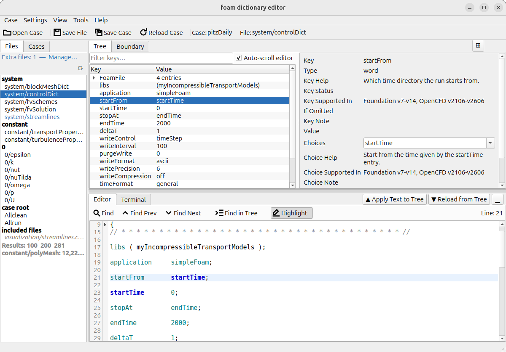

The main window is divided into two top-level columns separated by a horizontal splitter.

- **Left column** — two tabs, full window height: **Files**, the file list for the selected OpenFOAM case, and **Cases**, a directory browser for finding and managing whole cases (see [Case navigator](#case-navigator)). `Ctrl+1` hides or shows the column as a whole, whichever tab is in front.
- **Right column** — a vertical splitter with two rows:
  - **Upper row** — a tab widget with up to three tabs:
    - **Tree** tab — parsed dictionary tree (center) and detail editor (right). A **⊞** button in the tab bar's top-right corner activates side-by-side mode when `blockMeshDict`, `topoSetDict`, `snappyHexMeshDict`, or `setFieldsDict` is the active file (see [BlockMesh panel — Side-by-side mode](#side-by-side-mode)).
    - **Boundary** tab — boundary condition table for all field variables (see [Boundary view](#boundary-view)).
    - **BlockMesh** tab — interactive 3-D viewer for `blockMeshDict` geometry (see [BlockMesh panel](#blockmesh-panel)). Visible only when the Simple terminal is active (standard variant); can also be toggled via **View > BlockMesh 3-D Panel**.
  - **Lower row** — tabbed panel with two tabs:
    - **Editor** — plain-text editor with line numbers.
    - **Terminal** — integrated terminal with a mode toggle (see [Terminal tab](#terminal-tab) below).

    The lower row's tab bar carries **▲ Apply Text to Tree** and **▼ Reload from Tree** in its top-right corner — see below.

The top action bar is a toolbar docked above the tab strip, holding the frequently used commands and the current case and file display.

- Open Case — the same command as **Case > Open Case…** `Ctrl+O`.
- Save File.
- Save Case.
- Reload Case.
- Case: current case name display.
- File: current file name display.

**Save File**, **Save Case**, **Reload Case** and **Open Case** are the same commands as the matching **Case** menu entries.

The two commands that move content between the tree and the editor text sit on the *seam* between the two panes, in the top-right corner of the lower row's tab bar, rather than in the top action bar with the disk operations. The arrows read against the vertical splitter: the tree is the upper pane, the editor the lower one.

- **▲ Apply Text to Tree** — re-parse the editor text and rebuild the tree above. Also **Case > Apply Text to Tree** `Ctrl+Shift+A`.
- **▼ Reload from Tree** — regenerate the editor text from the tree above. Also **Case > Reload from Tree**; no shortcut, since it overwrites the editor text.

Because they ride the tab bar rather than sitting inside a tab page, both stay available whichever tab either row is showing — **Apply Text to Tree** still refreshes the BlockMesh 3-D overlays while the **BlockMesh** tab is in front.

The **Editor** tab has its own toolbar row with text search operations.

- Find — opens a search dialog (Ctrl+F).
- Find Prev — wraps to the previous match (Shift+F3).
- Find Next — advances to the next match (F3).
- Find in Tree — selects the deepest tree node whose source span covers the current cursor line (Ctrl+Shift+T).
- Highlight — toggleable button; click to turn syntax highlighting on or off. The setting is saved to `app_config.json` and restored on the next launch.
- Line: N — current cursor line number (right side of the toolbar).

The menu bar provides a **Case** menu, a **Settings** menu, a **View** menu, a **Tools** menu, and a **Help** menu.

**Case menu:**

- Case > Open Case… `Ctrl+O` — also on the top toolbar.
- Case > Open from Case Library…
- *Drag and drop:* drag a case directory from your file manager onto any part of the application window to open it. If there are unsaved changes, a confirmation dialog is shown first.
- Case > Reload Case.
- Case > Save File `Ctrl+S`.
- Case > Save Case `Ctrl+Shift+S`.
- Case > Save as New Case…
- Case > Apply Text to Tree `Ctrl+Shift+A` — the same action as the **▲ Apply Text to Tree** button on the lower tab bar.
- Case > Reload from Tree — the same action as the **▼ Reload from Tree** button. Deliberately without a shortcut: it overwrites the editor text, discarding any edits not yet applied to the tree.
- Case > Duplicate Case…
- Case > Duplicate from Case Library…
- Case > Case Browser… — open the two-pane Case Browser window. See [Case Browser window](#case-browser-window).
- Case > Find OpenFOAM Examples… — the same action as Tools > Find OpenFOAM Examples…, listed here too because it can duplicate a tutorial case as the starting point for a new case. See [Find OpenFOAM Examples](#find-openfoam-examples).
- Case > Clean Backup Files…
- Case > Manage Extra Files & Directories… — manage the extra files and directories of the open case. See [Adding extra directories](#adding-extra-directories).
- Case > Reset File List — drop the case's extra files and directories again. See [Removing extra files and directories](#removing-extra-files-and-directories).
- Case > Compare with Case…
- Case > Exit `Ctrl+Q`.

**View menu:**

- View > Show Type Column (checkable; hidden by default).
- View > File List `Ctrl+1`, View > Detail Pane `Ctrl+2`, View > Editor / Terminal Pane `Ctrl+3` — checkable; unticking one minimizes that pane. See [Minimizing panes](#minimizing-panes).
- View > Reset Window Size — restore the default window size. See [Window size](#window-size).
- View > BlockMesh 3-D Panel (checkable; shows or hides the BlockMesh tab. Grayed out — with the label "BlockMesh 3-D Panel  (unavailable: xterm active)" — while xterm terminal mode is active due to the GPU conflict).
- View > Save Image… `Ctrl+Shift+I` — the same action as the **Save Image…** button in the BlockMesh panel; present only when that panel is available. See [BlockMesh panel](#blockmesh-panel).
- View > View Log Summary… — the same action as Tools > View Log Summary…, listed here too for discoverability. See [View Log Summary](#view-log-summary).

**Settings menu:**

- Settings > Set Default Case Directory…
- Settings > Manage Case Library…
- Settings > Manage Schema Modules…
- Settings > Generate OpenFOAM Keywords… — rebuild the syntax-highlighter keyword list from a selected OpenFOAM installation. See [Generate OpenFOAM Keywords](#generate-openfoam-keywords).
- Settings > Restore Last Session on Startup (checkable; ticked by default) and Settings > Forget Saved Session. See [Session restore](#session-restore).
- Settings > Reset All Settings…
- Settings > Appearance — select the colour theme: **Follow System** (default), **Light**, or **Dark**. Takes effect after restarting the application. See [Appearance and colours](#appearance-and-colours).
- Settings > UI Scale — scale the whole interface by 100 % (default), 125 %, 150 %, 175 % or 200 %. Takes effect after restarting the application. See [Text size and display scaling](#text-size-and-display-scaling).
- Settings > Language — select the UI language (English / 日本語). Takes effect after restarting the application.

**Tools menu:** see [Tools menu](#tools-menu) for what the items need and a list of them in menu order.

**Help menu:**

- Help > About Foam Dictionary Editor (FoDE) — shows the application version (with a short dev-build suffix when run from a git checkout), license, and acknowledgements.
- Help > Keyboard Shortcuts
- Help > Resources

## Current case and file display

The toolbar shows the current case as its directory name and the current file as `parent-directory/file-name`. For example, `system/controlDict` and `constant/transportProperties` are shown in that form.

If no case or file is loaded, the labels show `-`.

## Tree and text workflow

The editor is designed so that raw text editing remains available even when the parser cannot fully interpret a file. The intended workflow is:

1. Open a case and select a file from the file list.
2. Load the raw text into the bottom editor immediately.
3. Parse the text and update the tree when parsing succeeds.
4. Use the tree for structure browsing and simple value editing. Selecting a row highlights its source lines in the editor (see [Editor sync](#editor-sync-auto-scroll-editor)).
5. Use the lower text editor for direct manual editing.
6. Press **Apply Text to Tree** when you want to parse the edited text back into the tree. This also restores editor sync if the source lines had become stale.
7. Press **Reload from Tree** when you want to regenerate the text from the current parsed tree.
8. Press **Save File** to save the current raw text to disk, or **Save Case** to save all modified files at once.

## Detail pane

The right-side detail pane shows contextual information for the selected node and lets you edit its value.

When a schema is defined for the selected key, the pane displays:

- **Key Help** — a description of what the setting controls.
- **Key Status** — shown only when the key is not simply current; see below.
- **Key Supported In** — the solver types or configurations where the setting applies.
- **Key Note** — additional remarks or caveats.
- **Choices** — a drop-down list of valid or common values. Selecting a choice updates the help fields below to show the description, supported-in information, and notes specific to that value.

### Old names and entries that do nothing

OpenFOAM renames dictionary keys from time to time, and the two forks do not always rename them together. Rather than hide a name that is no longer current, the pane tells you what it is:

- **A renamed key** shows *Historical name — OpenFOAM reads '<new name>' in <version>*. For example `convertToMeters` was renamed to `scale`, and `minMedianAxisAngle` to `minMedialAxisAngle` in v1712 — the latter is still accepted by the Foundation releases but was removed from OpenCFD in v2212, so the same line behaves differently depending on which OpenFOAM you run.
- **An entry that has no effect** is shown in warning colour: *Has no effect — OpenFOAM reads '<other key>' instead*. These are keys that appear in the official tutorials but that no OpenFOAM reader consumes, so writing them changes nothing. `minFlatness` in `meshQualityControls` is the notable one: the motorBike tutorial has shipped it in both forks since OpenFOAM-2.3.x, while the key actually read is `minFaceFlatness`. If you started from motorBike — as a great many cases do — that line in your dictionary is inert.

### Coverage

These help fields are populated from schema modules. The built-in schemas cover the great majority of entries in `controlDict`, `fvSchemes`, `fvSolution`, `blockMeshDict`, `snappyHexMeshDict`, and `turbulenceProperties` / `momentumTransport`, including entries named after your own case such as `div(phi,U)` or a solver block for a particular field. OpenFOAM is large, so other dictionaries are not yet covered: for a key without a schema the pane still shows its name, type, and value, but the help fields stay blank. You can fill in the gaps by writing your own schema modules, which are plain Python files you can load at runtime via **Settings > Manage Schema Modules…**.

Modules shipped with a new release are added to your list automatically. If you have previously removed a module, it stays removed.

For ordinary nodes, the pane also shows Key, Type, and an editable Value field. For `field_value` nodes, the pane shows Field Type, Field Name, and Value.

### Numeric type promotion

OpenFOAM does not strictly distinguish between integer and floating-point values in most contexts. When you enter a fractional value (for example `0.5`) for a node whose current type is `int`, the editor automatically promotes the node to `scalar` without an error or confirmation prompt. The Type column updates immediately to reflect the new type. Entering an integer value in a `scalar` node keeps the type as `scalar`.

### Edit validation

If the value you enter is not valid for the node's current type — for example, a non-numeric string for a `scalar` node, or a word other than `true`/`false`/`on`/`off`/`yes`/`no` for a `bool` node — the edit is rejected silently and a message is shown in the status bar describing the problem. The node value is left unchanged.

## Editor behavior

The bottom editor is used for direct plain-text editing of OpenFOAM dictionary files. It shows the current line number in the lower area of the editor panel.

The editor applies **syntax highlighting** to OpenFOAM dictionary tokens: comments (`//` and `/* */`) appear grey italic, string literals green, `#directives` purple bold, `$macro` references orange, reserved keywords (`FoamFile`, `true`/`false`, `uniform`, `nonuniform`, etc.) blue bold, and numbers teal. Use the **Highlight** button in the editor toolbar to toggle highlighting on or off; the preference is saved across sessions.

The window title shows a `*` suffix when the editor content has unsaved changes, and clears it after save, reload from tree, or a successful apply-to-tree.

### Code folding

The line-number gutter on the left of the editor contains a narrow fold column. For every `{ … }` block that spans more than one line, a small triangle is drawn in the fold column on the opening-brace line:

| Triangle | Meaning |
|----------|---------|
| ▾ (down) | Block is expanded — click to collapse |
| ▶ (right) | Block is collapsed — click to expand |

Clicking the triangle hides or reveals the lines between the `{` and the matching `}`. The `FoamFile { … }` header block is collapsed automatically each time a file is loaded to keep the working dictionary entries at the top of the viewport.

Folding is visual only: the underlying text is not modified. **Apply Text to Tree**, **Save File**, and all copy operations work on the full, unmodified text regardless of the current fold state.

## Tree key filter and editor sync

### Tree key filter

A filter bar sits above the tree view. Type any substring to narrow the tree to rows whose key contains the text (case-insensitive). Matching is recursive: when a descendant matches, all its ancestors remain visible so the path to the match is always clear.

Clearing the filter restores the full tree. The filter is also cleared automatically whenever a new file is loaded.

`unknown_raw_entry` and `directive_entry` nodes have an empty key and are hidden by an active filter unless a sibling or descendant matches.

### Editor sync (Auto-scroll editor)

Selecting a row in the tree highlights the corresponding lines in the text editor with an amber background, so you can immediately see the raw text for the selected entry.

The **Auto-scroll editor** checkbox sits to the right of the filter bar and controls whether the editor also scrolls to the highlighted lines:

- **Checked (default)** — the editor scrolls to the entry's first line and highlights its full span in amber. Useful for navigating through a file using the tree.
- **Unchecked** — the amber highlight appears but the editor does not scroll. Useful for keeping a specific region of the raw text visible while browsing the tree structure.

The checkbox label turns grey and reads **Auto-scroll editor (stale)** when the editor text has been modified since the last parse. In this state the stored line numbers no longer match the text, so both jump and highlight are suspended. The status bar shows a reminder: *"Apply Text to Tree to re-enable jump-to-line"*. Jump and highlight resume automatically as soon as you press **Apply Text to Tree**, load a different file and return, or open a new case.

When a node was added or modified directly in the tree (rather than parsed from text), it has no associated source location. Selecting such a node leaves the editor position unchanged and shows *"No source location — entry was added or modified in the tree"* in the status bar.

### Find in Tree (editor → tree)

Click **Find in Tree** in the Editor toolbar (or press **Ctrl+Shift+T**) to navigate in the opposite direction: the tree selects the deepest node whose source span covers the current editor cursor line.

- If source lines are stale (text edited since the last parse), a status bar message is shown instead. Press **Apply Text to Tree** first.
- If the cursor sits outside every node's span (for example, a blank line at the top of the file), *"No tree entry found for line N"* is shown.
- If the matched node is hidden by the current key filter, the nearest visible ancestor is selected instead. If no ancestor is visible, *"Entry is hidden by the current filter"* is shown.

## Tree view context menu

Right-click any row in the center tree view to open a context menu. Items are grouped by function.

### Undo and redo

Tree edits are undoable: press **Ctrl+Z** while the tree has keyboard focus to revert the most recent tree change, and **Ctrl+Shift+Z** to re-apply it (both also appear in the context menu as **Undo Tree Edit** / **Redo Tree Edit**). This covers every tree-side mutation — inline cell edits, Detail-panel applies, Paste Value, Add/Duplicate/Delete/Comment Out/Restore, **Apply Text to Tree**, Vertices-table edits, and the Boundary tab's patch operations. A boundary operation that changed several field files at once (e.g. renaming a patch across `0/`) is undone as a whole — one Ctrl+Z restores every file it touched, and the status bar reports the extra files.

Undo is a single history for the whole session (up to 50 steps), cleared when you open another case: Ctrl+Z reverses the most recent tree change wherever it happened, switching the view to the affected file when it is not already on screen. The bottom text editor keeps its own native Ctrl+Z for free-form typing — the tree shortcut only fires while the tree has focus. Undoing reloads the tree, so expanded/selected rows are reset.

### Value copy and paste

- **Copy Value** — copies the display text from the Value column of the selected row to the system clipboard. Ctrl+C when the tree has keyboard focus does the same.
- **Paste Value** — applies the clipboard text to the Value column of the selected row using the same parsing path as direct cell editing. Ctrl+V when the tree has focus does the same.

**Paste Value** is disabled when the selected node type does not support value editing (for example, `dictionary` nodes that show an entry count). If the pasted text cannot be parsed for the node type (for example, a non-numeric string pasted into a `scalar` node), the paste is silently rejected and a status-bar message is shown.

Ctrl+C and Ctrl+V are scoped to the tree widget and do not interfere with the text editor at the bottom. When a tree cell is in inline-edit mode, the shortcuts go to the inline editor as usual.

### Adding and duplicating entries

- **Add Entry After** — inserts a new `word`-typed entry (`newKey / newValue`) as a sibling immediately after the selected node and opens the key cell for inline editing. Enabled when the parent is a dictionary or the root. On a `blockMeshDict` `block N` row it inserts a new block instead — a ready-made `hex (0 1 2 3 4 5 6 7) (10 10 10) simpleGrading (1 1 1)` — and opens its Value cell, since a block row's key is its position and cannot be typed.
- **Add Child Entry** — inserts a new entry as the last child of the selected node. Enabled only when the selected node is a `dictionary`.
- **Duplicate** — deep-copies the selected node and its subtree, inserting the copy immediately after the original.

### Commenting and deleting

- **Comment Out** — converts the selected entry into a commented-out `unknown_raw_entry` by prepending `// ` to every non-blank line of its rendered text. The result is written back into the file as a block comment. Disabled when the entry is already commented out, and on `block N` rows: a commented-out block inside `blocks ( … )` reads back as a comment rather than an entry, so the row would disappear instead of being restorable.
- **Restore from Comment** — reverses **Comment Out**: strips the `// ` prefix from each line, re-parses the result, and replaces the `unknown_raw_entry` with the recovered node(s). Enabled only when every non-blank line of the entry starts with `//`.
- **Delete** — removes the selected node after a Yes/No confirmation dialog. Deleting a `block N` row renumbers the blocks after it, in both the tree and the 3-D viewer.

## Behavior on parse failure

If parsing fails after loading or after editing, the application shows a warning and keeps the raw text editor usable. In this state, the last successfully parsed tree remains available until a later parse succeeds.

When parsing succeeds but some entries could not be fully interpreted, those entries are preserved as `unknown_raw_entry` nodes in the tree and a warning is shown in the status bar reporting how many unrecognized entries were found (for example, "Parsed: system/controlDict — 2 unrecognized entries"). The file is still usable; the raw text is preserved verbatim for those entries.

## File list behavior

The file list shows the common dictionaries of the case, any files you add yourself, and every field file in `0/` and `0.orig/`.

### Directory header markers

Each directory group in the file list is shown as a bold header. A `[+]` suffix is added to a header when files exist in that directory on disk but are not currently in the file list. No marker is shown when all files in the directory are already listed.

### Default target files

FoDE lists the dictionaries you are likely to edit rather than every file in the case:

- **`system/` and `constant/`** — about a hundred well-known dictionary names, chosen by surveying the OpenFOAM tutorials: `controlDict`, `fvSchemes`, `fvSolution`, `blockMeshDict`, `snappyHexMeshDict`, `transportProperties` and so on. Where the two OpenFOAM forks renamed a dictionary, both spellings are known and whichever one your case has is listed (`turbulenceProperties` / `momentumTransport`, `fvOptions` / `fvModels` + `fvConstraints`, `transportProperties` and `thermophysicalProperties` / `physicalProperties`). Names that belong to one case alone — a Lagrangian cloud called `limestoneCloud1Properties`, say — are not guessed.
- **Variants of the four dictionaries the 3-D viewer draws** — files in `system/` whose names start with `blockMeshDict`, `topoSetDict`, `snappyHexMeshDict` or `setFieldsDict`, so a case that keeps `topoSetDict-slices` or `topoSetDict.1` beside its `topoSetDict` lists them all.
- **Field files** — every file directly inside `0/` and `0.orig/`.
- **Phase variants** — `thermophysicalProperties.*`, `turbulenceProperties.*` and their relatives (for example `thermophysicalProperties.air`), from `constant/` and from each region's constant directory.
- **Case-root scripts** — `Allrun`, `Allclean` and the other `All*` scripts; see [Case-root scripts](#case-root-scripts).
- **Files pulled in by `#include`** — see [Included files](#included-files).

Anything else — a `README`, a `log.*` file, a dictionary with an unusual name, a whole directory — you add yourself: right-click a directory header and choose **Add files from…** ([Adding files at runtime](#adding-files-at-runtime)), or register the directory ([Adding extra directories](#adding-extra-directories)).

### Case-root scripts

Script files matching `All*` directly in the case root (`Allrun`, `Allrun.pre`, `Allclean`, …) are listed automatically under a **case root** group, shown after all other groups. Since the Tools menu can run these scripts, listing them lets you inspect and edit exactly what will be executed. Other case-root files (`log.*`, `*.foam`, result directories) stay hidden by default to keep the list clean, and this group never shows a `[+]` marker (there are almost always unlisted logs at the root, so the marker would be permanently on). To list specific extra root files — a run log, a `README`, a custom script — right-click the **case root** header and choose **Add files from 'case root'...**; the same menu also offers **New file in 'case root'...**, consistent with the other directory headers. Hidden files (names starting with `.`) are never offered.

Scripts are shell files, not OpenFOAM dictionaries: opening one shows it in the text editor only — the tree view stays empty, **Apply Text to Tree** has no effect, and compare mode skips them. The editor automatically switches to a shell-highlighting mode (detected by the `#!` shebang): `#` comments, quoted strings, `$variables`, OpenFOAM run helpers such as `runApplication` and `runParallel`, and utility/solver names from the regular OpenFOAM keyword list are all coloured. Editing and saving work as for any other file, and the executable permission is preserved. The scripts are also included when the case is duplicated or saved as a new case, so the copy remains runnable from the Tools menu.

### MultiRegion cases

When subdirectories are found inside `system/`, FoDE treats them as region names and builds additional file groups. For each region it looks for the same kinds of dictionary as at the top level — `fvSchemes`, `fvSolution`, `decomposeParDict`, `meshQualityDict` and the other mesh and solver dictionaries under `system/<region>/`, and `thermophysicalProperties`, `turbulenceProperties`/`momentumTransport`, `radiationProperties`, `dynamicMeshDict` and similar under `constant/<region>/` — and lists the ones that exist. Phase variants such as `thermophysicalProperties.air` are collected per region too.

Each region directory appears as its own group header in the file list (for example `system/fluid`, `constant/heater`). Region groups are sorted after the top-level `system` and `constant` groups.

Field files inside `0/<region>/` and `0.orig/<region>/` are also listed automatically, grouped under headers such as `0/fluid` and `0/solid`. This covers cases like `chtMultiRegionFoam` where each region has its own initial-condition files (e.g. `0/heater/T`, `0/bottomWater/p`).

### Included files

A dictionary can pull in another file with `#include` (and its relatives `#sinclude`, `#includeIfPresent`, `#includeEtc` and `#includeFunc`). The editor follows those directives and lists the files they refer to, so you can read them without hunting for them on disk. Nothing is merged into the including file: the included file stays a file of its own, much like a symbolic link, and the directive keeps its own row in the tree.

Where an included file appears depends on where it lives:

- **Inside the case** — it joins the group it belongs to. `#include "caseSettings"` from `constant/dynamicMeshDict` puts `caseSettings` in the **constant** group, marked with a `↳`. It behaves like any other case file: fully editable and saveable.
- **Outside the case** — typically `#includeEtc "caseDicts/setConstraintTypes"` or `#includeFunc solverInfo`, which resolve into your OpenFOAM installation. These are collected in an **included files** group at the bottom of the list, shown in italic. Hovering over any included file names the file whose `#include` pulled it in.

Files outside the case are **read-only**. Editing one would change a file shared by every case on the machine, so the editor shows it — tree and text — but the text editor is locked (a `read-only` badge appears beside the Line indicator), tree entries cannot be edited, and Save, Create Backup, Duplicate and Delete are unavailable. To customise one, right-click it and choose **Copy into case...**: the file is copied into your case (normally into `system/`, which is where OpenFOAM looks first) and the copy is editable. For `#includeFunc`, the copy takes effect immediately; for `#includeEtc`, change the directive to a plain `#include "<name>"` so it picks up your local version.

To jump from a directive to the file it names, right-click the directive's row in the tree and choose **Open Included File**, or double-click the row's Key or Type cell. Hovering over the row shows what the directive resolved to, or why it did not:

- **not found** — the file does not exist. This is normal before a case has been run, since some tutorials generate their included files in `Allrun`.
- **optional include not present** — a `#sinclude`/`#includeIfPresent` target that is absent. This is legal and not an error.
- **no OpenFOAM installation found** — `#includeEtc` and `#includeFunc` need an OpenFOAM installation to resolve against. Source OpenFOAM before starting FoDE, or choose an installation in **Find OpenFOAM Examples** or **Settings > Generate OpenFOAM Keywords…** (both use the same selector, and the choice is remembered).

Two limits are worth knowing. Includes are followed **one level only**, so a file that is itself included is not scanned for further includes. And because the editor cannot tell which OpenFOAM version a case was written for, `#includeEtc` resolves against the newest installation it finds unless you choose one explicitly.

### Symbolic links

Symbolic links in the file list are shown with a `⇢` marker appended to the file name and the item text is rendered in italic. Hovering over the item shows a tooltip containing the path and the link target. Editing a symlink writes through to the target file, exactly as the operating system resolves the link.

### Adding files at runtime

Right-click any directory header in the file list — including the **case root** header — to open a context menu with the following actions.

- **New file in '\<dir\>'...** — create a new file from a FoamFile template (see [Creating a new file](#creating-a-new-file)).
- **Add files from '\<dir\>'...** — add existing files to the file list. A dialog lists all files in that directory that are not yet shown (hidden files starting with `.` are excluded). Select one or more and click **OK** to add them.
- **Remove '\<dir\>' from file list** — removes an extra directory from the file list. Shown only on extra-directory headers (see [Adding extra directories](#adding-extra-directories)).
- **Duplicate '\<dir\>' → '\<counterpart\>'...** — copy a `0/` or `0.orig/` directory to create the missing counterpart (see [Duplicating a field directory](#duplicating-a-field-directory)). This action is shown only for `0` and `0.orig` headers, and only when exactly one of the two directories is present.
- **Delete '0' directory...** — permanently delete the `0/` directory from disk (see [Deleting a field directory](#deleting-a-field-directory)). Shown only on the `0` header, and only when `0.orig` exists.

Added files are saved to `.foam-editor-files.json` in the case directory and are restored the next time the case is opened. The config file is also copied when **Duplicate Case…** uses the app-visible files only mode.

Extra files are displayed in a distinct colour in the file list so they can be told apart from the default target files at a glance.

### Adding extra directories

Any directory inside the case root can be added to the file list so that all files inside it are scanned and listed automatically, in the same way as `0/` and `0.orig/`. This is useful for:

- Custom field directories used by non-standard solvers (e.g. `initial/` for `laserBeamFoam`).
- Restart time steps you want to browse and edit (e.g. `0.5/`, `1/`).
- Deep subdirectories with supplementary dictionaries (e.g. `lagrangian/sprayFoam/aachenBomb/chemkin/`).
- Result or validation trees (e.g. `validation/`) that contain files in subdirectories.

Extra directory group headers are shown in **purple** to distinguish them from built-in groups. The `[+]` unlisted-files marker is never shown for extra directories because all files are already loaded.

Hidden files and directories (names starting with `.`, such as the app's own `.foam-editor-files.json` or a `.git/` tree) are always excluded from extra-directory scans.

**Adding a time directory via the Results indicator:**  
Right-click the **Results: …** row at the bottom of the file list. A submenu lists each time directory; click one to add it. Directories already added are greyed out.

**Adding an arbitrary directory via the management dialog:**  
Open **Case > Manage Extra Files & Directories…** (or click the indicator button at the top of the file list). In the **Extra Directories** tab, click **Add Directory…**. A folder picker opens rooted at the case directory; select any subdirectory and click **OK**. The selected directory is added with flat (non-recursive) scanning by default and the file list refreshes.

**Enabling recursive scan:**  
By default a directory is scanned flat — only files directly inside it are listed. To include files in subdirectories, check the entry in the **Extra Directories** tab and click **Toggle Recursive**. The entry label changes to `<dir>  [recursive]` to indicate the mode. Click **Toggle Recursive** again on the same entry to revert to flat scanning.

**Removing an extra directory:**  
Right-click the (purple) directory header in the file list and select **Remove '\<dir\>' from file list**, or use the **Extra Directories** tab in the management dialog (check the entry, then click **Remove Selected**).

Files created or duplicated inside an extra directory are not added to the extra-files list — they are already visible because the whole directory is scanned.

**Run logs and large non-dictionary files in extra directories:**  
`log.*` run logs (e.g. `log.blockMesh`, `log.simpleFoam`) appearing via an extra directory are shown **dimmed (grey)** in the file list and always open as plain text — the dictionary parser is never run on them, so there is no tree view, **Apply Text to Tree** has no effect, and case comparison skips them (no `≠` marker). Opening a log larger than 100 KB still shows a confirmation dialog first, since loading a very large text file can take a moment. Other large non-dictionary files get the same confirmation dialog and are likewise skipped during diff computation.

### Extra files and directories indicator

A **Manage extra files…** button is always shown at the top of the file list panel when a case is loaded. When extra files or directories are registered it shows the count instead (e.g. **Extra files: 2, directories: 1 — Manage…**). Clicking it opens the **Manage Extra Files & Directories** dialog, which has two tabs.

- **Extra Files** — lists all individually registered extra files. Select one or more and click **Remove Selected** to remove them.
- **Extra Directories** — lists all registered extra directories. Entries with recursive scanning enabled are shown as `<dir>  [recursive]`. Click **Add Directory…** to add a new one (flat by default). Check one or more entries and click **Toggle Recursive** to flip their scan mode, or **Remove Selected** to remove them.

Changes take effect immediately when the dialog is closed.

### Removing extra files and directories

**Extra files:**
- **Right-click** an extra file (shown in blue) in the file list and select **Remove from extra files**. The file is removed immediately.
- Open the management dialog and use the **Extra Files** tab to remove one or more files at once.

**Extra directories:**
- **Right-click** the purple directory header and select **Remove '\<dir\>' from file list**. All files from that directory disappear from the list immediately.
- Open the management dialog and use the **Extra Directories** tab to remove one or more directories at once.

Removing an extra file or directory from the list does not delete anything from disk. It only removes it from the per-case configuration so it no longer appears in the file list.

### Numeric time directory indicator

When numeric directories (OpenFOAM calculation results such as `0.5`, `1`, `10`) are found at the case root — excluding `0`, `0.orig`, and any directories already added as extra directories — a non-selectable **Results: …** row is appended at the bottom of the file list. The indicator is rendered in bold gray text and lists up to six directory names. When more than six exist, a `(+N more)` suffix is added. Hovering shows the total count and, for multiple directories, the first and last in the sorted range.

Right-click the indicator to add any of the listed directories to the file list as an extra directory (see [Adding extra directories](#adding-extra-directories)). Once a directory is added, it no longer appears in the Results indicator and instead shows as a full group header.

### Mesh presence/staleness indicator

When `constant/polyMesh/owner` exists, a non-selectable indicator row is appended near the bottom of the file list (alongside the Results indicator) showing the cell count, e.g. **"constant/polyMesh: 8,000 cells"**. The count is read from the `note` field in the file's `FoamFile` header (e.g. `nPoints:9261 nCells:8000 nFaces:25200`) rather than by parsing the mesh, so the check is cheap. If the count can't be read from the header, the indicator falls back to **"constant/polyMesh (present)"**.

If `system/blockMeshDict` has been modified more recently than the mesh was generated, the indicator is shown in amber with a **" — stale (blockMeshDict changed since last run)"** suffix, and the tooltip explains why. Hovering over the indicator always shows the full point/cell/face counts when available.

The indicator updates automatically: it is recomputed on every file-list refresh, including after **Tools > Run blockMesh**, after saving `blockMeshDict` (`Save File` / `Save Case`), and after any change detected by the file-system watcher — no manual **Reload Case** is needed.

### Decomposed and background-run indicators

When the case has `processor*` directories, a **Decomposed: …** row follows, one row however many processors there are: their count, the times in them (the last four), and, in amber, how many of those times have not been through `reconstructPar` yet — the data that `decomposePar -force` would delete and that blocks [Delete processor\* Directories](#delete-processor-directories). Collated data reads **Decomposed (collated): …**. The tooltip lists every time. Right-click it for **Run reconstructPar…** or **Delete processor\* Directories…**. Re-decomposing is not offered there, since on a decomposed case it deletes the processor data first; use **Tools > Run decomposePar…**. The first processor directory is watched too, so a parallel run's new times show up as they are written.

While a [background run](#background-runs-and-stop-background-run) is going in the case, a **Running in background: <solver> (pid N)** row follows; it reads **Stopping <solver> … — requested hh:mm** in amber after **Stop Background Run**, until the run has gone. Right-click it to stop the run or view its log summary.

### Creating a backup

Right-click any file in the file list and select **Create Backup**. A copy of the file is saved in the same directory with a timestamp suffix, for example `controlDict.bak_20260502_143022`.

The backup captures the current in-memory buffer if the file has been loaded, so unsaved edits are included. If the file has not been loaded yet, the on-disk version is copied. A confirmation message is shown in the status bar, and if the backup includes unsaved edits that note is appended to the message.

### Creating a new file

Right-click a directory header in the file list and select **New file in '\<dir\>'...**. An input dialog prompts for a file name. The file is created at `<case_dir>/<dir>/<name>` with a minimal FoamFile dictionary header. The file is opened automatically in the editor after creation.

Files created in directories other than `0/` and `0.orig/` are registered in `.foam-editor-files.json` so they persist across sessions.

### Cleaning up backup files

Select **Case > Clean Backup Files…** to remove accumulated `.bak_*` files from the current case. The dialog scans the entire case directory recursively and lists every file whose name matches the `.bak_YYYYMMDD_HHMMSS` pattern, showing each relative path and file size.

All files are checked by default. Use the checkboxes to select individual files, or use **Select All** / **Deselect All** to change the entire selection at once. The **Delete Selected (N)** button shows the current count of checked files and is disabled when nothing is selected.

Clicking **Delete Selected** deletes the checked files from disk immediately, with no further confirmation. If any deleted file was open in the editor, the editor and tree view are cleared. If any error occurs (e.g. a permission problem), a summary is shown after the operation.

If no backup files are found, the dialog shows a message and offers only a **Close** button.

**This cannot be undone.** See [Disclaimer](#disclaimer).

### Deleting a file

Right-click any file in the file list and select **Delete file...**. A confirmation dialog shows the file name and three choices.

- **Backup && Delete** — creates a timestamped backup in the same directory (for example `controlDict.bak_20260506_143022`) and then deletes the original. The backup captures the current in-memory buffer, so unsaved edits are included. If the backup write fails, the deletion is aborted.
- **Delete** — deletes the file immediately without creating a backup.
- **Cancel** (default) — aborts the operation.

If the file has unsaved changes, the dialog shows an additional warning. The deleted file is removed from the in-memory buffers, the dirty-state tracking, and the per-case extra files configuration. If the deleted file was open in the editor, the editor and tree view are cleared. The file list is refreshed after deletion.

This action deletes the file from disk and cannot be undone.

### Duplicating a file

Right-click any file in the file list and select **Duplicate...**. An input dialog pre-fills the current file name and prompts for a new name. The duplicate is written to the same directory and the `object` field inside the FoamFile header is updated to match the new file name.

If the source file has unsaved changes, the application presents three choices.

- **Save and Duplicate** — save the file first, then duplicate the saved content.
- **Duplicate with Unsaved Changes** — duplicate the current in-memory buffer as-is.
- **Cancel** — abort the operation.

Files duplicated outside `0/` and `0.orig/` are registered in `.foam-editor-files.json`.

### Duplicating a field directory

Right-click the `0` or `0.orig` header in the file list and select **Duplicate '\<dir\>' → '\<counterpart\>'...**. This action copies the entire directory to create the missing counterpart (`0/` → `0.orig/` or `0.orig/` → `0/`). The action is shown only when exactly one of the two directories is present. A confirmation dialog is displayed before the copy begins.

### Deleting a field directory

Right-click the `0` header in the file list and select **Delete '0' directory...**. This action permanently deletes the entire `0/` directory and all files inside it from disk. The action is shown only when `0.orig` exists, so that initial field data is preserved.

A confirmation dialog shows the full directory path before deletion begins. If the currently open file is inside `0/`, the editor and tree view are cleared. The file list and boundary panel are refreshed after deletion.

This action deletes files from disk and cannot be undone.

### Resetting the file list

Select **Case > Reset File List** to remove all user-added files and directories for the current case. This deletes `.foam-editor-files.json` from the case directory and reloads the file list with the default target files only.

## Case navigator

The file list shows what is inside *one* case. The **Cases** tab beside it shows the cases themselves: it walks through directories on disk so you can find the case you want to open or compare against, and move, rename, copy or delete whole cases without switching to a file manager.

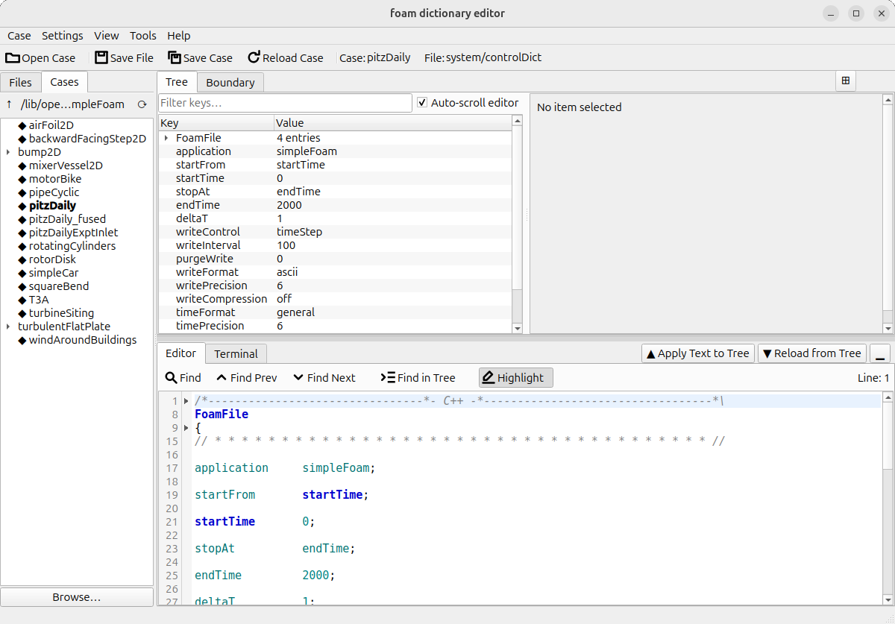

A directory that looks like an OpenFOAM case — one that contains `system/` or `constant/` — is marked with a **◆** and shown in bold when it is the case you currently have open. Double-clicking it **opens the case** rather than expanding it. Double-clicking any other folder goes into it; the **↑** button goes back up, and **⟳** rescans the current folder from disk.

Two things the navigator deliberately does not do. It does not descend into a case, because what is inside a case is the file list's job and two browsers over one case would only be confusing. And it does not list loose files at all — only directories. If a directory is wrongly detected as a case and you need to see the folders inside it, right-click it and choose **Show Subfolders**.

The navigator opens at the last place you were browsing, remembered between runs. The first time, it uses your [default case directory](#setting-the-default-case-directory), and failing that your home directory. You can navigate anywhere on the filesystem from there.

### Case Browser window

**Browse…** at the bottom of the Cases tab — or **Case > Case Browser…** — opens the full browser: a folder tree on the left, the contents of the current folder on the right, and a row of actions along the bottom. It is not modal, so you can leave it open beside the main window while you work, and it shares its location with the Cases tab: navigating in one moves the other.

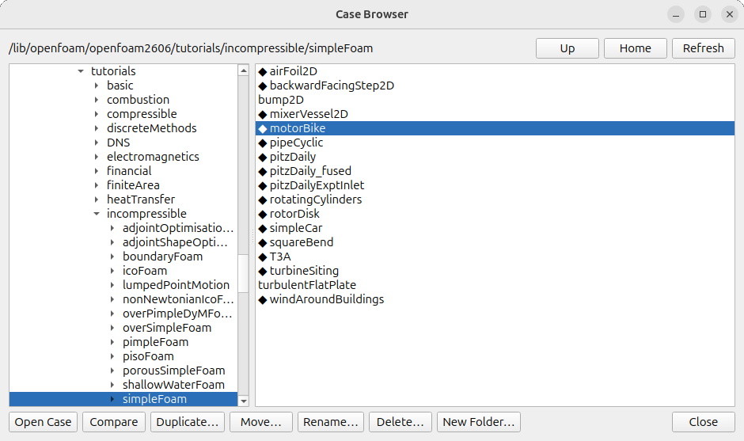

The action row applies to whatever is selected in the right-hand pane. **Open Case**, **Compare** and **Duplicate…** are available only for a real case; **Move…**, **Rename…** and **Delete…** work on any folder; **New Folder…** creates one in the folder you are looking at.

- **Open Case** opens the selected case, exactly as **Case > Open Case…** would.
- **Compare** makes the selected case the reference for [case comparison](#case-comparison). A case has to be open already for there to be anything to compare it against.
- **Duplicate…** opens the usual [Duplicate Case](#duplicating-a-case) dialog with the selected case as the source, so you can copy a case and choose whether to bring all its files or only the ones FoDE shows.

### Moving, renaming, copying and deleting a case

These are also on the right-click menu in the Cases tab. Each asks before doing anything that cannot be trivially undone, and each refuses outright rather than asking when the operation is one that cannot be done safely — a refusal appears in the status bar, not as a dialog.

**Deleting** sends the folder and everything in it to your desktop trash, so it can be recovered by the usual means. If the trash cannot be used — a different filesystem with no trash directory, or a permissions problem — you are told why and offered a permanent delete as a separate, explicit choice; nothing is ever permanently deleted without that second confirmation. Deleting a symbolic link removes only the link and leaves its target alone, and the confirmation says so.

**Moving** across filesystems is a copy followed by a delete rather than a rename, so it can take a while; the confirmation tells you when that is what will happen. If a move fails part-way, the original is always left untouched and you are told both where it still is and where an incomplete copy may have been left, rather than FoDE trying to tidy up and risking the only surviving copy.

**Operations on the case you have open** are allowed, and FoDE follows them: rename or move it and the case is reloaded at its new location, with the file list, the tree and the terminal's working directory all following. You are asked about unsaved changes first. Deleting the open case closes it first, leaving FoDE with no case open.

**Operations on a folder that *contains* the open case are refused.** Deleting `~/runs` while `~/runs/cavity` is open would mean closing a case you did not name, so FoDE asks you to close the case yourself first. A registered [Case Library](#case-library) directory, your home directory and the filesystem root are likewise protected and cannot be changed from here.

If the case you were comparing against is moved, the comparison follows it; if it is deleted, the comparison is simply cleared.

## Case Library

The Case Library is a set of directories used as sources for browsing and duplicating reference cases. It is intended to provide quick access to `$FOAM_TUTORIALS` and other template case collections without navigating the filesystem from scratch each time.

### Automatic inclusion of $FOAM_TUTORIALS

When the `FOAM_TUTORIALS` environment variable is set and points to an existing directory, that directory is automatically included at the top of the Case Library list on every application start. It does not need to be added manually and is not stored in `app_config.json`. If the variable is unset or the directory does not exist, it is simply absent from the list.

### Managing user-added directories

Select **Settings > Manage Case Library…** to open the library management dialog. The dialog shows two sections.

- **Auto-detected (read-only)** — shows the `$FOAM_TUTORIALS` path if the environment variable is active. This entry cannot be removed here; it disappears automatically when the variable is unset.
- **User-added directories** — directories you have added manually. Use **Add Directory...** to browse for a directory to register. Check one or more entries and click **Remove Selected (N)** to remove them. Changes are saved to `app_config.json`.

### Opening a case from the library

Select **Case > Open from Case Library…** to browse within a library directory and open a case from it. If multiple library directories are registered (including the auto-detected one), the application first asks which library to start from via a drop-down prompt, then opens a directory picker rooted at the chosen library.

### Duplicating a case from the library

Select **Case > Duplicate from Case Library…** to copy a case from the library into your working directory. The workflow is as follows.

1. Choose a library directory (if more than one is available).
2. Navigate to and select the source case inside that library.
3. A duplicate dialog opens with the **Default Case Directory** pre-filled as the destination parent.
4. Adjust the destination and name if needed, then click **OK** to copy.
5. After a successful copy, the application offers to open the new case immediately.

The copy mode options (full copy vs. app-visible files only) are the same as for **Case > Duplicate Case…**.

## Bundled example cases

The `tutorials/` directory in the repository root contains ready-to-open OpenFOAM cases:

| Directory | Solver | What it demonstrates |
|---|---|---|
| `tutorials/cavity/cavity/` | `icoFoam` | Single-region end-to-end workflow |
| `tutorials/cavity/cavityGrade/` | `icoFoam` | Non-uniform grading (`simpleGrading`) |
| `tutorials/cavity/cavityClipped/` | `icoFoam` | Clipped geometry; `mapFieldsDict` |
| `tutorials/snappyMultiRegionHeater/` | `chtMultiRegionFoam` | Multi-region boundary view and region file listing |
| `tutorials/damBreak/` | `interFoam` | Two-phase flow; `setFieldsDict` and `0.orig/` |
| `tutorials/pitzDaily/` | `simpleFoam` | The only bundled case with a turbulence model (RAS, `kEpsilon`), so it is where the [Detail pane](#detail-pane) help for `constant/turbulenceProperties` can be seen; also `#includeFunc`/`#includeEtc` |
| `tutorials/oneBlocks/` | `icoFoam` | 3-D single-block; `blockMeshDict` editing and 3-D mesh viewer |
| `tutorials/oneBlocks-vars/` | `icoFoam` | As `oneBlocks` with variable substitution and compact face notation |
| `tutorials/nineBlocks/` | `icoFoam` | 3×3 multi-block; regex boundary patches |
| `tutorials/nineBlocks-vars/` | `icoFoam` | As `nineBlocks` with variable substitution and compact face notation |
| `tutorials/topoSetShapes/` | `icoFoam` | Every `topoSetDict` geometry source the [topoSetDict overlay](#toposetdict-overlay) can draw, in one 3×3×3 block |
| `tutorials/samplingShapes/` | `icoFoam` | The same for the [sampling overlay](#sampling-overlay): probe points, lines, a point cloud and both plane spellings, across all three files sampling can be written in |

Open any case directly with **Case > Open Case…** and navigate to the case subdirectory, or duplicate it to a working directory with **Case > Duplicate from Case Library…** after adding `tutorials/` to the Case Library.

These case files are licensed under the **GPL-3.0**, separate from the AGPL-3.0 that covers FoDE source code. See `tutorials/README.md` for full provenance and license details.

## Saving as a new case

Select **Case > Save as New Case…** to write the current editor state to a new case directory and immediately switch to it. Unlike **Duplicate Case…** (which copies files from disk), this operation captures whatever is in the in-memory buffers — including unsaved edits — so the new case reflects the exact state visible in the editor at the moment the command is used. The original case is not modified.

A dialog shows the following fields.

- **Save in** — the parent directory for the new case (defaults to the parent of the current case).
- **New case name** — the name for the new case directory (defaults to the current name with `_new` appended).
- **Destination** — a live preview of the full destination path.
- **Copy mode** — controls which files are copied from disk before unsaved edits are applied:
  - **Copy app-visible files only** (default) — copies only the files shown in the file panel. Lightweight; excludes mesh data, processor directories, and result time steps.
  - **Copy all files** — full directory copy. Includes everything: mesh data, processor directories, existing result time steps, logs, etc.

In both modes, any unsaved in-memory edits are written into the new case on top of the copied files. The original case is not modified.

After the copy, the application opens the new case automatically.

## Duplicating a case

Select **Case > Duplicate Case…** to save a copy of the current case under a new name. A dialog is shown with the following fields.

- **Save in** — the parent directory for the new case (defaults to the parent of the current case).
- **New case name** — the name for the new case directory (defaults to the current name with `_copy` appended).
- **Destination** — a live preview of the full destination path.
- **Copy mode** — choose how files are copied:
  - **Copy all files** (default) — performs a full directory copy. Every file and subdirectory under the case root is included, such as mesh data, time-step directories, and log files.
  - **Copy app-visible files only** — copies only the files listed in the file panel (`system/controlDict`, `fvSchemes`, `fvSolution`, etc., and all files under `0/` and `0.orig/`). Files not shown by the application, such as `constant/polyMesh`, `processor*/`, and arbitrary time-step directories, are not copied.

If the destination already exists, a confirmation prompt is shown before overwriting. After a successful copy, the application offers to open the new case immediately.

If there are unsaved changes when **Duplicate Case…** is pressed, the application asks whether to save all modified files before copying so that the duplicated case reflects the latest edits.

To duplicate a case from a reference directory rather than the currently open case, use **Case > Duplicate from Case Library…** (see [Case Library](#case-library)). To duplicate an OpenFOAM tutorial case found by keyword search, use the **Duplicate this case…** button in [Find OpenFOAM Examples](#find-openfoam-examples).

## Case comparison

Select **Case > Compare with Case…** to pick a reference case directory and compare it against the currently open case.

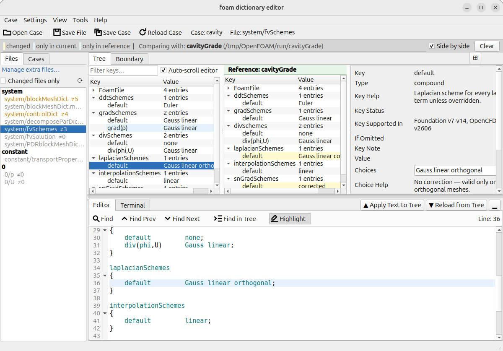

Once a reference is selected, a diff bar appears below the action bar. It shows a colour legend, the reference case name and full path, a **Side by side** toggle, and a **Clear** button to exit compare mode.

### Side-by-side view

When a reference case is selected the centre panel splits horizontally: the left pane shows the current case's editable tree as usual, and a new **Reference** pane opens on the right showing the corresponding file from the reference case in a read-only tree. A green header bar at the top of the reference pane displays the reference case name.

Both trees are annotated with the same colour scheme (see [Tree overlay](#tree-overlay) below). The reference pane additionally uses **light green** for keys that exist only in the reference case but are absent from the current file.

**Applying a value from the reference case:**  
Right-click any leaf node in the reference pane and select **Use this value**. The value is applied to the matching node in the current case's tree immediately, or inserted if the key is absent — including when its enclosing block does not exist yet: missing parent dictionaries (e.g. a `functions {}` block) are created automatically. Unnamed entries such as `#includeFunc …` directives are appended into the target block (and skipped with a message if an identical entry is already there). The only case that is refused is a name clash where the enclosing key exists in the current case but is not a dictionary. The diff highlighting updates automatically after the change.

**Toggling side-by-side:**  
Check or uncheck **Side by side** in the diff bar to show or hide the reference pane without leaving compare mode. The reference pane is hidden (not merely collapsed) when unchecked, so no splitter gap appears. The current case's tree always remains visible and editable.

### Tree overlay

While compare mode is active, both the main tree and the reference tree annotate rows with background colours.

**Current case tree (left):**

| Background | Meaning |
|---|---|
| Light yellow | Key exists in both cases; value or type differs. |
| Light blue | Key exists in this case but is absent in the reference. |
| No colour | Key is identical, or the node type is not compared. |

**Reference tree (right):**

| Background | Meaning |
|---|---|
| Light yellow | Key exists in both cases; value or type differs. |
| Light green | Key exists in the reference but is absent from the current file. |
| No colour | Key is identical. |

Hovering over a highlighted row shows a tooltip with additional context:
- **Changed** rows: `Ref: <value>` showing the reference value (left pane), or the current-case value (right pane).
- **Only in current** rows end with `(not in reference case)`.
- **Only in reference** rows end with `(only in reference case)`.

Comparison recurses into nested blocks, matching children by key name. The one exception is a `blockMeshDict`'s blocks, which have no names, so they are compared **by position** — block 0 against block 0, and so on — which means a file where two of five blocks differ is marked `≠2`, not `≠1`. Other positional list items (e.g. `vertices`) and anonymous entries (`#include`, `$macro`) are not annotated.

If the corresponding file does not exist in the reference case, no overlay is applied and the status bar shows a *"not found in reference case"* message.

### File list markers

When a reference case is selected, diff counts are computed progressively in the background — markers appear in the file list as each file is processed. Large files without a `FoamFile` header (e.g. log files, residual outputs) are skipped and will show no marker.

| Suffix | Colour | Meaning |
|---|---|---|
| *(none)* | — | Not yet computed, or skipped (large non-dictionary file). |
| `≠0` | Gray | Identical to the reference. |
| `≠N` | Amber | N differences found. |
| `≠50+` | Amber | More than 50 differences (display cap). |

**Changed files only filter:**  
A **Changed files only** checkbox appears in the file list panel while compare mode is active. When checked, files with zero differences are hidden, leaving only files that differ from the reference case. Uncheck to restore the full list. The filter is reset automatically when compare mode is cleared.

### Clearing compare mode

Click **Clear** in the diff bar to exit compare mode. This removes all `≠` markers from the file list, all background highlights from both trees, closes the reference pane, and hides the **Changed files only** filter. Selecting **Case > Compare with Case…** again replaces the current reference with a new one.

## Reloading a case

Click the **Reload Case** button in the toolbar or select **Case > Reload Case** to discard all in-memory edits and reload the current case from disk. All file buffers and dirty state are cleared, and the file list and boundary panel are refreshed exactly as if the case had just been opened.

If there are unsaved changes, a confirmation dialog shows the number of affected files and asks whether to proceed. Clicking **Yes** discards all changes; clicking **No** leaves the current state unchanged.

This is useful when you want to undo edits across multiple files without closing and reopening the case.

## Boundary view

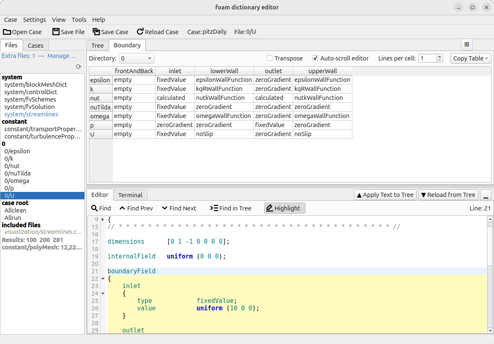

The **Boundary** tab in the upper right panel shows a table of boundary conditions for all field variable files in the current field directory.

### Table layout

**Default orientation:**
- **Rows** — one per field variable file, sorted by file name (`epsilon`, `k`, `nut`, `p`, `U`, etc.).
- **Columns** — one per boundary patch name, sorted alphabetically.

**Transposed orientation** (enable with the **Transpose** checkbox): rows become patches and columns become field files.

In both orientations:
- The column set is the union of all patch names across all field files; cells show `–` when a patch is not defined in a given file.
- **Cell text** — the `type` value for that patch (e.g. `fixedValue`, `zeroGradient`, `noSlip`). A `†` marker is appended when the patch contains large or binary data that cannot be shown in the edit dialog.
- **Tooltip** — hovering over a cell shows the full patch sub-dictionary text. For `†`-marked cells, the tooltip shows the type and a brief data description (`large data` or `binary data`) instead.
- **Lines per cell** — a spin box at the top right of the panel controls how many lines are shown per cell (1–10, default 1). When set above 1, additional key-value entries from the patch sub-dictionary are shown below the `type` line. Entries with large or complex values display as `key  …`.

### Directory selector

A drop-down at the top of the panel selects which field directory to display. It shows `0` and `0.orig` when they exist. For multiRegion cases it also shows one entry per region subdirectory (e.g. `0/bottomWater`, `0/heater`, `0/topAir`). Only directories that contain at least one parseable field file (i.e. a file with a `boundaryField` dictionary) appear in the list. When only one qualifying directory exists, the selector is disabled. The table is rebuilt automatically when the selection changes.

### Transpose

Check the **Transpose** checkbox at the top of the panel to swap rows and columns. The table is rebuilt immediately. All other operations (edit, create, copy, paste) work the same in both orientations.

### Single-click navigation

Clicking a cell opens its field file in the editor and scrolls to the corresponding patch entry in `boundaryField`.

The **Auto-scroll editor** checkbox at the top of the panel controls this behaviour:

- **Checked (default)** — clicking a cell loads the file (if it is not already open), updates the file list selection, and scrolls the editor to the patch name, highlighting the line in amber.
- **Unchecked** — single-click has no effect on the editor; only double-click (edit) and right-click (context menu) remain active.

When a cell shows `–` (no patch entry in that file), the file is still opened in the editor but no scroll is performed because there is no location to jump to.

### Editing a boundary condition

Double-click a cell (or right-click → **Edit**) to open the **Edit boundary** dialog. The dialog header shows the variable name and patch name in read-only form.

**Normal mode** (no `†` marker) — the full content of the patch sub-dictionary is shown in an editable text area. Edit any lines, including `type`, and click **OK** to apply. If the content is unchanged, **OK** has no effect and the file is not marked as modified.

**Complex mode** (`†` marker) — the patch contains a large nonuniform field or binary data. Only the `type` field is editable here; use the **Editor** tab to modify the full value.

### Creating a patch entry

When a cell shows `–`, the patch is not yet defined in that field file. Double-click the cell (or right-click → **Create Entry**) to open an empty **Edit boundary** dialog. Enter the patch content and click **OK** to create the entry. The new entry is appended to `boundaryField` in that file, and the cell updates immediately.

### Deleting a patch entry

Right-click a cell with a defined patch and select **Delete Entry** to remove that patch from the specific field file. The row or column for that patch is removed from the table if the patch no longer exists in any file.

### Copy and paste

Right-click any cell with a defined patch and select **Copy** to store that patch's full content in an internal clipboard. Then right-click any other cell (including `–` cells) and select **Paste** to apply the copied content. Pasting into a `–` cell creates the entry; pasting into an existing cell replaces its content. The clipboard persists within the application session.

### Copy Table

Click the **Copy Table** button in the panel toolbar to copy the entire boundary condition table to the system clipboard. A drop-down menu offers three formats:

- **Copy as Markdown** — produces a pipe-delimited Markdown table with field variable names as row headers and patch names as column headers (or the transposed equivalent). Multi-line cells (when **Lines per cell** is above 1) use `<br>` tags, which render as real line breaks in GitHub-Flavored Markdown.
- **Copy as CSV** — produces a CSV with one record per table row. When **Lines per cell** is above 1, the lines of a cell are joined with `; ` so that no field contains a line break. Reach for this one by default, and always when pasting into Excel or across a virtual machine's clipboard: applications split pasted plain text into rows on line breaks *before* they parse quotes, so a line break inside a cell would otherwise arrive as an extra row.
- **Copy as CSV (multi-line cells)** — produces an RFC 4180-compliant CSV that keeps multi-line cell content inside quoted fields, as a real line break within the cell. Use it when the target parses quoted fields properly — LibreOffice Calc's paste dialog does — or when saving the text to a `.csv` file to be opened rather than pasted.

All three formats include the row header column (field variable names or patch names, depending on the current orientation). The `–` marker is preserved as-is.

### Renaming a boundary patch

Right-click a cell, a patch column header (non-transposed view), or a patch row header (transposed view) and select **Rename Boundary...**. The same action is available by right-clicking a `boundary_entry` node or a patch `dictionary` node inside `boundaryField` in the tree view.

A dialog shows the current patch name, a text field for the new name, and a checklist of all loaded files in which that patch name was found — including both `blockMeshDict` boundary entries and `boundaryField` patch keys in field files. All matching files are pre-selected.

- Uncheck any file you want to leave unchanged.
- Use **Select All** / **Deselect All** to toggle the whole list.
- The **Rename** button is enabled only when the new name is non-empty, different from the current name, and at least one file is selected. It shows the count of selected files.

Clicking **Rename** applies the change atomically: each selected file is updated in memory and marked dirty. If the currently open file is among the renamed files, the tree view and text editor are refreshed immediately.

### Deleting a boundary condition across all field files

Right-click a patch column header (non-transposed view) or a patch row header (transposed view) and select **Delete BoundaryField '\<patch\>'**. A confirmation dialog lists the affected field files. Clicking **Yes** removes that patch entry from every field file in the current directory in one step.

### Adding a boundary condition across all field files

Right-click a patch column header or patch row header and select **Add BoundaryField...**. Enter the new patch name. A confirmation dialog states how many field files will receive an empty entry. Clicking **Yes** appends an empty `<patch> {}` block to each file that has a `boundaryField` dictionary but does not yet contain that patch. Edit individual cells afterwards to fill in the boundary condition content.

### No-type cells

Cells whose patch sub-dictionary has no `type` key are displayed in italic text. All other interactions (edit, delete, copy, paste) work identically.

Changes from all boundary view operations are immediately reflected in the tree view and text editor. Files modified through the boundary view are marked dirty (`*`) in the title bar and file list, the same as any other edit.

## BlockMesh panel

The **BlockMesh** tab in the upper panel provides an interactive 3-D view of the geometry defined in `blockMeshDict`. It is powered by [pyVista](https://pyvista.org/) / VTK and is available only when `pyvista` and `pyvistaqt` are installed. If they are absent, the tab shows an install prompt.

**Availability:** The BlockMesh tab is shown when the `blockmesh` feature flag is enabled. In the `standard` variant it is visible only when the Terminal is in Simple mode (switching to xterm mode hides it — see [Terminal tab](#terminal-tab)). In the `no-terminal-blockmesh` variant it is always visible because there is no terminal to conflict with. In the `no-terminal` variant the tab is absent entirely. See [Variants](#variants).

The tab can also be toggled at any time via **View > BlockMesh 3-D Panel** (checkable). When xterm terminal mode is active the action is grayed out and its label changes to **"BlockMesh 3-D Panel  (unavailable: xterm active)"** to explain why. Switch the terminal to Simple mode first to re-enable the panel.

The panel is updated automatically whenever `blockMeshDict` is loaded or edited. A **Refresh** button forces a manual update.

**What the view shows when a case opens.** Every dictionary in the file list that feeds the view — `blockMeshDict`, `topoSetDict` and its variants, `snappyHexMeshDict`, `setFieldsDict`, `controlDict` and any sampling file — is drawn as soon as the case opens, without opening it, and follows later edits and disk changes. Each overlay is drawn on its own, even when `blockMeshDict` is not loaded. A file pulled in by `#include` is drawn once, through the file that includes it. For a dictionary FoDE does not recognise, right-click it in the file list and choose **Show in 3-D view as**; the choice is remembered for the case.

Loading or editing `topoSetDict` also updates the panel: action geometry sources (box, rotated box, sphere, cylinder, cone, point-carrying sources such as `nearestToCell`, and `planeToFaceZone`) are overlaid on the mesh. Use the **"Show topoSet geometry"** toggle in the **topoSet ▾** menu to toggle it.

Loading or editing `snappyHexMeshDict` overlays its `geometry` block (box/sphere/cylinder/cone/triSurfaceMesh/collection), classified as surface, region, or geometry-only via `refinementSurfaces`/`refinementRegions`, plus `locationInMesh`/`locationsInMesh` keep-point markers — see [snappyHexMeshDict overlay](#snappyhexmeshdict-overlay).

Loading or editing `setFieldsDict` overlays its `regions ( … )` list the same way, each region labelled with its `fieldValues` summary — see [setFieldsDict overlay](#setfieldsdict-overlay).

Overlay shapes that extend beyond the block mesh are clipped in the view so the mesh stays visible — see [Overlay clipping](#overlay-clipping).

### Parameters kept in an included file

A case can keep every dimension and cell count in one place and have each dictionary pull it in:

```
#include "settings-region"
```

with `scale`, `x0`, `xMax` and the rest defined only in `system/settings-region`. The 3-D view resolves those definitions as though they had been written inline, so a `blockMeshDict` whose every vertex is a `$variable` from the included file renders normally — as do the `topoSetDict`, `snappyHexMeshDict`, `setFieldsDict` and sampling overlays, which share the same mechanism. An included file that includes another is followed too.

**Editing the included file updates the view.** Change a dimension in `settings-region`, apply it, and every dictionary that includes it re-renders — you do not have to reopen them, and you do not have to save first: an unsaved edit is used as soon as it is applied.

The included file is not shown in the tree, and nothing is ever written back into it through the dictionary that includes it. The `#include` line stays a single row, and **Open Included File** on its right-click menu is still the way to go and edit the file itself.

If an include cannot be resolved — a missing file, or one that will not parse — the view simply falls back to what the dictionary holds on its own, which is what it did before. A `#sinclude` with no target is legal OpenFOAM and is not treated as a problem.

`#includeFunc` is left alone on purpose. It names a function object whose file already appears in the file list and is drawn on its own, so resolving it here as well would draw the same sample lines twice.

Arithmetic in `#eval{ … }` understands the usual functions — `round`, `floor`, `ceil`, `sqrt`, `min`, `max`, `mag`, `pow`, `abs`, the trigonometric family, `exp`, `log`, `log10`, `degToRad`, `radToDeg` and the constant `pi` — so a cell count written `nX #eval{round($xMax/$CS)}` resolves rather than being quietly skipped.

### Side-by-side mode

A **⊞** toggle button appears in the top-right corner of the upper tab widget when `blockMeshDict`, `topoSetDict`, `snappyHexMeshDict`, or `setFieldsDict` is the active file and the BlockMesh panel is available. Clicking it places the 3-D viewer in a horizontal splitter to the right of the Tree tab so both are visible at the same time. The separate **BlockMesh** tab is removed while side-by-side mode is on, and restored when it is turned off.

The 3-D view follows your edits in side-by-side mode just as it does in its own tab: every tree edit, **Add** / **Duplicate** / **Delete** and **Apply Text to Tree** redraws it. **Refresh** forces a manual redraw.

The splitter handle between the tree and the 3-D view can be dragged freely: neither pane snaps closed, and the 3-D view can be narrowed down to a small minimum width, with its toolbar wrapping onto extra lines as needed.

The **⊞** button is disabled while the xterm terminal is active (GPU/OpenGL conflict prevents the BlockMesh panel from being open at the same time).

### Variable resolution

Variable definitions at the top level of `blockMeshDict` are automatically resolved before the geometry is extracted:

- **Direct values** — `xMin -0.5;`, `length 10;` etc. are used as-is.
- **Macro references** — `nx $nCell;` is resolved to whatever `nCell` evaluates to, including through chains of arbitrary depth.
- **Negated macro references** — `xMin -$xMax;` (a leading minus sign before a `$reference`) is resolved once `xMax` is known.
- **`$varName` and `${varName}`** references inside `vertices` and `blocks` are substituted with the resolved values.
- **`#eval{ expr }`** — arithmetic expressions are evaluated after variable substitution. Supported operators: `+`, `−`, `*`, `/`, `**`, parentheses; plus the functions `round`, `floor`, `ceil`, `sqrt`, `min`, `max`, `mag`, `pow`, `abs`, `sin`, `cos`, `tan`, `asin`, `acos`, `atan`, `atan2`, `exp`, `log`, `log10`, `degToRad`, `radToDeg` and the constant `pi`. Examples: `zMax #eval{ $length / $nCell };`, `nX #eval{ round($xMax/$CS) };`.

A variable defined in an `#include`d file counts as resolved — see [Parameters kept in an included file](#parameters-kept-in-an-included-file). If a reference genuinely cannot be resolved (a typo in the name, or an include that does not resolve), any vertex or block that contains it is silently skipped, so a mesh that renders with fewer vertices than it should is usually a misspelt variable.

### Geometry controls

All controls sit in a single toolbar at the top of the panel. The toolbar *wraps*: when the panel is narrow (for example in side-by-side mode) the buttons flow onto additional lines instead of dictating a minimum panel width.

| Control | Description |
|---|---|
| **Vertices ▾** | Drop-down menu with three checkable items: **Vertices** (show vertices as red spheres), **Vertex labels** (overlay vertex index numbers), **Vertices table** (show or hide the vertex coordinate table on the right). |
| **Blocks ▾** | Drop-down menu with four checkable items: **Block edges** (wireframe), **Block labels** (index at centroid), **Color blocks** (distinct colour per block from the tab10 palette), **Solid blocks** (semi-transparent solid faces at opacity 0.25, shares colour with Color blocks). |
| *(block highlight)* | Not a control: selecting a `block N` row in the Tree view outlines that block here, in a colour used for nothing else. The row number and the number drawn at the block's centre are the same number. The outline shows even with **Block edges** and **Solid blocks** both off, and clears when you select any other row or load another mesh. |
| **Boundary faces** | Show boundary patch faces, colour-coded by type. Exterior block faces not claimed by any patch — blockMesh's implicit `defaultFaces` — are drawn in a fainter grey; without them a quasi-2-D case like damBreak (whose big front/back faces are never listed under `boundary`) would appear to have no boundary at all. |
| **topoSet ▾** | Drop-down menu for the `topoSetDict` overlay: a master **Show topoSet geometry** toggle, **Show all shapes** / **Hide all shapes** actions, an action-colour legend, one checkable toggle per renderable shape, and a **Non-geometric sources (N)** submenu collecting the entries that carry no drawable geometry (see [topoSetDict overlay](#toposetdict-overlay)). |
| **snappyHexMesh ▾** | Drop-down menu for the `snappyHexMeshDict` overlay, structured like **topoSet ▾**: a master toggle, **Show all shapes** / **Hide all shapes**, a category-colour legend, per-shape and keep-point toggles, and a **Non-geometric sources (N)** submenu (see [snappyHexMeshDict overlay](#snappyhexmeshdict-overlay)). |
| **setFields ▾** | Drop-down menu for the `setFieldsDict` overlay, structured like **topoSet ▾**: a master **Show setFields regions** toggle, **Show all shapes** / **Hide all shapes**, the region colour legend, one checkable toggle per renderable region, and a **Non-geometric sources (N)** submenu (see [setFieldsDict overlay](#setfieldsdict-overlay)). |
| **sample ▾** | Drop-down menu for the sampling overlay — probe points, sample lines, and sample planes from `controlDict`'s `functions {}` block or a standalone sampling dict — structured like **topoSet ▾** (see [Sampling overlay](#sampling-overlay)). |
| **Refresh** | Re-extract geometry from the current tree and redraw. In Preview mode, also discards all preview edits and resets vertex coordinates to the tree values. |
| **Preview** | Appears only when the `vertices` block contains variable references (`$varName`). This button is shown inside the **Vertices** panel (not in the main toolbar). Click to enter Preview mode: table cells become editable and each change immediately updates the 3-D view, but the tree and file are not modified. A yellow banner is shown while Preview mode is active. Click **Refresh** to leave Preview mode and restore the original values. |
| **STL ▾** | Drop-down menu for STL/OBJ reference overlays and for exporting shapes as STL; see [STL overlays and export](#stl-overlays-and-export) below. |
| **Save Image…** | Save the 3-D view exactly as shown — same pixel size, same background colour — to a PNG, JPEG, BMP, or TIFF file. **The extension you type in the Name field chooses the format.** An extension the writer cannot use, including a supported one spelled in capitals such as `.JPG`, is corrected before writing, and you are asked first if that correction would overwrite an existing file. Also available as **Save Image…** in the **View** menu and via `Ctrl+Shift+I`. Greyed out until the 3-D view has been shown at least once, since there is nothing yet to capture. The default filename is `<caseName>-3Dview.png` in the current case directory. Unlike **Export Shapes as STL…**, this captures the rendered picture — overlays, colours, camera angle, and all — rather than raw geometry. |

Both the traditional 4-vertex face notation `(v0 v1 v2 v3)` and the newer compact notation `(blockIndex faceIndex)` are supported and can coexist in the same file. The compact form is automatically expanded to 4-vertex lists using the standard hex block face numbering before display.

#### STL overlays and export

The **STL ▾** menu loads reference surfaces and exports the shapes FoDE draws.

- **Load STL / OBJ…** shows STL or OBJ files as translucent overlays. Several files can be selected at once and further loads add to what is shown; if one file cannot be read, the rest still load and a single warning names the ones that failed. Gzip-compressed files (`.stl.gz`, `.obj.gz`) load directly.
- Each loaded file gets its own checkable row at the bottom of the menu, with a colour swatch so several surfaces stay apart. **Show loaded surfaces**, **Show all surfaces** and **Hide all surfaces** switch them together, the same arrangement as the overlay menus above. A surface is drawn even with no `blockMeshDict` open.
- Loading a file that is already loaded re-reads it into its existing row, which is how you refresh a surface edited outside FoDE. **Unload ▸** removes one file and **Clear STL** removes all of them (both greyed out when none are loaded); opening another case also clears them.
- **Export Shapes as STL…** opens a dialog listing every renderable `topoSetDict`, `snappyHexMeshDict` and `setFieldsDict` shape currently loaded, with a checkbox per shape (defaulting to its current visibility in the 3-D view) and **Select All** / **Deselect All**. Choose an output folder and click Export to write each checked shape as its own `.stl` file, named after its label. It is greyed out when none of that geometry is loaded.
- Point-marker shapes (e.g. `nearestToCell`) and `planeToFaceZone` discs are not offered, because they have no meaningful STL surface. Exported geometry is always the full, unclipped shape, even when the 3-D view shows it clipped.

### topoSetDict overlay

When `topoSetDict` is loaded or edited, the geometry source of each action entry is drawn as a semi-transparent shape overlaid on the mesh. The **"Show topoSet geometry"** master toggle in the **topoSet ▾** menu toggles the whole overlay; each renderable shape also gets its own checkable toggle, and **Show all shapes** / **Hide all shapes** switch every toggle at once. Sources that carry no drawable geometry (e.g. `cellToFace`, `patchToCell`) are collected under a **Non-geometric sources (N)** submenu so a source-rich dictionary stays readable.

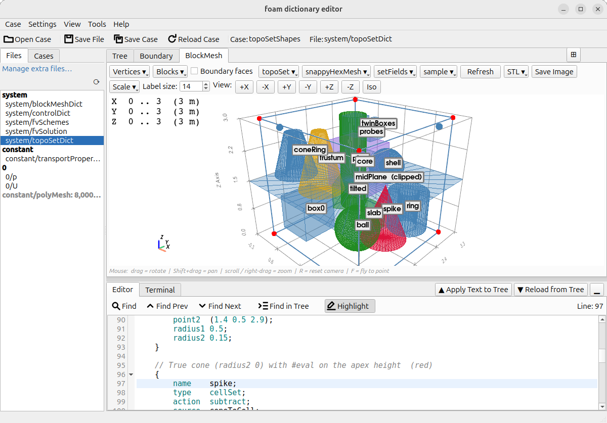

**Supported source types:**

| Source family | Examples | Shape |
|---|---|---|
| `boxToCell/Face/Point` | `box (x0 y0 z0) (x1 y1 z1)`, or `min`/`max` keys, or a multi-box `boxes ( … )` list | Wireframe + surface box (a `boxes` list draws every box) |
| `rotatedBoxToCell/Face/Point` | `origin`, `i`, `j`, `k` | Oriented (rotated) box |
| `sphereToCell/Face/Point` | `origin`/`centre`, `radius`, optional `innerRadius` | Sphere (hollow when `innerRadius` is given — the inner shell shows through) |
| `cylinderToCell/Face/Point`, `cylinderAnnulusToCell` | `point1`/`p1`, `point2`/`p2`, `radius` | Cylinder |
| `coneToCell/Face/Point`, `coneAnnulusToCell` | `point1`/`p1`, `point2`/`p2`, `radius1`, `radius2` | Cone (truncated; a true cone when `radius2` is 0) |
| `nearestToCell`, `nearestToPoint` | `points ( … )` | Labelled point markers |
| `regionToCell` / `regionToFace` | `insidePoints`/`insidePoint` / `nearPoint` | Labelled point markers |
| `planeToFaceZone` | `point`, `normal` | Disc in the given plane, sized to the scene bounds (a plane is infinite, so the extent is display-only) |

**Colour coding by action:**

| Action | Colour |
|---|---|
| `new` | Steel blue |
| `add` | Green |
| `subtract` / `delete` | Red |
| `subset` | Purple |
| `invert` | Gold |

If an entry's geometry cannot be fully resolved (e.g. because of an unresolvable `$variable`), that entry is silently skipped.

**Variable resolution** — Top-level scalar/integer definitions in `topoSetDict` (e.g. `xMin -0.01;`) are resolved before extraction, including macro chains (`y $x;`) and `#eval{ expr }` expressions. This is the same mechanism used in `blockMeshDict`. A variable defined in a file the dictionary `#include`s is in scope too (see [Parameters kept in an included file](#parameters-kept-in-an-included-file)); a variable that lives in a file it does not include is not.

### snappyHexMeshDict overlay

When `snappyHexMeshDict` is loaded or edited, its `geometry {}` block is drawn as a set of semi-transparent shapes overlaid on the mesh, each classified as a **surface**, a **region**, or plain **geometry** by cross-referencing `castellatedMeshControls.refinementSurfaces` / `refinementRegions`. The **"Show snappyHexMesh geometry"** master toggle in the **snappyHexMesh ▾** menu toggles the whole overlay; the menu also lists a checkable toggle per individual shape (with **Show all shapes** / **Hide all shapes** to switch them all at once), plus a **Non-geometric sources (N)** submenu collecting the entries for geometry that could not be drawn.

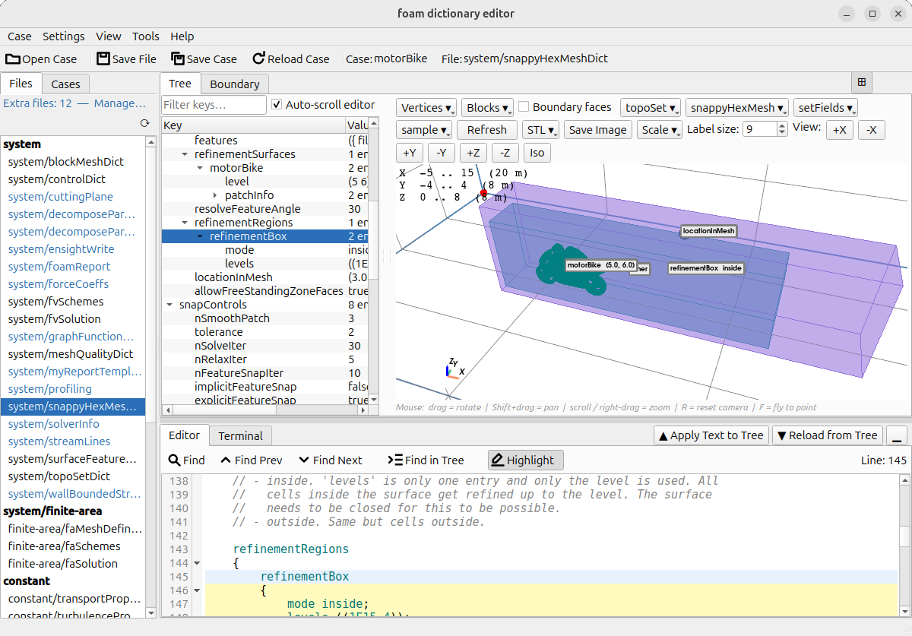

**Supported `geometry` entry types** — both forks' spellings are accepted (OpenCFD's short `box`, Foundation's `searchableBox`, and likewise for the others); the spelling in the dictionary is the one shown in the menu:

| `type` | Fields | Shape |
|---|---|---|
| `searchableBox` / `box` | `min`, `max` | Wireframe + surface box |
| `searchableSphere` / `sphere` | `centre`/`origin`, `radius` | Sphere; if `radius` is given as a vector `(rx ry rz)` (e.g. an igloo-shaped dome), an ellipsoid is drawn instead of a true sphere |
| `searchableCylinder` / `cylinder` | `point1`/`p1`, `point2`/`p2`, `radius` | Cylinder |
| `searchableCone` / `cone` | `point1`/`p1`, `point2`/`p2`, `radius1`, `radius2` | Cone (truncated; a true cone when `radius2` is 0) |
| `triSurfaceMesh` / `distributedTriSurfaceMesh` / `closedTriSurfaceMesh` | `file` (or the entry's own key, if it ends in `.stl`/`.stlb`/`.obj`) | The referenced mesh, loaded automatically from `constant/triSurface/` relative to the case directory. Found even when shipped gzip-compressed (e.g. `motorBike.obj.gz`), whether the dict references the plain name or the `.gz` name directly — no manual gunzip needed. If the file cannot be found, the entry is listed greyed-out instead of drawn. |
| `searchableSurfaceCollection` / `collection` | named sub-entries, each with `surface <name>`, `scale`, `transform { origin; rotation none; }` or `transform { origin; e1; e3; }` | Each sub-entry referencing a **box**-type base surface is drawn as its own scaled/rotated/translated box, named `<collection>.<member>` (e.g. `twoFridgeFreezers.seal`). Members referencing a non-box base, or using an unsupported/missing `transform`, are not drawn; if none of a collection's members could be resolved, the collection itself is listed greyed-out. |

**Colour coding by category:**

| Category | Colour | How it's determined |
|---|---|---|
| Surface | Teal | The geometry entry's name (or a `name` override) matches a `refinementSurfaces` entry — either exactly, or via a regex-pattern key such as `"iglo.*"` |
| Region | Purple | Matches a `refinementRegions` entry (by exact name only); a shape that matches both is shown as a surface |
| Geometry | Grey | Defined in `geometry {}` but not referenced by either control block |

Each drawn shape is labelled with its name and, when available, its `refinementSurfaces` level `(min max)` or its `refinementRegions` mode (`inside`/`outside`/`distance`).

**Keep points** — `castellatedMeshControls.locationInMesh` (a single point), Foundation's `insidePoint` and `insidePoints` (a list of points) at the same level, or `locationsInMesh` (a list of `((x y z) regionName)` pairs, used by multi-region cases) are drawn as labelled point markers, independent of the shape overlay above.

If a `geometry` entry's fields cannot be fully resolved (e.g. an unresolvable `$variable`), it is listed greyed-out rather than drawn.

**Not visualized** — per-region overrides inside a `refinementSurfaces` entry's `regions { … }` sub-block, `patchInfo`, `castellatedMeshControls.features` (feature-edge `.eMesh` references), and `refinementRegions.levelIncrement` (directional refinement) are read by the parser/schema but have no effect on this overlay.

**Variable resolution** — Top-level scalar/integer definitions in `snappyHexMeshDict` are resolved the same way as in `blockMeshDict`/`topoSetDict`, including macro chains and `#eval{ expr }` expressions.

### setFieldsDict overlay

When `setFieldsDict` is loaded or edited, each entry of its `regions ( … )` list is drawn as a semi-transparent orange shape overlaid on the mesh. Region sources use the same geometry keywords as `topoSetDict`, so the same shape families render: `boxToCell` (including the `min`/`max` and multi-box `boxes ( … )` forms), `rotatedBoxToCell`, `sphereToCell` (with optional `innerRadius`), `cylinderToCell`/`cylinderAnnulusToCell`, and `coneToCell`/`coneAnnulusToCell` — see the source table in [topoSetDict overlay](#toposetdict-overlay). `$variable` and `#eval{ expr }` references are resolved the same way.

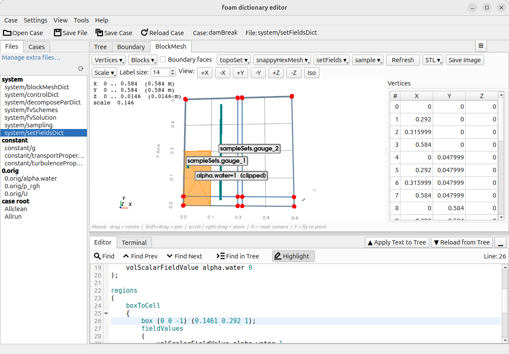

Each shape is labelled with a summary of the entry's `fieldValues` (e.g. `alpha.water=1`), so you can see at a glance which region sets which field. The **"Show setFields regions"** master toggle in the **setFields ▾** menu toggles the whole overlay; each region also gets its own checkable toggle, with **Show all shapes** / **Hide all shapes** to switch them all at once. Sources that carry no drawable geometry (e.g. `zoneToCell`, `surfaceToCell`) are collected under a **Non-geometric sources (N)** submenu. `defaultFieldValues` applies to the whole mesh and is not drawn.

Renderable regions are also offered by **STL ▾ → Export Shapes as STL…** as a third group.

### Sampling overlay

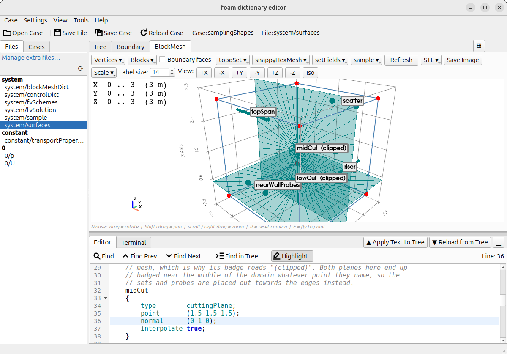

`controlDict` and every sampling file are drawn in teal on the 3-D view. A sampling file is recognised by what it holds, a `sets`, `surfaces` or probes function object, whatever its name: `sample`, `probes`, `sampling`, `cuttingPlane`, Foundation's `functions` and so on. The definitions drawn are:

- **Probe points** — `probes` / `patchProbes` / `boundaryProbes` function objects: each `probeLocations` set is drawn as point markers.
- **Sample lines** — `sets`-type entries: each member with a `start`/`end` pair (`lineUniform`, `lineCell`, `uniform`, `face`, …) is drawn as a thin tube; `cloud`-type members with a `points` list are drawn as point markers. Both member-list syntaxes work — the dictionary form `sets { … }` and the classic parenthesised list form `sets ( y0.1 { … } … );` — as does the `.org` `singleGraph` style, whose `start`/`end` sit at the file's top level.
- **Sample planes** — `surfaces`-type entries: `plane` and `cuttingPlane` members (direct `point`/`normal`, `basePoint`/`normalVector`, or a `pointAndNormalDict {}`) are drawn as discs whose extent is display-only, like `planeToFaceZone` in the topoSet overlay.

Definitions can come from several files at once (e.g. probes in `controlDict` plus a `system/sample` file); the **sample ▾** menu shows the union, and each row is tagged with its source file in brackets. Entries that carry no drawable geometry — `patch`-type surfaces, members without resolvable coordinates, or a `sets`/`surfaces` entry whose member list is missing — are collected under **Non-geometric sources (N)**. Non-sampling function objects (`forces`, `fieldAverage`, …) are ignored entirely. Sampling shapes are not offered for STL export: points and lines have no surface, and a plane's drawn extent is display-only.

### Overlay clipping

setFieldsDict regions in particular are often written far larger than the domain (e.g. damBreak's `box (0 0 -1) (0.1461 0.292 1)` on a ~0.6 m tank) — drawn at full size they dwarf the block mesh. Whenever a block mesh is loaded, every overlay shape (topoSet, snappyHexMesh, setFields, and sampling) is therefore clipped, **for display only**, to the block-mesh bounding box expanded by 10% per axis:

- A shape that fits inside the expanded bounds is drawn unchanged.
- A shape that pokes out is cut down to the bounds and its scene label gains a **"(clipped)"** mark, so the cut is not mistaken for the shape's real extent.
- A shape lying entirely outside the block mesh is kept unclipped and labelled **"(outside block mesh)"**.
- A shape whose volume encloses the whole scene (no part of its surface falls inside the bounds) is drawn as its bounding-box overlap instead of disappearing.

The clipping never modifies the dictionary or the extracted geometry: **Export Shapes as STL…** always writes the full shape, and no clipping is applied when no block mesh is loaded.

### Boundary face colours

| Patch type | Colour |
|---|---|
| `wall` | Orange |
| `patch` | Blue |
| `empty` | Light grey |
| `symmetry` / `symmetryPlane` | Green |
| `wedge` | Purple |
| `cyclic` / `cyclicAMI` | Gold |
| `inlet` | Light blue |
| `outlet` | Red |
| Other / unknown | Blue |

### Vertices table

A scrollable table on the right side of the panel lists every vertex from the `vertices` block as a row with columns **#**, **X**, **Y**, **Z** (coordinates are shown after applying the `scale`/`convertToMeters` factor).

- **Click a row** to highlight the corresponding vertex in the 3-D view as a larger cyan sphere.
- **Double-click an X, Y, or Z cell** to edit the coordinate value inline (only available when vertices use literal numbers — see below). Entering a non-numeric value cancels the edit and restores the previous value. After a valid commit the tree and text editor are updated immediately and the file is marked dirty. The 3-D view updates after clicking **Refresh**.
- **When vertices contain variables** (`$varName` references), the X/Y/Z cells are read-only by default. A **⚙ Variable-based** chip and a **Preview** button appear at the top of the Vertices panel. Click **Preview** to unlock editing. In Preview mode changes update the 3-D view immediately without touching the tree or file. Click **Refresh** to exit Preview mode and restore the original values.
- The **#** index column is read-only. Reordering vertices would silently break all `hex` and `faces` index references.
- For meshes with more than 500 vertices only the first 500 rows are shown, with a truncation notice at the bottom.
- The **Vertices table** item in the **Vertices ▾** menu collapses the table pane entirely, giving more space to the 3-D view.

### Scale and label controls

| Control | Description |
|---|---|
| **Scale ▾** | Drop-down menu with three checkable items: **Axes** (corner XYZ orientation arrows), **Grid** (coordinate grid with tick labels), **Dimensions** (wireframe bounding box and X/Y/Z extents overlay; also shows the scale factor when `convertToMeters` or `scale` is not 1). |
| **Label size** | Spin box (range 6–32, default 10) that sets the font size for both vertex labels and block labels simultaneously. |
| **View: +X −X +Y −Y +Z −Z Iso** | Snap the camera to a standard direction. **+X** looks from the +X side toward the origin (shows the YZ plane), **−X** from the opposite side, and so on for Y and Z. **Iso** uses an isometric view. |

### Mouse controls

Rotate with a left drag, pan with `Shift` + left drag, and zoom with the scroll wheel or a right drag. The hint bar at the bottom of the BlockMesh panel shows the bindings; the full list is in [Keyboard shortcuts](#keyboard-shortcuts) and under **Help > Keyboard Shortcuts**.

## Tools menu

The **Tools** menu runs OpenFOAM for you and helps you prepare a run. This section covers what every item needs and how the dialogs behave; the sections after it describe the items one by one, in menu order.

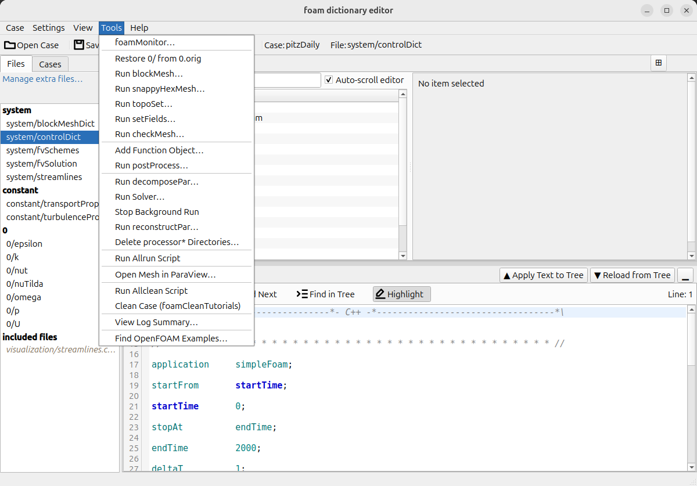

### What the Tools need

- **An open case.** Most items stay greyed out until a case is open. [Find OpenFOAM Examples](#find-openfoam-examples) is the exception: it works with no case open.
- **The Terminal panel.** Items that run a command send it to the **Terminal** tab, which comes to the front by itself. The `no-terminal` variants have no Terminal tab, so those items stay greyed out there (see [Variants](#variants)). Items that run nothing in the terminal — [Add Function Object](#add-function-object), [Stop Background Run](#background-runs-and-stop-background-run), [Delete processor\* Directories](#delete-processor-directories), [Open Mesh in ParaView](#open-mesh-in-paraview), [View Log Summary](#view-log-summary) and [foamMonitor](#foammonitor-launcher) — need only a case.
- **OpenFOAM, sourced.** FoDE does not bring OpenFOAM with it. The Terminal is a shell started from the one FoDE was started from, so source OpenFOAM's `bashrc` there before launching FoDE; otherwise `blockMesh` and the rest are "command not found". Editing and the 3-D view need no OpenFOAM.
- **Linux or another Unix for some items.** [Background runs](#background-runs-and-stop-background-run) and the check for commands still running in the terminal need Linux; [foamMonitor](#foammonitor-launcher) is a Unix shell script, so it does nothing on Windows.

### How a Run dialog works

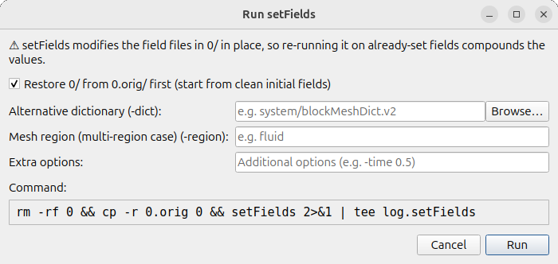

Every **Run …** item whose label ends in an ellipsis opens the same kind of dialog first ([Run Solver](#run-solver) adds rows of its own on top):

- **Curated options** — the tool's most common flags as checkboxes and fields. Where a flag takes a file, a **Browse…** button inserts a case-relative path.
- **Extra options** — a free-text field for any other flags (for example `-verbose`), appended to the command as typed.
- **Command** — a live preview of the exact command line that will be sent, so you always see (and learn) the real OpenFOAM invocation before running it.

Press **Run** (the default button — Enter runs with the current options) to send the command to the Terminal tab, which comes to the front by itself. The output is also saved to `log.<tool>` in the case directory; the `2>&1 | tee log.<tool>` redirection is added automatically so [View Log Summary](#view-log-summary) always finds the log. Option values are remembered per tool for the rest of the session. The meshing tools also warn at the top of the dialog when the case already has numeric result directories that re-running may invalidate.

### One command at a time

Every item that sends a command refuses while the Terminal is still running something — a solver, `./Allrun`, anything typed by hand — and while a [background run](#background-runs-and-stop-background-run) is going in the case: the new command would only queue behind the first or, in xterm mode, be typed into it, where `mpirun` would swallow it as input. Closing FoDE or switching terminal mode asks first for the same reason; see [Closing FoDE while a command runs](#closing-fode-while-a-command-runs).

### The menu, in order

- [foamMonitor…](#foammonitor-launcher) — plot residuals while a solver runs.

- [Restore 0/ from 0.orig](#restore-0-from-0orig) — recreate `0/` from `0.orig/`.
- [Run blockMesh…](#run-blockmesh), [Run snappyHexMesh…](#run-snappyhexmesh), [Run topoSet…](#run-toposet), [Run setFields…](#run-setfields), [Run checkMesh…](#run-checkmesh) — build and check the mesh and the initial fields.

- [Add Function Object…](#add-function-object) — add probes, a line graph, forces and more from your installation's templates.
- [Run postProcess…](#run-postprocess) — run function objects on results that already exist.

- [Run decomposePar…](#run-decomposepar), [Run Solver…](#run-solver), [Stop Background Run](#background-runs-and-stop-background-run), [Run reconstructPar…](#run-reconstructpar), [Delete processor\* Directories…](#delete-processor-directories) — a parallel or background run from start to finish.

- [Run Allrun Script](#run-allrun-script) — the case's whole workflow.

- [Open Mesh in ParaView…](#open-mesh-in-paraview)

- [Run Allclean Script](#run-allclean-script), [Clean Case (foamCleanTutorials)](#clean-case-foamcleantutorials) — clean the case back to a pristine state.

- [View Log Summary…](#view-log-summary) — a short report on a `log.*` file.

- [Find OpenFOAM Examples…](#find-openfoam-examples) — search the tutorials for how a keyword is used (also in the **Case** menu).

## foamMonitor launcher

**Tools > foamMonitor…** launches `foamMonitor` to plot residuals or other time-series data with gnuplot — without leaving FoDE. `foamMonitor` is a Unix shell script that must be on `PATH` (with gnuplot installed); the menu item has no effect on Windows.

**Launching.** Open a case and start a solver in the Terminal tab, then select **Tools > foamMonitor…**. A dialog opens with the following options:

| Field | Description |
|---|---|
| **File** | Path to the file to monitor. Click **Browse…** to open a file picker rooted at the case directory. Typical paths: `log.icoFoam`, `log.simpleFoam`, `postProcessing/residuals/0/residuals.dat`. |
| **Log scale (-l)** | Plot the y-axis on a log scale. |
| **Grid (-g)** | Draw grid lines. |
| **Refresh (-r)** | How often gnuplot re-reads the file (seconds, default 10). |
| **Idle timeout (-i)** | foamMonitor stops itself if the file has not changed for this many seconds (default 60). |
| **Extra** | Any additional `foamMonitor` flags, entered as free text (e.g. `-y [1e-8:1]`). |

Click **Launch**. A gnuplot window opens and refreshes automatically as the solver writes new data. FoDE patches gnuplot's deprecated `reread` command, so the window refreshes correctly with any installed gnuplot version.

**Stopping.** While foamMonitor is running the menu item reads **■ foamMonitor**; select **Tools > ■ foamMonitor** to stop it and close the gnuplot window. It also stops by itself when its idle timeout expires, and the menu item reverts to **foamMonitor…**. Opening a different case while foamMonitor is running stops the current instance.

If the selected file does not exist, or foamMonitor exits with an error (for example gnuplot is not installed), a warning dialog shows the error message.

## Restore 0/ from 0.orig

Select **Tools > Restore 0/ from 0.orig** to recreate the `0/` field directory from `0.orig/`. A confirmation dialog warns that `0/` will be deleted and replaced with a fresh copy of `0.orig/`, discarding any edits made directly to `0/`; click **Yes** to proceed. The command runs in the Terminal tab (`rm -rf 0 && cp -r 0.orig 0`), which is switched to automatically. Without a `0.orig/` directory it says so and does nothing.

**This cannot be undone.** See [Disclaimer](#disclaimer).

## Run blockMesh

Select **Tools > Run blockMesh…** to run `blockMesh` in the case directory. The [options dialog](#how-a-run-dialog-works) offers an alternative dictionary (`-dict`, with a **Browse…** button that inserts a case-relative path) and a mesh region (`-region`). If the case already has numeric result directories, the dialog lists them at the top and warns that re-running `blockMesh` may invalidate those results.

## Run snappyHexMesh

Select **Tools > Run snappyHexMesh…** to run `snappyHexMesh` in the case directory. The [options dialog](#how-a-run-dialog-works) offers `-overwrite` (checked by default — uncheck it to write the snapped mesh into new time directories instead of replacing `constant/polyMesh`), `-dict`, and `-region`, and warns at the top if the case already has numeric result directories that re-meshing may invalidate.

## Run topoSet

Select **Tools > Run topoSet…** to run `topoSet` in the case directory, reading `system/topoSetDict`. The [options dialog](#how-a-run-dialog-works) offers `-dict` (e.g. a `topoSetDict.refine` variant) and `-region`, and warns at the top if the case already has numeric result directories that re-running may invalidate.

## Run setFields

Select **Tools > Run setFields…** to run `setFields` in the case directory, reading `system/setFieldsDict`. The [options dialog](#how-a-run-dialog-works) offers `-dict` and `-region`.

`setFields` overwrites the field files in `0/` in place, so re-running it on already-set fields compounds the values (an already-filled `alpha.water` region stays filled even if the dictionary's box has moved) — the dialog says so at the top. When the case has a `0.orig/` backup, the dialog therefore also shows a **Restore 0/ from 0.orig/ first** checkbox, checked by default: it prepends `rm -rf 0 && cp -r 0.orig 0 && ` to the command (visible in the preview), the standard tutorial workflow of running `setFields` on clean initial fields. Uncheck it to run on the current `0/` as-is. Without a `0.orig/` directory the warning simply notes that there is no backup to restore from.

## Run checkMesh

Select **Tools > Run checkMesh…** to run `checkMesh` in the case directory — typically after **Run blockMesh** or **Run snappyHexMesh** — to validate mesh quality (non-orthogonality, skewness, aspect ratio, …). The [options dialog](#how-a-run-dialog-works) offers `-allGeometry` and `-allTopology` (the extended non-standard check sets), `-writeSets` with a surface format (e.g. `vtk`, writing the faulty cell/face sets for inspection in ParaView), and `-region`; `checkMesh` only reads the mesh, so the dialog carries no pre-flight warning.

## Add Function Object

Select **Tools > Add Function Object…** to add a post-processing function object — probes, a line graph, forces, yPlus, field averages and the rest — without knowing its dictionary by heart. FoDE does not carry its own idea of these: the list comes from the templates your OpenFOAM installation ships under `etc/caseDicts/postProcessing`, so it always matches the OpenFOAM you run. The installation used is the one chosen in **Find OpenFOAM Examples** or **Settings > Generate OpenFOAM Keywords…** (both use the same selector, and the choice is remembered), otherwise the one you sourced before starting FoDE; the dialog names it.

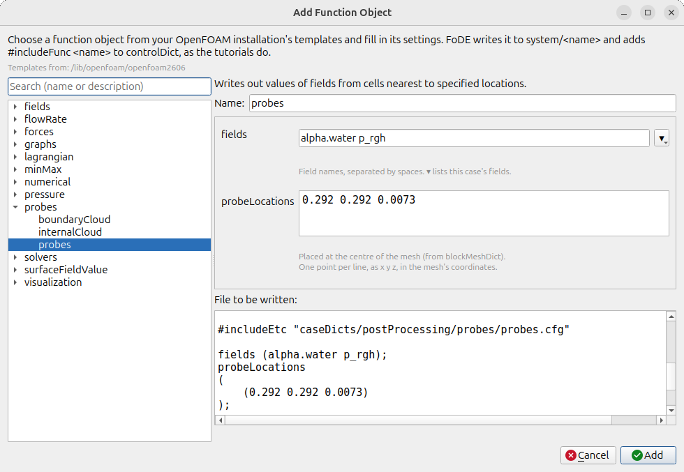

The two forks name and shape the same function differently (OpenCFD's probes take `probeLocations`, Foundation's `points`; OpenCFD's line graph is `singleGraph`, Foundation's `graphUniform` with `nPoints`), and both change between releases, which is why the list is read from your installation rather than held by FoDE.

Pick a template on the left — grouped by category, with a search box over names and descriptions — and its description and settings appear on the right. Only the entries the template itself sets are shown, each with an input for its kind:

- **Field names**, with ▾ listing the case's fields (`0/` and the latest time);
- **Patch names**, with ▾ listing the mesh's patches (or, before the mesh exists, those in `0/`). A name the mesh does not have is pointed out in amber — a patch group is accepted there, so it is a warning, not a refusal;
- **Points**, one `x y z` per line, and single points or directions as `x y z`;
- numbers, and `writeControl`/`executeControl` with their standard choices.

Foundation templates mark what you must fill in with `<placeholders>`: those entries start empty, are marked `*`, and **Add** stays disabled until each holds a valid value, with the reason shown. OpenCFD templates show working examples instead, pre-filled — check them, since an example such as `patches (patch1 patch2)` would only fail inside the solver. Under the form, **File to be written** shows the exact text, updated as you type; everything you did not change, including the template's comments and `#includeEtc` lines, stays as the template has it. The one template that holds C++ code cannot be turned into a form and is edited as text there instead.

OpenCFD's `visualization/surfaces` template is a nested list, so it gets a form of its own: **Cutting planes**, one per line as `name  px py pz  nx ny nz`, written out as `$cuttingPlane` members with their `point` and `normal` (as `basePoint`/`normalVector` for OpenFOAM Foundation 7 and 8, which read those first), and **Other surfaces**, the template's remaining members as written. That box holds an iso-surface and a patch surface named `CAD`, which your case will not have, so delete what you do not need.

**Starting places inside the domain.** A template's example coordinates are often on a corner or outside the domain: OpenCFD's probes example is `(0 0 0)`. So when the case has a `blockMeshDict`, FoDE starts these values inside the mesh instead, and the note under the field says so:

- a probe list gets one point at the centre of the mesh;
- a sample line runs through the centre along the mesh's longest direction, its ends pulled in slightly from the walls, since a point exactly on a boundary face may find no cell;
- Foundation's `cutPlaneSurface` gets a plane through the centre across the thinnest direction, which is a 2-D case's mid-plane;
- OpenCFD's cutting planes keep their names and normals and move to the centre.

A centre of rotation, a lift direction or a patch is a physics choice and is left alone. The size comes from `blockMeshDict`, never from `constant/polyMesh/points`, which can be very large; without a `blockMeshDict` the template's own values stay. In a snappyHexMesh case the `blockMeshDict` is only the background box, whose centre may lie inside the solid body, so the note says to check the 3-D view.

While you fill in a probe list, a line or a plane, the **3-D view draws it live** against the mesh, so you can see whether a probe sits inside the domain before running anything. The BlockMesh tab comes forward by itself the first time there is something to show. The preview goes when the dialog closes; the file you add is drawn under its own name from then on, even under a name of your choosing such as `lidProbes`.

When the case already has results, the dialog also offers **Also run it on the latest existing results now**. A function that needs the solver's models, such as forces or yPlus, runs through the solver, as in [Run postProcess](#run-postprocess). That is `postProcess -func <name> -latestTime`, or `foamPostProcess` in OpenFOAM Foundation 11 and later, read from the installation itself. When the latest results exist only in `processor*/`, it runs as `mpirun -np N … -parallel`. It runs in the Terminal tab and is refused while a command is still running there.

**Add** writes it the way the tutorials and `foamGet` do: the filled-in template becomes `system/<name>`, and `#includeFunc <name>` is added to the `functions` block of `system/controlDict` (created if missing). The name defaults to the template's and must not already be used in `controlDict` or as a file in `system/`. The new file opens in the editor and joins the file list. It runs with the solver from then on; to apply it to results you already have, use the option above or run `postProcess -func <name>` yourself (add `-latestTime` for just the last time). The action refuses while `controlDict` has unsaved edits in FoDE, since it writes to it.

## Run postProcess

Select **Tools > Run postProcess…** to run function objects on results that already exist, without running the solver again. Typical uses: you moved a probe or a sample line and want the new values from the results you have; you want `mag(U)`, `vorticity` or `yPlus` once; or you want a function on every time, not just the latest.

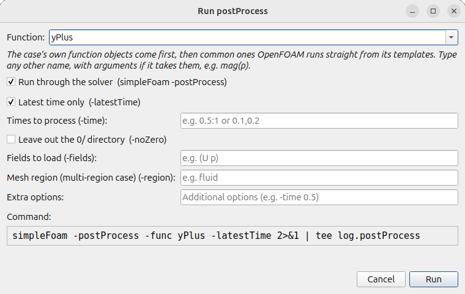

- **Function** lists, first, every function object the case's `controlDict` runs with `#includeFunc`. Then come common ones OpenFOAM runs straight from its templates with no `system/` file: `mag(U)`, `vorticity`, `Q`, `CourantNo`, `yPlus`, `wallShearStress` and more. The top entry, **(every function in controlDict)**, runs them all. You can type any other name, with arguments where it takes them, such as `mag(p)`.
- **Run through the solver** is needed by functions that use the solver's turbulence and transport models: `yPlus`, `wallShearStress`, `forces`, `forceCoeffs` and the like. Run plainly, they finish without any error yet calculate nothing; the log only says "Unable to find turbulence model in the database".
  - FoDE ticks the box by itself for such a function, judged by its type, so a forces function saved as `drag` counts too. It also ticks it for **(every function in controlDict)**, because run plainly with no function named, sampling functions find no fields and write nothing. Setting the box yourself overrides the automatic choice.
  - The command then becomes `<solver> -postProcess -func …` (OpenCFD, OpenFOAM Foundation up to 10) or `foamPostProcess -solver <module> -func …` (Foundation 11 and later), with the solver taken from `controlDict`.
- **Times**: the latest only by default, or a `-time` selection, with `-noZero` to leave out `0/`. **Fields** and **Region** are also available.
- **Run in parallel** appears for a decomposed case. It starts ticked when the latest results exist only in `processor*/`.

The output goes to `log.postProcess` (`log.foamPostProcess` on Foundation 11+), never to the solver's own log, even when the run goes through the solver. The dialog warns when the case has no results yet, and when files have unsaved edits, since postProcess reads them from disk. Like the other Run tools, it refuses while a command is running in the Terminal tab or a background run is going in the case. Right-clicking a function-object file that `controlDict` runs, such as `system/probes`, offers **Run postProcess with this…** with that function already chosen.

## Run decomposePar

Select **Tools > Run decomposePar…** to split the case into `processorN/` directories for a parallel run, as set out in `system/decomposeParDict` (the number of pieces is its `numberOfSubdomains`). The [options dialog](#how-a-run-dialog-works) offers `-force` (delete existing `processor*` directories first), `-copyZero` (copy `0/` as it is instead of decomposing the fields), `-latestTime` and `-region`. If the case is already decomposed, the dialog says so and `-force` starts ticked, because without it decomposePar refuses to run.

The one exception is when the `processor*` directories hold results that have not been reconstructed yet: time directories that exist there but not at the case root. `-force` would delete those for good, so the dialog lists the times, tells you to run `reconstructPar` first, and leaves `-force` unticked even if you ticked it last time. A decomposePar that refuses to run is the safe way for this to fail.

If the case has no `system/decomposeParDict`, a message says so and nothing runs. Run the solver in parallel afterwards with [Run Solver](#run-solver).

## Run Solver

Select **Tools > Run Solver…** to run the case's solver on its own, without the rest of an `Allrun` script — for example after changing a boundary condition or `endTime`, when the mesh and initial fields are already in place. The **Solver** field is filled in from `application` in `system/controlDict`. That includes an edit you have not saved yet, since the field reads the editor's text, not the file on disk.

You can type over it or pick another solver from the list, and the change applies to this run only: the next time the dialog opens, it is filled in from `controlDict` again. Only an executable name is accepted (letters, digits and `_ . + -`), and **Run** stays disabled until the field holds one.

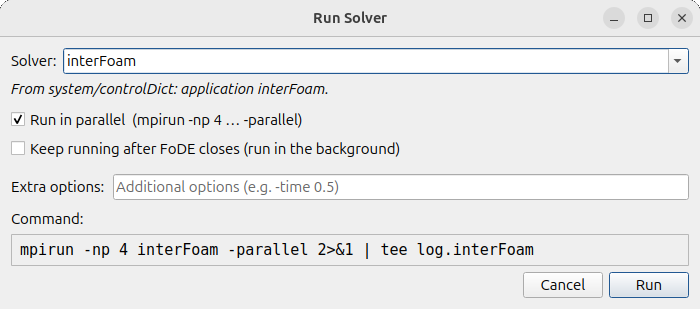

The line under the field says where the name came from. In an OpenFOAM Foundation v11+ case, `application` is `foamRun` and the physics is chosen by a separate `solver` entry (for example `incompressibleFluid`), or by `regionSolvers` for `foamMultiRun`. The dialog shows those modules, but the command is still plain `foamRun`, because foamRun reads them from `controlDict` itself.

The dialog also carries:

- **Save all unsaved files first**: shown, and ticked, whenever any file has unsaved changes, because the solver reads its dictionaries from disk, not from FoDE. If a file cannot be saved, the solver is not started.
- **Run in parallel (mpirun -np N … -parallel)**: shown when the case is decomposed or has a `system/decomposeParDict`. Once the case is decomposed, N is the number of pieces it is split into, because that is what `mpirun` must match; before that, N comes from `numberOfSubdomains`. If the case is not decomposed yet, a warning tells you to [run decomposePar](#run-decomposepar) first. The box starts ticked when the case is decomposed, except in two situations, where it starts unticked and a warning explains why:
  - `numberOfSubdomains` and the decomposition disagree, so OpenFOAM would stop the run at startup.
  - `0/` or `constant/polyMesh` changed after the case was decomposed, including an unsaved edit to a `0/` field that this dialog is about to save. A parallel run reads `processor*/`, never the case root, so it would silently run without your change. Re-run decomposePar first.
- Pre-flight warnings: no mesh found (`constant/polyMesh`, a region's `constant/<region>/polyMesh`, or a decomposed one); and time directories that already exist, together with what `startFrom` will do with them (`latestTime` continues from the latest one, anything else may overwrite results).
- **Extra options** for anything else, such as `-noFunctionObjects`.
- **Keep running after FoDE closes (run in the background)**: on Linux. Never ticked by default. See [Background runs](#background-runs-and-stop-background-run).
- A warning when `controlDict` has `stopAt writeNow` (or `noWriteNow`, `nextWrite`), which would stop the solver right after it starts — typically left over from stopping an earlier run by hand.
- **Existing log.<solver>**: shown only when that log already exists, typically when you continue a run from its latest time. Either way, plain `log.<solver>` is always the latest run.
  - **Keep it as log.<solver>.[suffix]**, the default, moves the old log aside before the run starts. The suffix is pre-filled with the next `partN` (one past the highest already there, so the numbers stay in run order) and you can type your own, such as `before-refine`. The suffix is not remembered: each time, the field starts at the next free `partN`.
  - **Overwrite it** replaces the old log.
  - Run stays disabled while the suffix is empty, starts with `.`, or contains anything but letters, digits and `_ . -`, and also while it names a log that already exists, so keeping one log can never overwrite another.

The output goes to `log.<solver>`, the same file name an `Allrun` script's `runApplication`/`runParallel` uses, so [View Log Summary](#view-log-summary) and the Allrun "case already run?" check both see it. Plot residuals while it runs with the [foamMonitor launcher](#foammonitor-launcher). Stop the solver from the Terminal tab with Ctrl+C; in Simple terminal mode a running job cannot be interrupted.

## Background runs and Stop Background Run

A run started in the Terminal tab ends when FoDE closes. For a long run, tick **Keep running after FoDE closes (run in the background)** in [Run Solver](#run-solver), or in the confirmation of [Run Allrun Script](#run-allrun-script). The run is then detached from the terminal, with its output written straight to `log.<solver>` (or `log.Allrun`), and closing FoDE or the terminal does not stop it. The Terminal tab follows the log until the run ends; Ctrl+C there stops only the following.

What you see while it runs:

- a **● icoFoam running in background** badge beside the case name in the toolbar — click it to stop the run or view its log summary;
- "— icoFoam running" at the end of the window title, so it shows in the taskbar too;
- a **Running in background** row at the bottom of the file list;
- a status-bar message when the run finishes on its own.

Closing FoDE does not ask about a background run, since closing does not affect it. It shows an OK-only reminder listing the runs still going; tick **Don't remind me again** to close silently from then on (**Settings > Reset All Settings…** brings the reminder back). Opening the case again shows the run, and shutting down or logging out ends it.

While a background run is going in a case, every Tools-menu action that sends a command refuses, naming the run and its process ID — even after FoDE was closed and opened again — because a second run would write the same time directories. FoDE records the run in a hidden `.fode-background-run` file in the case, which is ignored once the process has gone.

Edits you save to `controlDict`, `fvSchemes` or `fvSolution` while a run goes take effect in that run: OpenFOAM re-reads them (`runTimeModifiable`, on by default).

**Stopping it.** **Tools > Stop Background Run** (also on the right-click menu of the file-list row) asks the solver to write its current time step and exit — the OpenFOAM way, since a killed solver would lose that step. It does this by setting `stopAt writeNow;` in `system/controlDict`, which the solver re-reads. The badge and the row turn amber and read **■ Stopping …**, which can last as long as one time step. Then a message reports:

- the last time written;
- whether the run ended cleanly — if its log has no final `End` line, it crashed or was killed and the last time may be incomplete;
- that `stopAt` was put back, so the next run does not stop at its first step. If FoDE is closed first, it does this the next time it opens the case.

The stop is refused while `controlDict` has unsaved edits in FoDE, and when `controlDict` turns `runTimeModifiable` off, since the solver would never see the request — the message then gives the `kill` command, which loses the current step. For Allrun, the stop ends the solver step; the steps after it, such as reconstructPar, still run.

Background runs need Linux. On a system configured to kill a user's processes at logout (systemd's `KillUserProcesses`; Ubuntu's default does not), logging out can still end them; there, use `loginctl enable-linger` or a job scheduler.

### Without FoDE: finding, stopping or killing a run from a terminal

A background run outlives FoDE, so you may want to deal with it when FoDE is not at hand — over SSH, say. The run FoDE started in a case is recorded in that case's `.fode-background-run` as `<pid> <solver> <log>`:

```bash
cat <case>/.fode-background-run       # e.g. 1877261 icoFoam log.icoFoam
pgrep -a icoFoam                      # every running icoFoam, with its command line
pgrep -af mpirun                      # parallel runs
ps -o pid,etime,args -C icoFoam       # etime: how long it has been running
pwdx <pid>                            # which case directory a process runs in
```

To stop it cleanly, writing the current time step, do what Stop Background Run does — and set `stopAt` back afterwards yourself, since FoDE only restores a value it set:

```bash
cd <case>
foamDictionary system/controlDict -entry stopAt -set writeNow
# once it has stopped:
foamDictionary system/controlDict -entry stopAt -set endTime
```

To kill it, losing the current time step:

```bash
kill -- -<pid>        # the minus matters: the whole run
kill -9 -- -<pid>     # only if it ignores the first
```

Mind the minus: kill the run with `kill -- -<pid>`; a plain `kill <pid>` leaves the solver running (FoDE still counts it as the run, and still refuses a second one). After a kill nothing needs cleaning up: FoDE treats the leftover `.fode-background-run` as stale.

## Run reconstructPar

Select **Tools > Run reconstructPar…** to merge a parallel run's results from the `processor*/` directories back into ordinary time directories at the case root, where FoDE, ParaView and the serial tools can read them. The [options dialog](#how-a-run-dialog-works) offers `-newTimes` (ticked by default: skip the times already at the case root), `-latestTime`, `-time` (for example `0.5:1`), `-fields` (for example `(U p)`), `-withZero` and `-region` — the options both forks spell the same way.

The "skip fields / sets / lagrangian" switches are spelt `-noFields` on Foundation and `-no-fields` on OpenCFD, so they go in **Extra options**.

The dialog lists the times not yet at the case root, or says there is nothing new to reconstruct. It refuses when the case has no `processor*/` directories, and while a command is still running in the Terminal tab, since a time step being written could be reconstructed half-finished.

## Delete processor* Directories

Select **Tools > Delete processor\* Directories…** to free the disk space a decomposed case takes once its results have been reconstructed. Nothing is deleted until FoDE has checked that everything in `processor*/` also exists, and is complete, at the case root:

- every time directory and the files in it (fields, `uniform/`, `lagrangian/`) — so a run reconstructed with `-latestTime` or `-fields` is caught;
- the cell, face and point sets in `constant/polyMesh/sets/`;
- the mesh: if the processors hold one, the case root needs a mesh with the same total cell count;
- that the copies at the case root are complete and belong to the current mesh, not cut off by an interrupted `reconstructPar` or left over from another mesh — if one is not, the message tells you to run `reconstructPar -time <t>` again;
- that nothing else is working in the case right now, such as a `reconstructPar` in another terminal or a solver run with `-case`. The process is named; idle shells, editors and ParaView do not count. This is checked again just before deleting.

If anything would be lost, the dialog lists what (for example "time 0.3 exists only in processor\*") and deletes nothing; there is no "delete anyway". Collated data (`processorsN`) is refused too, because FoDE cannot read inside it.

When the check passes, a confirmation states what will be deleted and how much, with **No** as the default. Its checkbox **Keep the latest time (t) and the decomposed mesh** is ticked by default:

- **Ticked** — every time directory except the latest goes, and each processor's `constant/` stays. The run can carry on in parallel with `startFrom latestTime;` without running `decomposePar` again (slow and memory-hungry on a large case), while nearly all the space is still freed.
- **Unticked** — the directories go entirely. Continuing in parallel later needs `decomposePar` again; its `-latestTime` option decomposes just the last time.

FoDE sets the default for you where it matters: the box starts unticked if the case root already has a later time than the processors, and is ticked and locked if deleting everything would lose data (the mesh exists only in `processor*/`).

Compressed cases (`writeCompression on`) get one more option, **Read compressed files to the end first**, ticked by default. Confirming that a `.gz` file is complete means decompressing all of it, which takes minutes on a large case. Unticked, compressed files are checked at their start only, and the confirmation warns that one cut off part-way would not be detected.

The deletion is permanent, not moved to the trash. It runs behind a progress window that names the directory being deleted; **Stop** ends it after the current time directory, which is always safe because everything was checked first — run the action again to finish. The action refuses while a command is still running in the Terminal tab, and needs no terminal itself.

**This cannot be undone.** See [Disclaimer](#disclaimer).

## Run Allrun Script

Select **Tools > Run Allrun Script** to run the case's `./Allrun` script in the Terminal tab (switched to automatically) — the case's full workflow, typically meshing, field initialisation, and the solver itself. A warning dialog is shown if the case has no `Allrun` script. Since solver runs can take a long time, a confirmation dialog is shown first; note that in Simple terminal mode a running job cannot be interrupted (the xterm terminal supports Ctrl+C).

If the case already has `log.*` files, a different dialog appears instead: OpenFOAM's Allrun helper functions (`runApplication`/`runParallel`) skip any step whose `log.*` file already exists ("already run … remove log file to re-run"), so on an already-run case a plain `./Allrun` may appear to do nothing. The dialog lists the existing log files and offers three choices: **Clean, then run** (sends `foamCleanTutorials && ./Allrun` — the standard `./Allclean && ./Allrun` idiom, see [Clean Case](#clean-case-foamcleantutorials)), **Run anyway** (sends `./Allrun` unchanged, with already-run steps skipped), or **Cancel**. Both dialogs carry **Keep running after FoDE closes** on Linux; see [Background runs](#background-runs-and-stop-background-run).

Each `Allrun` step writes its own `log.<application>` file, so [View Log Summary](#view-log-summary) and [foamMonitor](#foammonitor-launcher) work on the results as usual.

## Open Mesh in ParaView

Select **Tools > Open Mesh in ParaView…** to view the actual generated mesh in ParaView, as an alternative to the BlockMesh 3-D panel's block-topology preview. FoDE launches `paraFoam -case <case directory>` if `paraFoam` is on `PATH`, falling back to a plain `paraview` launch if it is not. If neither is found, a warning dialog reports that neither could be located. The action is available whenever a case is open; it does not require `blockMesh` to have been run in FoDE.

## Run Allclean Script

Select **Tools > Run Allclean Script** to run the case's `./Allclean` script in the Terminal tab (switched to automatically). A warning dialog is shown if the case has no `Allclean` script; otherwise a confirmation dialog warns that the generated mesh, time directories, log files, and other results will be removed. The file list refreshes automatically once the deletions hit the disk.

Note that [Clean Case (foamCleanTutorials)](#clean-case-foamcleantutorials) already runs `./Allclean` when the case has one — this action exists for when you want the script itself, explicitly.

**This cannot be undone.** See [Disclaimer](#disclaimer).

## Clean Case (foamCleanTutorials)

Select **Tools > Clean Case (foamCleanTutorials)** to clean the case with OpenFOAM's standard `foamCleanTutorials` script, run in the Terminal tab (switched to automatically). It removes the generated mesh (`constant/polyMesh`), time directories, `processor*/` decompositions, `postProcessing/`, `log.*` files, and other generated artifacts. Two case-specific behaviors, both stated in the confirmation dialog:

- If the case has its own `Allclean` (or `Allwclean`) script, `foamCleanTutorials` runs that script instead of its built-in cleaning.
- Otherwise, if a `0.orig/` directory exists, `0/` is also removed (`foamCleanTutorials`' default `-auto` mode — the standard tutorial convention; use [Restore 0/ from 0.orig](#restore-0-from-0orig) or **Run Allrun Script** to recreate it).

The file list and the [mesh indicator](#mesh-presencestaleness-indicator) refresh automatically after cleaning.

**This cannot be undone.** See [Disclaimer](#disclaimer).

## View Log Summary

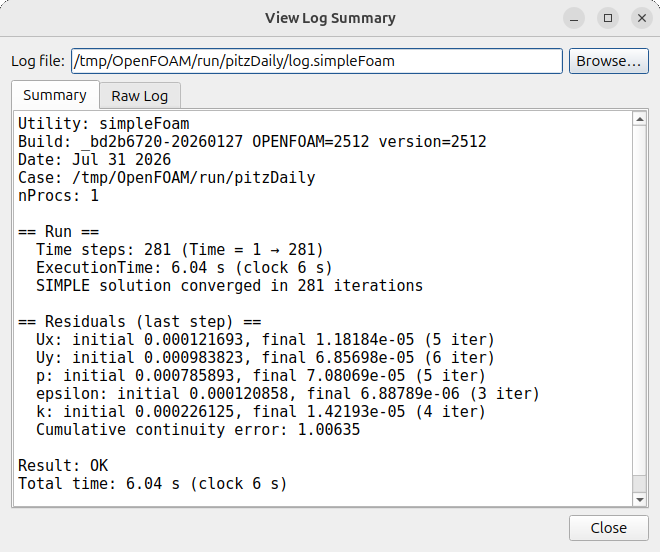

Select **Tools > View Log Summary…** to open a condensed report of a `log.*` file instead of reading the raw text — most useful for `log.snappyHexMesh`, which can run to thousands of lines of repetitive refinement/snapping/layer-iteration output. The dialog defaults to the most-recently-modified `log.*` file in the case directory (use **Browse…** to pick a different one, including outside the case directory) and shows two tabs:

- **Summary** — depends on the kind of log:
  - `blockMesh`: the `Mesh Information` and `Patches` blocks.
  - `snappyHexMesh`: final cell/face/point counts and iteration counts per castellation refinement category, the snapping relaxation iteration count, the final per-patch layer-thickness table, and the mesh-quality result.
  - `topoSet`: one condensed line per cell/face/point set, listing the sources applied and the final set size.
  - **Solver log** (`log.simpleFoam`, `log.interFoam`, … — recognised by its time-loop shape, so any solver works without being on a list): the number of time steps and the simulated time range, the final `ExecutionTime`/`ClockTime`, a convergence line if the run converged (`SIMPLE solution converged in N iterations`), and the last step's residuals — initial/final residual and iteration count per field, Courant number(s), and the cumulative continuity error. A run that neither converged nor reached `End` is reported as FAILED.
  - Any other utility's log falls back to its header plus the last ~20 lines.
  - In every kind, repeated warnings (e.g. per-iteration displacement warnings) are collapsed into one line with a count, and fatal errors are always shown in full.
- **Raw Log** — the untouched file contents, in case the summary omits something you need.

Like [Find OpenFOAM Examples](#find-openfoam-examples) — and unlike FoDE's other dialogs — this one is **non-modal**: it can stay open beside the main window while you keep working in the tree, editor, or terminal, so you can cross-reference dictionary settings against the log's results. The action is available whenever a case is open; it does not require the terminal panel or a prior FoDE-run mesh command — any existing `log.*` file works.

## Find OpenFOAM Examples

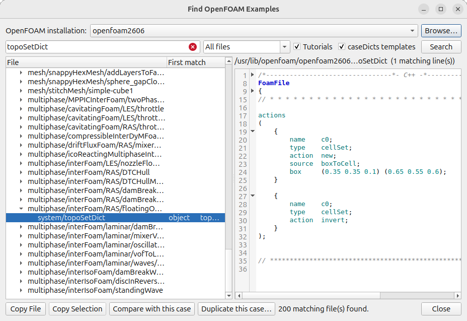

Select **Tools > Find OpenFOAM Examples…** (also available as **Case > Find OpenFOAM Examples…**) to search a local OpenFOAM installation for real usage examples of a keyword or setting — the kind of question ("how is `nOuterCorrectors` actually used?", "what goes in a `forces` function object?") that otherwise requires `find`/`grep` skills. The dialog searches two sources, each toggleable with a checkbox:

- **Tutorials** — the ~550 example cases shipped under the installation's `tutorials/` directory.
- **caseDicts templates** — the curated files under `etc/caseDicts/`, including the `postProcessing/` function-object templates (usable in a `controlDict` `functions {}` block via `#includeFunc <name>`) and the fully annotated example dictionaries under `annotated/`.

**Choosing an installation.** The selector at the top lists the OpenFOAM installations found on your machine: the sourced environment (`WM_PROJECT_DIR`/`FOAM_TUTORIALS`/`FOAM_ETC`) if FoDE was started from a sourced shell, plus auto-discovered installs under `/usr/lib/openfoam/`, `/opt/`, and `~/OpenFOAM/`, newest first. Use **Browse…** to point at any other directory (an install root or a bare `tutorials/` directory); a browsed choice is saved to `app_config.json` (`openfoam_dir` key) and preselected next time.

**Searching.** Type a keyword (matched case-insensitively, line by line) and press Enter or click **Search**. The file-name dropdown narrows the search to one dictionary file (`controlDict`, `fvSchemes`, …) — leave it on "All files" to search everything. The search runs in the background and can be cancelled; results are capped at 200 files. Hits are grouped by tutorial case (and by template folder for caseDicts), each with the first matching line as a preview snippet.

**Using a result.** Selecting a hit shows the whole file in a read-only, syntax-highlighted preview, scrolled to the first matching line. From there:

- **Copy File** / **Copy Selection** — copy the whole file, or just the text you selected in the preview (the button enables once something is selected), e.g. to paste into the Editor tab of your own case.
- **Compare with this case** — enabled when the hit lies inside a tutorial case. One click loads that case as the reference of the existing [Case comparison](#case-comparison) view, so you can see exactly where your case differs and adopt individual settings with the right-click **Use this value** action. FoDE asks you to open a case first if none is open.
- **Duplicate this case…** — enabled when the hit lies inside a tutorial case. Opens the same dialog as [Duplicating a case](#duplicating-a-case) with the tutorial as the source, so you can copy it to a writable location and start your own case from it — tutorial cases inside the installation should never be edited in place. The destination defaults to your default case directory (falling back to your home directory, never the read-only installation), and after copying FoDE offers to open the new case immediately.

The dialog is **non-modal**: keep it open beside the main window and copy from examples while editing. No case needs to be open just to search.

## Variants

FoDE ships in three configurations controlled by feature flags. Choose the one that matches your platform and workflow.

| Variant | Terminal tab | BlockMesh tab | Launch command |
|---|---|---|---|
| `standard` | Yes (xterm / Simple toggle) | Yes (visible in Simple mode) | `python3 main.py` |
| `no-terminal` | No | No | `python3 main.py --variant no-terminal` |
| `no-terminal-blockmesh` | No | Yes (always visible) | `python3 main.py --variant no-terminal-blockmesh` |

The `--variant` flag chooses the configuration and remembers it: the choice is saved when you quit, and later launches without `--variant` use it automatically.

The `no-terminal` variants avoid the `QtWebEngineWidgets` dependency and are the recommended choice for Windows, because xterm needs a Unix pseudo-terminal and the Tools commands are OpenFOAM shell commands that Simple mode's `cmd.exe` cannot run, and for any environment where the xterm.js terminal is not needed.

## Terminal tab

The bottom panel contains an **Editor** tab and a **Terminal** tab. The Terminal tab has two modes that can be switched at runtime.

### Mode toggle

A checkbox at the top of the Terminal tab reads **"xterm terminal (hides BlockMesh 3-D panel)"**.

| Mode | Description |
|---|---|
| **xterm** (checked, default on Linux/macOS) | Full terminal emulation powered by [xterm.js](https://xtermjs.org/): colour output, cursor control, interactive programs (`vim`, `htop`, …). The BlockMesh tab is hidden while this mode is active, and **View > BlockMesh 3-D Panel** is grayed out. |
| **Simple** (unchecked) | A basic terminal running a persistent shell (`bash` on Linux/macOS, `cmd.exe` on Windows). Output is shown in a plain-text area with ANSI escape codes stripped. The BlockMesh 3-D panel becomes visible in the upper tab widget and **View > BlockMesh 3-D Panel** is re-enabled. |

The xterm checkbox is disabled on Windows or when `QtWebEngineWidgets` is not installed — Simple mode is used automatically in those cases. In the `no-terminal` and `no-terminal-blockmesh` variants the Terminal tab is absent entirely; see [Variants](#variants).

The two modes take turns because the xterm terminal and the 3-D viewer cannot safely share the graphics card on Linux. See [Troubleshooting](#troubleshooting) if the 3-D view has gone missing.

When a case is opened, the terminal automatically changes its working directory to the case root so that OpenFOAM commands such as `blockMesh` or `interFoam` can be run directly.

### xterm.js assets

The xterm.js library files are downloaded automatically from jsDelivr on first use and cached in `ui/xterm/`. No manual installation is required. If the download fails (e.g. no internet access), a message is displayed instead; place the following files in `ui/xterm/` manually:

| File | Source |
|---|---|
| `xterm.js` | `https://cdn.jsdelivr.net/npm/@xterm/xterm@6.0.0/lib/xterm.js` |
| `xterm.css` | `https://cdn.jsdelivr.net/npm/@xterm/xterm@6.0.0/css/xterm.css` |
| `xterm-addon-fit.js` | `https://cdn.jsdelivr.net/npm/@xterm/addon-fit@0.11.0/lib/addon-fit.js` |

### Simple mode

Simple mode supports basic command-line interaction:

- Type a command in the input field at the bottom and press **Enter** to run it.
- Use the **↑** and **↓** arrow keys to navigate command history.
- Click **Clear** to clear the output area.
- If the shell process exits unexpectedly, it is restarted automatically.
- The shell process is terminated cleanly when the application closes.

### Closing FoDE while a command runs

The Terminal tab's shell ends when FoDE closes, and so does anything it is running. A solver stopped that way does not write its current time step. So if a command is still running — a solver, `./Allrun`, anything typed by hand — closing the window asks first, naming what is running, with **No** as the default answer. Switching between xterm and Simple mode replaces the shell too, so the mode checkbox asks the same question and stays as it was if you answer No. Nothing is asked when the shell is idle.

For the same reason, every Tools-menu action that sends a command refuses while one is still running; see [One command at a time](#one-command-at-a-time).

FoDE finds out what is running by reading the shell's child processes from `/proc`, so the question is asked on Linux; elsewhere it stays silent and closing behaves as before. To keep a run going after FoDE closes, start it with **Keep running after FoDE closes** in [Run Solver](#run-solver) or Run Allrun Script; see [Background runs](#background-runs-and-stop-background-run).

## Schema module configuration

Schema modules supply the help the [Detail pane](#detail-pane) shows for each key — its description, valid choices and the OpenFOAM versions that support it. FoDE ships modules for the common `system/` and `constant/` dictionaries, including the turbulence models; the ones in use are listed under **Settings > Manage Schema Modules…**.

You can add or remove schema modules at any time through **Settings > Manage Schema Modules…**, without modifying the source code.

### Writing a custom schema module

A custom schema module is a plain Python file. It names the dictionary it describes and maps each key to a description, its valid choices and the OpenFOAM versions that support it. Add it with **Settings > Manage Schema Modules… > Add Module from File**; it takes effect immediately. Several modules may describe the same file: their entries are merged, and a module loaded later wins on a key both define. The format, a minimal example and the lookup rules for keys inside sub-dictionaries are described in [DEVELOPER.md](DEVELOPER.md#schema-system).

### schema_config.json

`schema_config.json` is created the first time the user modifies schema settings via **Settings > Manage Schema Modules…** or triggers a settings reset. If the file does not exist, the default modules are used without writing anything to disk. The file records the list of schema modules to load.

```json
{
  "schema_modules": [
    "schemas.control_dict",
    "schemas.fv_schemes",
    "…"
  ]
}
```

To add a custom schema module, select **Settings > Manage Schema Modules…** in the application, then use the **Add Module from File** button to select a Python file. The change is saved to `schema_config.json` and takes effect immediately.

## Generate OpenFOAM Keywords

Select **Settings > Generate OpenFOAM Keywords…** to rebuild the keyword list used by the editor's syntax highlighter (see [Editor behavior](#editor-behavior)) from your local OpenFOAM installation.

Pick an installation from the **Installation** dropdown — installations are auto-discovered the same way as in [Find OpenFOAM Examples](#find-openfoam-examples) (sourced environment first, then the usual install locations), and **Browse…** lets you point at any other directory. This is the same selector as in Find OpenFOAM Examples, and the choice is remembered. Click **Generate**. The scan reads the installation's `etc/caseDicts/` templates and the keyword names that its source code uses, including free-form keys such as `application` or `writePrecision` in `controlDict`. The result is written to `app_config/foam_keywords.json`, which overrides the bundled default list. Progress is shown in the dialog's log area; click **Cancel** to stop an in-progress scan. The dialog can be closed once the scan finishes or is cancelled.

If no installation is selected and no OpenFOAM environment is sourced, the scan reports an error in the log instead of failing silently.

This is an optional, advanced action — the application ships with a pre-generated `app_config/foam_keywords.default.json` (built from OpenFOAM v2512; see the file's `version` field), so highlighting works out of the box without ever running this scanner. Version-to-version keyword differences are small and only cosmetic for highlighting, so one bundled default is enough — if you want a list matched exactly to your own version or distribution, regenerate it here. Deleting `app_config/foam_keywords.json` reverts to the bundled default.

## Application settings

General application settings are stored in `app_config.json`, which is separate from `schema_config.json`. This file is created the first time a case is opened (which triggers an automatic save of the case directory). If the file does not exist, built-in defaults are used.

### app_config.json

```json
{
  "window_size": [1200, 800],
  "default_case_dir": "/path/to/cases",
  "case_library_dirs": ["/home/user/my_templates"],
  "case_browser_dir": "/path/to/cases/run",
  "user_links": [{"label": "My reference", "url": "https://example.com"}],
  "features": {"terminal": true, "blockmesh": true},
  "openfoam_dir": "/usr/lib/openfoam/openfoam2606",
  "restore_session": true,
  "sessions": {"terminal+blockmesh": {"…": "saved window layout"}}
}
```

| Key | Description |
|---|---|
| `window_size` | Main window size on startup. Saved automatically when the application is closed. |
| `default_case_dir` | Initial directory shown when **Case > Open Case…** is used. Updated automatically to the parent of the last opened case. Also used as the default destination parent in **Case > Duplicate from Case Library…** and **Case > Save as New Case…**. |
| `case_library_dirs` | User-added Case Library directories. The `$FOAM_TUTORIALS` directory is not stored here; it is included dynamically from the environment variable. |
| `case_browser_dir` | Directory the [case navigator](#case-navigator) and the Case Browser last showed, so both reopen where you left off. Written as you navigate; absent means the [default case directory](#setting-the-default-case-directory) is used instead. Kept separate from `default_case_dir`, which is where **Open Case…** and the duplicate destination start from. |
| `user_links` | User-defined reference links shown in **Help > Resources > My Links**. Each entry is `{"label": "…", "url": "…"}`. |
| `features` | Feature flags set by `--variant` (see [Variants](#variants)). Omitting this key is equivalent to `{"terminal": true, "blockmesh": true}`. |
| `openfoam_dir` | OpenFOAM installation chosen via **Browse…** in the installation selector of [Find OpenFOAM Examples](#find-openfoam-examples) or **Settings > Generate OpenFOAM Keywords…**. Only written after browsing; auto-discovered installations are not stored. |
| `restore_session` | Whether **Settings > Restore Last Session on Startup** is on. Only written when turned off; absent means on. See [Session restore](#session-restore). |
| `sessions` | Saved window layouts, one per feature set (`terminal+blockmesh`, `blockmesh`, `minimal`), written when the application is closed. Hand-editing is not expected: unrecognised or malformed entries are ignored and replaced on the next close. |

### Setting the default case directory

Select **Settings > Set Default Case Directory…** to set the directory that opens when **Case > Open Case…** is used. The directory is also updated automatically to the parent of the last opened case, so the next session starts from the same location.

### Window size

The main window opens at the size recorded in `app_config.json`. If the file does not exist, the default size of 1200×800 is used. The size is saved automatically on exit. To restore the default size, select **View > Reset Window Size**.

## Session restore

FoDE reopens where you left it. When the application is closed, it records the shape of the window and what was in it; the next launch puts that back before you touch anything.

What is restored:

- Window size and position, and the splitter positions between the file list, the tree, the detail pane and the bottom panel.
- The active upper tab (**Tree** / **Boundary** / **BlockMesh**) and lower tab (**Editor** / **Terminal**), the Terminal's mode, and whether the 3-D panel is shown or in side-by-side mode.
- The case directory, every file that was open, and which of them was on screen.
- The selected tree row, and with it the editor position and detail pane that follow from it.
- The BlockMesh panel's display toggles, label size and camera angle — the 3-D view comes back at the angle you left it, not reset to the default view.

What is not restored is anything the window works out for itself: scroll positions, the editor's cursor and folded regions, and tree expansion beyond the ancestors of the selected row. Unsaved edits are not restored either — FoDE asks about those when you close, as it always has.

### Turning it off

**Settings > Restore Last Session on Startup** is ticked by default. Unticking it means the next launch opens a default window. It decides whether a stored layout is *applied*, nothing more: what is already stored stays stored, and closing the window while the setting is off does not overwrite it. Re-ticking it therefore returns you to the layout that was stored when you last unticked, which may be some time ago.

To throw a layout away — one that has ended up somewhere unhelpful, or because it records case paths you would rather not keep — use **Settings > Forget Saved Session**. It discards the stored layouts of every variant, not just the one you are running, and is greyed out when there is nothing stored. The next launch then opens a default window and starts a fresh layout from there.

For a single clean launch without changing either, use `python3 main.py --no-restore`. The stored session is kept, and the launch after that uses it again.

### When something has moved

A saved session describes a case that existed the last time you closed FoDE, and cases get renamed, files get deleted and dictionaries get edited elsewhere. Nothing in a saved session can stop the application opening. Each part that no longer applies is skipped on its own, the rest is restored, and a line in the status bar names what was left out:

- If the case directory is gone, the layout is still restored but no files are opened.
- If one file is gone, the others still open.
- If the selected tree row no longer exists — the entry was deleted since — the file still opens, with no row selected.
- A large non-dictionary file such as a `log.*` run log is not reopened. Opening one asks for confirmation because it freezes the window while it loads, and that is not a question to ask before you have started work; click the file to open it as usual.

### Variants

Each `--variant` keeps its own layout, because variants change which panels and tabs exist and a layout recorded with a terminal in it means nothing to a window that has none. Running one variant for an afternoon does not disturb another's saved layout. See [Variants](#variants).

## Resetting settings

Select **Settings > Reset All Settings…** to reset `app_config.json`, `schema_config.json`, or both to their default values. A confirmation dialog is shown before any changes are made.

Resetting the application settings deletes `app_config.json`, and the reset holds: from that point on, closing the window writes nothing back. In particular the window layout and size of that session are not saved, so the next launch starts from the defaults the reset asked for — which is why the dialog asks you to restart. Settings you change deliberately after the reset, such as the theme, are still saved as usual.

## Minimizing panes

Three panes can be parked out of the way in one click and brought back the same way: the **file list**, the **Detail pane** to the right of the tree, and the **Editor / Terminal** row along the bottom. Dragging a splitter handle across the window does the same thing, but takes several mouse moves and leaves you to find the handle again afterwards.

Three ways to do it, all equivalent:

- **View menu** — **File List** `Ctrl+1`, **Detail Pane** `Ctrl+2`, **Editor / Terminal Pane** `Ctrl+3`. Ticked means shown. These items are also the guaranteed way *back*, which matters because the state is remembered between runs (see below).
- **The ▁ button** on the right of the Editor/Terminal tab bar, for the bottom row only. It becomes **▔** while the row is minimized.
- **Double-click a splitter handle** — the handle between the tree and the Detail pane, above the Editor row, or to the right of the file list. Double-clicking a handle with no minimizable pane beside it does nothing.

The file list and the Detail pane collapse to nothing. The Editor/Terminal row is different: it minimizes down to its **tab bar**, not to zero, so the Editor and Terminal tabs stay clickable and **▲ Apply Text to Tree** / **▼ Reload from Tree** stay where they were. Clicking **▔** puts the row back at the height it had before.

Entering [side-by-side mode](#side-by-side-mode) minimizes the Detail pane for you and restores it on the way out, since a file being inspected in 3-D has little use for it and the width is better spent on the 3-D view. If you had already minimized the pane by hand, leaving side-by-side mode leaves it minimized.

Which panes are minimized — and the size each one should come back to — is part of the saved session, so a window closed with the Detail pane parked reopens that way. The View menu items are always present and always show the current state, so nothing is ever stranded off-screen.

## Appearance and colours

**Settings > Appearance** selects the colour theme. The choice is saved in `app_config.json` and takes effect after restarting the application.

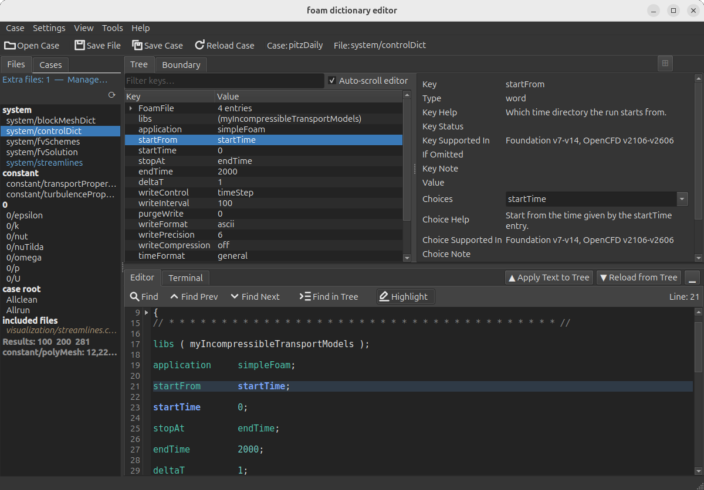

| Mode | Behaviour |
|------|-----------|
| **Follow System** (default) | Keeps the platform's native widget style and desktop palette — including your accent colour on Windows and the desktop theme on Linux. |
| **Light** | Forces the Fusion style with FoDE's light palette, identical on every OS. |
| **Dark** | Forces the Fusion style with FoDE's dark palette, identical on every OS. |

To try a theme without changing the saved setting, pass `--theme` on the command line: `python3 main.py --theme dark` uses that theme for one run only, so two windows in different themes can sit side by side and neither of them decides what the next launch looks like. `system`, `light` and `dark` are accepted — the same three choices as the menu.

Dark mode covers the BlockMesh 3-D viewer as well: the scene background, the axis and bounds text, vertex/block numbers, and the shape name badges all follow the theme. The patch and overlay colours themselves (wall orange, patch blue, the topoSet action colours, …) stay the same in both themes, because they identify what you are looking at rather than decorate it.

### Selected-row readability

FoDE chooses the text and fill colours of a selected row itself, so a selection stays legible whatever accent colour your desktop uses — in the tree, the file list, the boundary table and the comparison panel.

## Text size and display scaling

Every piece of text in FoDE is sized from the desktop's own font setting — the tree, the file list, the Detail pane, the editor and both terminals. Raise the system font size and all of them grow together; there is nothing to set inside the application to keep them in step. Two extra controls exist for when that is not enough.

### Settings > UI Scale

Scales the entire interface — text, icons, spacing and all — by **100 %** (default), **125 %**, **150 %**, **175 %** or **200 %**. The choice is saved in `app_config.json` and takes effect after restarting, because Qt settles its scale factor when the application starts and offers no way to change it while running.

This is the one to reach for when *everything* in FoDE looks too small next to your other applications — see [When the desktop is scaled but FoDE is not](#when-the-desktop-is-scaled-but-fode-is-not) below for why that happens.

To try a scale without changing the saved setting, pass `--ui-scale` on the command line: `python3 main.py --ui-scale 150` applies it for one run only. Anything from 50 to 400 is accepted there, not just the five values in the menu.

### Zooming the editor

The editor text can be sized on its own, without touching anything else in the window:

| Action | Shortcut |
|--------|----------|
| Zoom in | `Ctrl` + `+`  (or `Ctrl` + `=`) |
| Zoom out | `Ctrl` + `-` |
| Back to the desktop's size | `Ctrl` + `0` |
| Zoom by mouse | `Ctrl` + scroll wheel |

The keys work while the editor has focus, so they never fire from the tree or the 3-D viewer. The zoom is an offset from the desktop's font size rather than a fixed size — two steps up stays two steps up if you later change that font — and it is saved with the session, so it is still there after a restart.

### When the desktop is scaled but FoDE is not

On X11, Qt works out its scale factor from the `Xft.dpi` X resource and nothing else. Desktops that scale through some other mechanism — GDK's `GDK_SCALE`, or fractional scaling applied by a Wayland compositor to XWayland clients — leave `Xft.dpi` at 96, and every Qt application then draws at 1× while the GTK applications beside it look right. That is the usual cause of a FoDE window that looks half-size on a high-resolution display.

Three ways out, in increasing order of permanence:

```bash
python3 main.py --ui-scale 150
```

```bash
QT_SCALE_FACTOR=1.5 python3 main.py
```

```bash
echo "Xft.dpi: 144" >> ~/.Xresources && xrdb -merge ~/.Xresources
```

The first covers FoDE only and can be made permanent in **Settings > UI Scale**. The second covers any Qt application launched that way. The third covers every Qt application from then on, and takes effect for applications started after the next login.

Two variations are worth knowing:

- `QT_FONT_DPI=144` grows the text without growing icons and spacing. It keeps more content on screen than a full scale-up, at the cost of a slightly cramped look.
- `QT_SCALE_FACTOR_ROUNDING_POLICY=PassThrough` stops Qt rounding a fractional scale down to a whole number, which is what makes a 125 % desktop come out at 100 %.

`QT_SCALE_FACTOR` set in the environment wins over the saved **Settings > UI Scale** value, on the grounds that a variable in your environment was chosen for the machine you are sitting at. `--ui-scale` overrides both.

## Resources dialog

Select **Help > Resources** to open the Resources dialog. It has two tabs.

### OpenFOAM tab

Displays links to official OpenFOAM documentation for the two main distributions — OpenCFD/ESI Group (openfoam.com) and the OpenFOAM Foundation (openfoam.org). These links are fixed and read-only. This application is not affiliated with either organisation.

### My Links tab

Lets you manage a personal list of reference links.

- **Add** — opens a dialog to enter a label and a URL. The label is optional; if left blank, the URL is used as the display text.
- **Edit** — opens the same dialog pre-filled with the selected entry's label and URL.
- **Remove** — deletes the selected entry from the list.
- **Move Up / Move Down** — reorders the selected entry.
- **Double-click** an entry to open its URL in the default browser.

Changes are saved to `app_config.json` when the dialog is closed.

## Troubleshooting

**Where is the 3-D view? The BlockMesh tab is missing.** The 3-D viewer and the xterm terminal cannot share the graphics card, so they take turns: while xterm mode is on, the tab is hidden and **View > BlockMesh 3-D Panel** is greyed out. Untick **xterm terminal** at the top of the Terminal tab and the tab comes back, or start FoDE with `--variant no-terminal-blockmesh`, which has no terminal and always shows the 3-D view. If the tab shows an install prompt instead, install `pyvista` and `pyvistaqt`. See [Terminal tab](#terminal-tab), [Variants](#variants) and [BlockMesh panel](#blockmesh-panel).

**A Tools menu item is greyed out.** Most items need an open case, and the ones that send a command need the Terminal panel, which the `no-terminal` variants do not have. If an item is enabled but answers with a message instead of running, a command is still running in the Terminal tab or a [background run](#background-runs-and-stop-background-run) is going in the case; wait for it, or stop it. See [Tools menu](#tools-menu).

**A command says "command not found" (`blockMesh`, `interFoam`, …).** OpenFOAM is not sourced in the shell FoDE was started from. Source OpenFOAM's `bashrc` there and start FoDE again; the built-in terminal inherits that environment. See [Tools menu](#tools-menu).

**The window looks half-size on a high-resolution screen.** Qt did not pick up your desktop's scaling. Start FoDE with `python3 main.py --ui-scale 150`, or set **Settings > UI Scale**; the other ways out are in [When the desktop is scaled but FoDE is not](#when-the-desktop-is-scaled-but-fode-is-not).

**The terminal is a plain text box — no colours, and `vim` does not work.** That is Simple mode. Either **xterm terminal** is unticked, or xterm.js could not be loaded, which needs an internet connection the first time FoDE starts. Restart with internet access, or place the three files yourself; see [xterm.js assets](#xtermjs-assets).

**Some vertices, blocks or shapes are missing from the 3-D view.** A reference FoDE cannot resolve — a misspelt variable name, an `#include` that is not found — makes the vertex, block or shape that uses it vanish quietly. Check the spelling, and that a variable kept in another file is pulled in with `#include`. See [Variable resolution](#variable-resolution) and [Parameters kept in an included file](#parameters-kept-in-an-included-file).

**The 3-D view shows nothing for a file.** FoDE draws a dictionary it recognises by its name or by the `object` entry in its `FoamFile` header, and sampling files by their content. A file with a custom name and no header is not recognised: right-click it in the file list and choose **Show in 3-D view as**. A file that is only an `#include` fragment — a bare `hex …` list with no enclosing dictionary — is deliberately not drawn on its own. See [BlockMesh panel](#blockmesh-panel).

## Keyboard shortcuts

The same list is available in the application under **Help > Keyboard Shortcuts**. Several keys mean different things depending on what has focus.

| Where | Action | Keys |
|---|---|---|
| Anywhere | Open Case | `Ctrl+O` |
| Anywhere | Save File | `Ctrl+S` |
| Anywhere | Save Case (all modified files) | `Ctrl+Shift+S` |
| Anywhere | Apply Text to Tree | `Ctrl+Shift+A` |
| Anywhere | Find in Tree (select the tree row for the editor's cursor line) | `Ctrl+Shift+T` |
| Anywhere | Save the 3-D view as an image (when the 3-D panel is available) | `Ctrl+Shift+I` |
| Anywhere | Exit | `Ctrl+Q` |
| Anywhere | Show or hide the file list / Detail pane / Editor and Terminal row | `Ctrl+1` / `Ctrl+2` / `Ctrl+3` |
| Tree | Copy Value / Paste Value | `Ctrl+C` / `Ctrl+V` |
| Tree | Undo Tree Edit / Redo Tree Edit | `Ctrl+Z` / `Ctrl+Shift+Z` |
| Editor | Find / Find Next / Find Previous | `Ctrl+F` / `F3` / `Shift+F3` |
| Editor | Undo / Redo | `Ctrl+Z` / `Ctrl+Y` or `Ctrl+Shift+Z` |
| Editor | Cut / Copy / Paste / Select All | `Ctrl+X` / `Ctrl+C` / `Ctrl+V` / `Ctrl+A` |
| Editor | Zoom in / Zoom out / Reset zoom | `Ctrl++` (or `Ctrl+=`) / `Ctrl+-` / `Ctrl+0` |
| Editor | Zoom with the mouse | `Ctrl` + scroll wheel |
| Simple terminal | Previous / next command | `↑` / `↓` |
| 3-D viewer | Rotate / Pan | Left drag / `Shift` + left drag |
| 3-D viewer | Zoom | Scroll wheel, right drag or `Up` / `Down` |
| 3-D viewer | Reset camera / Isometric view / Fly to point | `R` / `V` / `F` |
| 3-D viewer | Wireframe / Surface | `W` / `S` |
| 3-D viewer | Larger / smaller points and lines | `+` / `-` |
| Splitter handle | Minimize or restore the pane beside it | Double-click |

The 3-D viewer keys work while the 3-D view has focus. The tree's `Ctrl+C`, `Ctrl+V` and `Ctrl+Z` apply only while the tree has focus, so they never interfere with the editor.

## Glossary

- **Case** — the folder that holds one simulation: `system/`, `constant/` and the initial fields in `0/`. The top-level folder is the **case root**; FoDE also uses that name for the file-list group that holds the `Allrun`-style scripts.
- **Dictionary** — OpenFOAM's plain-text configuration format: `keyword value;` entries and nested `{ … }` blocks. `controlDict`, `fvSchemes` and `blockMeshDict` are dictionaries.
- **Field file** — a file in `0/` such as `U`, `p` or `T`. It holds one field's initial values (`internalField`) and its boundary conditions (`boundaryField`).
- **Patch** — a named piece of the mesh boundary, such as an inlet or a wall. Boundary conditions are set per patch and per field; the [Boundary view](#boundary-view) shows them all in one table.
- **Function object** — post-processing that runs together with the solver (probes, forces, sampling lines, …), listed under `functions` in `controlDict`. See [Add Function Object](#add-function-object).
- **`0.orig`** — a pristine copy of the initial fields. Utilities such as `setFields` overwrite `0/`, so tutorials restore it from `0.orig/` before a clean run; see [Restore 0/ from 0.orig](#restore-0-from-0orig).
- **Decomposed / `processor*`** — for a parallel run, `decomposePar` splits the case into `processor0`, `processor1`, … directories, and `reconstructPar` merges the results back. See [Run decomposePar](#run-decomposepar) and [Run reconstructPar](#run-reconstructpar).
- **Sourced environment** — a shell in which OpenFOAM's `bashrc` has been run, so its commands and variables (`WM_PROJECT_DIR`, `FOAM_TUTORIALS`, …) are available. FoDE and its built-in terminal use the environment they were started from.

## Supported syntax and node types

FoDE targets common OpenFOAM dictionary syntax with practical, tolerant handling rather than full specification coverage. The string shown in the **Type** column of the tree view is the exact `node_type` name for that row (see [DEVELOPER.md](DEVELOPER.md#node-types) for the internal Python representation of each type). The parser recognises the following node types:

| Type | Description |
|---|---|
| `word` | A plain keyword–value pair (single unquoted token, fallback type) |
| `string` | A double-quoted string value, e.g. `"my value"` |
| `macro` | A `$variable` reference used as a value, e.g. `$nu` in `nu $nu;` |
| `compound` | Multiple space-separated tokens that do not form a list, e.g. `uniform 0` or `uniform (0 0 0)` |
| `scalar` | A floating-point value |
| `int` | An integer value (auto-promoted to `scalar` when a fractional value is entered) |
| `bool` | A boolean value (`true`/`false`/`yes`/`no`/`on`/`off`) |
| `vector` | A parenthesised three-component value, e.g. `(0 0 9.81)` |
| `box_pair` | Two `(x y z)` vectors defining a bounding box; produced only for the `box` key |
| `int_list` | A parenthesised list of integers, e.g. `(0 1 2)` |
| `scalar_list` | A parenthesised list of floats (not exactly 3 items), e.g. `(0.1 0.5 1.0 2.0)` |
| `raw_list` | A parenthesised list with mixed or nested content (e.g. `vertices`); kept as raw text |
| `nonuniform_list` | A `nonuniform List<T> N (…)` field value (e.g. `internalField` in `0/U`); shown as a count summary in the tree and stored as raw text — not editable inline |
| `dictionary` | A sub-dictionary block |
| `field_value_block` | A block with `internalField`/`boundaryField` structure (field files such as `0/U`) |
| `field_value` | An individual field value entry within a `field_value_block` |
| `region_block` | A named region block (used in `setFieldsDict`) |
| `region_entry` | An entry within a `region_block` |
| `boundary_block` | A `boundary ( … );` block in `blockMeshDict`; each patch is a `boundary_entry` child |
| `boundary_entry` | A named patch entry within a `boundary_block` |
| `block_list` | The `blocks ( … );` list in `blockMeshDict`; each `hex` becomes a `block_entry` child. The Value column shows the block count |
| `block_entry` | One block within a `block_list`, labelled `block 0`, `block 1`, … to match the numbers the BlockMesh 3-D viewer draws at each block's centre. The Value column holds the whole block (`hex (…) (…) simpleGrading (…)`) and is editable inline; hover for a breakdown of its vertices, cells, grading, and zone |
| `action_list` | The `actions ( … );` list in `topoSetDict`; each `{ … }` block is an `action_entry` |
| `action_entry` | One unnamed `{ … }` action inside an `action_list` |
| `named_dict_list` | A parenthesised list of named dictionaries — `sets ( y0.1 { … } );` or `surfaces ( … );` in a classic sample dictionary. A plain word list such as `sets (setA setB);` stays a `raw_list` |
| `named_dict_entry` | One named `{ … }` entry inside a `named_dict_list` |
| `valueless` | A key with no value at all, such as `p;` in `fluxRequired { p; pcorr; }`. The name carries the meaning, so there is nothing to edit in the Value column |
| `directive_entry` | A `#include`, `#inputMode`, or other pre-processor directive |
| `macro_entry` | A `$variable` macro expansion |
| `unknown_raw_entry` | Any entry the parser could not fully interpret; stored and written back as raw text. Displayed in **amber** in the tree to distinguish it from normal entries |

Unrecognised syntax is preserved as `unknown_raw_entry` nodes and written back verbatim, so partially-parsed files are not corrupted.

**`field_value` nodes in the tree** — The Key column displays the `field_name` (e.g. `U`) and the Value column shows the `field_type` followed by the formatted value (e.g. `volVectorField uniform (0 0 0)`). In the Detail pane, these nodes show separate **Field Type**, **Field Name**, and **Value** fields. The value portion is editable; the type classification follows the same rules as for ordinary nodes.

## Limitations

FoDE is a practical editor, not a complete OpenFOAM parser. Known limitations at this stage include these points:

- Full lossless round-trip behavior is not guaranteed for every possible OpenFOAM syntax variant.
- Formatting and comment placement can change for modified nodes when text is regenerated from the tree.

## Disclaimer

FoDE is provided "as is", without warranty of any kind. It edits, copies and deletes files in your cases, and although it guards those operations, you use it at your own risk: the authors are not liable for any loss of data or other damage arising from its use. Keep backups of any case you cannot regenerate. The binding terms are sections 15 (Disclaimer of Warranty) and 16 (Limitation of Liability) of the [licence](LICENSE).

This offering is not approved or endorsed by OpenCFD Limited, producer and distributor of the OpenFOAM software via [www.openfoam.com](http://www.openfoam.com/), and owner of the OPENFOAM® and OpenCFD® trade marks.

## Acknowledgements

- [PySide6 (Qt for Python)](https://doc.qt.io/qtforpython/) — GUI framework (LGPL v3).
- [pyVista](https://pyvista.org/) / [VTK](https://vtk.org/) — 3-D viewer for the dictionaries (BSD-3-Clause, optional).
- [xterm.js](https://xtermjs.org/) — Terminal emulator used in the Terminal panel (MIT).
  Files are downloaded automatically from jsDelivr on first launch and cached in `ui/xterm/`.
- [pytest](https://pytest.org/) / [pytest-qt](https://pytest-qt.readthedocs.io/) — Test framework (development only).
- [PyInstaller](https://pyinstaller.org/) — Used to build standalone executables.

Special thanks to the [OpenFOAM Foundation](https://openfoam.org/) and [OpenCFD / ESI Group](https://www.openfoam.com/) and all contributors for developing and maintaining OpenFOAM as free, open-source CFD software.

---

Copyright (C) 2025-2026 Shinji NAKAGAWA — [AGPL-3.0-or-later](LICENSE)
