# Foam Dictionary Editor (FoDE)

FoDE — Foam Dictionary Editor（読み方: "フォーディー"）

## FoDE とは？

FoDE は OpenFOAM ケースの辞書ファイルをグラフィカルに編集するツールです。構造化されたツリー表示とプレーンテキストエディタの両方で辞書を閲覧・編集・管理できます。OpenFOAM シミュレーションを行うエンジニアや研究者が、ケースファイルのセットアップや修正をより手軽に行えることを目指しています。

## このガイドについて

本書は FoDE のリファレンスで、すべてのパネル・メニュー・ダイアログ・操作手順を網羅しています。初めての方は、5 分で一通り試せる[最初の一歩](#最初の一歩)から始めてください。うまく動かないときは[トラブルシューティング](#トラブルシューティング)を参照してください。インストール手順は [README_ja.md](README_ja.md) を、プロジェクト構成・開発環境のセットアップ・テストについては [DEVELOPER_ja.md](DEVELOPER_ja.md) を参照してください。

## 最初の一歩

FoDE に同梱されている damBreak チュートリアル（`tutorials/damBreak`）を使った短い体験ツアーです。約 5 分で、本書の以降の内容のほとんどに触れられます。各手順は、詳細を説明するセクションへリンクしています。

1. **OpenFOAM を source したシェルから FoDE を起動します** — 内蔵ターミナルはその環境を引き継ぐため、`blockMesh` やソルバーなどが見つかります。編集だけなら OpenFOAM は不要です。[Tools メニュー](#tools-メニュー) を参照。
2. **ケースを開きます:** `tutorials/damBreak` を **Case > Open Case…**（`Ctrl+O`）で選ぶか、フォルダをウィンドウにドラッグします。辞書、`0.orig/` のフィールド、`Allrun`/`Allclean` スクリプトが左側に一覧表示されます。[ファイル一覧の挙動](#ファイル一覧の挙動) を参照。
3. **3D で見る:** **BlockMesh** タブを開きます。メッシュ、`setFieldsDict` の水柱、2 本のゲージ線が描画されます。*タブがない場合は*、**Terminal** タブ上部の **xterm terminal** のチェックを外してください。3D ビューとそのターミナルはグラフィックスカードを共有できないため、交代で使われます。[BlockMesh パネル](#blockmesh-パネル) と [ターミナルタブ](#ターミナルタブ) を参照。
4. **読んで編集する:** `system/controlDict` をクリックし、**Tree** タブの行を選びます。隣の**詳細ペイン**がそのキーを説明し、選択肢を示します。値を変えて `Ctrl+S` で保存します。[ツリーとテキストの編集フロー](#ツリーとテキストの編集フロー) と [詳細ペイン](#詳細ペイン) を参照。
5. **境界を確認する:** **Boundary** タブにすべてのパッチとすべてのフィールドが並びます。[境界条件ビュー](#境界条件ビュー) を参照。
6. **実行する:** **Tools > Run blockMesh…**、続けて **Tools > Run setFields…**（*Restore 0/ from 0.orig/ first* は最初からチェックされています）、そして **Tools > Run Solver…** を選びます。いずれも実行前にコマンドが表示され、出力は Terminal に現れて `log.*` に保存されます。[Tools メニュー](#tools-メニュー) を参照。
7. **結果を見る:** **Tools > View Log Summary…** でソルバーのログが要約され、**Tools > Open Mesh in ParaView…** でケースを ParaView で開けます。[View Log Summary](#view-log-summary) を参照。

実行するとメッシュと結果は開いたフォルダに書き込まれるため、リポジトリを汚したくない場合は、先に **Case > Duplicate Case…** でチュートリアルをコピーし、そのコピーを開いてください。自分のケースから始めるには、同じ方法でそのケースを開きます。**Case > Duplicate from Case Library…** は OpenFOAM のチュートリアルを自分のフォルダにコピーして出発点にできます。[ケースライブラリ](#ケースライブラリ) を参照。

## 目次

**はじめに**
- [FoDE とは？](#fode-とは)
- [このガイドについて](#このガイドについて)
- [最初の一歩](#最初の一歩)
- [目的別ガイド](#目的別ガイド)
- [機能](#機能)
- [現在のUI構成](#現在のui構成)
- [現在のケースとファイル表示](#現在のケースとファイル表示)

**編集**
- [ツリーとテキストの編集フロー](#ツリーとテキストの編集フロー)
- [詳細ペイン](#詳細ペイン)
  - [旧称のキーと、何も起きないエントリ](#旧称のキーと何も起きないエントリ)
  - [カバー範囲](#カバー範囲)
  - [数値型の自動昇格](#数値型の自動昇格)
  - [編集値の検証](#編集値の検証)
- [エディタの挙動](#エディタの挙動)
  - [コード折りたたみ](#コード折りたたみ)
- [ツリーキーフィルターとエディタ同期](#ツリーキーフィルターとエディタ同期)
  - [ツリーキーフィルター](#ツリーキーフィルター)
  - [エディタ同期（Auto-scroll editor）](#エディタ同期auto-scroll-editor)
  - [Find in Tree（エディタ → ツリー方向）](#find-in-treeエディタ--ツリー方向)
- [ツリービューのコンテキストメニュー](#ツリービューのコンテキストメニュー)
  - [元に戻す・やり直す](#元に戻すやり直す)
  - [Value のコピー・ペースト](#value-のコピーペースト)
  - [エントリの追加・複製](#エントリの追加複製)
  - [コメントアウトと削除](#コメントアウトと削除)
- [パース失敗時の挙動](#パース失敗時の挙動)

**ファイルとケース**
- [ファイル一覧の挙動](#ファイル一覧の挙動)
  - [ディレクトリヘッダーのマーカー](#ディレクトリヘッダーのマーカー)
  - [デフォルト対象ファイル](#デフォルト対象ファイル)
  - [ケースルートのスクリプト](#ケースルートのスクリプト)
  - [マルチリージョンケース](#マルチリージョンケース)
  - [インクルードされたファイル](#インクルードされたファイル)
  - [シンボリックリンクの表示](#シンボリックリンクの表示)
  - [実行時のファイル追加](#実行時のファイル追加)
  - [追加ディレクトリの登録](#追加ディレクトリの登録)
  - [追加ファイル・ディレクトリインジケーター](#追加ファイルディレクトリインジケーター)
  - [追加ファイル・ディレクトリの削除](#追加ファイルディレクトリの削除)
  - [数値タイムディレクトリのインジケーター](#数値タイムディレクトリのインジケーター)
  - [メッシュ有無・古さのインジケーター](#メッシュ有無古さのインジケーター)
  - [分割済み・バックグラウンド実行のインジケーター](#分割済みバックグラウンド実行のインジケーター)
  - [バックアップの作成](#バックアップの作成)
  - [新規ファイルの作成](#新規ファイルの作成)
  - [バックアップファイルの一括削除](#バックアップファイルの一括削除)
  - [ファイルの削除](#ファイルの削除)
  - [ファイルの複製](#ファイルの複製)
  - [フィールドディレクトリの複製](#フィールドディレクトリの複製)
  - [フィールドディレクトリの削除](#フィールドディレクトリの削除)
  - [ファイル一覧のリセット](#ファイル一覧のリセット)
- [ケースナビゲーター](#ケースナビゲーター)
  - [Case Browser ウィンドウ](#case-browser-ウィンドウ)
  - [ケースの移動・リネーム・複製・削除](#ケースの移動リネーム複製削除)
- [ケースライブラリ](#ケースライブラリ)
  - [$FOAM_TUTORIALS の自動検出](#foam_tutorials-の自動検出)
  - [ユーザー追加ディレクトリの管理](#ユーザー追加ディレクトリの管理)
  - [ライブラリからケースを開く](#ライブラリからケースを開く)
  - [ライブラリからケースを複製する](#ライブラリからケースを複製する)
- [同梱サンプルケース](#同梱サンプルケース)
- [新しいケースとして保存](#新しいケースとして保存)
- [ケースの複製](#ケースの複製)
- [ケース比較](#ケース比較)
  - [サイドバイサイド表示](#サイドバイサイド表示)
  - [ツリーオーバーレイ](#ツリーオーバーレイ)
  - [ファイル一覧のマーカー](#ファイル一覧のマーカー)
  - [比較モードの終了](#比較モードの終了)
- [ケースの再読み込み](#ケースの再読み込み)

**境界条件と 3D ビュー**
- [境界条件ビュー](#境界条件ビュー)
  - [テーブルの構成](#テーブルの構成)
  - [ディレクトリ切り替え](#ディレクトリ切り替え)
  - [転置（Transpose）](#転置transpose)
  - [シングルクリックナビゲーション](#シングルクリックナビゲーション)
  - [境界条件の編集](#境界条件の編集)
  - [パッチエントリの作成](#パッチエントリの作成)
  - [パッチエントリの削除](#パッチエントリの削除)
  - [コピー・ペースト](#コピーペースト)
  - [テーブルのコピー](#テーブルのコピー)
  - [境界パッチのリネーム](#境界パッチのリネーム)
  - [全フィールドファイルからの境界条件削除](#全フィールドファイルからの境界条件削除)
  - [全フィールドファイルへの境界条件追加](#全フィールドファイルへの境界条件追加)
  - [type キーなしのセル](#type-キーなしのセル)
- [BlockMesh パネル](#blockmesh-パネル)
  - [インクルードファイルに置いたパラメータ](#インクルードファイルに置いたパラメータ)
  - [サイドバイサイドモード](#サイドバイサイドモード)
  - [変数の解決](#変数の解決)
  - [ジオメトリコントロール](#ジオメトリコントロール)
  - [topoSetDict オーバーレイ](#toposetdict-オーバーレイ)
  - [snappyHexMeshDict オーバーレイ](#snappyhexmeshdict-オーバーレイ)
  - [setFieldsDict オーバーレイ](#setfieldsdict-オーバーレイ)
  - [サンプリングオーバーレイ](#サンプリングオーバーレイ)
  - [オーバーレイのクリップ表示](#オーバーレイのクリップ表示)
  - [境界面の色分け](#境界面の色分け)
  - [頂点テーブル](#頂点テーブル)
  - [スケール・ラベルコントロール](#スケールラベルコントロール)
  - [マウス操作](#マウス操作)

**ツール**
- [Tools メニュー](#tools-メニュー)
  - [ツールが必要とするもの](#ツールが必要とするもの)
  - [Run ダイアログの仕組み](#run-ダイアログの仕組み)
  - [一度に 1 つのコマンド](#一度に-1-つのコマンド)
  - [メニューの順序](#メニューの順序)
- [foamMonitor ランチャー](#foammonitor-ランチャー)
- [Restore 0/ from 0.orig](#restore-0-from-0orig)
- [Run blockMesh](#run-blockmesh)
- [Run snappyHexMesh](#run-snappyhexmesh)
- [Run topoSet](#run-toposet)
- [Run setFields](#run-setfields)
- [Run checkMesh](#run-checkmesh)
- [Add Function Object](#add-function-object)
- [Run postProcess](#run-postprocess)
- [Run decomposePar](#run-decomposepar)
- [Run Solver](#run-solver)
- [Background runs and Stop Background Run](#background-runs-and-stop-background-run)
  - [FoDE を使わずに: ターミナルから実行を探す・止める・強制終了する](#fode-を使わずに-ターミナルから実行を探す止める強制終了する)
- [Run reconstructPar](#run-reconstructpar)
- [Delete processor* Directories](#delete-processor-directories)
- [Run Allrun Script](#run-allrun-script)
- [Open Mesh in ParaView](#open-mesh-in-paraview)
- [Run Allclean Script](#run-allclean-script)
- [Clean Case (foamCleanTutorials)](#clean-case-foamcleantutorials)
- [View Log Summary](#view-log-summary)
- [Find OpenFOAM Examples](#find-openfoam-examples)

**設定**
- [バリアント](#バリアント)
- [ターミナルタブ](#ターミナルタブ)
  - [モード切替](#モード切替)
  - [xterm.js アセット](#xtermjs-アセット)
  - [Simple モード](#simple-モード)
  - [コマンド実行中に FoDE を閉じる場合](#コマンド実行中に-fode-を閉じる場合)
- [スキーマモジュール設定](#スキーマモジュール設定)
  - [カスタムスキーマモジュールの書き方](#カスタムスキーマモジュールの書き方)
  - [schema_config.json](#schema_configjson)
- [Generate OpenFOAM Keywords](#generate-openfoam-keywords)
- [アプリケーション設定](#アプリケーション設定)
  - [app_config.json](#app_configjson)
  - [デフォルトのケースディレクトリ設定](#デフォルトのケースディレクトリ設定)
  - [ウィンドウサイズ](#ウィンドウサイズ)
- [セッションの復元](#セッションの復元)
  - [無効にする](#無効にする)
  - [対象が移動していた場合](#対象が移動していた場合)
  - [バリアント](#バリアント-1)
- [設定のリセット](#設定のリセット)
- [ペインの最小化](#ペインの最小化)
- [外観と配色](#外観と配色)
  - [選択行の可読性](#選択行の可読性)
- [文字サイズと表示スケーリング](#文字サイズと表示スケーリング)
  - [Settings > UI Scale](#settings--ui-scale)
  - [エディタのズーム](#エディタのズーム)
  - [デスクトップは拡大されているのに FoDE だけ小さい場合](#デスクトップは拡大されているのに-fode-だけ小さい場合)
- [Resources ダイアログ](#resources-ダイアログ)
  - [OpenFOAM タブ](#openfoam-タブ)
  - [My Links タブ](#my-links-タブ)

**ヘルプとリファレンス**
- [トラブルシューティング](#トラブルシューティング)
- [キーボードショートカット](#キーボードショートカット)
- [用語集](#用語集)
- [対応構文とノード型](#対応構文とノード型)
- [制限事項](#制限事項)
- [免責事項](#免責事項)
- [謝辞](#謝辞)

## 目的別ガイド

| やりたいこと | 参照セクション |
|---|---|
| 例題ケースで 5 分間の操作を試す | [最初の一歩](#最初の一歩) |
| うまく動かない（3D ビューがない、メニュー項目がグレーアウト、ウィンドウが小さいなど）ときに調べる | [トラブルシューティング](#トラブルシューティング) |
| patch、フィールドファイル、`processor*` などの用語を調べる | [用語集](#用語集) |
| ケースのファイルを管理する | [ファイル一覧の挙動](#ファイル一覧の挙動) |
| ディレクトリを辿って開く・比較するケースを探す | [ケースナビゲーター](#ケースナビゲーター) |
| ケース全体を FoDE から離れずに移動・リネーム・複製・削除する | [Case Browser ウィンドウ](#case-browser-ウィンドウ) |
| デフォルト以外のファイルやディレクトリ、結果タイムステップをファイル一覧に追加する | [追加ディレクトリの登録](#追加ディレクトリの登録) |
| ケースを開く・再読み込みする | [ケースの再読み込み](#ケースの再読み込み) |
| ケースを保存・複製する | [ケースの複製](#ケースの複製) / [新しいケースとして保存](#新しいケースとして保存) |
| ファイルをバックアップする・古いバックアップを整理する | [バックアップの作成](#バックアップの作成) / [バックアップファイルの一括削除](#バックアップファイルの一括削除) |
| 2 つのケースを比較する | [ケース比較](#ケース比較) |
| チュートリアルやテンプレートケースを使う | [ケースライブラリ](#ケースライブラリ) |
| 同梱のサンプルケースで FoDE を試す | [同梱サンプルケース](#同梱サンプルケース) |
| マルチリージョン（CHT）ケースを扱う | [マルチリージョンケース](#マルチリージョンケース) |
| `#include` で取り込まれたファイルを見る / OpenFOAM インストール内のファイルを編集する | [インクルードされたファイル](#インクルードされたファイル) |
| ツリーとテキストの同期を理解する | [ツリーとテキストの編集フロー](#ツリーとテキストの編集フロー) |
| ツリーで値を編集する | [ツリービューのコンテキストメニュー](#ツリービューのコンテキストメニュー) |
| blockMeshDict のブロックを 1 つずつ編集する | [ツリービューのコンテキストメニュー](#ツリービューのコンテキストメニュー) |
| blockMeshDict のブロックを追加・複製・削除する | [エントリの追加・複製](#エントリの追加複製) / [コメントアウトと削除](#コメントアウトと削除) |
| 辞書設定のヘルプを確認する | [詳細ペイン](#詳細ペイン) |
| 変数ファイルを切り替えずに全境界条件を一覧する | [境界条件ビュー](#境界条件ビュー) |
| 境界条件を全フィールドファイルへ一括で追加・削除する | [削除](#全フィールドファイルからの境界条件削除) / [全フィールドファイルへの境界条件追加](#全フィールドファイルへの境界条件追加) |
| blockMeshDict と全フィールドファイルにまたがって境界パッチをリネームする | [境界パッチのリネーム](#境界パッチのリネーム) |
| 境界条件テーブルをレポートにコピーする（Markdown/CSV） | [テーブルのコピー](#テーブルのコピー) |
| blockMeshDict のジオメトリを 3D で確認する | [BlockMesh パネル](#blockmesh-パネル) |
| 寸法が `#include` したファイルにあるジオメトリを表示する | [インクルードファイルに置いたパラメータ](#インクルードファイルに置いたパラメータ) |
| topoSetDict のジオメトリを 3D で確認する | [topoSetDict オーバーレイ](#toposetdict-オーバーレイ) |
| snappyHexMeshDict の surface / region を 3D で確認する | [snappyHexMeshDict オーバーレイ](#snappyhexmeshdict-オーバーレイ) |
| setFieldsDict の領域を 3D で確認する | [setFieldsDict オーバーレイ](#setfieldsdict-オーバーレイ) |
| ツリーと 3D ビューを同時に表示する | [サイドバイサイドモード](#サイドバイサイドモード) |
| ペインを最小化して 3D ビューを広くする | [ペインの最小化](#ペインの最小化) |
| 頂点座標をテーブルで編集する | [頂点テーブル](#頂点テーブル) |
| topoSet/snappyHexMesh の形状を STL にエクスポートする・STL/OBJ を重ねて表示する | [ジオメトリコントロール](#ジオメトリコントロール) |
| 生成されたメッシュを ParaView で確認する | [Open Mesh in ParaView](#open-mesh-in-paraview) |
| ツリーキーを絞り込む | [ツリーキーフィルター](#ツリーキーフィルターとエディタ同期) |
| エディタのカーソル行からツリーエントリへ移動する | [Find in Tree](#ツリーキーフィルターとエディタ同期) |
| エディタでテキストを検索する | [Editor ツールバー](#現在のui構成) |
| キーボードショートカットを調べる | [キーボードショートカット](#キーボードショートカット) |
| FoDE から OpenFOAM コマンドを実行する | [Tools メニュー](#tools-メニュー) / [ターミナルタブ](#ターミナルタブ) |
| メッシュが最新かどうかを確認する | [メッシュ有無・古さのインジケーター](#メッシュ有無古さのインジケーター) |
| FoDE を離れずに blockMesh を実行・0/ を復元する | [Run blockMesh](#run-blockmesh) / [Restore 0/ from 0.orig](#restore-0-from-0orig) |
| FoDE を離れずに snappyHexMesh・topoSet を実行する | [Run snappyHexMesh](#run-snappyhexmesh) / [Run topoSet](#run-toposet) |
| 初期場の領域を設定する、またはメッシュを検証する | [Run setFields](#run-setfields) / [Run checkMesh](#run-checkmesh) |
| 並列計算用にケースを分割する、ソルバーだけを実行する、結果を戻す | [Run decomposePar](#run-decomposepar) / [Run Solver](#run-solver) / [Run reconstructPar](#run-reconstructpar) |
| 再構築済みの並列計算のディスク容量を空ける | [Delete processor\* Directories](#delete-processor-directories) |
| 長い計算を FoDE を閉じても続け、後できれいに止める | [Background runs and Stop Background Run](#background-runs-and-stop-background-run) |
| 辞書の書き方を知らなくても、プローブ・サンプル線・切断面を追加する | [Add Function Object](#add-function-object) |
| ソルバーを再実行せずに、既存の結果をサンプリングしたり yPlus を一度だけ計算したりする | [Run postProcess](#run-postprocess) |
| ケースのワークフロー全体を実行する、またはケースを初期状態にクリーンする | [Run Allrun Script](#run-allrun-script) / [Run Allclean Script](#run-allclean-script) / [Clean Case](#clean-case-foamcleantutorials) |
| ソルバー実行中に残差をプロットする | [foamMonitor ランチャー](#foammonitor-ランチャー) |
| 数千行に及ぶ log.snappyHexMesh をスクロールせずに読む | [View Log Summary](#view-log-summary) |
| キーワードや function object が実際のケースでどう使われているか調べる | [Find OpenFOAM Examples](#find-openfoam-examples) |
| バリアント（ターミナルなし・BlockMesh）を選ぶ | [バリアント](#バリアント) |
| カスタムキーのスキーマを追加する | [スキーマモジュール設定](#スキーマモジュール設定) |
| 自分の OpenFOAM バージョンに合わせてシンタックスハイライトを更新する | [Generate OpenFOAM Keywords](#generate-openfoam-keywords) |
| 前回の続きから再開する／その動作を止める | [セッションの復元](#セッションの復元) |
| アプリの設定を変更する | [アプリケーション設定](#アプリケーション設定) |
| UI 言語を切り替える（English / 日本語） | Settings > Language |
| 配色テーマを切り替える（システム/ライト/ダーク） | Settings > Appearance |
| 文字を大きくする／ウィンドウが極端に小さく表示されるのを直す | [文字サイズと表示スケーリング](#文字サイズと表示スケーリング) |
| ヘルプリンクや参照サイトを開く | [Resources ダイアログ](#resources-ダイアログ) |
| アプリの注釈付きスクリーンショットを見る | [スクリーンショットギャラリー](docs/SCREENSHOTS_ja.md) |
| アプリを実際に使っている様子を見る | [デモ動画](docs/DEMO_SCRIPTS_ja.md) |
| 別バージョンの OpenFOAM のケースが動かない理由を調べる | [OpenFOAM のバージョン間の違い](docs/OPENFOAM_VERSIONS_ja.md) |

---

## 機能

- **ケースのファイルを一目で把握。** 辞書、`0/` のフィールド、`Allrun` 系のスクリプトが自動で一覧に並びます。マルチリージョンケースはリージョンごとにグループ化され、`#include` されたファイルも表示されます。メッシュの有無・古さ・分割済みかどうかも分かります。→ [ファイル一覧の挙動](#ファイル一覧の挙動)
- **ツリーとテキストを連動して編集。** ツリーでもプレーンテキストでも値を編集でき、両者は連動します。右クリックでエントリの追加・複製・コメントアウト・削除ができ、ツリーの編集は `Ctrl+Z` で元に戻せます。→ [ツリーとテキストの編集フロー](#ツリーとテキストの編集フロー)
- **すべてのキーにヘルプ。** 設定を選ぶと、詳細ペインが説明・選択肢・対応する OpenFOAM バージョンを表示します。→ [詳細ペイン](#詳細ペイン)
- **境界条件を 1 つの表に。** すべてのパッチとすべてのフィールドを並べて、その場で編集できます。パッチの追加・削除・リネームを全フィールドファイルにまとめて適用できます。→ [境界条件ビュー](#境界条件ビュー)
- **辞書のための 3D ビューア。** `blockMeshDict` を 3D 表示し、`topoSetDict`・`snappyHexMeshDict`・`setFieldsDict`・サンプリングファイルの形状を重ねて描画します。メッシュを切る前に、ボックスの位置違いに気づけます。→ [BlockMesh パネル](#blockmesh-パネル)
- **Tools メニューからケースを実行。** blockMesh、snappyHexMesh、setFields、ソルバー、`Allrun` などを、実際のコマンドを表示するダイアログから実行でき、実行後はログの要約も見られます。→ [Tools メニュー](#tools-メニュー)
- **FoDE を閉じても続く実行。** ソルバーをバックグラウンドで起動して FoDE を閉じ、あとで書き出し時刻を指定してきれいに停止できます。→ [Background runs](#background-runs-and-stop-background-run)
- **辞書を知らなくても後処理を追加。** probes、線上のグラフ、切断面、forces をフォームから追加でき、入力中に 3D ビューへ描画されます。→ [Add Function Object](#add-function-object)
- **動いているケースと比較。** 自分のケースをチュートリアルと並べると、差分が色分けされ、右クリック 1 回で値を取り込めます。→ [ケース比較](#ケース比較)
- **他の人の使い方を調べる。** インストール内のチュートリアルからキーワードを検索したり、チュートリアルを複製して新しいケースの出発点にしたりできます。→ [Find OpenFOAM Examples](#find-openfoam-examples)、[ケースライブラリ](#ケースライブラリ)
- **ケース全体の管理。** ファイルマネージャなしで、ケースの閲覧・オープン・移動・リネーム・コピー・削除ができます。→ [ケースナビゲーター](#ケースナビゲーター)
- **使い心地の工夫。** ライトテーマ／ダークテーマ、English／日本語、UI スケーリング、邪魔なときに畳めるペイン、前回の状態で再開するウィンドウ。→ [外観と配色](#外観と配色)、[ペインの最小化](#ペインの最小化)、[セッションの復元](#セッションの復元)

## 現在のUI構成

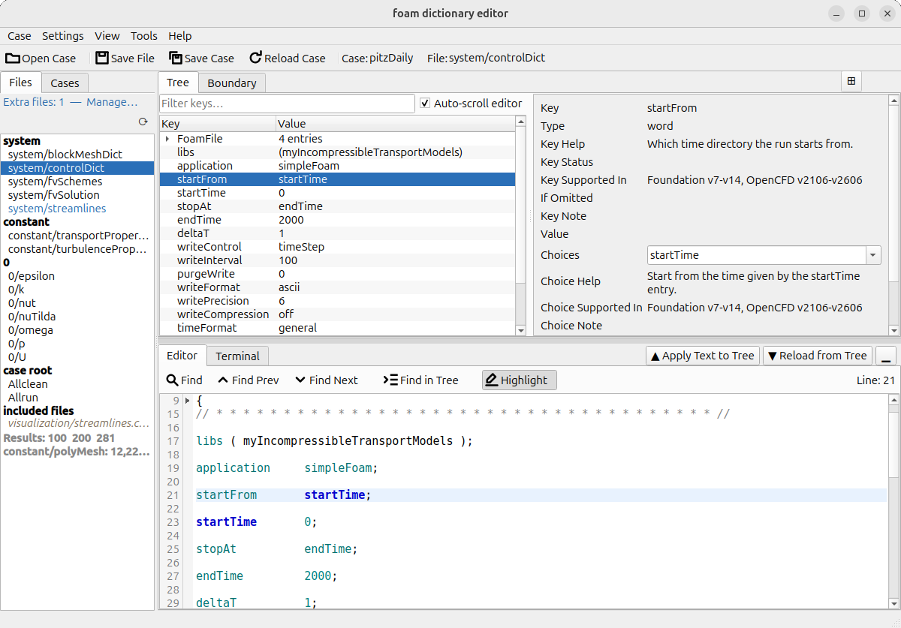

メインウィンドウは水平スプリッタで左右に分割されています。

- **左カラム** — ウィンドウ全高で 2 つのタブに分かれています: **Files**（選択中の OpenFOAM ケースのファイル一覧）と **Cases**（ケース全体を探す・管理するためのディレクトリブラウザ。「[ケースナビゲーター](#ケースナビゲーター)」参照）。`Ctrl+1` は前面のタブを問わず、カラム全体を非表示・表示します。
- **右カラム** — 垂直スプリッタで上下に分割。
  - **上段** — タブ切り替えパネル（最大 3 タブ）。
    - **Tree** タブ — パース済み辞書のツリー表示（中央）と詳細編集ペイン（右）。`blockMeshDict`、`topoSetDict`、`snappyHexMeshDict`、`setFieldsDict` のいずれかがアクティブなファイルのとき、タブバーの右上に **⊞** ボタンが表示されサイドバイサイドモードを起動できます（「[BlockMesh パネル — サイドバイサイドモード](#サイドバイサイドモード)」参照）。
    - **Boundary** タブ — 全フィールド変数の境界条件テーブル（「[境界条件ビュー](#境界条件ビュー)」参照）。
    - **BlockMesh** タブ — `blockMeshDict` ジオメトリのインタラクティブ 3D ビューア（「[BlockMesh パネル](#blockmesh-パネル)」参照）。シンプルターミナルが有効なときのみ表示（standard バリアント）。**View > BlockMesh 3-D Panel** でも切り替え可能。
  - **下段** — タブ切り替えパネル。
    - **Editor** タブ — 行番号付きのプレーンテキストエディタ。
    - **Terminal** タブ — モード切替機能付きの統合ターミナル（詳細は「[ターミナルタブ](#ターミナルタブ)」を参照）。

    下段のタブバー右上には **▲ Apply Text to Tree** と **▼ Reload from Tree** が配置されています（後述）。

上部アクションバーはタブ列の上に固定されたツールバーで、頻繁に使う操作と現在のケース・ファイル表示があります。

- Open Case — **Case > Open Case…** `Ctrl+O` と同じ操作です。
- Save File
- Save Case
- Reload Case
- Case: 現在ケース名表示
- File: 現在ファイル名表示

**Save File**、**Save Case**、**Reload Case**、**Open Case** は、対応する **Case** メニュー項目と同じ操作です。

ツリーとエディタテキストの間で内容を受け渡す 2 つの操作は、ディスク操作と一緒に上部アクションバーへ置くのではなく、両ペインの*境目* — 下段タブバーの右上隅 — に配置しています。矢印は垂直スプリッタの向きを表します（ツリーが上段、エディタが下段）。

- **▲ Apply Text to Tree** — エディタのテキストを解析し直して上のツリーを再構築します。**Case > Apply Text to Tree** `Ctrl+Shift+A` からも実行できます。
- **▼ Reload from Tree** — 上のツリーからエディタのテキストを生成し直します。**Case > Reload from Tree** からも実行できます（エディタのテキストを上書きするため、ショートカットはありません）。

タブページの内部ではなくタブバー上に置かれているため、どちらの段でどのタブを選んでいても常に利用できます。**BlockMesh** タブを前面にしたままでも **Apply Text to Tree** は 3D オーバーレイを更新します。

**Editor** タブには、テキスト検索操作用のツールバー行があります。

- Find — 検索ダイアログを開きます（Ctrl+F）。
- Find Prev — 前の一致箇所に移動します（Shift+F3）。
- Find Next — 次の一致箇所に移動します（F3）。
- Find in Tree — 現在のカーソル行を含むソーススパンを持つ最も深いツリーノードを選択します（Ctrl+Shift+T）。
- Highlight — シンタックスハイライトのオン／オフを切り替えるトグルボタン。設定は `app_config.json` に保存され、次回起動時に復元されます。
- Line: N — 現在のカーソル行番号（ツールバー右端）。

メニューバーには **Case** メニュー、**Settings** メニュー、**View** メニュー、**Tools** メニュー、**Help** メニューがあります。

**Case メニュー:**

- Case > Open Case… `Ctrl+O` — 上部ツールバーにも同じボタンがあります。
- Case > Open from Case Library…
- *ドラッグ＆ドロップ:* ファイルマネージャからケースディレクトリをウィンドウ上の任意の場所にドロップするとケースを開きます。未保存の変更がある場合は確認ダイアログが表示されます。
- Case > Reload Case
- Case > Save File `Ctrl+S`
- Case > Save Case `Ctrl+Shift+S`
- Case > Save as New Case…
- Case > Apply Text to Tree `Ctrl+Shift+A` — 下段タブバーの **▲ Apply Text to Tree** ボタンと同じ動作です。
- Case > Reload from Tree — **▼ Reload from Tree** ボタンと同じ動作です。エディタのテキストを上書きし、ツリーへ未適用の編集を破棄するため、意図的にショートカットを割り当てていません。
- Case > Duplicate Case…
- Case > Duplicate from Case Library…
- Case > Case Browser… — 2 ペイン構成の Case Browser ウィンドウを開きます。「[Case Browser ウィンドウ](#case-browser-ウィンドウ)」を参照。
- Case > Find OpenFOAM Examples… — Tools > Find OpenFOAM Examples… と同じアクションです。チュートリアルケースを複製して新しいケースの出発点にできるため、ここにも表示されます。[Find OpenFOAM Examples](#find-openfoam-examples) を参照。
- Case > Clean Backup Files…
- Case > Manage Extra Files & Directories… — 開いているケースの追加ファイル・追加ディレクトリを管理します。[追加ディレクトリの登録](#追加ディレクトリの登録) を参照。
- Case > Reset File List — ケースの追加ファイル・追加ディレクトリの登録を解除します。[追加ファイル・ディレクトリの削除](#追加ファイルディレクトリの削除) を参照。
- Case > Compare with Case…
- Case > Exit `Ctrl+Q`

**View メニュー:**

- View > Show Type Column（チェック式、デフォルトで非表示）
- View > File List `Ctrl+1`、View > Detail Pane `Ctrl+2`、View > Editor / Terminal Pane `Ctrl+3` — チェック式。チェックを外すとそのペインが最小化されます。「[ペインの最小化](#ペインの最小化)」を参照。
- View > Reset Window Size — ウィンドウサイズを既定に戻します。[ウィンドウサイズ](#ウィンドウサイズ) を参照。
- View > BlockMesh 3-D Panel（チェック式。BlockMesh タブの表示・非表示を切り替えます。xterm ターミナルモードが有効な場合は GPU 競合のためグレーアウトし、ラベルが **"BlockMesh 3-D Panel  (unavailable: xterm active)"** に変わります）
- View > Save Image… `Ctrl+Shift+I` — BlockMesh パネルの **Save Image…** ボタンと同じアクションで、そのパネルが使える場合にのみ表示されます。[BlockMesh パネル](#blockmesh-パネル) を参照。
- View > View Log Summary… — Tools > View Log Summary… と同じアクションで、見つけやすさのためここにも表示されます。[View Log Summary](#view-log-summary) を参照。

**Settings メニュー:**

- Settings > Set Default Case Directory…
- Settings > Manage Case Library…
- Settings > Manage Schema Modules…
- Settings > Generate OpenFOAM Keywords… — 選択した OpenFOAM インストールからシンタックスハイライト用のキーワード一覧を再生成します。[Generate OpenFOAM Keywords](#generate-openfoam-keywords) を参照。
- Settings > Restore Last Session on Startup（チェック式、既定でオン）と Settings > Forget Saved Session。[セッションの復元](#セッションの復元) を参照。
- Settings > Reset All Settings…
- Settings > Appearance — 配色テーマを選択します: **Follow System**（既定）、**Light**、**Dark**。アプリケーションを再起動すると反映されます。[外観と配色](#外観と配色)を参照してください。
- Settings > UI Scale — UI 全体の拡大率を 100 %（既定）、125 %、150 %、175 %、200 % から選択します。アプリケーションを再起動すると反映されます。[文字サイズと表示スケーリング](#文字サイズと表示スケーリング)を参照してください。
- Settings > Language — UI の言語を選択します（English / 日本語）。アプリケーションを再起動すると反映されます。

**Tools メニュー:** 各項目の前提条件とメニュー順の一覧は [Tools メニュー](#tools-メニュー) を参照してください。

**Help メニュー:**

- Help > About Foam Dictionary Editor (FoDE) — アプリケーションのバージョン（git チェックアウトから実行した場合は開発ビルドの短い接尾辞付き）、ライセンス、謝辞を表示します。
- Help > Keyboard Shortcuts
- Help > Resources

## 現在のケースとファイル表示

ツールバーには現在のケース名（ディレクトリ名）と、現在ファイルを `親ディレクトリ/ファイル名` の形式で表示します。たとえば `system/controlDict` や `constant/transportProperties` のように表示されます。

ケースまたはファイルが未読み込みの場合は `-` を表示します。

## ツリーとテキストの編集フロー

このエディタは、パーサがファイルを完全に解釈できない場合でも、生テキスト編集を継続できることを重視しています。想定される操作手順は次の通りです。

1. ケースを開き、ファイル一覧から対象ファイルを選択します。
2. まず下部エディタに生テキストを直ちに読み込みます。
3. パースに成功した場合は、ツリー表示を更新します。
4. ツリーを使って構造を確認し、簡単な値編集を行います。行を選択すると対応するソース行がエディタでハイライトされます（[エディタ同期](#エディタ同期auto-scroll-editor)を参照）。
5. 下部テキストエディタで直接手動編集も行えます。
6. 編集済みテキストをツリーへ反映したい場合は **Apply Text to Tree** を押します。ソース行が古くなっていた場合はエディタ同期も復帰します。
7. 現在のツリーからテキストを再生成したい場合は **Reload from Tree** を押します。
8. 現在ファイルだけを保存する場合は **Save File**、変更済みファイルをまとめて保存する場合は **Save Case** を押します。

## 詳細ペイン

右側の詳細ペインは、選択したノードのコンテキスト情報を表示し、値の編集を行う場所です。

選択したキーにスキーマが定義されている場合、次の情報が表示されます。

- **Key Help** — その設定が何を制御するかの説明。
- **Key Status** — そのキーが単に現行のものではない場合にのみ表示されます（後述）。
- **Key Supported In** — その設定が適用されるソルバー種別や構成。
- **Key Note** — 補足事項や注意点。
- **Choices** — 有効または一般的な値のドロップダウンリスト。選択肢を変えると、その値に固有の説明・Supported In・注記が下部のヘルプ欄に反映されます。

### 旧称のキーと、何も起きないエントリ

OpenFOAM は辞書のキーを折に触れて改名しており、2 つのフォークが常に同時に改名するとは限りません。現行でない名前を隠すのではなく、詳細ペインはそれが何なのかを伝えます。

- **改名されたキー**には *Historical name — OpenFOAM reads '<新しい名前>' in <バージョン>* と表示されます。たとえば `convertToMeters` は `scale` に、`minMedianAxisAngle` は v1712 に `minMedialAxisAngle` へ改名されました。後者は Foundation 系では現在も受け付けられますが OpenCFD は v2212 で削除したため、同じ 1 行でも使用中の OpenFOAM によって挙動が変わります。
- **効果のないエントリ**は警告色で *Has no effect — OpenFOAM reads '<別のキー>' instead* と表示されます。公式チュートリアルには現れるものの、どの OpenFOAM リーダも読まないキーであり、書いても何も変わりません。代表例は `meshQualityControls` の `minFlatness` です。motorBike チュートリアルが OpenFOAM-2.3.x 以来、両フォークでこのキーを出荷し続けている一方、実際に読まれるのは `minFaceFlatness` です。motorBike を出発点にしたケース（非常に多くのケースがそうです）では、その 1 行は無効なまま残っています。

### カバー範囲

これらのヘルプ情報はスキーマモジュールから提供されます。組み込みスキーマは `controlDict`、`fvSchemes`、`fvSolution`、`blockMeshDict`、`snappyHexMeshDict`、`turbulenceProperties`／`momentumTransport` のエントリの大半をカバーしており、`div(phi,U)` や特定フィールドのソルバーブロックのように、ケース側の名前が付いたエントリも含みます。OpenFOAM は巨大なので、その他の辞書はまだ対象外です。スキーマのないキーでも詳細ペインにはキー名・型・値が表示されますが、ヘルプ欄は空白になります。不足している設定のスキーマは、独自のスキーマモジュール（Python ファイル）を作成し、**Settings > Manage Schema Modules…** から実行時に読み込むことで補完できます。

新しいリリースに同梱されたモジュールは、一覧に自動的に追加されます。以前に削除したモジュールは削除されたままになります。

通常ノードでは Key、Type、編集可能な Value フィールドも表示されます。`field_value` ノードでは Field Type、Field Name、Value を表示します。

### 数値型の自動昇格

OpenFOAM は多くの場面で整数と浮動小数点数を厳密に区別しません。現在の型が `int` のノードに小数値（例: `0.5`）を入力すると、エラーや確認ダイアログなしに自動的に `scalar` へ型が昇格されます。Type 列は Apply Value の直後に更新されます。`scalar` ノードに整数値を入力しても型は `scalar` のまま維持されます。

### 編集値の検証

入力した値がノードの型に対して無効な場合（例: `scalar` ノードに非数値の文字列、または `bool` ノードに `true`/`false`/`on`/`off`/`yes`/`no` 以外の文字列）、編集は受け付けられずノードの値はそのまま維持されます。ステータスバーに問題の詳細が表示されます。

## エディタの挙動

下部エディタは OpenFOAM 辞書ファイルのプレーンテキスト直接編集に使われます。エディタパネル下部に現在行番号も表示します。

エディタは OpenFOAM 辞書ファイルのトークンに**シンタックスハイライト**を適用します: コメント（`//` および `/* */`）はグレー斜体、文字列リテラルは緑、`#ディレクティブ` は紫太字、`$マクロ` 参照はオレンジ、予約済みキーワード（`FoamFile`、`true`/`false`、`uniform`、`nonuniform` など）は青太字、数値はティール色で表示されます。エディタツールバーの **Highlight** ボタンでハイライトのオン／オフを切り替えられます。設定はセッションをまたいで保存されます。

テキストエディタ内容に未保存の変更があるとウィンドウタイトルに `*` が付き、保存・ツリーからの再読み込み・Apply-to-Tree 成功後に外れます。

### コード折りたたみ

エディタ左側の行番号ガターには、折りたたみ用の細い列があります。複数行にまたがる `{ … }` ブロックごとに、開き波括弧の行の折りたたみ列に小さな三角形が表示されます。

| 三角形 | 意味 |
|--------|------|
| ▾（下向き）| ブロックは展開中 — クリックで折りたたむ |
| ▶（右向き）| ブロックは折りたたみ中 — クリックで展開する |

三角形をクリックすると、`{` から対応する `}` までの行を非表示または表示に切り替えられます。ファイルを読み込むたびに `FoamFile { … }` ヘッダーブロックが自動的に折りたたまれ、辞書の本文を画面上部に表示します。

折りたたみは表示のみの操作であり、テキスト本文は変更されません。**Apply Text to Tree**、**Save File**、コピー操作はいずれも、現在の折りたたみ状態に関わらず完全なテキストに対して動作します。

## ツリーキーフィルターとエディタ同期

### ツリーキーフィルター

ツリービューの上部にフィルターバーがあります。キー名の一部を入力すると、一致するキーを含む行だけに絞り込まれます（大文字・小文字を区別しない）。マッチングは再帰的で、子孫ノードが一致した場合はその親ノードも表示されるため、一致箇所までのパスが常に確認できます。

フィルターをクリアすると全エントリが再表示されます。新しいファイルを開いた際もフィルターは自動的にクリアされます。

`unknown_raw_entry` や `directive_entry` ノードはキーが空のため、アクティブなフィルターによって非表示になります（兄弟または子孫ノードが一致する場合を除く）。

### エディタ同期（Auto-scroll editor）

ツリーの行を選択すると、対応する行がテキストエディタで琥珀色の背景でハイライトされます。これにより、選択したエントリの生テキストをすぐに確認できます。

フィルターバーの右隣にある **Auto-scroll editor** チェックボックスで、エディタがハイライト位置にスクロールするかどうかを切り替えられます。

- **オン（デフォルト）** — エディタがエントリの先頭行にスクロールし、行スパン全体を琥珀色でハイライトします。ツリーを使ってファイルをナビゲートするのに適しています。
- **オフ** — 琥珀色のハイライトは表示されますが、エディタはスクロールしません。特定の生テキスト領域を固定したままツリー構造を閲覧するのに適しています。

エディタのテキストが最後のパース以降に変更されると、チェックボックスのラベルがグレーになり **Auto-scroll editor (stale)** と表示されます。この状態では保存された行番号がテキストと一致しないため、ジャンプとハイライトは停止します。ステータスバーに *"Apply Text to Tree to re-enable jump-to-line"* というリマインダーが表示されます。**Apply Text to Tree** を押すか、別のファイルを選択して戻るか、新しいケースを開くと自動的に復帰します。

ツリー上で直接追加・編集したノード（テキストからパースされたものではないノード）はソース位置情報を持ちません。そのようなノードを選択してもエディタ位置は変わらず、ステータスバーに *"No source location — entry was added or modified in the tree"* と表示されます。

### Find in Tree（エディタ → ツリー方向）

Editor ツールバーの **Find in Tree** ボタンをクリック（または **Ctrl+Shift+T** を押す）すると、逆方向のナビゲーションができます。現在のエディタカーソル行を含むソーススパンを持つ最も深いノードがツリーで選択されます。

- ソース行が古くなっている（最後のパース以降にテキストを編集した）場合は、ステータスバーにメッセージが表示されます。先に **Apply Text to Tree** を実行してください。
- カーソルがすべてのノードのスパン外（ファイル先頭の空白行など）にある場合は、*"No tree entry found for line N"* と表示されます。
- 一致したノードが現在のキーフィルターで非表示になっている場合は、最も近い表示中の祖先ノードが代わりに選択されます。表示中の祖先もない場合は *"Entry is hidden by the current filter"* と表示されます。

## ツリービューのコンテキストメニュー

中央ツリービューの任意の行を右クリックするとコンテキストメニューが表示されます。項目は機能ごとにグループ化されています。

### 元に戻す・やり直す

ツリーの編集は元に戻せます: ツリーがキーボードフォーカスを持つ状態で **Ctrl+Z** を押すと、最後に行ったツリー変更が取り消され、**Ctrl+Shift+Z** で再適用されます（コンテキストメニューの **Undo Tree Edit** / **Redo Tree Edit** からも実行できます）。対象はツリー側のすべての変更 — インラインセル編集、Detail パネルの Apply、Paste Value、Add/Duplicate/Delete/Comment Out/Restore、**Apply Text to Tree**、Vertices テーブルでの編集、Boundary タブのパッチ操作 — です。複数のフィールドファイルを一度に変更する境界操作（例: `0/` 全体でのパッチ名変更）は一体として取り消されます。1 回の Ctrl+Z で触れたすべてのファイルが復元され、ステータスバーに追加ファイル数が表示されます。

Undo はセッション全体で単一の履歴として保持され（最大 50 ステップ）、別のケースを開くとクリアされます: Ctrl+Z は場所を問わず最後のツリー変更を取り消し、対象ファイルが画面に表示されていない場合はそのファイルへ表示を切り替えます。下部のテキストエディタは自由入力用に自身のネイティブな Ctrl+Z を保持しています — ツリーのショートカットはツリーにフォーカスがあるときだけ発火します。Undo はツリーを再読み込みするため、行の展開・選択状態はリセットされます。

### Value のコピー・ペースト

- **Copy Value** — 選択行の Value 列に表示されているテキストをシステムクリップボードにコピーします。ツリーにキーボードフォーカスがある状態で Ctrl+C を押しても同じ動作をします。
- **Paste Value** — クリップボードのテキストを選択行の Value 列に適用します。セルを直接編集する場合と同じパースパスを経由します。ツリーにフォーカスがある状態で Ctrl+V を押しても同じ動作をします。

**Paste Value** は、選択ノードの型が Value 編集をサポートしない場合（例: `dictionary` ノードのエントリ数表示）にグレーアウトされます。ペーストした文字列がノード型のフォーマットと合わない場合（例: `scalar` ノードに非数値を貼り付ける）は、ペーストは受け付けられず、ステータスバーにメッセージが表示されます。

Ctrl+C / Ctrl+V ショートカットはツリーウィジェット限定のスコープのため、下部テキストエディタとは干渉しません。セルがインライン編集モードの場合は、ショートカットはインラインエディタ側で処理されます。

### エントリの追加・複製

- **Add Entry After** — 選択ノードの直後に `word` 型の新規エントリ（`newKey / newValue`）を兄弟として挿入し、キーセルをインライン編集状態にします。親が辞書またはルートの場合に有効です。`blockMeshDict` の `block N` 行では代わりに新しいブロック — そのまま使える `hex (0 1 2 3 4 5 6 7) (10 10 10) simpleGrading (1 1 1)` — を挿入し、Value セルをインライン編集状態にします。ブロック行のキーは位置そのものであり入力できないためです。
- **Add Child Entry** — 選択ノードの最後の子として新規エントリを挿入します。選択ノードが `dictionary` の場合のみ有効です。
- **Duplicate** — 選択ノードとそのサブツリーをディープコピーし、元のノードの直後に挿入します。

### コメントアウトと削除

- **Comment Out** — 選択エントリのレンダリングテキストの全非空白行先頭に `// ` を付けて `unknown_raw_entry` に変換します。すでにコメントアウト済みの場合、および `block N` 行ではグレーアウトされます。`blocks ( … )` の中でコメントアウトされたブロックはエントリではなくコメントとして読み戻されるため、行が復元可能な形で残らず消えてしまうからです。
- **Restore from Comment** — **Comment Out** の逆操作です。各行の `// ` プレフィックスを除去して再パースし、元のノードに戻します。全非空白行が `//` で始まる `unknown_raw_entry` の場合にのみ有効です。
- **Delete** — Yes/No の確認ダイアログ後に選択ノードを削除します。`block N` 行を削除すると、それ以降のブロック番号はツリーでも 3D ビューアでも振り直されます。

## パース失敗時の挙動

読み込み時または編集後の再パース時に失敗すると、アプリケーションは警告を表示しつつ、生テキストエディタはそのまま利用可能な状態を維持します。このとき、後続のパースが成功するまでは、最後に正常パースできたツリーが保持されます。

パース自体は成功したが一部のエントリを完全に解釈できなかった場合は、それらのエントリが `unknown_raw_entry` ノードとしてツリーに保持され、認識できなかったエントリの件数を示す警告がステータスバーに表示されます（例: "Parsed: system/controlDict — 2 unrecognized entries"）。該当エントリの生テキストは保持されたまま書き戻されるため、ファイルは引き続き利用できます。

## ファイル一覧の挙動

ファイル一覧には、ケースの主要な辞書、ユーザーが追加したファイル、`0/` と `0.orig/` 内のすべてのフィールドファイルが表示されます。

### ディレクトリヘッダーのマーカー

ファイル一覧の各ディレクトリグループは太字のヘッダーで表示されます。そのディレクトリにファイルが存在するにもかかわらず、現在のファイル一覧に含まれていない場合は `[+]` サフィックスが付きます。全ファイルが一覧に含まれている場合はマーカーなしで表示されます。

### デフォルト対象ファイル

FoDE はケース内のすべてのファイルではなく、編集することの多い辞書を一覧に表示します。

- **`system/` と `constant/`** — OpenFOAM のチュートリアルを調査して選んだ、よく知られた辞書名約 100 個です。`controlDict`、`fvSchemes`、`fvSolution`、`blockMeshDict`、`snappyHexMeshDict`、`transportProperties` などが含まれます。2 つの OpenFOAM フォークで名前が変わった辞書は、どちらの綴りも登録されており、ケースにあるほうが表示されます（`turbulenceProperties` / `momentumTransport`、`fvOptions` / `fvModels` + `fvConstraints`、`transportProperties` および `thermophysicalProperties` / `physicalProperties`）。`limestoneCloud1Properties` のような、1 つのケースにしかない名前は推測しません。
- **3D ビューアが描画する 4 つの辞書の変種** — `system/` 内の、名前が `blockMeshDict`、`topoSetDict`、`snappyHexMeshDict`、`setFieldsDict` で始まるファイル。`topoSetDict-slices` や `topoSetDict.1` を `topoSetDict` と並べて持つケースでも、すべて一覧に表示されます。
- **フィールドファイル** — `0/` と `0.orig/` の直下にあるすべてのファイル。
- **フェーズバリアント** — `thermophysicalProperties.*`、`turbulenceProperties.*` とその仲間（例: `thermophysicalProperties.air`）。`constant/` と各リージョンの constant ディレクトリから集めます。
- **ケースルートのスクリプト** — `Allrun`、`Allclean` などの `All*` スクリプト。[ケースルートのスクリプト](#ケースルートのスクリプト) を参照。
- **`#include` で取り込まれるファイル** — [インクルードされたファイル](#インクルードされたファイル) を参照。

それ以外 — `README`、`log.*` ファイル、変わった名前の辞書、ディレクトリ全体 — は自分で追加します。ディレクトリヘッダーを右クリックして **Add files from…** を選ぶか（[実行時のファイル追加](#実行時のファイル追加)）、ディレクトリを登録します（[追加ディレクトリの登録](#追加ディレクトリの登録)）。

### ケースルートのスクリプト

ケースルート直下の `All*` にマッチするスクリプトファイル（`Allrun`、`Allrun.pre`、`Allclean` など）は、他のすべてのグループの後に表示される **case root** グループへ自動的に一覧表示されます。Tools メニューからこれらのスクリプトを実行できるため、実行される内容をそのまま確認・編集できます。それ以外のケースルート直下のファイル（`log.*`、`*.foam`、結果ディレクトリ）は一覧を簡潔に保つためデフォルトでは表示されず、このグループに `[+]` マーカーが付くこともありません（ルートにはほぼ常に未表示のログが存在するため、マーカーが常時点灯してしまうからです）。特定のルートファイル — 実行ログ、`README`、カスタムスクリプトなど — を一覧に加えたい場合は、**case root** ヘッダーを右クリックして **Add files from 'case root'...** を選択します。同じメニューには他のディレクトリヘッダーと同様に **New file in 'case root'...** もあります。隠しファイル（`.` で始まる名前）は候補に表示されません。

スクリプトはシェルファイルであり OpenFOAM 辞書ではないため、開いてもテキストエディタにのみ表示されます — ツリービューは空のままで、**Apply Text to Tree** は効果がなく、比較モードの対象にもなりません。エディタは（`#!` シバンの検出により）自動的にシェル用のシンタックスハイライトに切り替わり、`#` コメント、引用符付き文字列、`$変数`、`runApplication`・`runParallel` などの OpenFOAM 実行ヘルパー、および通常の OpenFOAM キーワードリストによるユーティリティ・ソルバー名が色分けされます。編集と保存は他のファイルと同様に行え、実行権限は保持されます。また、ケースを複製したり新しいケースとして保存したりする際にもスクリプトが含まれるため、複製後も Tools メニューから実行できます。

### マルチリージョンケース

`system/` 内にサブディレクトリが存在する場合、FoDE は各サブディレクトリをリージョン名として扱い、追加のファイルグループを構築します。リージョンごとに、トップレベルと同じ種類の辞書を探します — `system/<region>/` の `fvSchemes`、`fvSolution`、`decomposeParDict`、`meshQualityDict` などのメッシュ・ソルバー系辞書、`constant/<region>/` の `thermophysicalProperties`、`turbulenceProperties`/`momentumTransport`、`radiationProperties`、`dynamicMeshDict` など — で、存在するものを一覧に追加します。`thermophysicalProperties.air` のようなフェーズバリアントもリージョンごとに集められます。

各リージョンディレクトリはファイル一覧に独立したグループヘッダー（例: `system/fluid`、`constant/heater`）として表示されます。リージョングループはトップレベルの `system` および `constant` グループの後にソートされます。

`0/<region>/` および `0.orig/<region>/` 内のフィールドファイルも自動的に一覧表示されます。グループヘッダーは `0/fluid` や `0/solid` のように表示されます。`chtMultiRegionFoam` のようにリージョンごとに初期条件ファイルを持つケース（例: `0/heater/T`、`0/bottomWater/p`）に対応しています。

### インクルードされたファイル

辞書は `#include`（および `#sinclude`、`#includeIfPresent`、`#includeEtc`、`#includeFunc`）で別のファイルを取り込めます。FoDE はこれらのディレクティブを追跡し、参照先のファイルをファイル一覧に表示するので、ディスク上を探し回らずに内容を読めます。取り込み元の辞書に内容が展開されることはありません。インクルードされたファイルはシンボリックリンクされたファイルと同じように独立したファイルのままで、ディレクティブもツリー上の 1 行として残ります。

表示先はファイルの場所によって変わります。

- **ケース内** — 本来所属するグループに入ります。`constant/dynamicMeshDict` の `#include "caseSettings"` なら `caseSettings` は **constant** グループに `↳` マーク付きで現れます。他のケースファイルと同様、編集も保存も可能です。
- **ケース外** — 典型的には `#includeEtc "caseDicts/setConstraintTypes"` や `#includeFunc solverInfo` で、OpenFOAM のインストール先に解決されます。これらは一覧下部の **included files** グループにまとめられ、斜体で表示されます。インクルードされたファイルにカーソルを合わせると、どのファイルの `#include` が取り込んだかが表示されます。

ケース外のファイルは**読み取り専用**です。編集するとマシン上の全ケースが共有するファイルを変えてしまうため、ツリーとテキストは表示されますが、テキストエディタはロックされ（Line 表示の隣に `read-only` バッジが出ます）、ツリーの項目は編集できず、Save・Create Backup・Duplicate・Delete も使えません。手を入れたい場合は右クリックして **Copy into case...** を選びます。ファイルがケース内（通常は OpenFOAM が最初に参照する `system/`）へコピーされ、コピーは編集可能になります。`#includeFunc` ならコピーは即座に効きます。`#includeEtc` の場合はディレクティブを素の `#include "<名前>"` に変えると、ローカルのコピーが使われます。

ディレクティブから参照先ファイルへ移動するには、ツリー上のディレクティブ行を右クリックして **Open Included File** を選ぶか、行の Key 列または Type 列をダブルクリックします。行にカーソルを合わせると、解決先、あるいは解決できなかった理由が表示されます。

- **not found** — ファイルが存在しません。チュートリアルにはインクルード対象を `Allrun` で生成するものがあるため、ケースを実行する前は正常な状態です。
- **optional include not present** — `#sinclude`/`#includeIfPresent` の対象が存在しません。これは正当であり、エラーではありません。
- **no OpenFOAM installation found** — `#includeEtc` と `#includeFunc` の解決には OpenFOAM のインストールが必要です。FoDE を起動する前に OpenFOAM を source するか、**Find OpenFOAM Examples** または **Settings > Generate OpenFOAM Keywords…** でインストールを選択してください（どちらも同じ選択欄で、選択は記憶されます）。

制限が 2 点あります。インクルードは**1 段階のみ**追跡するため、インクルードされたファイル自身のインクルードは辿りません。また、ケースがどの OpenFOAM バージョン向けに書かれたかは判別できないため、明示的に選択しない限り `#includeEtc` は見つかった最新のインストールに対して解決されます。

### シンボリックリンクの表示

ファイル一覧内のシンボリックリンクは、ファイル名の末尾に `⇢` マーカーを付け、斜体テキストで表示されます。アイテムにホバーするとパスとリンク先を含むツールチップが表示されます。シンボリックリンクを編集するとリンク先ファイルへ書き込まれます（OS のリンク解決と同じ動作）。

### 実行時のファイル追加

ファイル一覧のディレクトリヘッダー（**case root** ヘッダーを含む）を右クリックすると、次のコンテキストメニューが表示されます。

- **New file in '\<dir\>'...** — FoamFile テンプレートから新規ファイルを作成します（「[新規ファイルの作成](#新規ファイルの作成)」を参照）。
- **Add files from '\<dir\>'...** — 既存ファイルを一覧に追加します。そのディレクトリにあって未登録のファイルがダイアログで表示されます（`.` で始まる隠しファイルは除外されます）。1 つ以上選択して **OK** をクリックすると追加されます。
- **Remove '\<dir\>' from file list** — 追加ディレクトリをファイル一覧から削除します。追加ディレクトリのヘッダー（紫色）にのみ表示されます（「[追加ディレクトリの登録](#追加ディレクトリの登録)」を参照）。
- **Duplicate '\<dir\>' → '\<counterpart\>'...** — `0/` または `0.orig/` ディレクトリを複製してもう一方を作成します（「[フィールドディレクトリの複製](#フィールドディレクトリの複製)」を参照）。`0` および `0.orig` のヘッダーでのみ表示され、2 つのうちどちらか一方しか存在しない場合に限り表示されます。
- **Delete '0' directory...** — `0/` ディレクトリをディスクごと削除します（「[フィールドディレクトリの削除](#フィールドディレクトリの削除)」を参照）。`0` ヘッダーでのみ表示され、`0.orig` が存在する場合にのみ有効です。

追加したファイルはケースディレクトリ内の `.foam-editor-files.json` に保存され、次回ケースを開いたときに自動的に復元されます。**Duplicate Case…** でアプリ表示ファイルのみコピーモードを使用した場合も、この設定ファイルがコピーされます。

追加ファイルはデフォルトのターゲットファイルと区別できるよう、ファイル一覧内で異なる色（青）で表示されます。

### 追加ディレクトリの登録

ケースルート内の任意のディレクトリをファイル一覧に追加し、`0/` や `0.orig/` と同様にディレクトリ内のファイルを自動スキャンできます。次のような用途に対応します。

- 非標準ソルバーが使うカスタムフィールドディレクトリ（例: `laserBeamFoam` の `initial/`）。
- 閲覧・編集したい再起動タイムステップ（例: `0.5/`、`1/`）。
- 補助辞書を含む深い階層のサブディレクトリ（例: `lagrangian/sprayFoam/aachenBomb/chemkin/`）。
- サブディレクトリにファイルを含む結果・検証ツリー（例: `validation/`）。

追加ディレクトリのグループヘッダーは**紫色**で表示されます。ファイルがすべて読み込まれるため、`[+]` の未読み込みマーカーは表示されません。

隠しファイル・隠しディレクトリ（`.` で始まる名前、例: アプリ自身の `.foam-editor-files.json` や `.git/` ツリー）は、追加ディレクトリのスキャンから常に除外されます。

**Results インジケーターからタイムディレクトリを追加する:**  
ファイル一覧下部の **Results: …** 行を右クリックします。各タイムディレクトリがサブメニューに表示されます。クリックするとそのディレクトリが追加されます。すでに追加済みのディレクトリはグレーアウトされます。

**管理ダイアログから任意のディレクトリを追加する:**  
**Case > Manage Extra Files & Directories…**（またはファイル一覧上部のインジケーターボタン）を開きます。**Extra Directories** タブで **Add Directory…** をクリックするとケースディレクトリ配下のフォルダピッカーが開きます。追加したいサブディレクトリを選択して **OK** をクリックします。デフォルトはフラットスキャン（直下ファイルのみ）で追加されます。

**再帰スキャンを有効にする:**  
デフォルトのフラットスキャンではディレクトリ直下のファイルのみ一覧表示されます。サブディレクトリ内のファイルも含めるには、**Extra Directories** タブで対象エントリにチェックを付けて **Toggle Recursive** をクリックします。エントリのラベルが `<dir>  [recursive]` に変わり再帰モードであることを示します。同じエントリに再度 **Toggle Recursive** をクリックするとフラットスキャンに戻ります。

**追加ディレクトリを削除する:**  
紫色のディレクトリヘッダーを右クリックして **Remove '\<dir\>' from file list** を選択するか、管理ダイアログの **Extra Directories** タブでチェックを付けて **Remove Selected** をクリックします。

追加ディレクトリ内で作成・複製したファイルは、そのディレクトリ全体がスキャン対象のため、追加ファイルリストへは追加されません。

**追加ディレクトリ内の実行ログと大きな非ディクショナリファイル:**  
追加ディレクトリ経由で一覧に含まれた `log.*` 実行ログ（例: `log.blockMesh`、`log.simpleFoam`）は、ファイル一覧で**グレー（薄く）表示**され、常にプレーンテキストとして開かれます — 辞書パーサーは一切実行されないため、ツリービューはなく、**Apply Text to Tree** は効果がなく、ケース比較でもスキップされます（`≠` マーカーなし）。100 KB を超えるログを開く場合は、大きなテキストファイルの読み込みに時間がかかることがあるため、先に確認ダイアログが表示されます。それ以外の大きな非ディクショナリファイルにも同じ確認ダイアログが表示され、差分計算では同様にスキップされます。

### 追加ファイル・ディレクトリインジケーター

ケースが読み込まれている間は、ファイル一覧パネルの上部に常に **Manage extra files…** ボタンが表示されます。追加ファイルやディレクトリが登録されている場合はボタンの表示が件数に変わります（例: **Extra files: 2, directories: 1 — Manage…**）。クリックすると **Manage Extra Files & Directories** ダイアログが開き、2 つのタブで管理できます。

- **Extra Files** — 個別に登録した追加ファイルの一覧。1 件以上選択して **Remove Selected** で削除できます。
- **Extra Directories** — 登録した追加ディレクトリの一覧。**Add Directory…** で新しいディレクトリを追加し、**Remove Selected** で削除できます。

ダイアログを閉じると変更が即座に反映されます。

### 追加ファイル・ディレクトリの削除

**追加ファイルの場合:**
- ファイル一覧の追加ファイル（青色）を**右クリック**して **Remove from extra files** を選択します。即座に削除されます。
- 管理ダイアログの **Extra Files** タブで1件または複数件をまとめて削除します。

**追加ディレクトリの場合:**
- 紫色のディレクトリヘッダーを**右クリック**して **Remove '\<dir\>' from file list** を選択します。そのディレクトリのファイルが即座に一覧から消えます。
- 管理ダイアログの **Extra Directories** タブで1件または複数件をまとめて削除します。

削除してもディスク上のファイルは削除されません。ケースごとの設定から除外されるだけで、ファイル一覧に表示されなくなります。

### 数値タイムディレクトリのインジケーター

ケースルートに数値名のディレクトリ（`0.5`、`1`、`10` のような OpenFOAM の計算結果ディレクトリ）が存在する場合、`0`、`0.orig`、およびすでに追加ディレクトリとして登録済みのものを除いて、ファイル一覧の末尾に非選択の **Results: …** 行が追加されます。太字のグレーテキストで表示され、最大 6 件のディレクトリ名を並べます。7 件以上の場合は `(+N more)` サフィックスが付きます。ホバーすると件数と、複数ある場合は最初と最後のディレクトリ名が表示されます。

右クリックするとサブメニューが表示され、任意のタイムディレクトリを追加ディレクトリとしてファイル一覧に登録できます（「[追加ディレクトリの登録](#追加ディレクトリの登録)」を参照）。登録後はそのディレクトリは Results インジケーターに表示されなくなり、代わりに通常のグループヘッダーとして表示されます。

### メッシュ有無・古さのインジケーター

`constant/polyMesh/owner` が存在する場合、ファイル一覧の下部（Results インジケーターの近く）に非選択の行が追加され、**「constant/polyMesh: 8,000 cells」** のようにセル数が表示されます。この件数はメッシュ自体を解析するのではなく、ファイルの `FoamFile` ヘッダーの `note` フィールド（例: `nPoints:9261 nCells:8000 nFaces:25200`）から読み取るため、チェックは軽量です。ヘッダーから件数を読み取れない場合は **「constant/polyMesh (present)」** にフォールバックします。

`system/blockMeshDict` がメッシュの生成後に変更されている場合、インジケーターはアンバー色になり **「 — stale (blockMeshDict changed since last run)」** というサフィックスが付き、ツールチップに理由が表示されます。ホバーすると、利用可能な場合は常に頂点・セル・面の全カウントが表示されます。

インジケーターは自動的に更新されます。ファイル一覧が更新されるたびに再計算され、**Tools > Run blockMesh** の実行後、`blockMeshDict` の保存後（**Save File** / **Save Case**）、ファイルシステムウォッチャーが変更を検知した後のいずれでも、手動で **Reload Case** を行う必要はありません。

### 分割済み・バックグラウンド実行のインジケーター

ケースに `processor*` ディレクトリがある場合、続けて **分割済み: …** の行が表示されます。プロセッサがいくつあっても 1 行で、その数、含まれる時刻（最後の 4 つ）、そしてそのうち `reconstructPar` をまだ通っていない時刻の数をアンバー色で示します。これは `decomposePar -force` で削除されてしまうデータで、[Delete processor\* Directories](#delete-processor-directories) を妨げるものでもあります。collated 形式では **分割済み（collated）: …** と表示されます。ツールチップにはすべての時刻が表示されます。右クリックで **Run reconstructPar…** または **Delete processor\* Directories…** を実行できます。分割済みのケースで分割し直すと先に processor のデータが削除されるため、ここには分割し直す項目はありません。**Tools > Run decomposePar…** を使ってください。最初の processor ディレクトリも監視するため、並列計算が書き出した新しい時刻はすぐに反映されます。

ケースで[バックグラウンド実行](#background-runs-and-stop-background-run)が動いている間は、**バックグラウンド実行中: <ソルバー>（pid N）** の行が続きます。**Stop Background Run** の後は、実行が終わるまでアンバー色で **<ソルバー> を停止中 … — hh:mm に要求** と表示されます。右クリックで実行の停止やログの要約表示ができます。

### バックアップの作成

ファイル一覧でファイルを右クリックし、**Create Backup** を選択すると、同じディレクトリにタイムスタンプ付きのコピーが保存されます（例: `controlDict.bak_20260502_143022`）。

バックアップはそのファイルが読み込み済みであれば現在のバッファの内容（未保存の編集を含む）を使用します。未読み込みの場合はディスク上のファイルをコピーします。ステータスバーにバックアップ完了のメッセージが表示され、未保存の編集が含まれる場合はその旨も表示されます。

### 新規ファイルの作成

ファイル一覧のディレクトリヘッダーを右クリックして **New file in '\<dir\>'...** を選択します。入力ダイアログでファイル名を指定すると、`<ケースディレクトリ>/<dir>/<name>` に最小限の FoamFile ヘッダーを持つファイルが作成されます。作成後、エディタで自動的に開かれます。

`0/` と `0.orig/` 以外のディレクトリで作成したファイルは `.foam-editor-files.json` に登録され、次回以降もファイル一覧に表示されます。

### バックアップファイルの一括削除

**Case > Clean Backup Files…** を選ぶと、現在のケースに蓄積した `.bak_*` ファイルをまとめて削除できます。ケースディレクトリ全体を再帰スキャンして `.bak_YYYYMMDD_HHMMSS` パターンに一致するファイルを一覧表示します。各ファイルは相対パスとサイズで表示されます。

全ファイルがデフォルトで選択された状態で開きます。チェックボックスで個別に選択を変更するか、**Select All** / **Deselect All** でまとめて切り替えられます。**Delete Selected (N)** ボタンは現在のチェック数を表示し、選択がない場合はグレーアウトされます。

**Delete Selected** をクリックすると追加確認なしに即座に削除されます。削除したファイルがエディタで開かれていた場合はエディタとツリービューがクリアされます。エラーが発生した場合は操作後に一覧が表示されます。

バックアップファイルが見つからない場合は「No backup files found.」と表示され、**Close** ボタンのみが表示されます。

**この操作は元に戻せません。** [免責事項](#免責事項) を参照してください。

### ファイルの削除

ファイル一覧の任意のファイルを右クリックして **Delete file...** を選択します。ファイル名を表示する確認ダイアログが開き、次の 3 択を選べます。

- **Backup && Delete** — 同じディレクトリにタイムスタンプ付きバックアップ（例: `controlDict.bak_20260506_143022`）を作成してから元ファイルを削除します。バックアップには現在のバッファの内容（未保存の編集を含む）が反映されます。バックアップの書き込みに失敗した場合、削除は中断されます。
- **Delete** — バックアップを作成せずにファイルを即座に削除します。
- **Cancel**（デフォルト）— 操作を中止します。

ファイルに未保存の変更がある場合は、ダイアログに追加の警告文が表示されます。削除後はそのファイルがメモリバッファ・ダーティ状態管理・ケースごとの追加ファイル設定から除外されます。削除したファイルがエディタで開かれていた場合は、エディタとツリービューがクリアされます。削除後にファイル一覧が自動更新されます。

この操作はディスク上のファイルを削除するため、元に戻せません。

### ファイルの複製

ファイル一覧の任意のファイルを右クリックして **Duplicate...** を選択します。現在のファイル名があらかじめ入力されたダイアログが表示され、新しいファイル名を指定できます。複製先は同じディレクトリで、FoamFile ヘッダーの `object` フィールドが新しいファイル名に自動更新されます。

複製元ファイルに未保存の変更がある場合は、次の 3 択が表示されます。

- **Save and Duplicate** — 先にファイルを保存してから複製します。
- **Duplicate with Unsaved Changes** — 現在のバッファの内容（未保存状態）をそのまま複製します。
- **Cancel** — 操作をキャンセルします。

`0/` と `0.orig/` 以外で複製したファイルは `.foam-editor-files.json` に登録されます。

### フィールドディレクトリの複製

ファイル一覧の `0` または `0.orig` ヘッダーを右クリックして **Duplicate '\<dir\>' → '\<counterpart\>'...** を選択します。このアクションはディレクトリ全体をコピーしてもう一方のディレクトリを作成します（`0/` → `0.orig/`、または `0.orig/` → `0/`）。このメニューは 2 つのうちどちらか一方しか存在しない場合にのみ表示されます。コピー開始前に確認ダイアログが表示されます。

### フィールドディレクトリの削除

ファイル一覧の `0` ヘッダーを右クリックして **Delete '0' directory...** を選択します。このアクションは `0/` ディレクトリとその中にあるすべてのファイルをディスクから完全に削除します。`0.orig` が存在する場合にのみ表示され、初期フィールドデータが保持されることが保証されます。

削除前に確認ダイアログで対象ディレクトリの完全パスが表示されます。現在開いているファイルが `0/` 内にある場合はエディタとツリービューがクリアされます。削除後にファイル一覧と境界条件パネルが自動更新されます。

この操作はディスク上のファイルを削除するため、元に戻せません。

### ファイル一覧のリセット

**Case > Reset File List** を選択すると、現在のケースに対して追加したファイルおよびディレクトリをすべて削除できます。ケースディレクトリの `.foam-editor-files.json` が削除され、ファイル一覧がデフォルトに戻ります。

## ケースナビゲーター

ファイル一覧が表示するのは*1 つの*ケースの中身です。その隣にある **Cases** タブが表示するのはケースそのものです。ディスク上のディレクトリを辿ることで、開く・比較する対象のケースを見つけたり、ファイルマネージャに切り替えることなくケース全体を移動・リネーム・複製・削除したりできます。

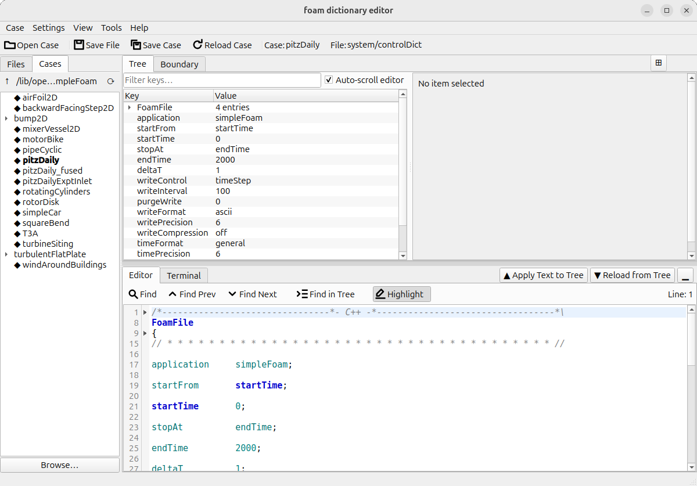

`system/` または `constant/` を含む、OpenFOAM ケースらしきディレクトリには **◆** が付き、現在開いているケースであれば太字で表示されます。ダブルクリックすると展開ではなく**ケースを開き**ます。それ以外のフォルダをダブルクリックするとその中へ移動し、**↑** ボタンで 1 つ上へ戻り、**⟳** で現在のフォルダをディスクから再スキャンします。

ナビゲーターが意図的に行わないことが 2 つあります。ケースの中へは降りていきません — ケースの中身を扱うのはファイル一覧の役目であり、1 つのケースを 2 つのブラウザで覗くのは混乱のもとだからです。また、ファイル単体は一切一覧に表示しません — ディレクトリのみです。あるディレクトリが誤ってケースと判定され、その中のフォルダを見る必要がある場合は、右クリックして **Show Subfolders** を選んでください。

ナビゲーターは前回閲覧していた場所を実行間で記憶し、そこから開きます。初回は[デフォルトのケースディレクトリ](#デフォルトのケースディレクトリ設定)を使い、それも無ければホームディレクトリを使います。そこから先はファイルシステム上のどこへでも移動できます。

### Case Browser ウィンドウ

Cases タブ下端の **Browse…**、または **Case > Case Browser…** で、フルサイズのブラウザを開けます。左にフォルダツリー、右に現在のフォルダの中身、下端にアクションの行があります。非モーダルなので作業中もメインウィンドウの横に開いたままにでき、Cases タブと表示場所を共有します — どちらか一方で移動すると、もう一方も追従します。

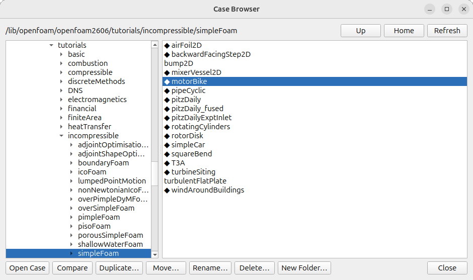

アクション行は右側ペインで選択中の項目に対して働きます。**Open Case**・**Compare**・**Duplicate…** は実在するケースに対してのみ使用でき、**Move…**・**Rename…**・**Delete…** は任意のフォルダに対して使用でき、**New Folder…** は表示中のフォルダの中に新規フォルダを作成します。

- **Open Case** — **Case > Open Case…** と全く同じように、選択したケースを開きます。
- **Compare** — 選択したケースを[ケース比較](#ケース比較)の参照側にします。比較対象があるためには、あらかじめ何らかのケースを開いておく必要があります。
- **Duplicate…** — 選択したケースをソースとして、通常の[ケースの複製](#ケースの複製)ダイアログを開きます。ケースを複製する際に、全ファイルを持っていくか FoDE が表示するファイルだけにするかを選べます。

### ケースの移動・リネーム・複製・削除

これらは Cases タブの右クリックメニューからも実行できます。それぞれ、簡単には元に戻せない操作を行う前には確認を求め、安全に行えない操作については確認すら求めず端的に拒否します — 拒否はダイアログではなくステータスバーに表示されます。

**削除**すると、そのフォルダと中身すべてがデスクトップのゴミ箱に送られ、通常の方法で復元できます。ゴミ箱が使えない場合 — ゴミ箱ディレクトリを持たない別のファイルシステムだったり、権限の問題があったりする場合 — は理由が示され、完全削除を別の明示的な選択肢として提示します。この 2 段階目の確認なしに完全に削除されることはありません。シンボリックリンクを削除した場合はリンクだけが削除されリンク先はそのまま残り、確認メッセージにもその旨が示されます。

ファイルシステムをまたぐ**移動**はリネームではなくコピー後に削除する形で行われるため、時間がかかることがあります。それが起きる場合は確認メッセージで知らされます。移動が途中で失敗した場合、元のディレクトリは必ず手つかずのまま残り、それがどこにあるか、そして不完全なコピーがどこに残っている可能性があるかの両方が示されます。FoDE が後始末をしようとして唯一残っているコピーを危険にさらすことはありません。

**開いているケースに対する操作**も許可されており、FoDE はそれに追従します。リネームまたは移動すると、ケースは新しい場所で再読み込みされ、ファイル一覧・ツリー・ターミナルの作業ディレクトリもすべて追従します。まず未保存の変更について確認が求められます。開いているケースを削除するとまずそのケースを閉じ、FoDE はケースを開いていない状態になります。

**開いているケースを*含む*フォルダに対する操作は拒否されます。** `~/runs/cavity` を開いた状態で `~/runs` を削除すると、名指ししていないケースを閉じることになってしまうため、FoDE はまずケース自身を閉じるよう求めます。登録済みの[ケースライブラリ](#ケースライブラリ)のディレクトリ、ホームディレクトリ、ファイルシステムのルートも同様に保護されており、ここから変更することはできません。

比較対象にしていたケースが移動された場合は比較もそれに追従し、削除された場合は比較状態が単純にクリアされます。

## ケースライブラリ

ケースライブラリは、参照ケースの閲覧・複製に使うソースディレクトリのセットです。`$FOAM_TUTORIALS` やその他のテンプレートケース群への素早いアクセスを提供し、毎回ファイルシステムを一から辿る手間を省きます。

### $FOAM_TUTORIALS の自動検出

`FOAM_TUTORIALS` 環境変数が設定されており、かつ対象ディレクトリが存在する場合、そのパスはアプリ起動のたびに自動的にケースライブラリリストの先頭に追加されます。手動で追加する必要はなく、`app_config.json` にも保存されません。環境変数が未設定または対象ディレクトリが存在しない場合は自動的にリストから除外されます。

### ユーザー追加ディレクトリの管理

**Settings > Manage Case Library…** でライブラリ管理ダイアログを開きます。ダイアログは 2 つのセクションに分かれています。

- **Auto-detected（読み取り専用）** — 環境変数が有効な場合に `$FOAM_TUTORIALS` のパスを表示します。このエントリはここから削除できず、環境変数が無効になると自動的に消えます。
- **User-added directories** — 手動で追加したディレクトリです。**Add Directory...** で追加し、チェックを付けて **Remove Selected (N)** で削除できます。変更内容は `app_config.json` に保存されます。

### ライブラリからケースを開く

**Case > Open from Case Library…** を選択すると、ライブラリ内のディレクトリを参照してケースを開けます。複数のライブラリディレクトリが登録されている場合は、まずどのライブラリを参照するかをドロップダウンで選択してからディレクトリピッカーが開きます。

### ライブラリからケースを複製する

**Case > Duplicate from Case Library…** を選択すると、ライブラリ内のケースを作業ディレクトリへ複製できます。操作の流れは次の通りです。

1. ライブラリディレクトリを選択します（複数登録されている場合）。
2. そのライブラリ内でコピー元ケースのディレクトリを選択します。
3. 複製ダイアログが開き、**デフォルトケースディレクトリ**がコピー先の親ディレクトリとして自動入力されます。
4. 必要に応じてコピー先と名前を変更し、**OK** をクリックしてコピーを実行します。
5. 複製完了後、その場で新しいケースを開くかどうかを選択できます。

コピーモードの選択肢（全ファイルコピーまたはアプリ表示ファイルのみ）は **Case > Duplicate Case…** と同じです。

## 同梱サンプルケース

リポジトリルートの `tutorials/` ディレクトリには、すぐに開ける OpenFOAM ケースが収録されています。

| ディレクトリ | ソルバー | 解説内容 |
|---|---|---|
| `tutorials/cavity/cavity/` | `icoFoam` | 単一リージョンのエンドツーエンドワークフロー |
| `tutorials/cavity/cavityGrade/` | `icoFoam` | 非一様グレーディング（`simpleGrading`） |
| `tutorials/cavity/cavityClipped/` | `icoFoam` | クリップ形状・`mapFieldsDict` |
| `tutorials/snappyMultiRegionHeater/` | `chtMultiRegionFoam` | マルチリージョン境界条件ビューとリージョンファイル一覧 |
| `tutorials/damBreak/` | `interFoam` | 二相流・`setFieldsDict` と `0.orig/` のテスト |
| `tutorials/pitzDaily/` | `simpleFoam` | 乱流モデルを持つ唯一の同梱ケース（RAS・`kEpsilon`）。`constant/turbulenceProperties` に対する[詳細ペイン](#詳細ペイン)のヘルプを実際に確認できる場所。`#includeFunc`/`#includeEtc` の実例でもある |
| `tutorials/oneBlocks/` | `icoFoam` | 3-D 単一ブロック・`blockMeshDict` 編集と 3-D メッシュビューア |
| `tutorials/oneBlocks-vars/` | `icoFoam` | `oneBlocks` の変数置換・コンパクト面記法バリアント |
| `tutorials/nineBlocks/` | `icoFoam` | 3×3 マルチブロック・正規表現パッチ |
| `tutorials/nineBlocks-vars/` | `icoFoam` | `nineBlocks` の変数置換・コンパクト面記法バリアント |
| `tutorials/topoSetShapes/` | `icoFoam` | [topoSetDict オーバーレイ](#toposetdict-オーバーレイ)が描画できるすべてのジオメトリソースを、1 つの 3×3×3 ブロック内に配置したケース |
| `tutorials/samplingShapes/` | `icoFoam` | 同じことを[サンプリングオーバーレイ](#サンプリングオーバーレイ)について行ったケース: プローブ点・サンプル線・点群・平面の 2 通りの記法を、サンプリングを書ける 3 種類のファイルすべてにまたがって収録 |

**Case > Open Case…** でケースのサブディレクトリを直接開くか、`tutorials/` をケースライブラリに追加したうえで **Case > Duplicate from Case Library…** を使って作業ディレクトリへ複製できます。

これらのケースファイルは **GPL-3.0** でライセンスされています（FoDE ソースコードの AGPL-3.0 とは別）。詳細は `tutorials/README.md` を参照してください。

## 新しいケースとして保存

**Case > Save as New Case…** を選択すると、現在のエディタ上の状態を新しいケースディレクトリへ書き出し、そのケースへ切り替えます。**Duplicate Case…**（ディスクからコピー）とは異なり、メモリ上のバッファの内容（未保存の編集を含む）を新しいケースへ反映します。元のケースは変更されません。

ダイアログには以下の項目があります。

- **Save in** — 新しいケースを作成する親ディレクトリ（デフォルトは現在のケースの親ディレクトリ）。
- **New case name** — 新しいケースのディレクトリ名（デフォルトは現在の名前に `_new` を付加した値）。
- **Destination** — コピー先の完全パスのプレビュー（リアルタイム更新）。
- **Copy mode** — 未保存の編集を書き込む前に、ディスクからコピーするファイルの範囲を選択します。
  - **Copy app-visible files only**（デフォルト）— ファイルパネルに表示されているファイルのみをコピーします。軽量で、メッシュデータ・プロセッサディレクトリ・結果タイムステップは含まれません。
  - **Copy all files** — ディレクトリを丸ごとコピーします。メッシュデータ・プロセッサディレクトリ・既存の結果・ログなどすべてが含まれます。

どちらのモードでも、未保存の編集内容はコピーされたファイルの上に書き込まれます。元のケースは変更されません。

コピー完了後、自動的に新しいケースを開きます。

## ケースの複製

**Case > Duplicate Case…** を選択すると、現在のケースを別の名前で複製できます。ダイアログには以下の項目があります。

- **Save in** — 新しいケースを作成する親ディレクトリ（デフォルトは現在のケースの親ディレクトリ）。
- **New case name** — 新しいケースのディレクトリ名（デフォルトは現在の名前に `_copy` を付加した値）。
- **Destination** — コピー先の完全パスのプレビュー（リアルタイム更新）。
- **Copy mode** — コピー方法を選択します。
  - **Copy all files**（デフォルト）— ディレクトリを丸ごとコピーします。メッシュデータ、タイムステップディレクトリ、ログファイルなどすべてが含まれます。
  - **Copy app-visible files only** — ファイルパネルに表示されているファイルのみをコピーします（`system/controlDict`、`fvSchemes`、`fvSolution` 等、`0/` と `0.orig/` 内の全ファイル）。`constant/polyMesh`、`processor*/`、任意のタイムステップディレクトリなど、アプリに表示されないファイルはコピーされません。

コピー先がすでに存在する場合は、上書き確認ダイアログが表示されます。複製完了後、その場で新しいケースを開くかどうかを選択できます。

**Duplicate Case…** を押した時点で未保存の変更がある場合は、コピー前にすべてのファイルを保存するかどうかを確認します。保存することで、複製先に最新の編集内容が反映されます。

現在開いているケースではなく参照ディレクトリからケースを複製したい場合は、**Case > Duplicate from Case Library…** を使用してください（「[ケースライブラリ](#ケースライブラリ)」を参照）。キーワード検索で見つけた OpenFOAM チュートリアルケースを複製するには、[Find OpenFOAM Examples](#find-openfoam-examples) の **このケースを複製…** ボタンを使用してください。

## ケース比較

**Case > Compare with Case…** で参照ケースのディレクトリを選択し、現在のケースと比較します。

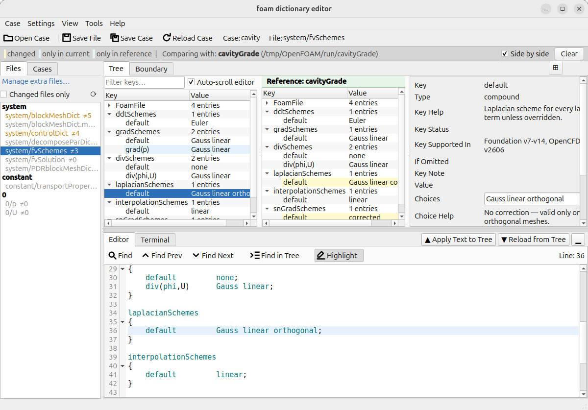

参照ディレクトリを選択すると、アクションバーの下に差分バーが表示されます。差分バーにはカラーレジェンド、参照ケースの名前とフルパス、**Side by side** トグル、比較モードを終了する **Clear** ボタンが含まれます。

### サイドバイサイド表示

参照ケースを選択すると中央パネルが水平に分割されます。左ペインはこれまで通り現在のケースの編集可能なツリーを表示し、右ペインには参照ケースの同じファイルが読み取り専用のツリーで表示されます。右ペインの上部には参照ケース名が緑色のヘッダバーで示されます。

両方のツリーは同じカラースキーム（後述の「[ツリーオーバーレイ](#ツリーオーバーレイ)」参照）でハイライトされます。参照ペインでは追加で **薄緑色** を使用し、参照ケースにのみ存在して現在のファイルには存在しないキーを示します。

**参照ケースから値を適用する:**  
参照ペインの任意のリーフノードを右クリックし、**Use this value** を選択します。対応するノードの値が現在のケースのツリーに即座に適用されます。キーが存在しない場合は挿入され、そのキーを囲むブロック自体が存在しない場合（例: `functions {}` ブロックがないケース）も、不足している親辞書が自動的に作成されます。`#includeFunc …` のような名前を持たないエントリは対象ブロックの末尾に追加されます（同一のエントリが既にある場合はメッセージを表示してスキップします）。拒否されるのは、囲むキーが現在のケースに存在するものの辞書ではない、という名前衝突の場合だけです。変更後、差分ハイライトは自動的に更新されます。

**サイドバイサイドの切り替え:**  
差分バーの **Side by side** チェックボックスで参照ペインの表示・非表示を切り替えられます。チェックを外すと参照ペインは単に折りたたまれるのではなく完全に非表示になり、スプリッターの隙間も消えます。比較モードを終了せずに表示を制御できます。現在のケースのツリーは常に表示され、編集可能です。

### ツリーオーバーレイ

比較モードが有効な間、メインツリーと参照ツリーの両方に背景色でハイライトが付きます。

**現在のケースのツリー（左）:**

| 背景色 | 意味 |
|---|---|
| 薄黄色 | 両ケースにキーが存在するが、値または型が異なる。 |
| 薄青 | このケースにキーが存在するが、参照ケースには存在しない。 |
| 色なし | 両ケースで同一、または比較対象外のノード型。 |

**参照ケースのツリー（右）:**

| 背景色 | 意味 |
|---|---|
| 薄黄色 | 両ケースにキーが存在するが、値または型が異なる。 |
| 薄緑色 | 参照ケースにキーが存在するが、現在のファイルには存在しない。 |
| 色なし | 両ケースで同一。 |

ハイライトされた行をホバーすると、ツールチップに追加情報が表示されます。
- **変更あり（薄黄色）** の行では参照値（左ペイン）または現在のケースの値（右ペイン）が `Ref: <値>` の形式で末尾に付きます。
- **このケースのみ（薄青）** の行では `(not in reference case)` が末尾に付きます。
- **参照ケースのみ（薄緑）** の行では `(only in reference case)` が末尾に付きます。

比較は入れ子のブロックに再帰的に適用され、キー名で子ノードを照合します。例外は `blockMeshDict` のブロックで、名前がないため**位置**で比較されます（ブロック 0 とブロック 0、以下同様）。そのため 5 ブロック中 2 ブロックが異なるファイルのマーカーは `≠1` ではなく `≠2` になります。その他の位置指定のリスト項目（`vertices` など）と匿名のエントリ（`#include`、`$macro` など）は対象外です。

参照ケースに対応するファイルが存在しない場合は、オーバーレイは適用されず、ステータスバーに「参照ケースに見つかりません」メッセージが表示されます。

### ファイル一覧のマーカー

参照ケースを選択すると、差分件数はバックグラウンドで段階的に計算されます。各ファイルの処理が完了すると順次マーカーが表示されます。`FoamFile` ヘッダーを持たない大きなファイル（ログファイル、残差出力など）はスキップされ、マーカーは表示されません。

| サフィックス | 色 | 意味 |
|---|---|---|
| *（なし）* | — | 未計算、またはスキップ済み（大きな非ディクショナリファイル）。 |
| `≠0` | グレー | 参照と同一。 |
| `≠N` | アンバー | N 個の差分があります。 |
| `≠50+` | アンバー | 差分が 50 件超（表示上限）。 |

**Changed files only フィルタ:**  
比較モードが有効な間、ファイル一覧パネルに **Changed files only** チェックボックスが表示されます。チェックを入れると差分がゼロのファイルが非表示になり、参照ケースと異なるファイルのみが表示されます。チェックを外すと全ファイルが表示に戻ります。比較モードを終了するとフィルタは自動的にリセットされます。

### 比較モードの終了

差分バーの **Clear** ボタンをクリックして比較モードを終了します。ファイル一覧のすべての `≠` マーカー、両ツリーのすべての背景色ハイライト、参照ペイン、および **Changed files only** フィルタが削除されます。**Case > Compare with Case…** を再度選択すると、別の参照ディレクトリに切り替えられます。

## ケースの再読み込み

ツールバーの **Reload Case** ボタンをクリックするか、**Case > Reload Case** を選択すると、すべてのメモリ上の編集内容を破棄し、現在のケースをディスクから再読み込みします。全ファイルのバッファとダーティ状態がクリアされ、ファイル一覧と境界条件パネルがケースを開いた直後と同じ状態に更新されます。

未保存の変更がある場合は、対象ファイル数を示す確認ダイアログが表示されます。**Yes** をクリックするとすべての変更が破棄されます。**No** をクリックすると現在の状態がそのまま維持されます。

ケースを閉じて開き直さずに、複数のファイルへの編集をまとめて元に戻したい場合に便利です。

## 境界条件ビュー

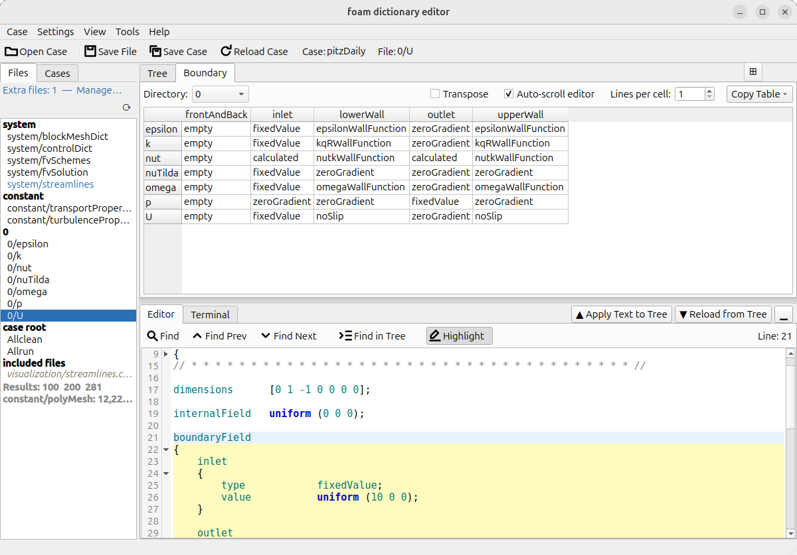

右上パネルの **Boundary** タブに、現在のフィールドディレクトリにある全フィールド変数ファイルの境界条件テーブルが表示されます。

### テーブルの構成

**デフォルトの向き:**
- **行** — フィールドファイルごと（`epsilon`、`k`、`nut`、`p`、`U` など、ファイル名順）。
- **列** — 境界パッチ名ごと（アルファベット順）。

**転置の向き**（**Transpose** チェックボックスで切り替え）: 行がパッチ、列がフィールドファイルになります。

どちらの向きでも:
- 列は全ファイルにわたるパッチ名の和集合です。そのファイルに定義されていないパッチのセルは `–` で表示されます。
- **セルテキスト** — そのパッチの `type` 値（例: `fixedValue`、`zeroGradient`、`noSlip`）。大規模データまたはバイナリデータを含むパッチには `†` マーカーが付きます。
- **ツールチップ** — セルにホバーするとパッチ sub-dict の全テキストを表示します。`†` マーカーのあるセルでは、type と簡潔なデータ説明（`large data` または `binary data`）を表示します。
- **Lines per cell** — パネル右上のスピンボックスで、セルあたりの表示行数を 1〜10 の範囲で指定できます（デフォルト: 1）。2 以上に設定すると、`type` 行の下にパッチ sub-dict の追加キー・値が表示されます。値が大きい・複雑なエントリは `key  …` として表示されます。

### ディレクトリ切り替え

パネル上部のドロップダウンで表示対象のフィールドディレクトリを切り替えられます。`0` および `0.orig` のほか、マルチリージョンケースではリージョンごとのサブディレクトリ（例: `0/bottomWater`、`0/heater`、`0/topAir`）も選択肢に表示されます。パース可能なフィールドファイル（`boundaryField` 辞書を持つファイル）を含むディレクトリのみが表示されます。有効なディレクトリが 1 件のみの場合はドロップダウンが無効化されます。切り替えるとテーブルが即座に再構築されます。

### 転置（Transpose）

パネル上部の **Transpose** チェックボックスをオンにすると、行と列が入れ替わります。テーブルは即座に再構築されます。編集・作成・コピー・ペーストの各操作はどちらの向きでも同様に機能します。

### シングルクリックナビゲーション

セルをクリックすると、そのフィールドファイルがエディタで開かれ、`boundaryField` 内の対応するパッチエントリまでスクロールします。

パネル上部の **Auto-scroll editor** チェックボックスでこの動作を切り替えられます:

- **オン（デフォルト）** — セルをクリックすると、ファイルが未開の場合は読み込み、ファイルリストの選択を更新し、エディタをパッチ名の位置にスクロールしてその行を琥珀色でハイライトします。
- **オフ** — シングルクリックはエディタに影響しません。ダブルクリック（編集）と右クリック（コンテキストメニュー）のみが有効です。

セルが `–`（そのファイルにパッチエントリなし）の場合、ファイルはエディタで開かれますが、ジャンプ先がないためスクロールは行われません。

### 境界条件の編集

セルをダブルクリック（または右クリック → **Edit**）すると **Edit boundary** ダイアログが開きます。ダイアログ上部に編集対象の変数名とパッチ名が読み取り専用で表示されます。

**通常モード**（`†` なし）— パッチ sub-dict の全内容を編集可能なテキストエリアで表示します。`type` を含む任意の行を編集して **OK** をクリックすると反映されます。内容が変更されていない場合、**OK** を押してもファイルは変更済みにはなりません。

**複雑モード**（`†` あり）— パッチに大規模な nonuniform フィールドやバイナリデータが含まれます。ここでは `type` フィールドのみ編集できます。全内容の編集には **Editor** タブを使用してください。

### パッチエントリの作成

セルが `–` の場合、そのフィールドファイルにそのパッチがまだ定義されていません。セルをダブルクリック（または右クリック → **Create Entry**）すると空の **Edit boundary** ダイアログが開きます。パッチの内容を入力して **OK** をクリックするとエントリが作成されます。新しいエントリはそのファイルの `boundaryField` に追加され、セルが即座に更新されます。

### パッチエントリの削除

パッチが定義されているセルを右クリックして **Delete Entry** を選択すると、その特定フィールドファイルからそのパッチを削除します。全ファイルからそのパッチが無くなった場合、そのパッチの行/列もテーブルから削除されます。

### コピー・ペースト

パッチが定義されているセルを右クリックして **Copy** を選択すると、そのパッチの全内容がアプリ内クリップボードに保存されます。別のセル（`–` セルを含む）を右クリックして **Paste** を選択すると、コピーした内容が適用されます。`–` セルへのペーストは新規エントリを作成し、既存セルへのペーストは内容を置き換えます。クリップボードはアプリのセッション中に保持されます。

### テーブルのコピー

パネルツールバーの **Copy Table** ボタンをクリックすると、境界条件テーブル全体をシステムクリップボードにコピーします。ドロップダウンメニューで 3 つの形式を選択できます:

- **Copy as Markdown** — フィールド変数名を行ヘッダー、パッチ名を列ヘッダーとするパイプ区切りの Markdown テーブルを生成します（転置時はその逆）。**Lines per cell** が 2 以上の場合、複数行のセルは `<br>` タグで結合され、GitHub Flavored Markdown では改行として表示されます。
- **Copy as CSV** — テーブルの 1 行が 1 レコードとなる CSV を生成します。**Lines per cell** が 2 以上の場合、セル内の各行は `; ` で連結され、改行を含むフィールドは生成されません。通常はこちらを使ってください。Excel へ貼り付ける場合や、仮想マシンのクリップボードをまたぐ場合は特にそうです。アプリケーションは貼り付けられたプレーンテキストを、引用符を解釈する*前*に改行で行に分割するため、セル内の改行はそのままでは余分な行として現れてしまいます。
- **Copy as CSV (multi-line cells)** — RFC 4180 準拠の CSV を生成し、複数行のセル内容を引用符付きフィールド内の実際の改行として保持します。引用符付きフィールドを正しく解釈する貼り付け先（LibreOffice Calc の貼り付けダイアログなど）や、貼り付けではなく `.csv` ファイルとして保存して開く場合に使ってください。

いずれの形式も行ヘッダー列（現在の向きに応じてフィールド変数名またはパッチ名）を含みます。`–` マーカーはそのまま出力されます。

### 境界パッチのリネーム

セル、パッチ列ヘッダー（非転置時）、またはパッチ行ヘッダー（転置時）を右クリックして **Rename Boundary...** を選択します。ツリービューでも、`boundary_entry` ノードまたは `boundaryField` 内のパッチ `dictionary` ノードを右クリックすることで同じ操作が行えます。

ダイアログには現在のパッチ名、新しい名前を入力するテキストフィールド、および読み込み済みの全ファイルのうちそのパッチ名が見つかったファイルのチェックリストが表示されます。`blockMeshDict` の `boundary` エントリおよびフィールドファイルの `boundaryField` パッチキーの両方が対象になります。一致した全ファイルは最初から選択状態になっています。

- 変更を適用したくないファイルのチェックを外してください。
- **Select All** / **Deselect All** でリスト全体を一括切り替えできます。
- **Rename** ボタンは、新しい名前が空でなく現在の名前と異なり、かつ 1 件以上のファイルが選択されているときにのみ有効になります。ボタンには選択中のファイル数が表示されます。

**Rename** をクリックすると変更がアトミックに適用されます。選択した各ファイルはメモリ上で更新されてダーティ状態になります。現在開いているファイルが対象に含まれる場合、ツリービューとテキストエディタが即座に更新されます。

### 全フィールドファイルからの境界条件削除

パッチ列ヘッダー（非転置時）またはパッチ行ヘッダー（転置時）を右クリックして **Delete BoundaryField '\<patch\>'** を選択します。確認ダイアログで対象フィールドファイルの一覧が表示されます。**Yes** をクリックすると、現在のディレクトリにある全フィールドファイルからそのパッチエントリを一括削除します。

### 全フィールドファイルへの境界条件追加

パッチ列ヘッダーまたはパッチ行ヘッダーを右クリックして **Add BoundaryField...** を選択します。新しいパッチ名を入力すると、何件のフィールドファイルに空のエントリが追加されるかを示す確認ダイアログが表示されます。**Yes** をクリックすると、`boundaryField` 辞書を持ちそのパッチがまだ存在しない全ファイルに空の `<patch> {}` ブロックが追加されます。その後、各セルを編集して境界条件の内容を入力してください。

### type キーなしのセル

パッチ sub-dict に `type` キーが存在しないセルは斜体テキストで表示されます。編集・削除・コピー・ペーストなどの操作は通常のセルと同じように行えます。

境界条件ビューでの変更はすべてツリービューとテキストエディタに即座に反映されます。変更したファイルは通常の編集と同様にタイトルバーとファイル一覧で dirty（`*`）としてマークされます。

## BlockMesh パネル

上部パネルの **BlockMesh** タブは、`blockMeshDict` に定義されたジオメトリをインタラクティブに 3D 表示します。[pyVista](https://pyvista.org/) / VTK を使用しており、`pyvista` と `pyvistaqt` がインストールされている場合にのみ利用できます。インストールされていない場合はタブにインストールを促すメッセージが表示されます。

**表示条件:** BlockMesh タブは `blockmesh` フィーチャーフラグが有効なときに表示されます。`standard` バリアントではシンプルモード時のみ表示されます（xterm モードに切り替えると非表示になります — 「[ターミナルタブ](#ターミナルタブ)」参照）。`no-terminal-blockmesh` バリアントではターミナルとの競合がないため常時表示されます。`no-terminal` バリアントではタブ自体が存在しません。「[バリアント](#バリアント)」も参照してください。

**View > BlockMesh 3-D Panel**（チェック式）でいつでもタブを切り替えられます。xterm ターミナルモードが有効な場合はこの項目がグレーアウトし、ラベルが **"BlockMesh 3-D Panel  (unavailable: xterm active)"** に変わって理由を示します。パネルを有効にするには先にターミナルをシンプルモードに切り替えてください。

`blockMeshDict` を読み込んだとき、または編集したときにパネルが自動的に更新されます。**Refresh** ボタンで手動更新もできます。

**ケースを開いたときに表示されるもの。** ファイル一覧のうち 3D ビューに使われる辞書 — `blockMeshDict`、`topoSetDict` とその派生、`snappyHexMeshDict`、`setFieldsDict`、`controlDict`、サンプリングファイル — は、ケースを開いた時点で開かなくても描画され、その後の編集やディスク上の変更にも追従します。オーバーレイはそれぞれ単独で描画されるため、`blockMeshDict` が読み込まれていなくても表示されます。`#include` で取り込まれるファイルは、取り込む側を通じて 1 回だけ描画します。FoDE が認識しない辞書は、ファイル一覧で右クリックして **Show in 3-D view as** を選びます。この選択はケースごとに記憶されます。

`topoSetDict` を読み込んだり編集したりしたときも、各アクションのジオメトリソース（ボックス・回転ボックス・球・円柱・円錐、`nearestToCell` のような点を持つソース、`planeToFaceZone`）が 3D パネルにオーバーレイ表示されます。**topoSet ▾** メニューの **"Show topoSet geometry"** トグルで表示・非表示を切り替えられます。

`snappyHexMeshDict` を読み込んだり編集したりすると、その `geometry` ブロック（ボックス／球／円柱／円錐／triSurfaceMesh／collection）が `refinementSurfaces`/`refinementRegions` と照合して surface・region・ジオメトリのみに分類されオーバーレイ表示され、`locationInMesh`/`locationsInMesh` の保持点マーカーも表示されます — 詳細は「[snappyHexMeshDict オーバーレイ](#snappyhexmeshdict-オーバーレイ)」を参照してください。

`setFieldsDict` を読み込んだり編集したりすると、その `regions ( … )` リストも同様にオーバーレイ表示され、各領域には `fieldValues` の要約がラベルとして付きます — 「[setFieldsDict オーバーレイ](#setfieldsdict-オーバーレイ)」を参照してください。

ブロックメッシュを超えて広がるオーバーレイシェイプは、メッシュが見えるようにビュー内でクリップされます — 「[オーバーレイのクリップ表示](#オーバーレイのクリップ表示)」を参照してください。

### インクルードファイルに置いたパラメータ

寸法やセル数をすべて 1 箇所にまとめ、各辞書からそれを取り込む書き方ができます。

```
#include "settings-region"
```

として `scale`、`x0`、`xMax` などを `system/settings-region` だけに定義する形です。3-D ビューはこれらの定義を、その場に直接書かれていた場合と同じように解決します。したがって全頂点がインクルードファイル由来の `$変数` である `blockMeshDict` も通常どおり表示されます。`topoSetDict`、`snappyHexMeshDict`、`setFieldsDict`、サンプリングの各オーバーレイも同じ仕組みを共有しており、インクルードファイルがさらに別のファイルをインクルードしている場合もたどります。

**インクルードファイルを編集するとビューが更新されます。** `settings-region` の寸法を変更して適用すれば、それをインクルードしている辞書がすべて再描画されます。辞書を開き直す必要はなく、保存も不要です — 未保存の編集は適用した時点で反映されます。

インクルードファイルはツリーには展開されません。またインクルードしている辞書を通してインクルード先へ書き戻されることも一切ありません。`#include` の行は 1 行のままで、ファイル自体を開いて編集するには従来どおり右クリックメニューの **Open Included File** を使います。

インクルードが解決できない場合（ファイルが無い、パースできない）、ビューは辞書が単体で持つ内容にフォールバックします — 従来の動作と同じです。対象の無い `#sinclude` は OpenFOAM として正当な記述であり、問題として扱いません。

`#includeFunc` は意図的に対象外です。これは関数オブジェクトを指しており、そのファイルは既にファイル一覧に現れて単体で描画されるため、ここでも解決すると同じサンプリング線を二重に描くことになります。

`#eval{ … }` の算術は関数を解釈します（`round`、`floor`、`ceil`、`sqrt`、`min`、`max`、`mag`、`pow`、`abs`、三角関数一式、`exp`、`log`、`log10`、`degToRad`、`radToDeg`、定数 `pi`）。そのため `nX #eval{round($xMax/$CS)}` のようなセル数も、黙って飛ばされることなく解決されます。

### サイドバイサイドモード

`blockMeshDict`、`topoSetDict`、`snappyHexMeshDict`、`setFieldsDict` のいずれかがアクティブなファイルで BlockMesh パネルが利用可能なとき、上部タブウィジェットの右上に **⊞** トグルボタンが表示されます。クリックすると Tree タブの右隣に 3D ビューが水平スプリッターで並列表示され、ツリーの編集と 3D ビューを同時に確認できます。サイドバイサイドモード中は独立した **BlockMesh** タブが非表示になり、モードを切ると復元されます。

サイドバイサイドモードでも、3D ビューは専用タブのときと同じようにツリーの編集に追従します。ツリーの編集、**Add** / **Duplicate** / **Delete**、**Apply Text to Tree** のたびに再描画されます。**Refresh** は手動で再描画します。

ツリーと 3D ビューの間のスプリッターハンドルは自由にドラッグできます。どちらのペインも折りたたまれて消えることはなく、3D ビューは小さな最小幅まで狭められ、ツールバーは必要に応じて複数行に折り返されます。

xterm ターミナルがアクティブな間は **⊞** ボタンが無効化されます（GPU/OpenGL の競合により BlockMesh パネルを同時に開けないためです）。

### 変数の解決

`blockMeshDict` のトップレベルに定義された変数は、ジオメトリを抽出する前に自動的に解決されます。

- **直接値** — `xMin -0.5;`、`length 10;` などはそのまま使用されます。
- **マクロ参照** — `nx $nCell;` は `nCell` が評価される値に解決されます。任意の深さのチェーンに対応しています。
- **否定マクロ参照** — `xMin -$xMax;`（`$参照` の前にマイナス符号）は `xMax` が判明した時点で解決されます。
- **`$varName` および `${varName}`** — `vertices` と `blocks` 内の参照が解決済みの値に置換されます。
- **`#eval{ expr }`** — 算術式は変数置換後に評価されます。対応演算子：`+`、`−`、`*`、`/`、`**`、括弧。加えて関数 `round`、`floor`、`ceil`、`sqrt`、`min`、`max`、`mag`、`pow`、`abs`、`sin`、`cos`、`tan`、`asin`、`acos`、`atan`、`atan2`、`exp`、`log`、`log10`、`degToRad`、`radToDeg` と定数 `pi` に対応します。例：`zMax #eval{ $length / $nCell };`、`nX #eval{ round($xMax/$CS) };`

`#include` したファイルで定義された変数も解決済みとして扱われます — 「[インクルードファイルに置いたパラメータ](#インクルードファイルに置いたパラメータ)」を参照してください。それでも参照が解決できない場合（名前の綴り間違い、解決できないインクルードなど）、その変数を含む頂点やブロックは静かにスキップされます。したがって想定より頂点の少ないメッシュが表示されたときは、たいてい変数名の綴り間違いです。

### ジオメトリコントロール

すべてのコントロールはパネル上部の 1 本のツールバーに配置されています。ツールバーは*折り返し*式で、パネルが狭いとき（サイドバイサイドモードなど）はボタンが複数行に流し込まれ、パネルの最小幅を押し広げません。

| コントロール | 説明 |
|---|---|
| **Vertices ▾** | 3 つのチェック可能な項目を持つドロップダウンメニュー: **Vertices**（頂点を赤い球で表示）、**Vertex labels**（頂点インデックス番号をオーバーレイ表示）、**Vertices table**（右側の頂点座標テーブルを表示・非表示）。 |
| **Blocks ▾** | 4 つのチェック可能な項目を持つドロップダウンメニュー: **Block edges**（ワイヤーフレーム表示）、**Block labels**（重心にブロックインデックスをオーバーレイ）、**Color blocks**（tab10 パレットでブロックごとに色分け）、**Solid blocks**（半透明ソリッド面を opacity 0.25 で追加表示、Color blocks の色設定を共有）。 |
| *(ブロックのハイライト)* | コントロールではありません: Tree ビューで `block N` 行を選択すると、ここで該当ブロックが専用色で輪郭表示されます。行番号とブロック中心に描かれる番号は同じ番号です。**Block edges** と **Solid blocks** の両方をオフにしていても表示され、他の行を選択するか別のメッシュを読み込むと解除されます。 |
| **Boundary faces** | 境界パッチの面をパッチ種別で色分けして表示します。どのパッチにも割り当てられていない外部ブロック面 — blockMesh の暗黙の `defaultFaces` — は薄いグレーで描画されます。これがないと、damBreak のような擬似 2D ケース（大きな前面・背面が `boundary` に列挙されない）では境界が何も表示されないように見えてしまいます。 |
| **topoSet ▾** | `topoSetDict` オーバーレイ用のドロップダウンメニュー: マスタートグルの **Show topoSet geometry**、**Show all shapes** / **Hide all shapes** アクション、アクションカラーの凡例、描画可能なシェイプごとのチェック可能な表示切替、そして描画可能なジオメトリを持たないエントリをまとめた **Non-geometric sources (N)** サブメニュー（「[topoSetDict オーバーレイ](#toposetdict-オーバーレイ)」参照）。 |
| **snappyHexMesh ▾** | `snappyHexMeshDict` オーバーレイ用のドロップダウンメニューで、構成は **topoSet ▾** と同じです: マスタートグル、**Show all shapes** / **Hide all shapes**、カテゴリカラーの凡例、シェイプごと・保持点ごとの表示切替、**Non-geometric sources (N)** サブメニュー（「[snappyHexMeshDict オーバーレイ](#snappyhexmeshdict-オーバーレイ)」参照）。 |
| **setFields ▾** | `setFieldsDict` オーバーレイ用のドロップダウンメニューで、構成は **topoSet ▾** と同じです: マスタートグルの **Show setFields regions**、**Show all shapes** / **Hide all shapes**、領域カラーの凡例、描画可能な領域ごとの表示切替、**Non-geometric sources (N)** サブメニュー（「[setFieldsDict オーバーレイ](#setfieldsdict-オーバーレイ)」参照）。 |
| **sample ▾** | サンプリングオーバーレイ — `controlDict` の `functions {}` ブロックまたはスタンドアロンのサンプリング辞書に定義されたプローブ点・サンプル線・サンプル平面 — 用のドロップダウンメニューで、構成は **topoSet ▾** と同じです（「[サンプリングオーバーレイ](#サンプリングオーバーレイ)」参照）。 |
| **Refresh** | 現在のツリーからジオメトリを再抽出して再描画します。プレビューモード中はすべてのプレビュー編集を破棄してツリーの値に戻します。 |
| **Preview** | `vertices` ブロックに変数参照（`$varName`）が含まれる場合のみ表示されます。このボタンはメインツールバーではなく **Vertices** パネル内（テーブルの上部）に表示されます。クリックするとプレビューモードになり、テーブルセルが編集可能になって各変更が即座に 3D ビューへ反映されますが、ツリーとファイルは変更されません。プレビューモード中は黄色いバナーが表示されます。**Refresh** をクリックするとプレビューモードを終了して元の値に戻ります。 |
| **STL ▾** | STL/OBJ の参照オーバーレイと、シェイプの STL 書き出しのためのドロップダウンメニュー。下の「[STL オーバーレイと書き出し](#stl-オーバーレイと書き出し)」を参照 |
| **Save Image…** | 3D ビューを表示されているそのまま — 同じピクセルサイズ、同じ背景色 — で PNG / JPEG / BMP / TIFF ファイルに保存します。**Name 欄に入力した拡張子が形式を決めます。** 書き込みに使えない拡張子（`.JPG` のように大文字で書いた対応形式も含む）は書き込み前に補正され、補正後の名前が既存ファイルを上書きする場合は先に確認されます。**View** メニューの **Save Image…** や `Ctrl+Shift+I` からも実行できます。3D ビューが一度も表示されていない間は、取り込むものがないためグレーアウトします。デフォルトのファイル名は、現在のケースディレクトリ内の `<ケース名>-3Dview.png` です。**Export Shapes as STL…** とは異なり、オーバーレイ・色・カメラアングルを含めて描画された画像そのものを保存します（生のジオメトリではありません）。 |

従来の 4 頂点インデックス記法 `(v0 v1 v2 v3)` と新しいコンパクト記法 `(blockIndex faceIndex)` の両方がサポートされており、同じファイル内で混在させることができます。コンパクト記法は表示前に標準的な六面体ブロック面番号を使用して 4 頂点リストに自動展開されます。

#### STL オーバーレイと書き出し

**STL ▾** メニューは、参照用サーフェスの読み込みと、FoDE が描画しているシェイプの書き出しを行います。

- **Load STL / OBJ…** は STL または OBJ ファイルを半透明のオーバーレイとして表示します。ファイルダイアログで複数ファイルをまとめて選択でき、さらに読み込むと既存の表示に追加されます。一部のファイルが読み込めなくても残りは読み込まれ、失敗したファイル名をまとめた警告が 1 回だけ表示されます。gzip 圧縮されたファイル（`.stl.gz`、`.obj.gz`）もそのまま読み込めます。
- 読み込んだファイルはメニュー下部にファイルごとのチェック可能な行として表示され、スウォッチの色で複数のサーフェスを見分けられます。**Show loaded surfaces**、**Show all surfaces**、**Hide all surfaces** で一括切替でき、構成は上のオーバーレイメニューと同じです。`blockMeshDict` を開いていなくてもサーフェスは描画されます。
- 既に読み込み済みのファイルを読み込むと、行が増えるのではなく既存の行に再読み込みされます。FoDE の外で編集したサーフェスを更新したいときはこれを使います。**Unload ▸** で個別のファイルを、**Clear STL** ですべてを削除できます（いずれも未読み込み時はグレーアウト）。別のケースを開いたときもクリアされます。
- **Export Shapes as STL…** は、読み込み済みの `topoSetDict`・`snappyHexMeshDict`・`setFieldsDict` の描画可能な各シェイプをチェックボックス付きで一覧表示するダイアログを開きます（初期状態は 3D ビューでの現在の表示/非表示に対応）。**Select All** / **Deselect All** も使えます。出力先フォルダを選んで Export をクリックすると、チェックした各シェイプがそのラベルにちなんだ個別の `.stl` ファイルとして書き出されます。該当するジオメトリが読み込まれていない場合はグレーアウトします。
- 点マーカーのシェイプ（`nearestToCell` など）と `planeToFaceZone` の円板は、意味のある STL サーフェスを持たないため一覧に表示されません。書き出されるのは、3D ビューでクリップ表示されているシェイプであっても、常にクリップ前の完全なジオメトリです。

### topoSetDict オーバーレイ

`topoSetDict` を読み込んだり編集したりすると、各アクションエントリのジオメトリソースが半透明シェイプとしてメッシュ上に描画されます。**topoSet ▾** メニューのマスタートグル **"Show topoSet geometry"** でオーバーレイ全体を切り替えられるほか、描画可能な各シェイプには個別のチェック可能な表示切替があり、**Show all shapes** / **Hide all shapes** で全シェイプを一括切替できます。描画可能なジオメトリを持たないソース（`cellToFace`、`patchToCell` など）は **Non-geometric sources (N)** サブメニューにまとめられるため、ソースの多い辞書でもメニューが読みやすいままです。

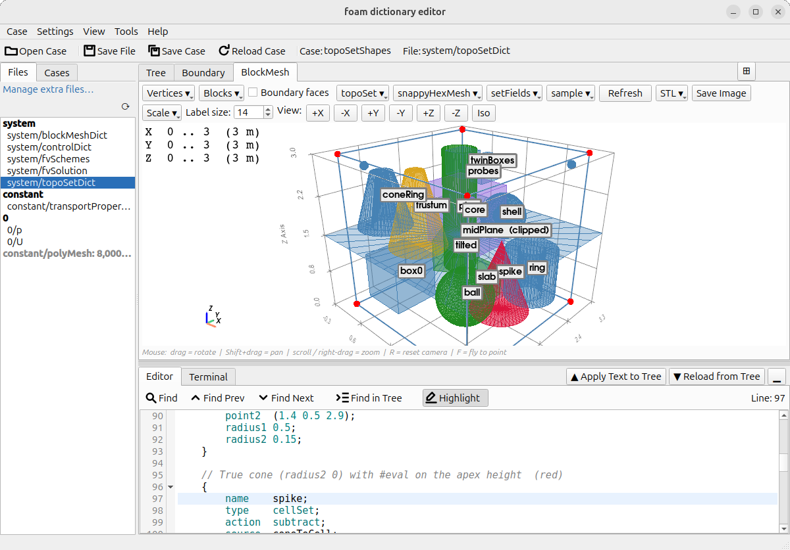

**対応ソースタイプ:**

| ソースファミリー | 例 | シェイプ |
|---|---|---|
| `boxToCell/Face/Point` | `box (x0 y0 z0) (x1 y1 z1)`、`min`/`max` キー、または複数ボックスの `boxes ( … )` リスト | ボックス（ワイヤーフレーム＋面。`boxes` リストはすべてのボックスを描画） |
| `rotatedBoxToCell/Face/Point` | `origin`、`i`、`j`、`k` | 回転（傾いた）ボックス |
| `sphereToCell/Face/Point` | `origin`/`centre`、`radius`、任意で `innerRadius` | 球（`innerRadius` 指定時は中空球 — 内殻が透けて見えます） |
| `cylinderToCell/Face/Point`、`cylinderAnnulusToCell` | `point1`/`p1`、`point2`/`p2`、`radius` | 円柱 |
| `coneToCell/Face/Point`、`coneAnnulusToCell` | `point1`/`p1`、`point2`/`p2`、`radius1`、`radius2` | 円錐（円錐台。`radius2` が 0 のときは真円錐） |
| `nearestToCell`、`nearestToPoint` | `points ( … )` | ラベル付き点マーカー |
| `regionToCell` / `regionToFace` | `insidePoints`/`insidePoint` / `nearPoint` | ラベル付き点マーカー |
| `planeToFaceZone` | `point`、`normal` | 指定平面上の円板。シーンの大きさに合わせて表示されます（平面は無限なので、表示範囲は表示専用です） |

**アクションによる色分け:**

| アクション | 色 |
|---|---|
| `new` | スチールブルー |
| `add` | 緑 |
| `subtract` / `delete` | 赤 |
| `subset` | 紫 |
| `invert` | ゴールド |

ジオメトリを完全に解決できないエントリ（未解決の `$変数` がある場合など）は静かにスキップされます。`blockMeshDict` が読み込まれていない場合でもオーバーレイのみ表示できます。

**変数の解決** — `topoSetDict` のトップレベルに定義したスカラー・整数変数（例：`xMin -0.01;`）は抽出前に解決されます。マクロチェーン（`y $x;`）や `#eval{ 式 }` 表現も対応します。これは `blockMeshDict` と同じ仕組みです。辞書が `#include` するファイルで定義された変数もスコープに入ります（[インクルードファイルに置いたパラメータ](#インクルードファイルに置いたパラメータ)を参照）。インクルードしていない別のファイルにある変数は使えません。

### snappyHexMeshDict オーバーレイ

`snappyHexMeshDict` を読み込んだり編集したりすると、その `geometry {}` ブロックが半透明シェイプの集合としてメッシュ上に描画されます。各シェイプは `castellatedMeshControls.refinementSurfaces` / `refinementRegions` と照合して **surface**（サーフェス）・**region**（リージョン）・**geometry**（ジオメトリのみ）のいずれかに分類されます。**snappyHexMesh ▾** メニューのマスタートグル **"Show snappyHexMesh geometry"** でオーバーレイ全体を切り替えられます。メニューには、シェイプごとのチェック可能な表示切替（**Show all shapes** / **Hide all shapes** で一括切替可能）に加え、描画できなかったジオメトリのエントリをまとめた **Non-geometric sources (N)** サブメニューも表示されます。

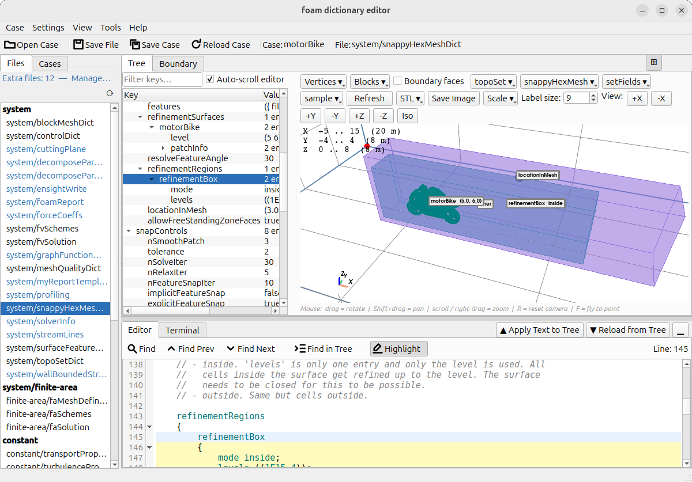

**対応する `geometry` エントリタイプ** — 両フォークの綴りを受け付けます（OpenCFD の短い `box`、Foundation の `searchableBox` など。他の型も同様）。メニューには辞書に書かれた綴りがそのまま表示されます:

| `type` | フィールド | シェイプ |
|---|---|---|
| `searchableBox` / `box` | `min`、`max` | ボックス（ワイヤーフレーム＋面） |
| `searchableSphere` / `sphere` | `centre`/`origin`、`radius` | 球。`radius` がベクトル `(rx ry rz)` で与えられている場合（イグルー型のドームなど）は球ではなくだ円体として描画されます |
| `searchableCylinder` / `cylinder` | `point1`/`p1`、`point2`/`p2`、`radius` | 円柱 |
| `searchableCone` / `cone` | `point1`/`p1`、`point2`/`p2`、`radius1`、`radius2` | 円錐（円錐台。`radius2` が 0 のときは真円錐） |
| `triSurfaceMesh` / `distributedTriSurfaceMesh` / `closedTriSurfaceMesh` | `file`（または `.stl`/`.stlb`/`.obj` で終わるエントリ自身のキー名） | ケースディレクトリを基準に `constant/triSurface/` から自動的に読み込まれたメッシュ。gzip 圧縮された状態（例: `motorBike.obj.gz`）で配布されていても、辞書がプレーンな名前を参照していても `.gz` の名前を直接参照していても見つけられます（手動での解凍は不要）。ファイルが見つからない場合はグレーアウト表示され、描画されません |
| `searchableSurfaceCollection` / `collection` | 名前付きサブエントリ。それぞれ `surface <name>`、`scale`、`transform { origin; rotation none; }` または `transform { origin; e1; e3; }` を持つ | ベースサーフェスが **box** タイプのサブエントリのみ、スケール・回転・平行移動済みのボックスとして `<collection>.<member>`（例：`twoFridgeFreezers.seal`）の名前で個別に描画されます。ベースが box 以外、または `transform` が未対応・未指定のメンバーは描画されません。collection のメンバーが 1 つも解決できなかった場合は collection 自体がグレーアウト表示されます |

**カテゴリによる色分け:**

| カテゴリ | 色 | 判定方法 |
|---|---|---|
| Surface | ティール | ジオメトリエントリの名前（または `name` による上書き名）が `refinementSurfaces` のエントリと一致 — 完全一致、または `"iglo.*"` のような正規表現パターンのキーによる一致 |
| Region | 紫 | `refinementRegions` のエントリと一致（完全一致のみ）。surface と region の両方に一致するシェイプは surface として表示されます |
| Geometry | グレー | `geometry {}` で定義されているが、いずれの制御ブロックからも参照されていない |

描画された各シェイプには名前に加え、可能であれば `refinementSurfaces` のレベル `(min max)` または `refinementRegions` のモード（`inside`/`outside`/`distance`）もラベル表示されます。

**保持点** — `castellatedMeshControls.locationInMesh`（単一の点）、同じ階層にある Foundation の `insidePoint` と `insidePoints`（点のリスト）、または `locationsInMesh`（マルチリージョンケースで使われる `((x y z) regionName)` のペアのリスト）は、上記のシェイプオーバーレイとは独立してラベル付きの点マーカーとして描画されます。

`geometry` エントリのフィールドを完全に解決できない場合（未解決の `$変数` があるなど）は、描画されずにグレーアウト表示されます。

**表示されないもの** — `refinementSurfaces` エントリ内の `regions { … }` によるリージョン単位の上書き、`patchInfo`、`castellatedMeshControls.features`（フィーチャーエッジの `.eMesh` 参照）、`refinementRegions.levelIncrement`（方向性リファインメント）は、パーサー／スキーマでは読み取られますが、このオーバーレイには反映されません。

**変数の解決** — `snappyHexMeshDict` のトップレベルに定義されたスカラー・整数変数は、`blockMeshDict`/`topoSetDict` と同じ仕組み（マクロチェーンおよび `#eval{ 式 }` 表現を含む）で解決されます。

### setFieldsDict オーバーレイ

`setFieldsDict` を読み込んだり編集したりすると、その `regions ( … )` リストの各エントリが半透明のオレンジ色のシェイプとしてメッシュ上に描画されます。領域ソースは `topoSetDict` と同じジオメトリキーワードを使うため、同じシェイプファミリーが描画されます: `boxToCell`（`min`/`max` 形式と複数ボックスの `boxes ( … )` 形式を含む）、`rotatedBoxToCell`、`sphereToCell`（オプションの `innerRadius` 付き）、`cylinderToCell`/`cylinderAnnulusToCell`、`coneToCell`/`coneAnnulusToCell` — ソースの一覧表は「[topoSetDict オーバーレイ](#toposetdict-オーバーレイ)」を参照してください。`$変数` と `#eval{ 式 }` の参照も同じ仕組みで解決されます。

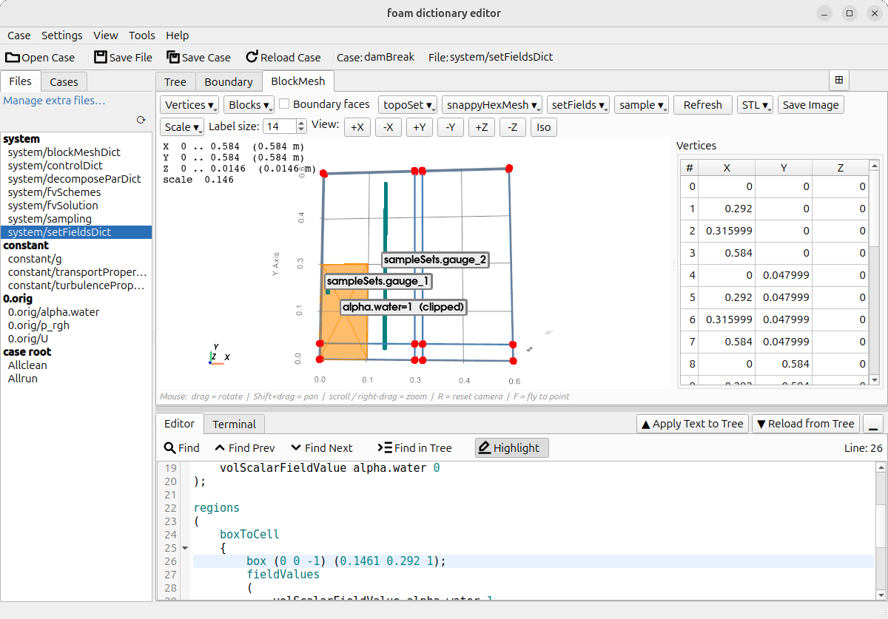

各シェイプにはエントリの `fieldValues` の要約（例: `alpha.water=1`）がラベル表示されるため、どの領域がどの場を設定するのかが一目で分かります。**setFields ▾** メニューのマスタートグル **"Show setFields regions"** でオーバーレイ全体を切り替えられるほか、各領域には個別のチェック可能な表示切替があり、**Show all shapes** / **Hide all shapes** で一括切替できます。描画可能なジオメトリを持たないソース（`zoneToCell`、`surfaceToCell` など）は **Non-geometric sources (N)** サブメニューにまとめられます。`defaultFieldValues` はメッシュ全体に適用されるため描画されません。

描画可能な領域は **STL ▾ → Export Shapes as STL…** にも 3 つ目のグループとして表示されます。

### サンプリングオーバーレイ

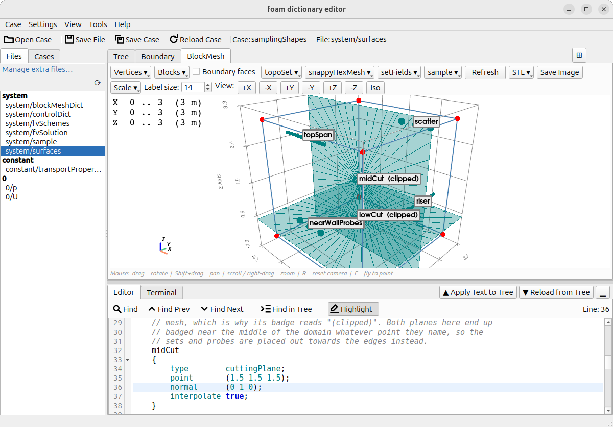

`controlDict` とすべてのサンプリングファイルが、3D ビューにティール色で描画されます。サンプリングファイルは名前ではなく中身、つまり `sets`、`surfaces`、probes の関数オブジェクトを含むかどうかで判定します。`sample`、`probes`、`sampling`、`cuttingPlane`、Foundation の `functions` など、どんな名前でも構いません。描画される定義は次のとおりです:

- **プローブ点** — `probes` / `patchProbes` / `boundaryProbes` ファンクションオブジェクト: 各 `probeLocations` が点マーカーとして描画されます。
- **サンプル線** — `sets` タイプのエントリ: `start`/`end` の組を持つメンバー（`lineUniform`、`lineCell`、`uniform`、`face` など）は細いチューブとして、`points` リストを持つ `cloud` タイプのメンバーは点マーカーとして描画されます。メンバーリストの 2 つの書式 — 辞書形式 `sets { … }` と従来の丸括弧リスト形式 `sets ( y0.1 { … } … );` — の両方に対応し、`start`/`end` がファイルのトップレベルに置かれる .org 系の `singleGraph` スタイルも使えます。
- **サンプル平面** — `surfaces` タイプのエントリ: `plane` と `cuttingPlane` のメンバー（直接の `point`/`normal`、`basePoint`/`normalVector`、または `pointAndNormalDict {}`）は、topoSet オーバーレイの `planeToFaceZone` と同様に、表示専用の広がりを持つ円盤として描画されます。

定義は複数のファイルから同時に取り込めます（例: `controlDict` のプローブ + `system/sample` ファイル）。**sample ▾** メニューにはその合算が表示され、各行には角括弧で元ファイル名が付きます。描画可能なジオメトリを持たないエントリ — `patch` タイプのサーフェス、座標を解決できないメンバー、メンバーリスト自体が無い `sets`/`surfaces` エントリ — は **Non-geometric sources (N)** にまとめられます。サンプリング以外のファンクションオブジェクト（`forces`、`fieldAverage` など）は完全に無視されます。サンプリングシェイプは STL エクスポートの対象外です: 点と線にはサーフェスがなく、平面の描画上の広がりは表示専用のためです。

### オーバーレイのクリップ表示

特に setFieldsDict の領域は、ドメインよりはるかに大きく書かれることがよくあります（例: 約 0.6 m のタンクに対する damBreak の `box (0 0 -1) (0.1461 0.292 1)`）— そのままの大きさで描画するとブロックメッシュが極端に小さく見えてしまいます。そのため、ブロックメッシュが読み込まれている場合、すべてのオーバーレイシェイプ（topoSet、snappyHexMesh、setFields、サンプリング）は、ブロックメッシュのバウンディングボックスを各軸 10% 拡大した範囲に **表示上のみ** クリップされます:

- 拡大した範囲に収まるシェイプはそのまま描画されます。
- はみ出すシェイプは範囲内に切り取られ、シーンラベルに **「(clipped)」** マークが付くため、切り取られた形状を実際の大きさと見誤ることはありません。
- ブロックメッシュの完全に外側にあるシェイプはクリップせずに **「(outside block mesh)」** とラベル付けされます。
- シーン全体を包み込むシェイプ（表面のどの部分も範囲内に入らないもの）は、消えてしまう代わりにバウンディングボックスの重なり部分として描画されます。

クリップ表示は辞書にも抽出済みジオメトリにも影響しません: **Export Shapes as STL…** は常に完全なシェイプを書き出し、ブロックメッシュが読み込まれていないときはクリップも行われません。

### 境界面の色分け

| パッチ種別 | 色 |
|---|---|
| `wall` | オレンジ |
| `patch` | 青 |
| `empty` | ライトグレー |
| `symmetry` / `symmetryPlane` | 緑 |
| `wedge` | 紫 |
| `cyclic` / `cyclicAMI` | 金 |
| `inlet` | ライトブルー |
| `outlet` | 赤 |
| その他 / 未知 | 青 |

### 頂点テーブル

パネル右側のスクロール可能なテーブルに、`vertices` ブロックのすべての頂点が **#**、**X**、**Y**、**Z** 列で表示されます（座標は `scale`/`convertToMeters` 係数適用後の値です）。

- **行をクリック**すると、対応する頂点が 3D ビュー内でより大きなシアン色の球としてハイライト表示されます。
- **X・Y・Z セルをダブルクリック**すると座標値をインライン編集できます（頂点がリテラル数値の場合のみ。以下参照）。数値以外を入力するとキャンセルされ元の値に戻ります。有効な値をコミットすると FoamNode ツリーとテキストエディタが即座に更新され、ファイルはダーティとしてマークされます。3D ビューへの反映は **Refresh** ボタンで行います。
- **頂点に変数参照（`$varName`）が含まれる場合**、X/Y/Z セルはデフォルトで読み取り専用になります。Vertices パネルの上部に **⚙ Variable-based** チップと **Preview** ボタンが表示されます。**Preview** をクリックすると編集可能になり、変更は即座に 3D ビューへ反映されますが、ツリーとファイルは変更されません。**Refresh** をクリックするとプレビューモードを終了して元の値に戻ります。
- **#** 列（インデックス）は読み取り専用です。頂点の順序を変えると `hex` や `faces` のインデックス参照がすべて壊れるためです。
- 頂点数が 500 を超える場合は先頭 500 行のみ表示され、末尾に件数の通知が表示されます。
- **Vertices ▾** メニューの **Vertices table** 項目でテーブルペインを完全に折りたたむことができ、3D ビューの表示領域を広げられます。

### スケール・ラベルコントロール

| コントロール | 説明 |
|---|---|
| **Scale ▾** | 3 つのチェック可能な項目を持つドロップダウンメニュー: **Axes**（コーナー XYZ 方向矢印）、**Grid**（ティックラベル付き座標グリッド）、**Dimensions**（バウンディングボックスと X/Y/Z 範囲オーバーレイ。`convertToMeters` または `scale` が 1 でない場合はスケール係数も表示）。 |
| **Label size** | 頂点ラベルとブロックラベルのフォントサイズを共通で設定するスピンボックス（範囲 6–32、デフォルト 10）。 |
| **View: +X −X +Y −Y +Z −Z Iso** | カメラを標準方向へスナップします。**+X** は +X 側から原点方向（YZ 平面が正面）、**−X** はその反対方向、Y・Z も同様。**Iso** はアイソメトリックビューです。 |

### マウス操作

左ドラッグで回転、`Shift` + 左ドラッグで平行移動、スクロールホイールまたは右ドラッグでズームします。BlockMesh パネル下部のヒントバーに操作が表示されます。一覧は [キーボードショートカット](#キーボードショートカット) と **Help > Keyboard Shortcuts** にあります。

## Tools メニュー

**Tools** メニューは、OpenFOAM の実行と、実行の準備を助けます。このセクションでは、すべての項目に共通する前提条件とダイアログの動作を説明します。以降のセクションで、各項目をメニュー順に説明します。

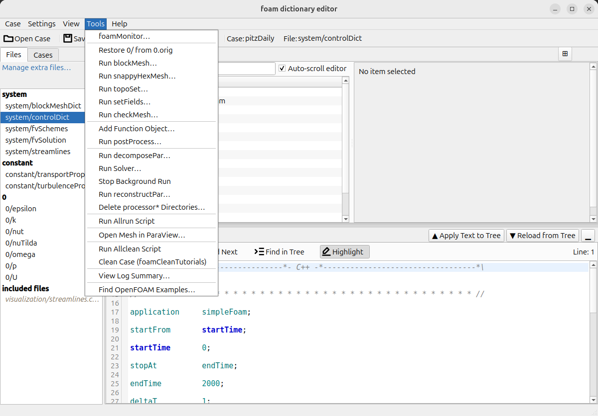

### ツールが必要とするもの

- **開いているケース。** ほとんどの項目は、ケースを開くまでグレーアウトします。[Find OpenFOAM Examples](#find-openfoam-examples) は例外で、ケースを開いていなくても使えます。
- **Terminal パネル。** コマンドを実行する項目は、そのコマンドを **Terminal** タブへ送り、タブは自動で前面に出ます。`no-terminal` バリアントには Terminal タブがないため、それらの項目はグレーアウトしたままです（[バリアント](#バリアント) を参照）。ターミナルで何も実行しない項目 — [Add Function Object](#add-function-object)、[Stop Background Run](#background-runs-and-stop-background-run)、[Delete processor\* Directories](#delete-processor-directories)、[Open Mesh in ParaView](#open-mesh-in-paraview)、[View Log Summary](#view-log-summary)、[foamMonitor](#foammonitor-ランチャー) — は、ケースだけあれば使えます。
- **source 済みの OpenFOAM。** FoDE は OpenFOAM を同梱していません。Terminal は FoDE を起動したシェルから起動されるため、FoDE を起動する前にそのシェルで OpenFOAM の `bashrc` を source してください。そうしないと `blockMesh` などは「command not found」になります。編集と 3D ビューに OpenFOAM は不要です。
- **一部の項目は Linux などの Unix が必要。** [Background runs](#background-runs-and-stop-background-run) と、ターミナルでコマンドが実行中かどうかの確認には Linux が必要です。[foamMonitor](#foammonitor-ランチャー) は Unix のシェルスクリプトなので、Windows では何もしません。

### Run ダイアログの仕組み

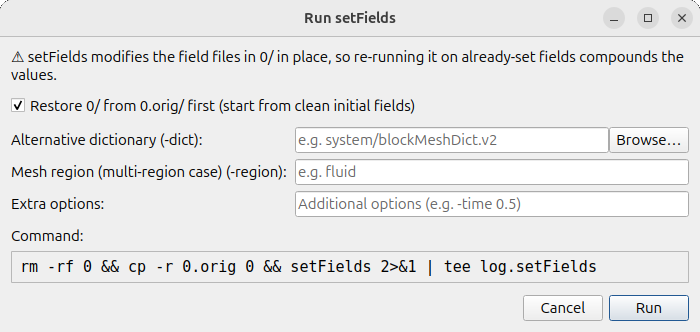

ラベルが省略記号（…）で終わる **Run …** 項目はすべて、まず同じ構成のダイアログを開きます（[Run Solver](#run-solver) はその上に独自の行を加えます）:

- **主要オプション** — そのツールでよく使うフラグのチェックボックスと入力欄。ファイルを取るフラグには、ケース相対パスを挿入する **Browse…** ボタンが付きます。
- **追加オプション** — それ以外のフラグ（例: `-verbose`）を自由に書けるテキスト欄。入力したとおりコマンドに追加されます。
- **コマンド** — 実際に送信されるコマンドラインをそのまま表示するライブプレビュー。実行前に本物の OpenFOAM の起動コマンドを常に確認（そして学習）できます。

**Run**（デフォルトボタン — Enter を押すと現在のオプションで実行）を押すと、コマンドが Terminal タブに送信され、タブは自動で前面に出ます。出力はケースディレクトリの `log.<ツール名>` にも保存されます。`2>&1 | tee log.<ツール名>` のリダイレクトは自動付与されるため、[View Log Summary](#view-log-summary) は常にログを見つけられます。オプションの値はセッション中ツールごとに記憶されます。メッシュ生成系のツールでは、ケースに既に数値の結果ディレクトリがあり再実行がそれらを無効にする可能性がある場合、ダイアログ上部にも警告が表示されます。

### 一度に 1 つのコマンド

コマンドを送る項目はすべて、Terminal で何かが実行中の間 — ソルバー、`./Allrun`、手で入力したコマンドなど — と、ケースで[バックグラウンド実行](#background-runs-and-stop-background-run)が動いている間は、実行を拒否します。新しいコマンドは最初のコマンドの後ろに並ぶだけか、xterm モードではそこに打ち込まれ、`mpirun` に入力として飲み込まれてしまうためです。FoDE を閉じるときやターミナルのモードを切り替えるときも、同じ理由で先に確認されます。[コマンド実行中に FoDE を閉じる場合](#コマンド実行中に-fode-を閉じる場合) を参照。

### メニューの順序

- [foamMonitor…](#foammonitor-ランチャー) — ソルバーの実行中に残差をプロットします。

- [Restore 0/ from 0.orig](#restore-0-from-0orig) — `0.orig/` から `0/` を再作成します。
- [Run blockMesh…](#run-blockmesh)、[Run snappyHexMesh…](#run-snappyhexmesh)、[Run topoSet…](#run-toposet)、[Run setFields…](#run-setfields)、[Run checkMesh…](#run-checkmesh) — メッシュと初期場を作成・確認します。

- [Add Function Object…](#add-function-object) — OpenFOAM インストールのテンプレートから probes、線上のグラフ、forces などを追加します。
- [Run postProcess…](#run-postprocess) — すでにある結果に関数オブジェクトを実行します。

- [Run decomposePar…](#run-decomposepar)、[Run Solver…](#run-solver)、[Stop Background Run](#background-runs-and-stop-background-run)、[Run reconstructPar…](#run-reconstructpar)、[Delete processor\* Directories…](#delete-processor-directories) — 並列実行やバックグラウンド実行を最初から最後まで。

- [Run Allrun Script](#run-allrun-script) — ケースのワークフロー全体。

- [Open Mesh in ParaView…](#open-mesh-in-paraview)

- [Run Allclean Script](#run-allclean-script)、[Clean Case (foamCleanTutorials)](#clean-case-foamcleantutorials) — ケースを初期状態にクリーンします。

- [View Log Summary…](#view-log-summary) — `log.*` ファイルの短いレポート。

- [Find OpenFOAM Examples…](#find-openfoam-examples) — キーワードの使われ方をチュートリアルから検索します（**Case** メニューにもあります）。

## foamMonitor ランチャー

**Tools > foamMonitor…** は `foamMonitor` を起動し、残差などの時系列データを gnuplot でプロットします。FoDE を離れる必要はありません。`foamMonitor` は Unix のシェルスクリプトで、`PATH` が通っていて gnuplot がインストールされている必要があります。Windows ではこのメニュー項目は何もしません。

**起動手順。** ケースを開いて Terminal タブでソルバーを起動し、**Tools > foamMonitor…** を選びます。次のオプションを持つダイアログが開きます:

| 項目 | 説明 |
|---|---|
| **File** | 監視するファイルのパス。**Browse…** をクリックするとケースディレクトリを起点にファイルを選択できます。よく使うパス例: `log.icoFoam`、`log.simpleFoam`、`postProcessing/residuals/0/residuals.dat` |
| **Log scale (-l)** | y 軸を対数スケールで表示します。 |
| **Grid (-g)** | グリッド線を表示します。 |
| **Refresh (-r)** | gnuplot がファイルを再読み込みする間隔（秒、デフォルト 10）。 |
| **Idle timeout (-i)** | ファイルが更新されない状態がこの秒数続くと foamMonitor が自動停止します（デフォルト 60）。 |
| **Extra** | 追加の `foamMonitor` フラグを自由入力できます（例: `-y [1e-8:1]`）。 |

**Launch** をクリックすると gnuplot のウィンドウが開き、ソルバーが新しいデータを書き出すたびに自動更新されます。FoDE は gnuplot で非推奨になった `reread` コマンドを補正するため、どのバージョンの gnuplot でもウィンドウは正しく更新されます。

**停止。** foamMonitor の実行中、メニュー項目は **■ foamMonitor** と表示されます。**Tools > ■ foamMonitor** を選ぶと停止し、gnuplot のウィンドウが閉じます。アイドルタイムアウトが切れたときも自動で停止し、メニュー項目は **foamMonitor…** に戻ります。foamMonitor の実行中に別のケースを開くと、実行中のインスタンスは停止します。

選択したファイルが存在しない場合や、foamMonitor がエラー終了した場合（たとえば gnuplot 未インストール）は、警告ダイアログにエラーメッセージが表示されます。

## Restore 0/ from 0.orig

**Tools > Restore 0/ from 0.orig** を選択すると、`0.orig/` から `0/` フィールドディレクトリを再作成できます。確認ダイアログが表示され、`0/` を削除して `0.orig/` の新しいコピーで置き換えること、`0/` に直接加えた編集はすべて破棄されることが警告されます。**Yes** をクリックすると続行します。コマンドは Terminal タブで実行され（`rm -rf 0 && cp -r 0.orig 0`）、自動的にそのタブへ切り替わります。`0.orig/` ディレクトリがない場合は、その旨を表示して何もしません。

**この操作は元に戻せません。** [免責事項](#免責事項) を参照してください。

## Run blockMesh

**Tools > Run blockMesh…** を選択すると、ケースディレクトリで `blockMesh` を実行できます。[オプションダイアログ](#run-ダイアログの仕組み)には、代替ディクショナリ（`-dict`。ケース相対パスを挿入する **Browse…** ボタン付き）とメッシュリージョン（`-region`）があります。ケースに既に数値の結果ディレクトリがある場合、ダイアログ上部にそれらが一覧表示され、`blockMesh` の再実行がそれらの結果を無効にする可能性があると警告されます。

## Run snappyHexMesh

**Tools > Run snappyHexMesh…** を選択すると、ケースディレクトリで `snappyHexMesh` を実行できます。[オプションダイアログ](#run-ダイアログの仕組み)には `-overwrite`（デフォルトでチェック — チェックを外すと `constant/polyMesh` を置き換える代わりにスナップ後のメッシュを新しい時間ディレクトリに書き出します）、`-dict`、`-region` が並び、ケースに既に数値の結果ディレクトリがある場合は再メッシュがそれらを無効にする可能性があるとダイアログ上部で警告されます。

## Run topoSet

**Tools > Run topoSet…** を選択すると、ケースディレクトリで `system/topoSetDict` を読み込む `topoSet` を実行できます。[オプションダイアログ](#run-ダイアログの仕組み)には `-dict`（例: `topoSetDict.refine` のような変種）と `-region` が並び、ケースに既に数値の結果ディレクトリがある場合は再実行がそれらを無効にする可能性があるとダイアログ上部で警告されます。

## Run setFields

**Tools > Run setFields…** を選択すると、ケースディレクトリで `system/setFieldsDict` を読み込む `setFields` を実行できます。[オプションダイアログ](#run-ダイアログの仕組み)には `-dict` と `-region` が並びます。

`setFields` は `0/` の場ファイルを直接書き換えるため、設定済みの場に対して再実行すると値が重ねて適用されます（辞書のボックスを動かしても、既に満たされた `alpha.water` 領域は満たされたままです）— ダイアログ上部にその旨が表示されます。そのため、ケースに `0.orig/` バックアップがある場合、ダイアログにはデフォルトでチェックされた **先に 0/ を 0.orig/ から復元する** チェックボックスも表示されます: コマンドの先頭に `rm -rf 0 && cp -r 0.orig 0 && ` が付加され（プレビューにも表示されます）、クリーンな初期場に対して `setFields` を実行するチュートリアルの標準的なワークフローになります。チェックを外すと現在の `0/` に対してそのまま実行します。`0.orig/` ディレクトリがない場合は、復元元のバックアップがないことが警告に示されるだけです。

## Run checkMesh

**Tools > Run checkMesh…** を選択すると、ケースディレクトリで `checkMesh` を実行し、メッシュ品質（非直交性、歪度、アスペクト比など）を検証できます。**Run blockMesh** や **Run snappyHexMesh** の後に実行するのが典型的です。[オプションダイアログ](#run-ダイアログの仕組み)には `-allGeometry` と `-allTopology`（非標準の拡張チェック群）、サーフェス形式を指定する `-writeSets`（例: `vtk` — 問題のあるセル/面セットを ParaView で調べられるように書き出します）、`-region` が並びます。`checkMesh` はメッシュを読むだけなので、ダイアログにプレフライト警告はありません。

## Add Function Object

**Tools > Add Function Object…** を選択すると、probes、線上のグラフ、forces、yPlus、場の平均などの後処理用の関数オブジェクトを、辞書の書き方を覚えていなくても追加できます。FoDE は独自の定義を持たず、一覧は OpenFOAM のインストールが `etc/caseDicts/postProcessing` に同梱しているテンプレートから作るため、実際に使う OpenFOAM と常に一致します。使うインストールは、**Find OpenFOAM Examples** または **Settings > Generate OpenFOAM Keywords…** で選んだもの（どちらも同じ選択欄で、選択は記憶されます）、なければ FoDE を起動する前に source したもので、ダイアログに表示されます。

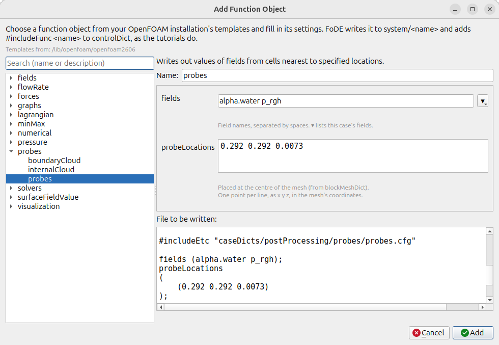

同じ関数でも 2 つのフォークで名前や形が異なり（OpenCFD の probes は `probeLocations`、Foundation は `points`。OpenCFD の線上のグラフは `singleGraph`、Foundation は `nPoints` を含む `graphUniform`）、どちらもリリースごとに変わります。一覧を FoDE が持たず、お使いのインストールから読むのはそのためです。

左側でテンプレートを選ぶと（カテゴリごとに分類され、名前と説明で検索できます）、右側に説明と設定が表示されます。表示されるのはテンプレート自身が設定する項目だけで、それぞれ種類に合った入力欄になります。

- **フィールド名**: ▾ でケースのフィールド（`0/` と最新の時刻）から選べます。
- **パッチ名**: ▾ でメッシュのパッチ（メッシュがまだなければ `0/` にあるもの）から選べます。メッシュにない名前はアンバー色で指摘します。パッチグループも指定できるため、拒否ではなく警告です。
- **点**: 1 行に 1 点ずつ `x y z`。1 つの点や方向は `x y z`。
- 数値、および標準の選択肢付きの `writeControl`/`executeControl`。

Foundation のテンプレートは入力が必要な箇所を `<プレースホルダー>` で示します。その項目は空欄で始まり `*` が付き、すべてに正しい値が入るまで **Add** は押せず、理由が表示されます。OpenCFD のテンプレートは代わりに動作する例が入っています。`patches (patch1 patch2)` のような例はソルバーの中で初めてエラーになるので、確認してください。入力欄の下の **File to be written** には、入力に合わせて正確なテキストが表示されます。変更していない部分は、テンプレートのコメントや `#includeEtc` の行も含めてそのまま残ります。C++ コードを含む 1 つのテンプレートだけは入力欄にできないため、そこでテキストとして編集します。

OpenCFD の `visualization/surfaces` テンプレートは入れ子のリストなので、専用の入力欄になります。**切断面** は 1 行に 1 つ `名前  px py pz  nx ny nz` の形で、`point` と `normal` を持つ `$cuttingPlane` のメンバーとして書き出されます（OpenFOAM Foundation 7 と 8 は `basePoint`/`normalVector` を先に読むため、その場合はこちらで書きます）。**その他の面** には、テンプレートの残りのメンバーが書かれたまま入ります。そこには等値面と `CAD` という名前のパッチ面があり、ケースには存在しないはずなので、不要なものは削除してください。

**領域の内側から始まる値。** テンプレートの例の座標は、角や領域の外にあることがよくあります（OpenCFD の probes の例は `(0 0 0)`）。そこでケースに `blockMeshDict` がある場合、FoDE はこうした値をメッシュの内側から始め、入力欄の下の注記でそのことを示します。

- 点のリストには、メッシュの中心に点を 1 つ置きます。
- サンプル線は、中心を通りメッシュの最も長い方向に沿って引き、両端を壁から少し内側に寄せます。境界面ちょうどの点はセルが見つからないことがあるためです。
- Foundation の `cutPlaneSurface` には、中心を通り最も薄い方向に垂直な面（2 次元ケースの中央面）を設定します。
- OpenCFD の切断面は、名前と法線をそのままに中心へ移します。

回転中心、揚力の方向、パッチは物理の選択なので変更しません。大きさは `blockMeshDict` から読み、非常に大きくなりうる `constant/polyMesh/points` は読みません。`blockMeshDict` がない場合は、テンプレート自身の値のままです。snappyHexMesh のケースでは `blockMeshDict` は背景ボックスにすぎず、その中心が固体の中にあることもあるため、3D ビューで確認するよう注記で促します。

点のリスト、線、面を入力している間は、**3D ビューがメッシュと重ねて即座に描画** するので、実行する前にプローブが領域の内側にあるかを確認できます。最初に表示できるものができたとき、BlockMesh タブが自動で前面に出ます。プレビューはダイアログを閉じると消え、追加したファイルは以後その名前で描画されます。`lidProbes` のように自分で付けた名前でも同じです。

ケースにすでに結果がある場合は、**既存の最新の結果にもすぐ実行する** の選択肢が表示されます。forces や yPlus のようにソルバーのモデルが必要な関数は、[Run postProcess](#run-postprocess) と同じくソルバーを通して実行します。`postProcess -func <name> -latestTime` で、OpenFOAM Foundation 11 以降では `foamPostProcess` になります（インストール自体から判断します）。最新の結果が `processor*/` にしかない場合は、`mpirun -np N … -parallel` として実行します。Terminal タブで実行され、そこでコマンドが実行中の間は拒否します。

**Add** を押すと、チュートリアルや `foamGet` と同じ形で書き出します。入力したテンプレートを `system/<name>` とし、`system/controlDict` の `functions` ブロック（なければ作成）に `#includeFunc <name>` を追加します。名前の初期値はテンプレート名で、`controlDict` 内や `system/` のファイルとしてすでに使われている名前は使えません。新しいファイルはエディタで開かれ、ファイル一覧に加わります。以後はソルバーと一緒に実行されます。すでにある結果に適用するには、上の選択肢を使うか、自分で `postProcess -func <name>` を実行してください（最後の時刻だけなら `-latestTime` を付けます）。FoDE で `controlDict` に未保存の編集がある間は、それに書き込むため実行を拒否します。

## Run postProcess

**Tools > Run postProcess…** を選択すると、ソルバーを再実行せずに、すでにある結果に関数オブジェクトを実行できます。たとえば、プローブやサンプル線を動かしたので手元の結果から新しい値を得たい場合、`mag(U)`、`vorticity`、`yPlus` を 1 回だけ計算したい場合、最新の時刻だけでなくすべての時刻に関数を適用したい場合に使います。

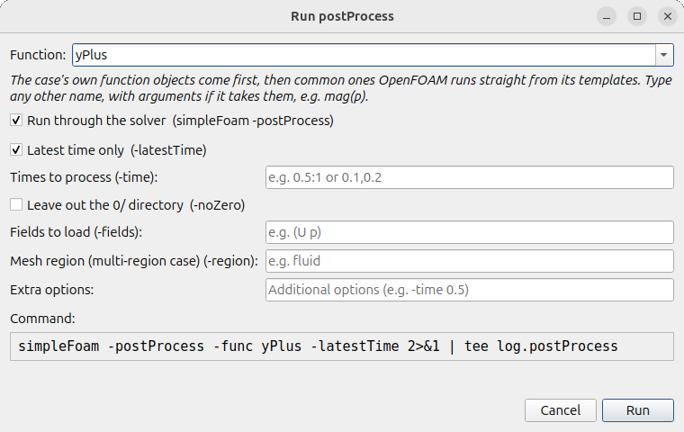

- **関数** には、まずケースの `controlDict` が `#includeFunc` で実行するすべての関数オブジェクトが並びます。続いて、OpenFOAM が `system/` のファイルなしでテンプレートから直接実行できるよく使うもの（`mag(U)`、`vorticity`、`Q`、`CourantNo`、`yPlus`、`wallShearStress` など）が並びます。先頭の **（controlDict のすべての関数）** はそれらをすべて実行します。その他の名前も入力でき、引数を取るものは `mag(p)` のように引数付きで書きます。
- **ソルバーを通して実行** は、ソルバーの乱流モデルや輸送モデルを使う関数（`yPlus`、`wallShearStress`、`forces`、`forceCoeffs` など）に必要です。そのまま実行するとエラーなく終了しますが何も計算されず、ログに「Unable to find turbulence model in the database」と出るだけです。
  - FoDE はそうした関数を型で判断して自動でチェックを入れるので、`drag` という名前で保存した forces の関数も対象になります。**（controlDict のすべての関数）** の場合も自動でチェックを入れます。関数名を指定せずにそのまま実行すると、サンプリングの関数がフィールドを見つけられず、何も書き出さないためです。自分でチェックを変えると、自動の選択より優先されます。
  - コマンドは `<ソルバー> -postProcess -func …`（OpenCFD、OpenFOAM Foundation 10 まで）または `foamPostProcess -solver <モジュール> -func …`（Foundation 11 以降）になり、ソルバーは `controlDict` から取ります。
- **時刻** は既定では最新のみで、`-time` で選ぶこともでき、`-noZero` で `0/` を除けます。**フィールド** と **領域** も指定できます。
- **並列実行** は分割済みのケースで表示され、最新の結果が `processor*/` にしかない場合はチェックされた状態で始まります。

出力は `log.postProcess`（Foundation 11 以降は `log.foamPostProcess`）に書かれ、ソルバーを通して実行する場合もソルバー自身のログには書きません。ケースにまだ結果がない場合や、未保存の編集があるファイルがある場合（postProcess はディスクから読むため）は警告します。他の Run ツールと同じく、Terminal タブでコマンドが実行中の間や、ケースでバックグラウンド実行が動いている間は拒否します。`controlDict` が実行する関数オブジェクトのファイル（`system/probes` など）を右クリックすると、その関数を選んだ状態で **これで postProcess を実行…** を開けます。

## Run decomposePar

**Tools > Run decomposePar…** を選択すると、`system/decomposeParDict` の設定に従って、並列計算用にケースを `processorN/` ディレクトリへ分割します（分割数は `numberOfSubdomains`）。[オプションダイアログ](#run-ダイアログの仕組み)には `-force`（既存の `processor*` ディレクトリを先に削除）、`-copyZero`（場を分割せず `0/` をそのままコピー）、`-latestTime`、`-region` が並びます。ケースがすでに分割済みの場合はダイアログにその旨が表示され、`-force` が最初からチェックされています。`-force` がないと decomposePar は実行を拒否するためです。

唯一の例外は、`processor*` ディレクトリにまだ再構築されていない結果（そちらにはあってケースルートにはない時間ディレクトリ）がある場合です。`-force` を付けるとこれらは完全に削除されるため、ダイアログはその時刻を示して先に `reconstructPar` を実行するよう促し、前回チェックしていても `-force` をチェックしない状態で開きます。この場合は、decomposePar が実行を拒否するのが安全な失敗のしかたです。

`system/decomposeParDict` がないケースではメッセージが表示され、何も実行されません。分割後は [Run Solver](#run-solver) で並列実行できます。

## Run Solver

**Tools > Run Solver…** を選択すると、`Allrun` スクリプトの他の手順を通さずに、ケースのソルバーだけを実行できます。たとえば境界条件や `endTime` を変えた後、メッシュと初期場がすでに揃っている場合に使います。**Solver** 欄には `system/controlDict` の `application` が入ります。欄はディスク上のファイルではなくエディタのテキストを読むので、未保存の編集も反映されます。

ソルバー名は上書き入力したり一覧から選んだりでき、変更はその回の実行にだけ適用されます。次にダイアログを開くと、再び `controlDict` の値が入ります。受け付けるのは実行ファイル名（英数字と `_ . + -`）だけで、有効な名前が入るまで **Run** は無効のままです。

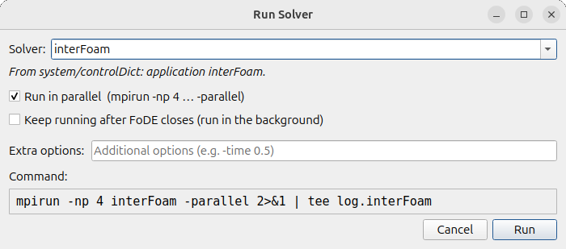

欄の下の行には、名前をどこから読んだかが表示されます。OpenFOAM Foundation v11 以降のケースでは `application` は `foamRun` で、物理モデルは別の `solver` エントリ（例: `incompressibleFluid`）、`foamMultiRun` なら `regionSolvers` で選びます。ダイアログはそれらのモジュールを表示しますが、コマンドは `foamRun` のままです。foamRun が `controlDict` から直接読み込むためです。

ダイアログには次の項目もあります。

- **未保存のファイルを先にすべて保存**: 未保存の変更があるファイルが一つでもあると表示され、チェックされた状態で始まります。ソルバーは FoDE ではなくディスクからディクショナリを読むためです。保存できないファイルがあった場合、ソルバーは開始されません。
- **並列実行 (mpirun -np N … -parallel)**: ケースが分割済みか、`system/decomposeParDict` があると表示されます。分割済みなら N は実際の分割数です（`mpirun` が合わせるべきなのはこの数です）。分割前は `numberOfSubdomains` から取られます。まだ分割されていない場合は、先に [decomposePar を実行](#run-decomposepar)するよう警告が表示されます。分割済みならチェックされた状態で始まりますが、次の 2 つの場合はチェックなしで始まり、警告で理由を示します。
  - `numberOfSubdomains` と実際の分割数が食い違っている場合。OpenFOAM が起動時に実行を止めます。
  - 分割後に `0/` または `constant/polyMesh` が変更された場合。このダイアログがこれから保存する `0/` の場の未保存の編集も含みます。並列実行はケースルートではなく `processor*/` を読むため、変更が反映されないまま黙って計算が進んでしまいます。先に decomposePar を再実行してください。
- プレフライト警告: メッシュが見つからない場合（`constant/polyMesh`、リージョンの `constant/<region>/polyMesh`、分割済みメッシュのいずれもない）、および時間ディレクトリがすでにある場合。後者では `startFrom` の扱いも示します（`latestTime` なら最新の時刻から継続、それ以外は結果が上書きされる可能性あり）。
- その他のオプション（`-noFunctionObjects` など）を指定する **Extra options**。
- **FoDE を閉じても実行を続ける（バックグラウンドで実行）**: Linux のみ。既定でチェックされることはありません。[Background runs](#background-runs-and-stop-background-run) を参照。
- `controlDict` の `stopAt` が `writeNow`（または `noWriteNow`、`nextWrite`）の場合の警告。ソルバーが開始直後に停止してしまうためです。以前の実行を手で止めたときの残りであることが多い設定です。
- **既存の log.<ソルバー名>**: そのログがすでにある場合（典型的には最新時刻から計算を継続する場合）にだけ表示されます。どちらの場合も、ただの `log.<ソルバー名>` が常に最新の実行です。
  - デフォルトの **名前を変えて残す: log.<ソルバー名>.[サフィックス]** は、実行前に古いログを別名に移します。サフィックスには次の `partN` が入っており（既存の最大番号の次なので、番号は実行順に並びます）、`before-refine` のように自分で入力することもできます。サフィックスは記憶されず、毎回次の空いている `partN` から始まります。
  - **上書きする** を選ぶと古いログを置き換えます。
  - サフィックスが空の場合、`.` で始まる場合、英数字と `_ . -` 以外を含む場合、およびすでにあるログ名になる場合は Run が無効になるので、ログを残す操作で別のログを上書きすることはありません。

出力は `log.<ソルバー名>` に保存されます。`Allrun` スクリプトの `runApplication`/`runParallel` と同じファイル名なので、[View Log Summary](#view-log-summary) と Allrun の「実行済みか」チェックの両方がこのログを認識します。実行中の残差は [foamMonitor ランチャー](#foammonitor-ランチャー) でプロットできます。ソルバーは Terminal タブで Ctrl+C を押すと停止できますが、Simple ターミナルモードでは実行中のジョブを中断できません。

## Background runs and Stop Background Run

Terminal タブで始めた実行は、FoDE を閉じると終了します。長い計算では、[Run Solver](#run-solver) または [Run Allrun Script](#run-allrun-script) の確認ダイアログで **FoDE を閉じても実行を続ける（バックグラウンドで実行）** をチェックしてください。実行はターミナルから切り離され、出力は `log.<ソルバー名>`（または `log.Allrun`）に直接書かれ、FoDE やターミナルを閉じても止まりません。Terminal タブは実行が終わるまでログを追って表示します。そこでの Ctrl+C は表示を止めるだけです。

実行中は次のように表示されます:

- ツールバーのケース名の横に **● icoFoam をバックグラウンド実行中** のバッジ（クリックで停止やログの要約表示）。
- ウィンドウタイトルの末尾に「— icoFoam 実行中」（タスクバーにも表示されます）。
- ファイル一覧の下部に **バックグラウンド実行中** の行。
- 実行が自然に終わったときのステータスバーのメッセージ。

バックグラウンド実行は閉じても影響を受けないため、FoDE を閉じるときに確認は出ません。代わりに、まだ動作中の実行を列挙する **OK** だけの案内が表示されます。**今後は表示しない** をチェックすると、以後は何も表示せずに閉じます（**Settings > Reset All Settings…** で案内が元に戻ります）。ケースを再び開けば実行が表示され、シャットダウンやログアウトで実行は終了します。

ケースでバックグラウンド実行が動いている間は、コマンドを送る Tools メニューの操作はすべて、その実行とプロセス ID を示して拒否されます（FoDE を閉じて開き直したあとでも同じです）。2 つ目の実行が同じタイムディレクトリに書き込んでしまうためです。FoDE は実行をケース内の隠しファイル `.fode-background-run` に記録し、プロセスが消えるとそのファイルは無視されます。

実行中に保存した `controlDict`、`fvSchemes`、`fvSolution` への編集は、その実行に反映されます。OpenFOAM がこれらを再読み込みするためです（`runTimeModifiable`、デフォルトでオン）。

**停止のしかた。** **Tools > Stop Background Run**（ファイル一覧の行の右クリックメニューにもあります）は、OpenFOAM の作法でソルバーに現在の時間ステップを書き出して終了するよう求めます。強制終了するとそのステップが失われるためです。`system/controlDict` に `stopAt writeNow;` を設定し、ソルバーがそれを再読み込みします。バッジと行は琥珀色になり **■ Stopping …** と表示されます。これは最大で 1 時間ステップ分続くことがあります。その後、メッセージで次の内容が報告されます:

- 最後に書き出された時刻。
- 実行が正常に終わったか — ログに最後の `End` 行がなければ、クラッシュまたは強制終了で、最後の時刻は不完全な可能性があります。
- `stopAt` が元に戻されたこと。次の実行が最初のステップで止まらないようにするためです。先に FoDE を閉じた場合は、次にそのケースを開いたときに戻します。

FoDE 上で `controlDict` に未保存の編集がある場合や、`controlDict` で `runTimeModifiable` がオフの場合（ソルバーが要求を読み取れないため）は、停止要求は拒否されます。後者ではメッセージに `kill` コマンドが示されますが、現在のステップは失われます。Allrun の場合、停止はソルバーのステップを終わらせ、その後の reconstructPar などのステップは引き続き実行されます。

バックグラウンド実行は Linux が必要です。ログアウト時にユーザーのプロセスを終了させる設定のシステム（systemd の `KillUserProcesses`。Ubuntu の既定では無効）では、ログアウトで実行が終了することがあります。その場合は `loginctl enable-linger` かジョブスケジューラを使ってください。

### FoDE を使わずに: ターミナルから実行を探す・止める・強制終了する

バックグラウンド実行は FoDE より長く続くため、FoDE が手元にないとき（SSH 経由など）に扱いたいこともあります。FoDE があるケースで開始した実行は、そのケースの `.fode-background-run` に `<pid> <ソルバー名> <ログ>` の形で記録されています。

```bash
cat <case>/.fode-background-run       # 例: 1877261 icoFoam log.icoFoam
pgrep -a icoFoam                      # 動作中のすべての icoFoam とそのコマンドライン
pgrep -af mpirun                      # 並列計算
ps -o pid,etime,args -C icoFoam       # etime: 実行時間
pwdx <pid>                            # プロセスが動作しているケースディレクトリ
```

現在の時間ステップを書き出してきれいに止めるには、Stop Background Run と同じことをします。FoDE が元に戻すのは自分で設定した値だけなので、止まった後は `stopAt` を自分で戻してください。

```bash
cd <case>
foamDictionary system/controlDict -entry stopAt -set writeNow
# 止まったら:
foamDictionary system/controlDict -entry stopAt -set endTime
```

強制終了するには（現在の時間ステップは失われます）:

```bash
kill -- -<pid>        # マイナスが重要: 実行全体
kill -9 -- -<pid>     # 最初のもので止まらない場合のみ
```

マイナスに注意してください。実行を止めるには `kill -- -<pid>` を使います。単なる `kill <pid>` ではソルバーが動き続けます（FoDE はそれを引き続き実行とみなし、2 つ目の実行も拒否します）。強制終了の後に片付けは不要です。残った `.fode-background-run` は古いものとして扱われます。

## Run reconstructPar

**Tools > Run reconstructPar…** を選択すると、並列計算の結果を `processor*/` ディレクトリからケースルートの通常の時間ディレクトリに戻し、FoDE・ParaView・シリアル実行のツールから読めるようにします。[オプションダイアログ](#run-ダイアログの仕組み)には、両フォークで綴りが同じオプションである `-newTimes`（既定でチェック: すでにケースルートにある時刻を飛ばす）、`-latestTime`、`-time`（例: `0.5:1`）、`-fields`（例: `(U p)`）、`-withZero`、`-region` が並びます。

「フィールド / セット / lagrangian を飛ばす」スイッチは Foundation では `-noFields`、OpenCFD では `-no-fields` と綴りが異なるため、**Extra options** に入力します。

ダイアログには、まだケースルートにない時刻が一覧されるか、新たに再構築するものがないことが表示されます。`processor*/` ディレクトリがないケースや、Terminal タブでコマンドがまだ実行中の場合は実行を拒否します。書き込み途中の時間ステップを中途半端な状態で再構築してしまうおそれがあるためです。

## Delete processor* Directories

**Tools > Delete processor\* Directories…** を選ぶと、結果を再構築し終えた分割済みケースが使っているディスク容量を解放できます。`processor*/` の中身がすべてケースルートにも存在し、かつ完全であることを FoDE が確認するまで、何も削除されません:

- すべての時間ディレクトリとその中のファイル（フィールド、`uniform/`、`lagrangian/`）— `-latestTime` や `-fields` で再構築した場合も検出されます。
- `constant/polyMesh/sets/` のセル・面・点のセット。
- メッシュ — プロセッサがメッシュを持っている場合、ケースルートに同じ総セル数のメッシュが必要です。
- ケースルートのコピーが完全で、現在のメッシュのものであること — 中断された `reconstructPar` で途切れたもの、別のメッシュ時代の残りものではないこと。そうでない場合は、`reconstructPar -time <t>` をもう一度実行するよう、メッセージに示されます。
- ケースで今ほかの作業が進んでいないこと — 別のターミナルの `reconstructPar` や `-case` 付きで実行したソルバーなど。該当するプロセスは名前が示されます。待機中のシェル・エディタ・ParaView は対象外です。この確認は、削除の直前にもう一度行われます。

失われるものがある場合、ダイアログは何が失われるか（例: 「time 0.3 exists only in processor\*」）を一覧し、何も削除しません。「それでも削除」はありません。コレート形式のデータ（`processorsN`）は、FoDE が中身を読めないため、同様に拒否されます。

確認が通ると、確認ダイアログが削除される内容と容量を示し、既定の答えは **No** です。チェックボックス **Keep the latest time (t) and the decomposed mesh** は既定でオンです:

- **オン** — 最新以外のすべての時間ディレクトリが削除され、各プロセッサの `constant/` は残ります。`decomposePar` をやり直さずに（大きなケースでは遅く、メモリも必要です）`startFrom latestTime;` で並列計算を続けられ、それでもほとんどの容量が解放されます。
- **オフ** — ディレクトリは完全に削除されます。後で並列計算を続けるには `decomposePar` をやり直す必要があります（`-latestTime` で最後の時刻だけを分割できます）。

重要な場面では FoDE が既定値を決めます。ケースルートにプロセッサより新しい時刻がある場合はチェックなしで始まり、すべて削除するとデータを失う場合（メッシュが `processor*/` にしかない）はチェック済みでロックされます。

圧縮されたケース（`writeCompression on`）にはもう 1 つオプション **Read compressed files to the end first** があり、既定でオンです。`.gz` ファイルが完全であることを確かめるには全体を展開する必要があり、大きなケースでは数分かかります。オフにすると、圧縮ファイルは先頭部分だけを確認し、途中で切れたものは検出されないと確認ダイアログに表示されます。

削除は完全削除で、ゴミ箱には移されません。削除中のディレクトリ名を示す進行状況ウィンドウの背後で実行され、**Stop** で現在の時間ディレクトリの後に終了します。すべて事前に確認済みなので、これは常に安全で、アクションをもう一度実行すれば続きが片付きます。Terminal タブでコマンドが実行中の間は拒否され、ターミナル自体は必要ありません。

**この操作は元に戻せません。** [免責事項](#免責事項) を参照してください。

## Run Allrun Script

**Tools > Run Allrun Script** を選択すると、ケースの `./Allrun` スクリプト — 通常はメッシュ生成・フィールド初期化・ソルバー本体までのワークフロー全体 — を Terminal タブで実行できます（自動的にそのタブへ切り替わります）。ケースに `Allrun` スクリプトがない場合は警告ダイアログが表示されます。ソルバー実行には長時間かかることがあるため、まず確認ダイアログが表示されます。なお Simple ターミナルモードでは実行中のジョブを中断できません（xterm ターミナルは Ctrl+C に対応しています）。

ケースに既に `log.*` ファイルがある場合は別のダイアログが表示されます。OpenFOAM の Allrun ヘルパー関数（`runApplication`/`runParallel`）は `log.*` ファイルが既に存在するステップをスキップする（「already run … remove log file to re-run」）ため、実行済みのケースで `./Allrun` をそのまま実行しても何も起きないように見えることがあります。ダイアログは既存のログファイルを列挙し、3 つの選択肢を提示します: **クリーンしてから実行**（`foamCleanTutorials && ./Allrun` を送信 — 標準的な `./Allclean && ./Allrun` イディオム。[Clean Case](#clean-case-foamcleantutorials) を参照）、**そのまま実行**（`./Allrun` をそのまま送信し、実行済みステップはスキップされます）、**キャンセル**。どちらのダイアログにも、Linux では **FoDE を閉じても実行を続ける** があります。[Background runs](#background-runs-and-stop-background-run) を参照。

`Allrun` の各ステップはそれぞれ `log.<アプリケーション>` ファイルを書き出すため、[View Log Summary](#view-log-summary) や [foamMonitor](#foammonitor-ランチャー) は通常どおり結果に対して利用できます。

## Open Mesh in ParaView

**Tools > Open Mesh in ParaView…** を選択すると、BlockMesh 3D パネルのブロックトポロジプレビューの代わりに、実際に生成されたメッシュを ParaView で表示できます。`paraFoam` が `PATH` 上にあれば `paraFoam -case <ケースディレクトリ>` を起動し、なければ `paraview` の単純起動にフォールバックします。どちらも見つからない場合は、警告ダイアログでその旨が表示されます。このアクションはケースが開かれていればいつでも利用でき、FoDE 内で `blockMesh` を実行済みである必要はありません。

## Run Allclean Script

**Tools > Run Allclean Script** を選択すると、ケースの `./Allclean` スクリプトを Terminal タブで実行できます（自動的にそのタブへ切り替わります）。ケースに `Allclean` スクリプトがない場合は警告ダイアログが表示されます。ある場合は、生成されたメッシュ・時刻ディレクトリ・ログファイルなどの結果が削除されることを警告する確認ダイアログが表示されます。削除がディスクに反映されると、ファイルリストは自動的に更新されます。

なお、[Clean Case (foamCleanTutorials)](#clean-case-foamcleantutorials) はケースに `./Allclean` がある場合それを実行するため、このアクションはスクリプト自体を明示的に実行したい場合のためのものです。

**この操作は元に戻せません。** [免責事項](#免責事項) を参照してください。

## Clean Case (foamCleanTutorials)

**Tools > Clean Case (foamCleanTutorials)** を選択すると、OpenFOAM 標準の `foamCleanTutorials` スクリプトを Terminal タブで実行してケースをクリーンできます（自動的にそのタブへ切り替わります）。生成されたメッシュ（`constant/polyMesh`）、時刻ディレクトリ、`processor*/` 分割、`postProcessing/`、`log.*` ファイルなどの生成物を削除します。ケースに応じて次の 2 つの挙動があり、いずれも確認ダイアログに明記されます。

- ケースに独自の `Allclean`（または `Allwclean`）スクリプトがある場合、`foamCleanTutorials` は組み込みのクリーン処理の代わりにそのスクリプトを実行します。
- それ以外で `0.orig/` ディレクトリが存在する場合、`0/` も削除されます（`foamCleanTutorials` のデフォルト `-auto` モード — 標準的なチュートリアルの慣例です。[Restore 0/ from 0.orig](#restore-0-from-0orig) または **Run Allrun Script** で再作成できます）。

クリーン後、ファイルリストと[メッシュインジケーター](#メッシュ有無古さのインジケーター)は自動的に更新されます。

**この操作は元に戻せません。** [免責事項](#免責事項) を参照してください。

## View Log Summary

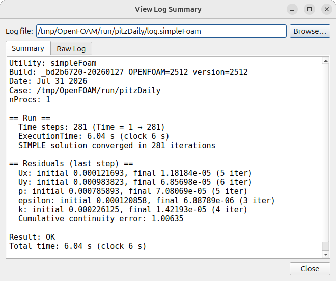

**Tools > View Log Summary…** を選択すると、`log.*` ファイルの生テキストの代わりに要約レポートを表示できます。特に `log.snappyHexMesh` で有用です。細分化・スナッピング・レイヤー追加の反復出力が繰り返されるため、数千行に達することがあります。ダイアログはケースディレクトリ内で最も新しく更新された `log.*` ファイルを初期選択します（**Browse…** で別のファイル、ケースディレクトリ外のファイルも選択できます）。2 つのタブがあります。

- **Summary** — ログの種類によって異なります。
  - `blockMesh`: `Mesh Information` と `Patches` ブロック。
  - `snappyHexMesh`: 最終的なセル・面・点数、細分化カテゴリごとの反復回数、スナッピングの緩和反復回数、最終的なパッチ別レイヤー厚テーブル、メッシュ品質チェックの結果。
  - `topoSet`: セル・面・点セットごとに 1 行で、適用されたソースと最終サイズを表示します。
  - **ソルバーログ**（`log.simpleFoam`、`log.interFoam` など — タイムループの形で認識されるため、リストに載っていないソルバーでも動作します）の場合は、時間ステップ数とシミュレーション時間の範囲、最終的な `ExecutionTime`/`ClockTime`、収束した場合の収束メッセージ（`SIMPLE solution converged in N iterations`）、そして最終ステップの残差 — フィールドごとの初期・最終残差と反復回数、Courant 数、累積連続性誤差 — を表示します。収束にも `End` にも到達しなかった実行は FAILED として報告されます。
  - それ以外のユーティリティのログはヘッダーと末尾約 20 行にフォールバックします。
  - どの種類でも、繰り返される警告（反復ごとの変位警告など）は件数付きの 1 行にまとめられ、致命的エラーは常に全文表示されます。
- **Raw Log** — 要約で省略された内容を確認できるよう、加工していないファイル内容をそのまま表示します。

[Find OpenFOAM Examples](#find-openfoam-examples) と同様に — そして FoDE の他のダイアログとは異なり — このダイアログは**非モーダル**です。ツリー・エディタ・ターミナルでの作業を続けながらメインウィンドウの横に表示したままにできるため、辞書の設定内容とログの結果を見比べながら作業できます。このアクションはケースが開かれていればいつでも利用でき、ターミナルパネルや FoDE 内でのメッシュコマンド実行を必要としません。既存の `log.*` ファイルであれば動作します。

## Find OpenFOAM Examples

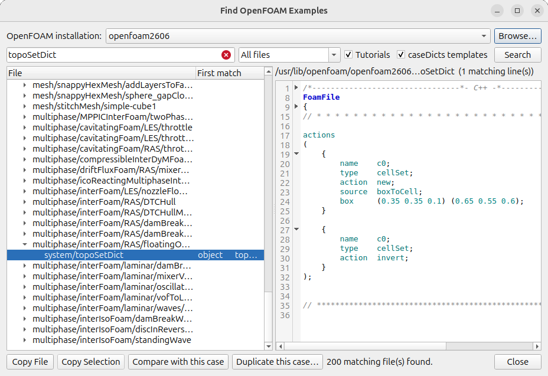

**Tools > Find OpenFOAM Examples…**（**Case > Find OpenFOAM Examples…** からも開けます）を選択すると、ローカルの OpenFOAM インストールからキーワードや設定の実際の使用例を検索できます。「`nOuterCorrectors` は実際どう使うのか」「`forces` の function object には何を書くのか」といった、従来は `find`/`grep` の知識が必要だった疑問に答えるための機能です。ダイアログは 2 つの検索対象を持ち、それぞれチェックボックスで切り替えられます。

- **チュートリアル** — インストールの `tutorials/` ディレクトリに同梱されている約 550 の例題ケース。
- **caseDicts テンプレート** — `etc/caseDicts/` 配下の厳選ファイル。`controlDict` の `functions {}` ブロックで `#includeFunc <名前>` として利用できる `postProcessing/` の function object テンプレートや、`annotated/` 配下の注釈付き例題辞書を含みます。

**インストールの選択。** 上部のセレクタには、マシン上で見つかった OpenFOAM インストールが一覧表示されます。FoDE を環境設定済みのシェルから起動した場合はその環境（`WM_PROJECT_DIR`/`FOAM_TUTORIALS`/`FOAM_ETC`）が、さらに `/usr/lib/openfoam/`、`/opt/`、`~/OpenFOAM/` から自動検出されたインストールが新しい順に並びます。**Browse…** で任意のディレクトリ（インストールルートまたは `tutorials/` ディレクトリそのもの）を指定でき、その選択は `app_config.json`（`openfoam_dir` キー）に保存されて次回も初期選択されます。

**検索。** キーワードを入力し（行単位・大文字小文字を区別せずに一致）、Enter または **検索** をクリックします。ファイル名ドロップダウンで検索対象を 1 つの辞書ファイル（`controlDict`、`fvSchemes` など）に絞り込めます。「すべてのファイル」のままにするとすべてを検索します。検索はバックグラウンドで実行されキャンセルも可能で、結果は 200 ファイルまでに制限されます。一致はチュートリアルケースごと（caseDicts はテンプレートフォルダごと）にグループ化され、最初の一致行がスニペットとして表示されます。

**結果の利用。** 一致を選択すると、ファイル全体が読み取り専用のシンタックスハイライト付きプレビューに表示され、最初の一致行までスクロールします。そこから:

- **ファイルをコピー** / **選択範囲をコピー** — ファイル全体、またはプレビュー内で選択したテキストだけをクリップボードにコピーします（選択範囲をコピーは何かを選択すると有効になります）。自分のケースの Editor タブへの貼り付けなどに使えます。
- **このケースと比較** — 一致がチュートリアルケース内にある場合に有効になります。ワンクリックでそのケースが既存の[ケース比較](#ケース比較)ビューの参照ケースとして読み込まれ、自分のケースとの差分を確認しながら、右クリックの **この値を使用** で個々の設定を取り込めます。ケースが開かれていない場合は、先にケースを開くよう案内されます。
- **このケースを複製…** — 一致がチュートリアルケース内にある場合に有効になります。そのチュートリアルをコピー元として「[ケースの複製](#ケースの複製)」と同じダイアログを開き、書き込み可能な場所へコピーして自分のケースの出発点にできます — インストール内のチュートリアルケースをその場で編集してはいけません。コピー先はデフォルトケースディレクトリ（未設定ならホームディレクトリ。読み取り専用のインストール先が提示されることはありません）が初期値になり、コピー完了後はその場で新しいケースを開くかどうかを選択できます。

このダイアログは**非モーダル**です。メインウィンドウの横に開いたまま、例を参照しながら編集を続けられます。検索するだけならケースを開いている必要はありません。

## バリアント

FoDE はフィーチャーフラグで制御される 3 つの構成で動作します。プラットフォームとワークフローに合ったものを選んでください。

| バリアント | Terminal タブ | BlockMesh タブ | 起動コマンド |
|---|---|---|---|
| `standard` | あり（xterm / シンプル切替） | あり（シンプルモード時のみ） | `python3 main.py` |
| `no-terminal` | なし | なし | `python3 main.py --variant no-terminal` |
| `no-terminal-blockmesh` | なし | あり（常時表示） | `python3 main.py --variant no-terminal-blockmesh` |

`--variant` フラグで構成を選び、その選択は記憶されます。終了時に保存され、次回以降は `--variant` を指定しなくても自動的に適用されます。

`no-terminal` バリアントは `QtWebEngineWidgets` への依存がなく、Windows（xterm は Unix の疑似端末を必要とし、Tools のコマンドは OpenFOAM のシェルコマンドでシンプルモードの `cmd.exe` では実行できないため）や、xterm.js ターミナルが不要な環境に推奨されます。

## ターミナルタブ

下部パネルには **Editor** タブと **Terminal** タブがあります。Terminal タブは実行中にモードを切り替えられます。

### モード切替

Terminal タブ上部に **「xterm terminal (hides BlockMesh 3-D panel)」** というチェックボックスがあります。

| モード | 説明 |
|---|---|
| **xterm**（チェックあり・Linux/macOS でのデフォルト） | [xterm.js](https://xtermjs.org/) によるフルターミナルエミュレーション。色付き出力・カーソル制御・対話型プログラム（`vim`、`htop` など）に対応します。このモードの間は BlockMesh タブが非表示になり、**View > BlockMesh 3-D Panel** はグレーアウトします。 |
| **シンプル**（チェックなし） | 永続的なシェル（Linux/macOS は `bash`、Windows は `cmd.exe`）を起動する基本的なターミナル。出力はプレーンテキストで表示され、ANSI エスケープは除去されます。上部のタブに BlockMesh 3D パネルが表示され、**View > BlockMesh 3-D Panel** が再び使えるようになります。 |

Windows または `QtWebEngineWidgets` がインストールされていない環境では xterm チェックボックスは無効化され、シンプルモードが自動的に使われます。`no-terminal` および `no-terminal-blockmesh` バリアントでは Terminal タブ自体が存在しません（「[バリアント](#バリアント)」参照）。

2 つのモードが交代で使われるのは、xterm ターミナルと 3D ビューアが Linux 上でグラフィックスカードを安全に共有できないためです。3D ビューが見当たらないときは[トラブルシューティング](#トラブルシューティング)を参照してください。

ケースを開くと、ターミナルのカレントディレクトリが自動的にケースのルートへ移動します。`blockMesh` や `interFoam` などの OpenFOAM コマンドをそのまま実行できます。

### xterm.js アセット

xterm.js のライブラリファイルは初回起動時に jsDelivr から自動ダウンロードされ、`ui/xterm/` にキャッシュされます。手動インストールは不要です。ダウンロードに失敗した場合（ネットワーク不可など）はメッセージが表示されます。その際は以下のファイルを `ui/xterm/` に手動で配置してください。

| ファイル | 取得先 |
|---|---|
| `xterm.js` | `https://cdn.jsdelivr.net/npm/@xterm/xterm@6.0.0/lib/xterm.js` |
| `xterm.css` | `https://cdn.jsdelivr.net/npm/@xterm/xterm@6.0.0/css/xterm.css` |
| `xterm-addon-fit.js` | `https://cdn.jsdelivr.net/npm/@xterm/addon-fit@0.11.0/lib/addon-fit.js` |

### Simple モード

Simple モードの基本操作:

- 下部の入力欄にコマンドを入力して **Enter** を押すと実行されます。
- **↑** / **↓** キーでコマンド履歴を移動できます。
- **Clear** ボタンで出力エリアを消去できます。
- シェルプロセスが終了した場合は自動的に再起動されます。
- アプリケーション終了時にシェルプロセスは正常に終了されます。

### コマンド実行中に FoDE を閉じる場合

FoDE を閉じると Terminal タブのシェルが終了し、そこで実行中のものも一緒に終了します。この方法で停止したソルバーは、現在の時間ステップを書き出しません。そのため、ソルバー、`./Allrun`、手で入力したコマンドなどがまだ実行中の場合は、ウィンドウを閉じる前に実行中のものの名前を示して確認します（既定の答えは **No**）。xterm モードと Simple モードの切り替えもシェルを置き換えるため、モードのチェックボックスでも同じ確認が出て、No と答えると元の状態のままになります。シェルが何も実行していなければ、確認は出ません。

同じ理由で、コマンドを送る Tools メニューの操作はすべて、別のコマンドが実行中の間は実行を拒否します。[一度に 1 つのコマンド](#一度に-1-つのコマンド) を参照。

FoDE は、シェルの子プロセスを `/proc` から読んで実行中のものを調べるため、この確認は Linux で行われます。それ以外の環境では何も表示されず、閉じる動作は従来どおりです。FoDE を閉じた後も計算を続けたい場合は、[Run Solver](#run-solver) または Run Allrun Script で **FoDE を閉じても実行を続ける** を選んで起動してください。[Background runs](#background-runs-and-stop-background-run) を参照。

## スキーマモジュール設定

スキーマモジュールは、[詳細ペイン](#詳細ペイン)が各キーに表示するヘルプ — 説明、選択肢、対応する OpenFOAM バージョン — を提供します。FoDE には `system/` と `constant/` の一般的な辞書（乱流モデルを含む）向けのモジュールが同梱されています。使用中のモジュールは **Settings > Manage Schema Modules…** で確認できます。

スキーマモジュールは、**Settings > Manage Schema Modules…** からいつでも追加・削除でき、ソースコードの修正は不要です。

### カスタムスキーマモジュールの書き方

カスタムスキーマモジュールは、普通の Python ファイルです。対象とする辞書の名前と、各キーの説明・選択肢・対応する OpenFOAM バージョンを記述します。**Settings > Manage Schema Modules… > Add Module from File** で追加すると、すぐに反映されます。1 つのファイルを複数のモジュールが対象にしてもよく、その場合エントリは統合され、両方が定義するキーでは後から読み込んだモジュールが優先されます。形式・最小例・サブ辞書内のキーの照合規則は、[DEVELOPER_ja.md](DEVELOPER_ja.md#スキーマシステム) に記載されています。

### schema_config.json

`schema_config.json` は、ユーザーが **Settings > Manage Schema Modules…** でスキーマ設定を変更したとき、または設定リセットを実行したときに初めて作成されます。ファイルが存在しない場合は、デフォルトのモジュールを使用し、ディスクへは何も書き込みません。このファイルには、読み込むスキーマモジュールの一覧が記録されます。

```json
{
  "schema_modules": [
    "schemas.control_dict",
    "schemas.fv_schemes",
    "…"
  ]
}
```

カスタムスキーマモジュールを追加するには、アプリケーションで **Settings > Manage Schema Modules…** を選び、**Add Module from File** ボタンから Python ファイルを指定します。変更内容は `schema_config.json` に保存され、その場で反映されます。

## Generate OpenFOAM Keywords

**Settings > Generate OpenFOAM Keywords…** を選択すると、エディタのシンタックスハイライトが使用するキーワード一覧（[エディタの挙動](#エディタの挙動) を参照）を、ローカルの OpenFOAM インストールからスキャンし直して再構築できます。

**Installation** ドロップダウンからインストールを選択します。インストールは [Find OpenFOAM Examples](#find-openfoam-examples) と同じ方法で自動検出され（source 済みの環境が最優先、次に一般的なインストール場所）、**Browse…** で任意のディレクトリを指定することもできます。選択欄は Find OpenFOAM Examples と同じもので、選択は記憶されます。**Generate** をクリックすると、スキャンはインストールの `etc/caseDicts/` テンプレートと、ソースコードが使っているキーワード名を対象とします。`controlDict` の `application` や `writePrecision` のような自由形式のキーも含まれます。結果は `app_config/foam_keywords.json` に書き込まれ、同梱のデフォルト一覧より優先されます。進捗状況はダイアログのログ領域に表示され、実行中に **Cancel** をクリックすると中断できます。スキャンが完了または中断された後、ダイアログを閉じられます。

インストールが選択されておらず OpenFOAM 環境も source されていない場合、スキャンは黙って失敗するのではなくログにエラーを表示します。

これは任意の上級者向け操作です。アプリケーションには事前生成済みの `app_config/foam_keywords.default.json`（OpenFOAM v2512 から生成。ファイルの `version` フィールドを参照）が同梱されているため、このスキャナを一度も実行しなくてもハイライト機能はそのまま動作します。バージョン間のキーワード差分は小さく、ハイライトにおいては見た目だけの違いなので、同梱デフォルトは 1 つで十分です。使用中のバージョンやディストリビューションに正確に一致した一覧が必要な場合は、ここで再生成してください。`app_config/foam_keywords.json` を削除すると同梱デフォルトに戻ります。

## アプリケーション設定

一般的なアプリケーション設定は `app_config.json` に保存され、`schema_config.json` とは分離されています。このファイルは、ケースを初めて開いたとき（ケースディレクトリの自動保存がトリガーされたとき）に作成されます。ファイルが存在しない場合は組み込みのデフォルト値を使用します。

### app_config.json

```json
{
  "window_size": [1200, 800],
  "default_case_dir": "/path/to/cases",
  "case_library_dirs": ["/home/user/my_templates"],
  "case_browser_dir": "/path/to/cases/run",
  "user_links": [{"label": "My reference", "url": "https://example.com"}],
  "features": {"terminal": true, "blockmesh": true},
  "openfoam_dir": "/usr/lib/openfoam/openfoam2606",
  "restore_session": true,
  "sessions": {"terminal+blockmesh": {"…": "保存されたウィンドウレイアウト"}}
}
```

| キー | 説明 |
|---|---|
| `window_size` | 起動時のメインウィンドウサイズです。終了時に自動保存されます。 |
| `default_case_dir` | **Case > Open Case…** 使用時に最初に開くディレクトリです。最後に開いたケースの親ディレクトリに自動更新されます。**Case > Duplicate from Case Library…** および **Case > Save as New Case…** のコピー先親ディレクトリのデフォルト値にもなります。 |
| `case_library_dirs` | ユーザーが手動で追加したケースライブラリのディレクトリ一覧です。`$FOAM_TUTORIALS` は環境変数から動的に追加されるため、ここには保存されません。 |
| `case_browser_dir` | [ケースナビゲーター](#ケースナビゲーター)と Case Browser が最後に表示していたディレクトリです。両者とも次回起動時にここから再開できるよう、移動のたびに書き込まれます。キーがなければ[デフォルトのケースディレクトリ](#デフォルトのケースディレクトリ設定)が代わりに使われます。**Open Case…** や複製先の起点である `default_case_dir` とは別に保持されます。 |
| `user_links` | **Help > Resources > My Links** に表示するユーザー定義のリンク一覧です。各エントリは `{"label": "…", "url": "…"}` の形式です。 |
| `features` | `--variant` で設定されるフィーチャーフラグ（「[バリアント](#バリアント)」参照）。このキーがない場合は `{"terminal": true, "blockmesh": true}` と同等です。 |
| `openfoam_dir` | [Find OpenFOAM Examples](#find-openfoam-examples) または **Settings > Generate OpenFOAM Keywords…** のインストール選択欄の **Browse…** で選択した OpenFOAM インストールです。この方法で指定した場合のみ書き込まれ、自動検出されたインストールは保存されません。 |
| `restore_session` | **Settings > Restore Last Session on Startup** の状態です。オフにしたときのみ書き込まれ、キーがなければオンです。「[セッションの復元](#セッションの復元)」参照。 |
| `sessions` | 保存されたウィンドウレイアウトです。フィーチャーセットごとに 1 件（`terminal+blockmesh`、`blockmesh`、`minimal`）、終了時に書き込まれます。手動編集は想定していません。認識できない項目や壊れた項目は無視され、次回終了時に置き換えられます。 |

### デフォルトのケースディレクトリ設定

**Settings > Set Default Case Directory…** から、**Case > Open Case…** 使用時に最初に開くディレクトリを設定できます。また、最後に開いたケースの親ディレクトリに自動更新されるため、次回起動時も同じ場所から始められます。

### ウィンドウサイズ

メインウィンドウは `app_config.json` に記録されたサイズで起動します。設定ファイルが存在しない場合は、デフォルトの 1200×800 が使用されます。ウィンドウサイズは終了時に自動保存され、**View > Reset Window Size** でデフォルトサイズへ戻せます。

## セッションの復元

FoDE は前回終了したときの状態で起動します。アプリケーションを閉じるときにウィンドウの形と中身を記録し、次回起動時に操作を始める前にそれを復元します。

復元されるもの:

- ウィンドウのサイズと位置、およびファイルリスト・ツリー・詳細ペイン・下部パネルの間のスプリッタ位置。
- 上部のアクティブタブ（**Tree** / **Boundary** / **BlockMesh**）と下部のアクティブタブ（**Editor** / **Terminal**）、Terminal のモード、3-D パネルの表示状態と Side-by-side モード。
- ケースディレクトリ、開いていたすべてのファイル、そのうち画面に表示していたファイル。
- 選択していたツリー行。これに伴ってエディタの表示位置と詳細ペインの内容も追随します。
- BlockMesh パネルの表示トグル・ラベルサイズ・カメラアングル。3-D ビューはデフォルト視点にリセットされず、終了時の角度のまま復元されます。

復元されないのは、ウィンドウ自身が導き出せるものです。スクロール位置、エディタのカーソル位置と折りたたみ状態、選択行の祖先を超えたツリーの展開状態は復元されません。未保存の編集内容も復元対象外で、これまでどおり終了時に確認ダイアログが表示されます。

### 無効にする

**Settings > Restore Last Session on Startup** はデフォルトでオンです。チェックを外すと次回起動時はデフォルトのウィンドウで開きます。この設定が決めるのは保存済みレイアウトを「適用するかどうか」だけです。保存されている内容はそのまま残り、オフの状態でウィンドウを閉じても上書きされません。したがって再度チェックすると、最後にチェックを外した時点で保存されていたレイアウト — かなり以前のものかもしれません — に戻ります。

レイアウトを破棄したい場合 — 意図しない状態になってしまった場合や、記録されているケースのパスを残したくない場合 — は **Settings > Forget Saved Session** を使います。実行中のバリアントだけでなく、すべてのバリアントの保存済みレイアウトを破棄します。保存されている内容がないときはグレー表示になります。破棄後の次回起動はデフォルトのウィンドウで開き、そこから新しいレイアウトが始まります。

どちらも変えずに一度だけデフォルト状態で起動したい場合は `python3 main.py --no-restore` を使います。保存済みのセッションはそのまま残り、その次の通常起動では再び使われます。

### 対象が移動していた場合

保存されたセッションは、前回 FoDE を閉じた時点のケースを指しています。ケースの名前が変わったり、ファイルが削除されたり、辞書が別の場所で編集されたりすることは当然あります。保存されたセッションが原因でアプリケーションが起動できなくなることはありません。適用できなくなった部分だけが個別にスキップされ、残りは復元され、除外された内容がステータスバーに表示されます。

- ケースディレクトリが存在しない場合、レイアウトは復元されますがファイルは開かれません。
- 1 つのファイルが存在しない場合でも、他のファイルは開かれます。
- 選択していたツリー行が存在しない場合（そのエントリが削除された場合）、ファイルは開かれ、行は未選択のままになります。
- `log.*` の実行ログのような、辞書ではない大きなファイルは開き直しません。この種のファイルは読み込み中ウィンドウが応答しなくなるため確認ダイアログが表示されますが、作業を始める前に尋ねるべき質問ではないからです。必要なときはこれまでどおりファイルをクリックして開いてください。

### バリアント

`--variant` ごとに個別のレイアウトを保持します。バリアントによって存在するパネルとタブが変わるため、ターミナルを含む状態で記録したレイアウトは、ターミナルを持たないウィンドウには意味を持たないからです。あるバリアントをしばらく使っても、別のバリアントの保存済みレイアウトは影響を受けません。「[バリアント](#バリアント)」参照。

## 設定のリセット

**Settings > Reset All Settings…** を選ぶと、`app_config.json`、`schema_config.json`、またはその両方をデフォルト値へ戻せます。実際に変更する前に確認ダイアログが表示されます。

アプリケーション設定のリセットは `app_config.json` を削除し、その結果は維持されます。以降はウィンドウを閉じても何も書き戻されません。特にそのセッションのウィンドウレイアウトとサイズは保存されないため、次回起動時はリセットが意図したとおりデフォルトの状態から始まります。ダイアログが再起動を求めるのはこのためです。リセット後に自分で変更した設定（テーマなど）は、これまでどおり保存されます。

## ペインの最小化

3 つのペインをワンクリックで退避させ、同じ操作で元に戻せます。**ファイル一覧**、ツリー右側の **Detail ペイン**、そして下段の **Editor / Terminal** 行です。スプリッタのハンドルをウィンドウ端まで動かしても同じことはできますが、マウス操作が何度も必要で、戻すときにハンドルを探し直すことになります。

方法は 3 つあり、どれも同じ動作です。

- **View メニュー** — **File List** `Ctrl+1`、**Detail Pane** `Ctrl+2`、**Editor / Terminal Pane** `Ctrl+3`。チェックが入っている状態が表示中です。この項目は確実な*復帰手段*でもあります（状態が実行間で保存されるため。後述）。
- **▁ ボタン** — Editor/Terminal タブバー右端。下段専用です。最小化中は **▔** に変わります。
- **スプリッタハンドルのダブルクリック** — ツリーと Detail ペインの間、Editor 行の上、ファイル一覧の右のいずれか。最小化できるペインが隣にないハンドルでは何も起きません。

ファイル一覧と Detail ペインは幅ゼロまで畳まれます。Editor / Terminal 行だけは異なり、ゼロではなく**タブバーの高さ**まで最小化されます。Editor・Terminal タブはクリックでき、**▲ Apply Text to Tree** / **▼ Reload from Tree** もその場に残ります。**▔** を押すと直前の高さに戻ります。

[サイドバイサイドモード](#サイドバイサイドモード)に入ると Detail ペインは自動的に最小化され、抜けると元に戻ります。3D で確認しているファイルに Detail ペインの出番は少なく、その幅は 3D ビューに回したほうがよいためです。手動で先に最小化していた場合は、サイドバイサイドモードを抜けても最小化されたままになります。

どのペインが最小化されているか、そして復帰先のサイズはセッションとして保存されるため、Detail ペインを畳んだまま閉じたウィンドウは次回も同じ状態で開きます。View メニューの項目は常に存在し常に現在の状態を示すので、ペインが画面外に取り残されることはありません。

## 外観と配色

**Settings > Appearance** で配色テーマを選択します。選択内容は `app_config.json` に保存され、アプリケーションの再起動後に反映されます。

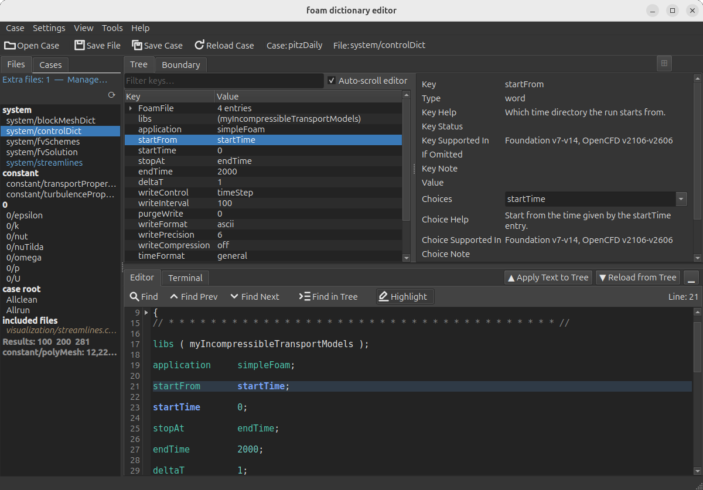

| モード | 動作 |
|--------|------|
| **Follow System**（既定） | プラットフォームのネイティブなウィジェットスタイルとデスクトップのパレットをそのまま使用します — Windows のアクセントカラーや Linux のデスクトップテーマを含みます。 |
| **Light** | Fusion スタイルと FoDE のライトパレットを強制し、どの OS でも同じ見た目になります。 |
| **Dark** | Fusion スタイルと FoDE のダークパレットを強制し、どの OS でも同じ見た目になります。 |

保存済みの設定を変更せずにテーマを試すには、コマンドラインで `--theme` を指定します。`python3 main.py --theme dark` はその実行に限って指定テーマを使うため、異なるテーマのウィンドウを並べて置いても、次回起動時の見た目はどちらにも左右されません。指定できるのはメニューと同じ `system`、`light`、`dark` の 3 つです。

ダークモードは BlockMesh 3D ビューアにも適用されます: シーンの背景、軸と範囲のテキスト、頂点・ブロック番号、形状名バッジがすべてテーマに追従します。一方、パッチやオーバーレイの色そのもの（wall のオレンジ、patch の青、topoSet のアクション色など）は両テーマで同じです — これらは装飾ではなく、何を見ているかを識別するための色だからです。

### 選択行の可読性

FoDE は選択行の文字色と塗り色を自分で決めるため、デスクトップのアクセントカラーが何色でも、ツリー・ファイル一覧・境界条件テーブル・比較パネルで選択行が読みやすく保たれます。

## 文字サイズと表示スケーリング

FoDE の文字サイズは、すべてデスクトップのフォント設定から決まります。ツリー、ファイル一覧、Detail ペイン、エディタ、2 種類のターミナルのいずれもです。システムのフォントサイズを大きくすれば、これらは一緒に大きくなります。アプリ側で個別に合わせる設定は必要ありません。それでも足りない場合のために、次の 2 つの手段があります。

### Settings > UI Scale

UI 全体（文字・アイコン・余白のすべて）を **100 %**（既定）、**125 %**、**150 %**、**175 %**、**200 %** の倍率で拡大します。選択内容は `app_config.json` に保存され、再起動後に反映されます。Qt は起動時にスケール係数を確定し、実行中に変更する手段を持たないためです。

FoDE *全体*が他のアプリケーションと比べて小さすぎる場合は、この設定を使ってください。そうなる理由は下の[デスクトップは拡大されているのに FoDE だけ小さい場合](#デスクトップは拡大されているのに-fode-だけ小さい場合)を参照してください。

保存された設定を変えずに試したい場合は、コマンドラインで `--ui-scale` を渡します。`python3 main.py --ui-scale 150` はその 1 回の実行にだけ適用されます。こちらはメニューの 5 段階に限らず、50〜400 の任意の値を受け付けます。

### エディタのズーム

エディタの文字だけを、ウィンドウの他の部分に影響を与えずに拡大縮小できます。

| 操作 | ショートカット |
|------|----------------|
| 拡大 | `Ctrl` + `+`（または `Ctrl` + `=`） |
| 縮小 | `Ctrl` + `-` |
| デスクトップのサイズに戻す | `Ctrl` + `0` |
| マウスでズーム | `Ctrl` + ホイール |

これらのキーはエディタにフォーカスがあるときだけ働くので、ツリーや 3D ビューアで誤って発動することはありません。ズームは固定サイズではなくデスクトップのフォントサイズからの差分として保持されるため（2 段階拡大は、後でフォントサイズを変えても 2 段階拡大のままです）、セッションと一緒に保存され、再起動後も維持されます。

### デスクトップは拡大されているのに FoDE だけ小さい場合

X11 では、Qt はスケール係数を X リソースの `Xft.dpi` だけから決定します。それ以外の仕組みで拡大しているデスクトップ — GDK の `GDK_SCALE` や、Wayland コンポジタが XWayland クライアントに適用するフラクショナルスケーリングなど — では `Xft.dpi` が 96 のままになり、隣の GTK アプリケーションは正しく表示されているのに Qt アプリケーションだけが 1 倍で描画されます。高解像度ディスプレイで FoDE のウィンドウが極端に小さく見える場合、原因はたいていこれです。

対処は 3 通りあり、後のものほど恒久的です。

```bash
python3 main.py --ui-scale 150
```

```bash
QT_SCALE_FACTOR=1.5 python3 main.py
```

```bash
echo "Xft.dpi: 144" >> ~/.Xresources && xrdb -merge ~/.Xresources
```

1 つ目は FoDE だけに効き、**Settings > UI Scale** で恒久化できます。2 つ目はその方法で起動した Qt アプリケーション全般に効きます。3 つ目は以後すべての Qt アプリケーションに効き、次回ログイン以降に起動したアプリケーションから反映されます。

次の 2 つも覚えておくと役に立ちます。

- `QT_FONT_DPI=144` は、アイコンや余白は拡大せずに文字だけを大きくします。全体を拡大するより画面に表示できる情報量は多く保てますが、やや詰まった見た目になります。
- `QT_SCALE_FACTOR_ROUNDING_POLICY=PassThrough` は、Qt が小数のスケール係数を整数に丸めるのを防ぎます。125 % のデスクトップが 100 % で表示されてしまうのはこの丸めが原因です。

環境変数の `QT_SCALE_FACTOR` は、保存された **Settings > UI Scale** の値より優先されます。環境変数は目の前のマシンに合わせて設定されたものだからです。`--ui-scale` は両者より優先されます。

## Resources ダイアログ

**Help > Resources** を選択すると Resources ダイアログが開きます。2 つのタブがあります。

### OpenFOAM タブ

OpenCFD/ESI Group（openfoam.com）と OpenFOAM Foundation（openfoam.org）の 2 つの主要ディストリビューションに関する公式ドキュメントへのリンクを表示します。これらのリンクは固定で読み取り専用です。本アプリケーションはいずれの組織とも提携していません。

### My Links タブ

個人用の参照リンクを管理します。

- **Add** — ラベルと URL を入力するダイアログを開きます。ラベルは省略可能で、省略した場合は URL が表示名になります。
- **Edit** — 選択中のエントリのラベルと URL を編集するダイアログを開きます。
- **Remove** — 選択中のエントリをリストから削除します。
- **Move Up / Move Down** — 選択中のエントリの順序を変更します。
- エントリを**ダブルクリック**するとデフォルトブラウザで URL を開きます。

変更内容はダイアログを閉じると `app_config.json` に保存されます。

## トラブルシューティング

**3D ビューがない。BlockMesh タブが見当たらない。** 3D ビューアと xterm ターミナルはグラフィックスカードを共有できないため、交代で使われます。xterm モードの間はタブが非表示になり、**View > BlockMesh 3-D Panel** はグレーアウトします。Terminal タブ上部の **xterm terminal** のチェックを外すとタブが戻ります。または `--variant no-terminal-blockmesh` で起動すると、ターミナルがなく、3D ビューが常に表示されます。タブにインストールの案内が表示される場合は、`pyvista` と `pyvistaqt` をインストールしてください。[ターミナルタブ](#ターミナルタブ)、[バリアント](#バリアント)、[BlockMesh パネル](#blockmesh-パネル) を参照。

**Tools メニューの項目がグレーアウトしている。** ほとんどの項目はケースを開いている必要があり、コマンドを送る項目には Terminal パネルも必要です（`no-terminal` バリアントにはありません）。項目が有効なのに、実行せずメッセージが表示される場合は、Terminal タブでコマンドが実行中か、ケースで[バックグラウンド実行](#background-runs-and-stop-background-run)が動いています。終わるのを待つか、停止してください。[Tools メニュー](#tools-メニュー) を参照。

**コマンドが「command not found」になる（`blockMesh`、`interFoam` など）。** FoDE を起動したシェルで OpenFOAM が source されていません。そのシェルで OpenFOAM の `bashrc` を source してから FoDE を起動し直してください。内蔵ターミナルはその環境を引き継ぎます。[Tools メニュー](#tools-メニュー) を参照。

**高解像度の画面でウィンドウが半分の大きさに見える。** Qt がデスクトップのスケーリングを認識していません。`python3 main.py --ui-scale 150` で起動するか、**Settings > UI Scale** を設定してください。ほかの方法は[デスクトップは拡大されているのに FoDE だけ小さい場合](#デスクトップは拡大されているのに-fode-だけ小さい場合)にあります。

**ターミナルがただのテキストボックスで、色がなく `vim` も動かない。** Simple モードです。**xterm terminal** のチェックが外れているか、xterm.js を読み込めなかったかのどちらかです（初回起動時にインターネット接続が必要です）。インターネットに接続して再起動するか、3 つのファイルを自分で配置してください。[xterm.js アセット](#xtermjs-アセット) を参照。

**3D ビューから頂点・ブロック・形状が欠けている。** FoDE が解決できない参照 — 変数名の綴り間違い、見つからない `#include` — があると、それを使う頂点・ブロック・形状が黙って消えます。綴りを確認し、別のファイルにある変数は `#include` で取り込まれているか確認してください。[変数の解決](#変数の解決) と [インクルードファイルに置いたパラメータ](#インクルードファイルに置いたパラメータ) を参照。

**あるファイルについて 3D ビューに何も表示されない。** FoDE は、名前、または `FoamFile` ヘッダーの `object` エントリで認識できる辞書を描画し、サンプリングファイルは内容で認識します。独自の名前でヘッダーがないファイルは認識されません。ファイル一覧でそのファイルを右クリックして **Show in 3-D view as** を選んでください。`#include` の断片だけのファイル（囲む辞書のない `hex …` リストなど）は、それ単独では意図的に描画されません。[BlockMesh パネル](#blockmesh-パネル) を参照。

## キーボードショートカット

同じ一覧はアプリケーション内の **Help > Keyboard Shortcuts** でも見られます。キーの意味は、フォーカスのある場所によって変わるものがあります。

| 場所 | 操作 | キー |
|---|---|---|
| どこでも | Open Case | `Ctrl+O` |
| どこでも | Save File | `Ctrl+S` |
| どこでも | Save Case（変更したすべてのファイル） | `Ctrl+Shift+S` |
| どこでも | Apply Text to Tree | `Ctrl+Shift+A` |
| どこでも | Find in Tree（エディタのカーソル行に対応するツリー行を選択） | `Ctrl+Shift+T` |
| どこでも | 3D ビューを画像として保存（3D パネルが使えるとき） | `Ctrl+Shift+I` |
| どこでも | Exit | `Ctrl+Q` |
| どこでも | ファイル一覧 / 詳細ペイン / エディタ・ターミナル行の表示・非表示 | `Ctrl+1` / `Ctrl+2` / `Ctrl+3` |
| ツリー | Copy Value / Paste Value | `Ctrl+C` / `Ctrl+V` |
| ツリー | Undo Tree Edit / Redo Tree Edit | `Ctrl+Z` / `Ctrl+Shift+Z` |
| エディタ | Find / Find Next / Find Previous | `Ctrl+F` / `F3` / `Shift+F3` |
| エディタ | 元に戻す / やり直す | `Ctrl+Z` / `Ctrl+Y` または `Ctrl+Shift+Z` |
| エディタ | 切り取り / コピー / 貼り付け / すべて選択 | `Ctrl+X` / `Ctrl+C` / `Ctrl+V` / `Ctrl+A` |
| エディタ | 拡大 / 縮小 / ズームのリセット | `Ctrl++`（または `Ctrl+=`）/ `Ctrl+-` / `Ctrl+0` |
| エディタ | マウスでズーム | `Ctrl` + スクロールホイール |
| Simple ターミナル | 前のコマンド / 次のコマンド | `↑` / `↓` |
| 3D ビューア | 回転 / パン | 左ドラッグ / `Shift` + 左ドラッグ |
| 3D ビューア | ズーム | スクロールホイール、右ドラッグ、または `Up` / `Down` |
| 3D ビューア | カメラのリセット / アイソメトリック表示 / 点へ移動 | `R` / `V` / `F` |
| 3D ビューア | ワイヤフレーム / サーフェス | `W` / `S` |
| 3D ビューア | 点・線を大きく / 小さく | `+` / `-` |
| スプリッタのハンドル | 隣のペインを最小化・復元 | ダブルクリック |

3D ビューアのキーは、3D ビューにフォーカスがあるときに働きます。ツリーの `Ctrl+C`、`Ctrl+V`、`Ctrl+Z` はツリーにフォーカスがあるときだけ働くため、エディタとは干渉しません。

## 用語集

- **ケース（case）** — 1 つのシミュレーションを収めたフォルダ。`system/`、`constant/`、初期場の `0/` を含みます。最上位のフォルダは **ケースルート（case root）** で、FoDE は `Allrun` 系スクリプトを集めたファイル一覧のグループにもこの名前を使います。
- **辞書（dictionary）** — OpenFOAM のプレーンテキスト設定形式。`keyword value;` というエントリと入れ子の `{ … }` ブロックでできています。`controlDict`、`fvSchemes`、`blockMeshDict` は辞書です。
- **フィールドファイル（field file）** — `U`、`p`、`T` など `0/` にあるファイル。1 つの場の初期値（`internalField`）と境界条件（`boundaryField`）を持ちます。
- **パッチ（patch）** — メッシュ境界の名前付きの一部（入口や壁など）。境界条件はパッチごと・フィールドごとに設定します。[境界条件ビュー](#境界条件ビュー)はそれらを 1 つの表に表示します。
- **関数オブジェクト（function object）** — ソルバーと一緒に動く後処理（probes、forces、サンプリング線など）。`controlDict` の `functions` に列挙されます。[Add Function Object](#add-function-object) を参照。
- **`0.orig`** — 初期場のまっさらなコピー。`setFields` などは `0/` を上書きするため、チュートリアルはクリーンな実行の前に `0.orig/` から `0/` を復元します。[Restore 0/ from 0.orig](#restore-0-from-0orig) を参照。
- **分割済み / `processor*`（decomposed）** — 並列実行では、`decomposePar` がケースを `processor0`、`processor1`、… のディレクトリに分割し、`reconstructPar` が結果を元に戻します。[Run decomposePar](#run-decomposepar) と [Run reconstructPar](#run-reconstructpar) を参照。
- **source 済みの環境（sourced environment）** — OpenFOAM の `bashrc` を実行済みのシェル。OpenFOAM のコマンドと変数（`WM_PROJECT_DIR`、`FOAM_TUTORIALS` など）が使えます。FoDE と内蔵ターミナルは、起動時の環境を使います。

## 対応構文とノード型

FoDE は完全な仕様準拠ではなく、よく使われる OpenFOAM 辞書構文を実用的かつ寛容に扱うことを目的としています。ツリービューの **Type** 列に表示される文字列は、その行の `node_type` 名そのもので、以下の表の「型」列と一致します（各型の内部 Python 表現については [DEVELOPER_ja.md](DEVELOPER_ja.md#ノード型) を参照してください）。パーサは次のノード型を認識します。

| 型 | 説明 |
|---|---|
| `word` | キーと値の基本ペア（単一の引用符なしトークン、フォールバック型） |
| `string` | ダブルクォートで囲まれた文字列値（例: `"my value"`） |
| `macro` | 値として使われる `$変数` 参照（例: `nu $nu;` の `$nu`） |
| `compound` | リスト以外の複数の空白区切りトークン（例: `uniform 0` や `uniform (0 0 0)`） |
| `scalar` | 浮動小数点値 |
| `int` | 整数値（小数値を入力すると `scalar` へ自動昇格） |
| `bool` | 真偽値（`true`/`false`/`yes`/`no`/`on`/`off`） |
| `vector` | 括弧で囲まれた 3 成分値（例: `(0 0 9.81)`） |
| `box_pair` | 2 つの `(x y z)` ベクトルで境界ボックスを定義。`box` キーにのみ生成される |
| `int_list` | 括弧で囲まれた整数のリスト（例: `(0 1 2)`） |
| `scalar_list` | 括弧で囲まれた浮動小数点数のリスト（3 要素以外、例: `(0.1 0.5 1.0 2.0)`） |
| `raw_list` | 括弧で囲まれた混在・ネスト構造のリスト（`vertices` など）。生テキストのまま保持 |
| `nonuniform_list` | `nonuniform List<T> N (…)` 形式のフィールド値（`0/U` などの `internalField` など）。ツリーには件数サマリーで表示され、生テキストとして保存されます — インライン編集不可 |
| `dictionary` | サブ辞書ブロック |
| `field_value_block` | `internalField`/`boundaryField` 構造を持つブロック（`0/U` などのフィールドファイル） |
| `field_value` | `field_value_block` 内の個別フィールド値エントリ |
| `region_block` | 名前付きリージョンブロック（`setFieldsDict` で使用） |
| `region_entry` | `region_block` 内のエントリ |
| `boundary_block` | `blockMeshDict` の `boundary ( … );` ブロック。各パッチは `boundary_entry` の子ノード |
| `boundary_entry` | `boundary_block` 内の名前付きパッチエントリ |
| `block_list` | `blockMeshDict` の `blocks ( … );` リスト。各 `hex` が `block_entry` の子ノードになる。Value 列にはブロック数が表示される |
| `block_entry` | `block_list` 内の 1 ブロック。BlockMesh 3D ビューアが各ブロックの中心に描画する番号と一致するように `block 0`、`block 1`、… と表示される。Value 列はブロック全体（`hex (…) (…) simpleGrading (…)`）を保持し、インライン編集が可能。マウスオーバーで頂点・セル数・グレーディング・ゾーンの内訳が表示される |
| `action_list` | `topoSetDict` の `actions ( … );` リスト。各 `{ … }` ブロックが `action_entry` になる |
| `action_entry` | `action_list` 内の名前のない `{ … }` アクション 1 つ |
| `named_dict_list` | 名前付き辞書の括弧付きリスト — 従来形式のサンプル辞書の `sets ( y0.1 { … } );` や `surfaces ( … );`。`sets (setA setB);` のような単なる単語リストは `raw_list` のままです |
| `named_dict_entry` | `named_dict_list` 内の名前付き `{ … }` エントリ 1 つ |
| `valueless` | `fluxRequired { p; pcorr; }` の `p;` のように、値をまったく持たないキー。名前そのものが意味を持つため、Value 列で編集するものはありません |
| `directive_entry` | `#include`、`#inputMode` などのプリプロセッサディレクティブ |
| `macro_entry` | `$variable` マクロ展開 |
| `unknown_raw_entry` | パーサが解釈できなかったエントリ。生テキストのまま保持・書き戻し。通常エントリと区別できるよう、ツリー内で**琥珀色**で表示される |

認識できない構文は `unknown_raw_entry` ノードとして保持され、元のテキストのまま書き戻されるため、部分的にパースされたファイルが破損することはありません。

**ツリー内の `field_value` ノード** — Key 列には `field_name`（例: `U`）が表示され、Value 列には `field_type` に続いてフォーマットされた値（例: `volVectorField uniform (0 0 0)`）が表示されます。Detail ペインでは、これらのノードは **Field Type**・**Field Name**・**Value** の各フィールドを個別に表示します。値の部分は編集可能で、型の分類は通常ノードと同じルールに従います。

## 制限事項

FoDE は、完全な OpenFOAM パーサではなく、実用的なエディタです。現時点での主な制限は次の通りです。

- OpenFOAM のあらゆる構文バリエーションに対して、完全な lossless round-trip は保証されません。
- ツリーからテキストを再生成した場合、変更ノード周辺の整形やコメント位置が変化する可能性があります。

## 免責事項

FoDE は「現状のまま」提供され、いかなる保証もありません。FoDE はケース内のファイルを編集・コピー・削除します。これらの操作には安全策を設けていますが、ご自身の責任でお使いください。本ソフトウェアの使用によって生じたデータの損失その他の損害について、作者は責任を負いません。再生成できないケースはバックアップを取っておいてください。拘束力のある条件は[ライセンス](LICENSE)の第 15 条（保証の否認）と第 16 条（責任の制限）です。

This offering is not approved or endorsed by OpenCFD Limited, producer and distributor of the OpenFOAM software via [www.openfoam.com](http://www.openfoam.com/), and owner of the OPENFOAM® and OpenCFD® trade marks.

## 謝辞

- [PySide6 (Qt for Python)](https://doc.qt.io/qtforpython/) — GUI フレームワーク（LGPL v3）。
- [pyVista](https://pyvista.org/) / [VTK](https://vtk.org/) — 辞書の 3D ビューア（BSD-3-Clause、オプション）。
- [xterm.js](https://xtermjs.org/) — ターミナルパネルで使用するターミナルエミュレータ（MIT）。初回起動時に jsDelivr から自動ダウンロードされ `ui/xterm/` にキャッシュされます。
- [pytest](https://pytest.org/) / [pytest-qt](https://pytest-qt.readthedocs.io/) — テストフレームワーク（開発時のみ）。
- [PyInstaller](https://pyinstaller.org/) — スタンドアロン実行ファイルのビルドに使用。

[OpenFOAM Foundation](https://openfoam.org/) および [OpenCFD / ESI Group](https://www.openfoam.com/) をはじめ、OpenFOAM をフリーのオープンソース CFD ソフトウェアとして開発・維持してきたすべての貢献者の方々に深く感謝いたします。

---

Copyright (C) 2025-2026 Shinji NAKAGAWA — [AGPL-3.0-or-later](LICENSE)
